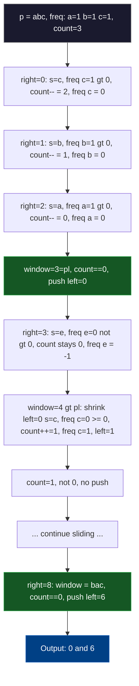

# Find All Anagrams in a String

## Problem Link
🔗 [LeetCode 438 — Find All Anagrams in a String](https://leetcode.com/problems/find-all-anagrams-in-a-string/)  
🔗 [GFG — Find Occurrences of Anagram](https://www.geeksforgeeks.org/problems/count-occurences-of-anagrams5839/1)

---

## What is this Problem?

Given strings `s` and `p`, find all **starting indices** in `s` where a substring is an **anagram of `p`**.

An anagram = same characters, same frequency, any order.

**Example:**
```
s = "cbaebabacd", p = "abc"

Substrings of length 3:
  index 0: "cba" → anagram of "abc" ✓
  index 1: "bae" → not anagram
  index 2: "aeb" → not anagram
  index 3: "eba" → not anagram
  index 4: "bab" → not anagram
  index 5: "aba" → not anagram
  index 6: "bac" → anagram of "abc" ✓
  index 7: "acd" → not anagram

Output: [0, 6]
```

---

## The Problem Explained

Think of it like a **sliding window scan on a word search**.

You have a window of size `|p|` sliding over `s`. At each position, check if the window is an anagram.

```
s = "cbaebabacd"
p = "abc"  → need freq: a=1, b=1, c=1

Window slides:
[cba] → c=1,b=1,a=1 ✓ anagram!
 [bae] → b=1,a=1,e=1 ✗
  [aeb] → ✗
        ...
      [bac] → b=1,a=1,c=1 ✓ anagram!
```

---

## HOOK TO REMEMBER FOREVER

**"SLIDING WINDOW + FREQUENCY ARRAY + `count` TRACKER"**

- ✅ Use a **frequency array** of size 26 (one per letter)
- ✅ `count` = how many characters of `p` are still needed in the window
- ✅ When `right` enters: if `freq[char] > 0` → this char is needed → `count--`
- ✅ Always do `freq[char]--` (track excess too, goes negative)
- ✅ When window exceeds `pl`: shrink from left — if `freq[left] >= 0` → this was a needed char → `count++`
- ✅ Always do `freq[left]++` and `left++`
- ✅ If `count == 0` → all chars matched → push `left` (start of window)

---

## The Key Insight — `count` and `freq` Working Together

```
freq[c] > 0  → c is still NEEDED in the window
freq[c] = 0  → c was needed and is now perfectly matched
freq[c] < 0  → c is in EXCESS (more than needed)

count = number of characters still needed

count == 0 → window is a perfect anagram ✓
```

### 🔀 Sliding Window Walkthrough



---

### 📊 Step-by-Step `count` and `freq` Update

| right | char | `freq[char]` before | Action on count | `freq[char]` after | Window size | Shrink? | count | Push? |
|---|---|---|---|---|---|---|---|---|
| 0 | c | 1 | count-- → 2 | 0 | 1 | No | 2 | No |
| 1 | b | 1 | count-- → 1 | 0 | 2 | No | 1 | No |
| 2 | a | 1 | count-- → 0 | 0 | 3 | No | 0 | ✅ push 0 |
| 3 | e | 0 | no change | -1 | 4 | Yes: remove c, freq[c]=0≥0 → count++=1 | 1 | No |
| 4 | b | 0 | no change | -1 | 4 | Yes: remove b, freq[b]=0≥0 → count++=2 | 2 | No |
| 5 | a | 0 | no change | -1 | 4 | Yes: remove a, freq[a]=0≥0 → count++=3 | 3 | No |
| 6 | b | -1 | no change | -2 | 4 | Yes: remove e, freq[e]=-1 lt 0 → no count change | 3 | No |

> Continue... eventually at index 6 (window `bac`), count hits 0 again → push 6.

---

## Code — Full Solution (with Line-by-Line Explanation)

---

```cpp
vector<int> freq(26, 0);
int count = p.size();
```
> `freq` tracks how many of each character we still **need** in the window.  
> `count` = total characters still needed = `p.size()` at start.

---

```cpp
for (auto &el : p) {
    freq[el - 'a']++;
}
```
> Fill `freq` with the requirements from `p`.  
> `el - 'a'` maps character to index 0–25.

---

```cpp
if (freq[s[right] - 'a'] > 0)
    count--;

freq[s[right] - 'a']--;
```
> **When a new character enters the window:**  
> If `freq > 0` → this character is **still needed** → reduce `count`.  
> Always decrement `freq` regardless — tracks excess (goes negative if not needed).

---

```cpp
if (right - left + 1 > pl) {
    if (freq[s[left] - 'a'] >= 0)
        count++;

    freq[s[left] - 'a']++;
    left++;
}
```
> **When window exceeds pattern length — shrink from left:**  
> If `freq[left] >= 0` → this character was **needed** (not excess) → removing it means we need one more → `count++`.  
> Always increment `freq` (restore the slot) and move `left` forward.

---

```cpp
if (count == 0)
    ans.push_back(left);
```
> All characters matched → window starting at `left` is an anagram → record it.

---

## Step-by-Step Trace

```
s = "cbaebabacd", p = "abc"
freq = [a=1, b=1, c=1, ...rest=0], count = 3, pl = 3

right=0 (c): freq[c]=1>0 → count=2, freq[c]=0. window=1
right=1 (b): freq[b]=1>0 → count=1, freq[b]=0. window=2
right=2 (a): freq[a]=1>0 → count=0, freq[a]=0. window=3 → count==0 → push 0 ✅

right=3 (e): freq[e]=0, count stays 0, freq[e]=-1. window=4>3 → shrink:
  s[left=0]=c, freq[c]=0>=0 → count=1, freq[c]=1, left=1
  count=1, no push.

right=4 (b): freq[b]=0, count stays 1, freq[b]=-1. window=4>3 → shrink:
  s[left=1]=b, freq[b]=-1<0 → count stays 1, freq[b]=0, left=2
  count=1, no push.

right=5 (a): freq[a]=0, count stays 1, freq[a]=-1. window=4>3 → shrink:
  s[left=2]=a, freq[a]=-1<0 → count stays 1, freq[a]=0, left=3
  count=1, no push.

right=6 (b): freq[b]=0, count stays 1, freq[b]=-1. window=4>3 → shrink:
  s[left=3]=e, freq[e]=-1<0 → count stays 1, freq[e]=0, left=4
  count=1, no push.

right=7 (a): freq[a]=0, count stays 1, freq[a]=-1. window=4>3 → shrink:
  s[left=4]=b, freq[b]=-1<0 → count stays 1, freq[b]=0, left=5
  count=1, no push.

right=8 (c): freq[c]=1>0 → count=0, freq[c]=0. window=4>3 → shrink:
  s[left=5]=a, freq[a]=-1<0 → count stays 0, freq[a]=0, left=6
  count==0 → push 6 ✅

right=9 (d): freq[d]=0, count stays 0, freq[d]=-1. window=4>3 → shrink:
  s[left=6]=b, freq[b]=0>=0 → count=1, freq[b]=1, left=7
  count=1, no push.

Output: [0, 6] ✅
```

---

## Brute Force vs Optimized

| | Brute Force (commented) | Optimized (used) |
|---|---|---|
| **How** | HashMap + `allzero()` check | Freq array + `count` variable |
| **`allzero` check** | O(26) per window | Skipped — `count==0` is O(1) |
| **Time** | O(n × 26) | **O(n)** |
| **Space** | O(26) HashMap | O(26) array |

---

## Time & Space Complexity

| | Complexity |
|---|---|
| **Time** | O(n) — single pass, O(1) per step |
| **Space** | O(26) = O(1) — fixed size freq array |

---

## References

- 🔗 [LeetCode 438 — Find All Anagrams in a String](https://leetcode.com/problems/find-all-anagrams-in-a-string/)
- 🔗 [GFG — Count Occurrences of Anagram](https://www.geeksforgeeks.org/problems/count-occurences-of-anagrams5839/1)
