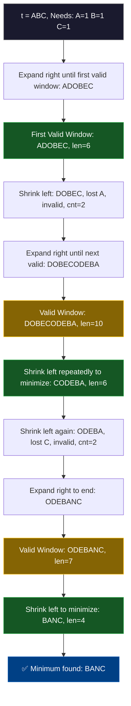

# Minimum Window Substring

## Problem Link
🔗 [LeetCode 76 — Minimum Window Substring](https://leetcode.com/problems/minimum-window-substring/)  
🔗 [GFG — Minimum Window Substring](https://www.geeksforgeeks.org/problems/minimum-window-indices3855/1)

---

## What is this Problem?

Given two strings `s` and `t`, return the **minimum window substring** of `s` such that every character in `t` (including duplicates) is included in the window. If there is no such substring, return `""`.

**Example:**
```
s = "ADOBECODEBANC", t = "ABC"
Output: "BANC"

Explanation: 
The substring "BANC" contains 'B', 'A', and 'C' from t, and its length is 4.
Other candidate windows like "ADOBEC" (length 6) are longer.
```

---

## The Problem Explained

Think of it like shopping for a list of items (`t = "ABC"`) on a super long supermarket aisle (`s = "ADOBECODEBANC"`).

1. You start walking from the left and put items in your shopping cart.
2. You keep walking to the right until you have collected **at least one** 'A', 'B', and 'C' in your cart. This is your first valid checkout window!
3. Now, you want to see if you can make your trip shorter. You try to discard items from the left side of your cart while still keeping at least one of each required item ('A', 'B', 'C').
4. If your cart still has all required items, you record this new smaller window size.
5. If you discard a required item and no longer have all three, your cart becomes invalid. You must walk further right to find another one.

---

## HOOK TO REMEMBER FOREVER

**"EXPAND TO ACQUIRE, SHRINK TO MINIMIZE"**

- ✅ **Sliding Window:** Use `left` and `right` pointers.
- ✅ **Frequency Map:** Store requirements of `t`. Values can go negative (representing excess characters in the window).
- ✅ **`cnt` Tracker:** Count of required characters currently matched in the window.
- ✅ **Acquire:** Move `right`. If `hash[s[right]] > 0`, it was needed, so `cnt++`. Decrement `hash[s[right]]`.
- ✅ **Minimize:** When `cnt == tlen` (valid window), record result, then shrink by moving `left`. Re-add `s[left]` to `hash`. If `hash[s[left]] > 0` (meaning a required character was lost), decrement `cnt`.

---

## The Key Insight — Sliding Window State Flow

### 🔀 Window Expansion and Shrinking



---

### 📊 Window State and `cnt` Tracker

Tracking `s = "ADOBECODEBANC"`, `t = "ABC"` (`tlen = 3`)

| Right | Char | `hash[char]` before | Action | `hash[char]` after | `cnt` | Window (s[l...r]) | Status | Action |
|---|---|---|---|---|---|---|---|---|
| 0 | A | 1 | `cnt++` | 0 | 1 | "A" | Invalid | Expand right |
| 1 | D | 0 | — | -1 | 1 | "AD" | Invalid | Expand right |
| 2 | O | 0 | — | -1 | 1 | "ADO" | Invalid | Expand right |
| 3 | B | 1 | `cnt++` | 0 | 2 | "ADOB" | Invalid | Expand right |
| 4 | E | 0 | — | -1 | 2 | "ADOBE" | Invalid | Expand right |
| 5 | C | 1 | `cnt++` | 0 | 3 | "ADOBEC" | **Valid** | Shrink left (l=0) |
| — | A | 0 (at l=0) | `cnt--` | 1 | 2 | "DOBEC" | Invalid | Expand right (l=1) |
| ... | ... | ... | ... | ... | ... | ... | ... | ... |
| 10 | A | 1 | `cnt++` | 0 | 3 | "CODEBA" | **Valid** | Shrink left (l=5) |
| ... | ... | ... | ... | ... | ... | ... | ... | ... |
| 12 | C | 1 | `cnt++` | 0 | 3 | "BANC" | **Valid** | Min len = 4! |

---

## Code — Full Solution (with Line-by-Line Explanation)

---

```cpp
for (auto &el : t) {
  hash[el]++;
}
```
> Populates our frequency map with the characters we need to match from `t`.

---

```cpp
while (r < slen) {
  if (hash[s[r]] > 0)
    cnt++;
  hash[s[r]]--;
```
> **Acquire Phase:**  
> Expand the window to the right.  
> If `hash[s[r]] > 0`, it means `s[r]` is one of the characters we still need to satisfy `t`. Increment `cnt`.  
> Decrement `hash[s[r]]` to show we've included it. (If it goes negative, we have excess of this character).

---

```cpp
  while (cnt == tlen) {
    if (r - l + 1 < min_len) {
      min_len = r - l + 1;
      startIndex = l;
    }
```
> **Minimize Phase:**  
> Once `cnt == tlen`, we have a valid window containing all required characters.  
> Update `min_len` and `startIndex` if the current window size `(r - l + 1)` is smaller than the previous minimum.

---

```cpp
    hash[s[l]]++;
    if (hash[s[l]] > 0)
      cnt--;
    l++;
  }
```
> Try to shrink the window from the left to find a smaller valid window.  
> Re-add the character at `left` back to the pool: `hash[s[l]]++`.  
> If `hash[s[l]] > 0`, it means we just removed a character that is strictly required (we no longer have enough of it in our window). Therefore, the window becomes invalid, so decrement `cnt`.  
> Increment `l` to shrink the window.

---

## Step-by-Step Trace

For `s = "ADOBECODEBANC"`, `t = "ABC"`

```
Initial hash: [A:1, B:1, C:1], cnt = 0, min_len = 1e9, startIndex = -1

- r = 0 (A): hash[A] > 0 -> cnt = 1. hash[A] = 0.
- r = 1 (D): hash[D] <= 0 -> hash[D] = -1.
- r = 2 (O): hash[O] <= 0 -> hash[O] = -1.
- r = 3 (B): hash[B] > 0 -> cnt = 2. hash[B] = 0.
- r = 4 (E): hash[E] <= 0 -> hash[E] = -1.
- r = 5 (C): hash[C] > 0 -> cnt = 3. hash[C] = 0.
  Window is valid (cnt == 3)!
  - Update min_len = 6 (ADOBEC), startIndex = 0.
  - Shrink left: hash[A]++ -> hash[A] = 1. Since hash[A] > 0, cnt = 2. l = 1.
  Window is invalid (cnt == 2).

- r = 6 (O): hash[O] = -2.
- r = 7 (D): hash[D] = -2.
- r = 8 (E): hash[E] = -2.
- r = 9 (B): hash[B] = -1.
- r = 10 (A): hash[A] > 0 -> cnt = 3. hash[A] = 0.
  Window is valid (cnt == 3)!
  - Current window: "DOBECODEBA" (l=1, r=10).
  - Shrink left until invalid:
    - l=1 (D): hash[D]++ -> hash[D]=-1. l=2.
    - l=2 (O): hash[O]++ -> hash[O]=-1. l=3.
    - l=3 (B): hash[B]++ -> hash[B]=0. l=4.
    - l=4 (E): hash[E]++ -> hash[E]=-1. l=5.
    - l=5 (C): hash[C]++ -> hash[C]=1. Since hash[C] > 0, cnt = 2. l=6.
    (Note: During these, the minimum window was updated to "CODEBA" len=6 at l=5)

- r = 11 (N): hash[N] = -1.
- r = 12 (C): hash[C] > 0 -> cnt = 3. hash[C] = 0.
  Window is valid (cnt == 3)!
  - Current window: "ODEBANC" (l=6, r=12).
  - Shrink left:
    - l=6 (O): hash[O]++ -> hash[O]=0. l=7.
    - l=7 (D): hash[D]++ -> hash[D]=0. l=8.
    - l=8 (E): hash[E]++ -> hash[E]=0. l=9.
    - l=9 (B): hash[B]++ -> hash[B]=1. Since hash[B] > 0, cnt = 2. l=10.
    (Note: During these, minimum window was updated to "BANC" len=4 at l=9)

End of string. Minimum window is "BANC".
```

---

## Why does `hash[s[l]] > 0` indicate a lost match?

```
When we decrement frequency counts in the acquire phase:
- Required characters become 0 or negative (if duplicate/extra are found).
- Non-required characters immediately go negative (e.g. -1, -2).

In the shrink phase, we increment the count:
- If a character's frequency becomes > 0, it means it is now actively lacking 
  from the window to form a valid match.
- If it remains <= 0, we still have enough duplicates or it is a non-required character.
```

---

## Time & Space Complexity

| Operation | Complexity |
|---|---|
| **Time** | O(N + M) — Each character is visited at most twice (once by `r`, once by `l`) |
| **Space** | O(K) — K is the number of unique characters in `t` (max 52 for letters) |

---

## References
- 🔗 [LeetCode 76 — Minimum Window Substring](https://leetcode.com/problems/minimum-window-substring/)
- 🔗 [GFG — Minimum Window Substring](https://www.geeksforgeeks.org/problems/minimum-window-indices3855/1)
