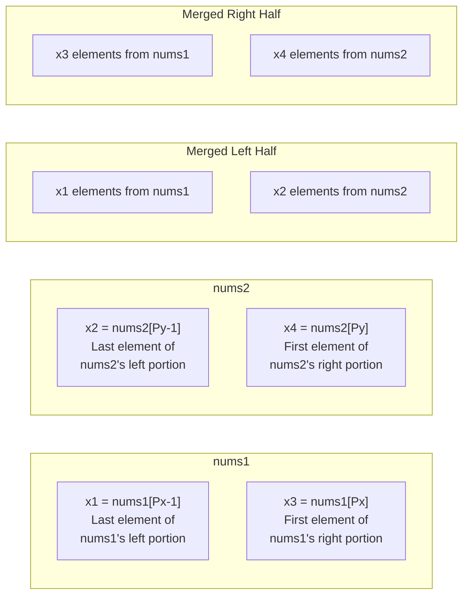
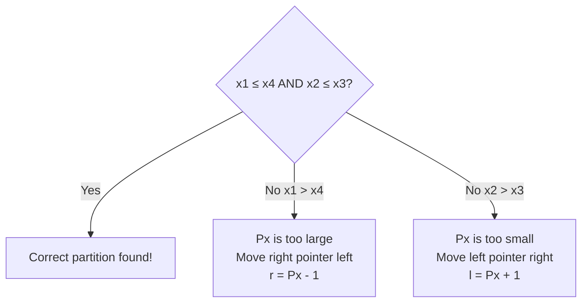
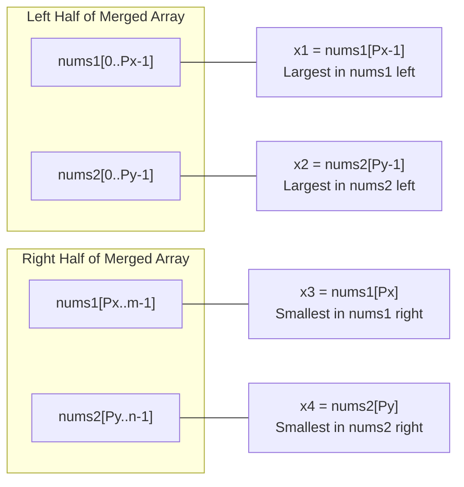
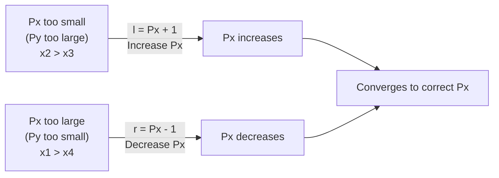
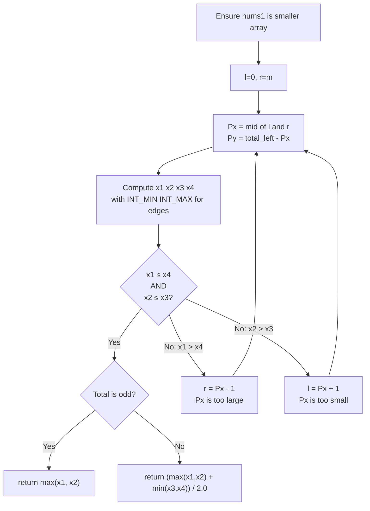

# Median of Two Sorted Arrays

## Problem Link
🔗 [LeetCode 4 — Median of Two Sorted Arrays](https://leetcode.com/problems/median-of-two-sorted-arrays/)

## Reference
📺 [Video Explanation](https://www.youtube.com/watch?v=7nABqJCEMuY&t=1s)

---

## What is this Problem?

Given two sorted arrays `nums1` (size m) and `nums2` (size n), find the **median** of the combined sorted array. Must run in **O(log(m+n))** time.

```
nums1 = [1, 3], nums2 = [2]
Combined sorted: [1, 2, 3]
Median: 2.0

nums1 = [1, 2], nums2 = [3, 4]
Combined sorted: [1, 2, 3, 4]
Median: (2 + 3) / 2 = 2.5
```

---

## The Core Intuition — What is a Median?

Median splits the combined array into **two equal halves**, where every element in the left half ≤ every element in the right half.

```
Combined: [1, 2, | 3, 4, 5]
                 ↑ median cut
          Left half  |  Right half

Median = max(left) when odd total
Median = (max(left) + min(right)) / 2 when even total
```

We don't need to actually merge the arrays. We just need to **find the right cut position**.

---

## The Key Insight : Binary Search on the Partition

Instead of merging two arrays (O(m+n)), we **binary search for the correct partition** on the smaller array.

If we decide to take `Px` elements from `nums1` into the left half, then we must take exactly `Py = (m+n+1)/2 - Px` elements from `nums2` — because the total left half size is fixed.



### The Partition Must Satisfy:

```
x1 ≤ x4  (last of nums1-left ≤ first of nums2-right)
x2 ≤ x3  (last of nums2-left ≤ first of nums1-right)
```

If BOTH conditions hold → **we found the correct partition!**



---

## The Four Boundary Variables



```
x1 and x2 → compete to be MAX of left half (the potential median for odd total)
x3 and x4 → compete to be MIN of right half
```

**Edge cases for boundaries:**
```
Px == 0 → nums1 contributes nothing to left → x1 = INT_MIN (can't block anything)
Px == m → nums1 contributes everything to left → x3 = INT_MAX (can't be on right)
Same for Py == 0 → x2 = INT_MIN
Same for Py == n → x4 = INT_MAX
```

---

## Full Worked Example

### `nums1 = [1, 3, 8, 9]`, `nums2 = [2, 5, 6, 7]`, target median of 8 elements

```
m=4, n=4. Left half size = (4+4+1)/2 = 4. Binary search on nums1 (l=0, r=4).
```

**Iteration 1: Px = 2**

```
Px=2, Py=4-2=2

nums1: [1, 3 | 8, 9]
              ↑ cut at Px=2
nums2: [2, 5 | 6, 7]
              ↑ cut at Py=2

x1=nums1[1]=3,  x2=nums2[1]=5
x3=nums1[2]=8,  x4=nums2[2]=6

Check: x1≤x4? 3≤6 ✓   x2≤x3? 5≤8 ✓
Both conditions hold! Correct partition found.

Total elements = 8 (even):
  max(x1,x2) = max(3,5) = 5
  min(x3,x4) = min(8,6) = 6
  Median = (5+6)/2.0 = 5.5 ✓
```

### `nums1 = [1, 3]`, `nums2 = [2, 4, 5, 6]`

```
m=2, n=4. Left half size = (2+4+1)/2 = 3. Binary search l=0, r=2.
```

**Iteration 1: Px = 1**

```
Px=1, Py=3-1=2

nums1: [1 | 3]
nums2: [2, 4 | 5, 6]

x1=nums1[0]=1,  x2=nums2[1]=4
x3=nums1[1]=3,  x4=nums2[2]=5

Check: x1≤x4? 1≤5 ✓   x2≤x3? 4≤3? ✗ (4 > 3!)

x2 > x3 → Px is too SMALL. We need more from nums1.
l = Px+1 = 2
```

**Iteration 2: Px = 2**

```
Px=2, Py=3-2=1

nums1: [1, 3 | ] (Px==m, nothing on right from nums1)
nums2: [2 | 4, 5, 6]

x1=nums1[1]=3,  x2=nums2[0]=2
x3=INT_MAX (Px==m),  x4=nums2[1]=4

Check: x1≤x4? 3≤4 ✓   x2≤x3? 2≤INT_MAX ✓
Correct!

Total=6 (even):
  max(x1,x2)=max(3,2)=3
  min(x3,x4)=min(INT_MAX,4)=4
  Median=(3+4)/2.0=3.5 ✓
```

---

## Code Full Solution

```cpp
class Solution {
public:
    double findMedianSortedArrays(vector<int>& nums1, vector<int>& nums2) {
        int m = nums1.size();
        int n = nums2.size();

        if (m > n) return findMedianSortedArrays(nums2, nums1);

        int l = 0, r = m;

        while (l <= r) {
            int Px = l + (r - l) / 2;
            int Py = (m + n + 1) / 2 - Px;

            int x1 = (Px == 0) ? INT_MIN : nums1[Px - 1];
            int x2 = (Py == 0) ? INT_MIN : nums2[Py - 1];
            int x3 = (Px == m) ? INT_MAX : nums1[Px];
            int x4 = (Py == n) ? INT_MAX : nums2[Py];

            if (x1 <= x4 && x2 <= x3) {
                if ((m + n) % 2 == 1) return max(x1, x2);
                return (max(x1, x2) + min(x3, x4)) / 2.0;
            }

            if (x1 > x4) r = Px - 1;
            else l = Px + 1;
        }

        return -1;
    }
};
```

---

## Code Explanation

### Always Binary Search on the Smaller Array

```cpp
if (m > n) return findMedianSortedArrays(nums2, nums1);
```

Binary search runs on `nums1`. We ensure `nums1` is always the smaller array so `Py` never goes negative or out of bounds (since `Py = half - Px`, and if `Px ≤ m ≤ n`, then `Py ≥ 0` always holds).

---

### Binary Search Range

```cpp
int l = 0, r = m;
```

`Px` can range from `0` (take nothing from nums1) to `m` (take everything from nums1). Binary search over this range.

---

### Compute Partition

```cpp
int Px = l + (r - l) / 2;
int Py = (m + n + 1) / 2 - Px;
```

```
Px = how many elements from nums1 go into the LEFT half
Py = how many elements from nums2 go into the LEFT half

Total left half size = (m+n+1)/2
  The +1 makes it ceil for odd totals — left half gets the extra element.
  For even totals: (m+n+1)/2 == (m+n)/2 (no change).
```

---

### Four Boundary Values with Edge Case Handling

```cpp
int x1 = (Px == 0) ? INT_MIN : nums1[Px - 1];
int x2 = (Py == 0) ? INT_MIN : nums2[Py - 1];
int x3 = (Px == m) ? INT_MAX : nums1[Px];
int x4 = (Py == n) ? INT_MAX : nums2[Py];
```

```
INT_MIN for left boundaries when partition is at 0:
  "Imagine there's an element -∞ to the left"
  → Never violates x ≤ y condition, so it never blocks.

INT_MAX for right boundaries when partition is at the end:
  "Imagine there's an element +∞ to the right"
  → Never violates x ≤ y condition, so it never blocks.
```

---

### Check and Adjust

```cpp
if (x1 <= x4 && x2 <= x3) {
    if ((m + n) % 2 == 1) return max(x1, x2);
    return (max(x1, x2) + min(x3, x4)) / 2.0;
}
if (x1 > x4) r = Px - 1;
else l = Px + 1;
```

```
x1 > x4: nums1's left part is too large. Px is too big. Move Px LEFT (r = Px-1).
x2 > x3: nums2's left part is too large. Px is too small (Py is too big). Move Px RIGHT (l = Px+1).

Why only two cases? x1>x4 and x2>x3 can't BOTH fail simultaneously
(that would mean the combined total isn't consistent with two sorted arrays).
So it's always either x1>x4 OR x2>x3 (but never both).
```

---

## Why Binary Search Works Here



```
As Px increases:
  x1 = nums1[Px-1] increases (or stays) — larger left of nums1
  x3 = nums1[Px] increases (or stays) — larger right of nums1
  x2 = nums2[Py-1] decreases — smaller left of nums2 (fewer elements taken)
  x4 = nums2[Py] decreases — smaller right of nums2

The monotonic behavior of these four values guarantees binary search converges. ✓
```

---

## Mermaid — Complete Algorithm Walkthrough



---

## Edge Cases

### Case 1: One Array Empty

```
nums1=[], nums2=[1,2,3]
m=0, always swap so nums1 is smaller.
l=0, r=0. Px=0, Py=2.
x1=INT_MIN, x2=nums2[1]=2.
x3=INT_MAX, x4=nums2[2]=3.
Check: INT_MIN≤3 ✓, 2≤INT_MAX ✓.
Total=3(odd): return max(INT_MIN,2)=2 ✓
```

### Case 2: Arrays of Different Sizes

```
The +1 in (m+n+1)/2 ensures the LEFT half is always
the larger half when total is odd — median comes from left.
```

### Case 3: Duplicate Elements

```
nums1=[1,2], nums2=[1,2]
Works correctly — binary search still converges since
all four boundary checks compare values, not indices.
```

---

## Time and Space Complexity

| | Value |
|---|---|
| Time | O(log(min(m,n))) — binary search on the smaller array |
| Space | O(1) — no extra space |

This is optimal — you cannot find the median of two sorted arrays faster than O(log(min(m,n))) since any comparison-based algorithm must perform at least that many operations.

---

## Key Insights

### Why `(m+n+1)/2` and not `(m+n)/2`?

```
Total = 7 (odd):
  (7+1)/2 = 4 elements on left, 3 on right
  Median = max(left) ← left gets the extra element
  Using (7)/2 = 3 → left would be too small, median wrong

Total = 6 (even):
  (6+1)/2 = 3 (integer division) = same as (6)/2
  Both halves equal size → median = (max(left)+min(right))/2

The +1 is only important for ODD totals. For even, it's a no-op.
```

### The Symmetry: x1>x4 is the ONLY Other Case

```
When the correct partition check fails:
  Either x1 > x4 (Px too big) → shrink right
  Or x2 > x3 (Px too small) → grow left

These are MUTUALLY EXCLUSIVE and EXHAUSTIVE.
The code only checks x1>x4 explicitly and uses else for x2>x3
— because if x1≤x4 but the check still failed, it MUST be x2>x3.
```

---

## References

- 🔗 [LeetCode 4 — Median of Two Sorted Arrays](https://leetcode.com/problems/median-of-two-sorted-arrays/)
- 📺 [Video Explanation](https://www.youtube.com/watch?v=7nABqJCEMuY&t=1s)