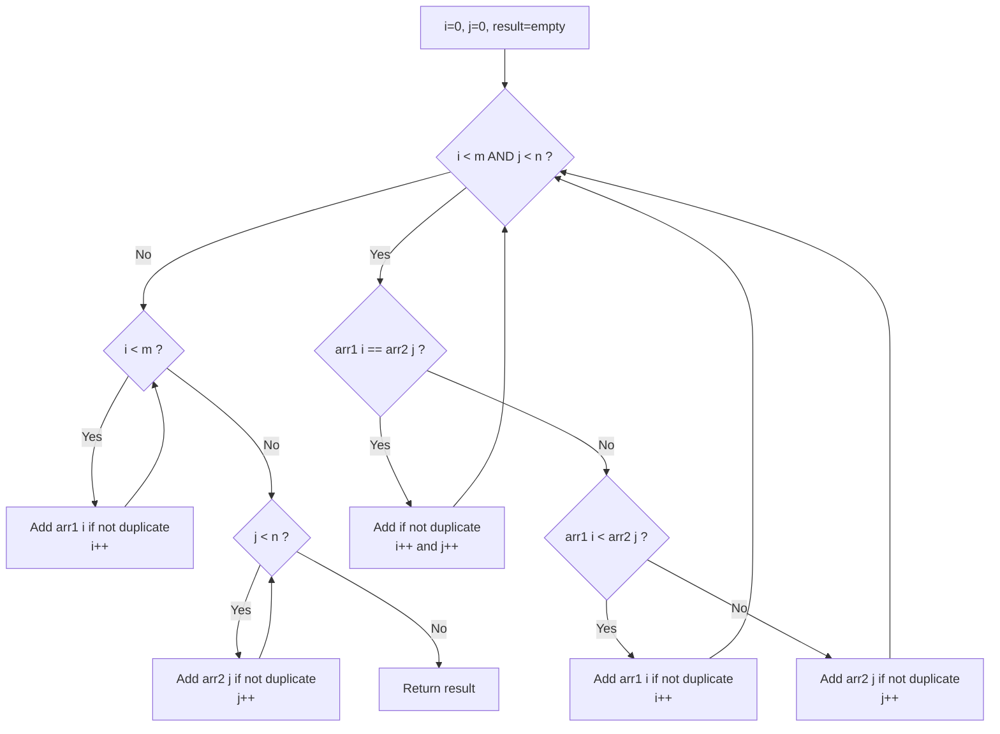
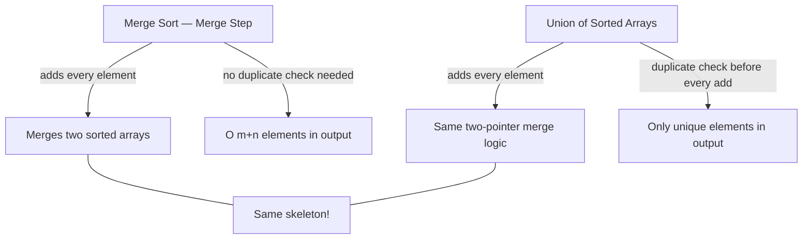

# Union of Two Sorted Arrays

## Problem Link
🔗 [GFG — Union of Two Sorted Arrays](https://www.geeksforgeeks.org/union-of-two-sorted-arrays/)

---

## What is this Problem?

Given **two sorted arrays**, find their **union** — a sorted list of all **distinct** elements that appear in either array (or both).

- Input arrays are **sorted in ascending order**
- Output must also be **sorted**
- **Duplicates** within the same array or across both arrays appear **only once** in the result

**Examples:**
```
arr1 = [1, 2, 3, 4, 5]
arr2 = [1, 2, 3, 6, 7]
Output: [1, 2, 3, 4, 5, 6, 7]
(3 appears in both — kept once. All others included.)

arr1 = [1, 1, 2, 3]
arr2 = [2, 3, 4, 4]
Output: [1, 2, 3, 4]
(Duplicates within same array also removed!)

arr1 = [1, 3, 5]
arr2 = [2, 4, 6]
Output: [1, 2, 3, 4, 5, 6]
(No common elements — all included, merged in sorted order.)
```

---

## The Problem Explained

Think of it like **merging two sorted playlists** and removing repeated songs:

```
Playlist A (sorted): [1, 2, 4, 5, 6]
Playlist B (sorted): [2, 3, 5, 7]

Combined unique playlist:
[1, 2, 3, 4, 5, 6, 7]

Rules:
  ✅ Every song from A is in the result
  ✅ Every song from B is in the result
  ✅ Songs in both A and B appear only ONCE
  ✅ Final playlist is sorted
```

**Key idea:** Use **two pointers** — one for each array. Always pick the **smaller** of the two current elements, skip it if it's a duplicate of the last added element, and advance the corresponding pointer. This is essentially the **merge step of merge sort**, with duplicate skipping added!

---

## HOOK TO REMEMBER FOREVER

**"TWO POINTERS — PICK SMALLER, SKIP DUPLICATE, ADVANCE POINTER"**

Every time you see "union of two sorted arrays":
- ✅ Use two pointers `i` and `j` starting at 0 for each array
- ✅ Always pick the **smaller** of `arr1[i]` and `arr2[j]`
- ✅ Before adding to result — check it's not the **same as last added** (skip duplicates)
- ✅ When equal — add once, advance **both** pointers
- ✅ Drain the remaining elements of whichever array still has elements
- ✅ O(m + n) time, O(m + n) space for result

**Remember: It's merge sort's merge step + one duplicate check before every push!** 🔗

---

## How It Works Step By Step

### The Strategy

```
arr1 = [1, 2, 4, 5, 6]
arr2 = [2, 3, 5, 7]
         i              j
         ↓              ↓

Compare arr1[i] vs arr2[j]:
  smaller (or equal) → add to result (if not duplicate) → advance pointer(s)

Step 1: arr1[0]=1 < arr2[0]=2  → add 1. result=[1]. i=1
Step 2: arr1[1]=2 == arr2[0]=2 → add 2. result=[1,2]. i=2, j=1
Step 3: arr1[2]=4 > arr2[1]=3  → add 3. result=[1,2,3]. j=2
Step 4: arr1[2]=4 < arr2[2]=5  → add 4. result=[1,2,3,4]. i=3
Step 5: arr1[3]=5 == arr2[2]=5 → add 5. result=[1,2,3,4,5]. i=4, j=3
Step 6: arr1[4]=6 > arr2[3]=7  → add 6. result=[1,2,3,4,5,6]. j=4 (j exhausted)
Drain arr1: nothing left.
Drain arr2: 7 → add 7. result=[1,2,3,4,5,6,7]

Return [1,2,3,4,5,6,7] ✓
```

### Visual — Two Pointer Walk

```
arr1:  [1,  2,  4,  5,  6]
        i

arr2:  [2,  3,  5,  7]
        j

result: []

Step 1: 1 < 2  → add 1        result=[1]          i→1
Step 2: 2 == 2 → add 2        result=[1,2]         i→2 j→1
Step 3: 4 > 3  → add 3        result=[1,2,3]       j→2
Step 4: 4 < 5  → add 4        result=[1,2,3,4]     i→3
Step 5: 5 == 5 → add 5        result=[1,2,3,4,5]   i→4 j→3
Step 6: 6 < 7  → add 6        result=[1,2,3,4,5,6] i→5 (exhausted)
Drain arr2: add 7              result=[1,2,3,4,5,6,7]
```

---

## Two Pointer Decision Flow



---

## State of Pointers Over Time

```mermaid
graph LR
    S([Start i=0 j=0])
    S   -->|"1 < 2, add 1"| A["i=1 j=0\nresult=[1]"]
    A   -->|"2 == 2, add 2"| B["i=2 j=1\nresult=[1,2]"]
    B   -->|"4 > 3, add 3"| C["i=2 j=2\nresult=[1,2,3]"]
    C   -->|"4 < 5, add 4"| D["i=3 j=2\nresult=[1,2,3,4]"]
    D   -->|"5 == 5, add 5"| E["i=4 j=3\nresult=[1,2,3,4,5]"]
    E   -->|"6 < 7, add 6"| F["i=5 j=3\nresult=[1,2,3,4,5,6]"]
    F   -->|"arr1 done, drain arr2, add 7"| G["result=[1,2,3,4,5,6,7] ✓"]
```



---

## Code Full Solution

```cpp
vector<int> unionOfSortedArrays(vector<int>& arr1, vector<int>& arr2) {
    int m = arr1.size(), n = arr2.size();
    int i = 0, j = 0;
    vector<int> result;

    while (i < m && j < n) {
        // Skip duplicates in arr1
        while (i > 0 && i < m && arr1[i] == arr1[i - 1]) i++;
        // Skip duplicates in arr2
        while (j > 0 && j < n && arr2[j] == arr2[j - 1]) j++;

        if (i >= m || j >= n) break;

        if (arr1[i] == arr2[j]) {
            if (result.empty() || result.back() != arr1[i])
                result.push_back(arr1[i]);
            i++;
            j++;
        } else if (arr1[i] < arr2[j]) {
            if (result.empty() || result.back() != arr1[i])
                result.push_back(arr1[i]);
            i++;
        } else {
            if (result.empty() || result.back() != arr2[j])
                result.push_back(arr2[j]);
            j++;
        }
    }

    // Drain remaining elements of arr1
    while (i < m) {
        if (result.empty() || result.back() != arr1[i])
            result.push_back(arr1[i]);
        i++;
    }

    // Drain remaining elements of arr2
    while (j < n) {
        if (result.empty() || result.back() != arr2[j])
            result.push_back(arr2[j]);
        j++;
    }

    return result;
}
```

---

## Code Explanation

### Initialize Pointers

```cpp
int m = arr1.size(), n = arr2.size();
int i = 0, j = 0;
vector<int> result;
```

- **`i`:** Points to current element in `arr1`
- **`j`:** Points to current element in `arr2`
- **`result`:** Accumulates the union in sorted order

---

### The Main While Loop

```cpp
while (i < m && j < n)
```

Runs as long as **both** arrays still have unprocessed elements. Once either is exhausted, we break and drain the remaining one.

---

### The Duplicate Guard

```cpp
if (result.empty() || result.back() != arr1[i])
    result.push_back(arr1[i]);
```

**This single condition prevents all duplicates:**

```
result.back() = last element added to result

Before adding any element, ask:
  "Is this the same as what I just added?"

If YES  → skip it (duplicate!)
If NO   → add it

Works for:
  - Duplicates within arr1: [1,1,2] → 1 added once, second 1 skipped
  - Duplicates within arr2: [2,2,3] → same logic
  - Common elements across arrays: both arr1[i] and arr2[j] are equal
    → add once, advance both → no re-add possible
```

---

### Three-Way Comparison

```cpp
if (arr1[i] == arr2[j]) {
    // add once, advance both
    i++; j++;
} else if (arr1[i] < arr2[j]) {
    // arr1's element is smaller — add it, advance i
    i++;
} else {
    // arr2's element is smaller — add it, advance j
    j++;
}
```

```
Equal:         Both point to same value. Add once. Move both forward.
arr1 smaller:  arr1's element can never be matched by arr2 (arr2 is sorted, only grows).
               Safe to add and move on.
arr2 smaller:  Mirror logic. arr2's element is consumed first.
```

---

### Drain Remaining Elements

```cpp
while (i < m) { /* add arr1[i] if not duplicate */ i++; }
while (j < n) { /* add arr2[j] if not duplicate */ j++; }
```

When the main loop ends, one array is exhausted and the other may have leftover elements. These are all **greater than everything already in result**, so we just append them (still checking for self-duplicates within the tail).

```
arr1 = [1, 2, 3]
arr2 = [1, 2, 3, 8, 9, 10]

After main loop: arr1 exhausted. arr2 still has [8, 9, 10].
Drain arr2 → append 8, 9, 10 to result. ✓
```

---

## Complete Example Traces

### Trace 1: Partial Overlap

```
arr1=[1,2,4,5,6], arr2=[2,3,5,7]
m=5, n=4, i=0, j=0, result=[]

i=0,j=0: 1 < 2  → add 1. result=[1]. i=1
i=1,j=0: 2 == 2 → add 2. result=[1,2]. i=2,j=1
i=2,j=1: 4 > 3  → add 3. result=[1,2,3]. j=2
i=2,j=2: 4 < 5  → add 4. result=[1,2,3,4]. i=3
i=3,j=2: 5 == 5 → add 5. result=[1,2,3,4,5]. i=4,j=3
i=4,j=3: 6 < 7  → add 6. result=[1,2,3,4,5,6]. i=5 (exhausted)

Drain arr2: j=3, arr2[3]=7. back=6≠7 → add 7.
result=[1,2,3,4,5,6,7]

Return [1,2,3,4,5,6,7] ✓
```

### Trace 2: Duplicates Within Same Array

```
arr1=[1,1,2,3], arr2=[2,3,4,4]
result=[]

i=0,j=0: 1 < 2  → result empty → add 1. result=[1]. i=1
i=1,j=0: 1 < 2  → back=1==1 → SKIP. i=2
i=2,j=0: 2 == 2 → back=1≠2 → add 2. result=[1,2]. i=3,j=1
i=3,j=1: 3 == 3 → back=2≠3 → add 3. result=[1,2,3]. i=4 (exhausted)

Drain arr2: j=2, arr2[2]=4. back=3≠4 → add 4. result=[1,2,3,4]. j=3
           j=3, arr2[3]=4. back=4==4 → SKIP. j=4

Return [1,2,3,4] ✓
```

### Trace 3: No Common Elements

```
arr1=[1,3,5], arr2=[2,4,6]
result=[]

i=0,j=0: 1 < 2 → add 1. result=[1]. i=1
i=1,j=0: 3 > 2 → add 2. result=[1,2]. j=1
i=1,j=1: 3 < 4 → add 3. result=[1,2,3]. i=2
i=2,j=1: 5 > 4 → add 4. result=[1,2,3,4]. j=2
i=2,j=2: 5 < 6 → add 5. result=[1,2,3,4,5]. i=3 (exhausted)

Drain arr2: add 6. result=[1,2,3,4,5,6]

Return [1,2,3,4,5,6] ✓
```

### Trace 4: One Array is a Subset of the Other

```
arr1=[2,4,6], arr2=[1,2,3,4,5,6,7]

All of arr1's elements exist in arr2.

Running two pointers:
  add 1 (arr2), 2 (both), 3 (arr2), 4 (both), 5 (arr2), 6 (both)
  arr1 exhausted. Drain arr2: add 7.

Return [1,2,3,4,5,6,7] ✓
```

### Trace 5: Identical Arrays

```
arr1=[1,2,3], arr2=[1,2,3]

i=0,j=0: 1==1 → add 1. i=1,j=1
i=1,j=1: 2==2 → add 2. i=2,j=2
i=2,j=2: 3==3 → add 3. i=3(exhausted), j=3(exhausted)

Drain: nothing left.

Return [1,2,3] ✓
(Union of identical arrays = the array itself)
```

### Trace 6: One Empty Array

```
arr1=[], arr2=[1,2,3]

Main loop: i<m fails immediately (m=0).

Drain arr2: add 1, 2, 3.

Return [1,2,3] ✓
```

---

## Edge Cases

### Case 1: Both Arrays Empty

```
arr1=[], arr2=[]
Main loop skipped. Both drains skipped.
Output: [] ✓
```

### Case 2: One Array Empty

```
arr1=[1,2,3], arr2=[]
Main loop skipped. Drain arr1 → [1,2,3].
Output: [1,2,3] ✓
```

### Case 3: All Elements Identical Across Both

```
arr1=[5,5,5], arr2=[5,5]
First 5 added, all others skipped by duplicate guard.
Output: [5] ✓
```

### Case 4: No Overlap, arr1 Entirely Before arr2

```
arr1=[1,2,3], arr2=[7,8,9]
Main loop adds 1,2,3 (arr1 smaller every time). arr1 exhausted.
Drain arr2: add 7,8,9.
Output: [1,2,3,7,8,9] ✓
```

### Case 5: Single Elements Each

```
arr1=[3], arr2=[3]
3==3 → add once. Both exhausted. Nothing to drain.
Output: [3] ✓
```

---

## Time Complexity

- **O(m + n)** where m = size of arr1, n = size of arr2
- Each element from both arrays is visited **exactly once**
- The main loop + two drain loops together cover all m + n elements
- Total: **O(m + n)**

---

## Space Complexity

- **O(m + n)** for the result array
- In the worst case (no common elements), result holds all m + n elements
- No extra auxiliary space beyond the output
- Total: **O(m + n)**

---

## Key Insights

### Why Two Pointers Work (and Why Sorting is Necessary)

```
The two-pointer technique relies on ONE guarantee:
  Both arrays are sorted → elements only increase as pointers advance.

This means:
  If arr1[i] < arr2[j], no future element in arr2 can be smaller than arr1[i].
  So arr1[i] is safe to add immediately — it will NEVER appear in arr2 later.

Without sorting:
  arr1=[3,1,2], arr2=[2,4,1]
  arr1[0]=3 > arr2[0]=2 → add 2 from arr2.
  But arr1 still has 1 which is smaller than 2 — we already missed the order!

Sorted arrays = pointer advances are safe and irreversible. ✓
```

### The Duplicate Guard — `result.back() != current`

```
Why check result.back() instead of a visited set?

A visited set (unordered_set) works but uses O(m+n) extra space
and has O(1) average but O(n) worst case per lookup.

result.back() works because:
  Both arrays are SORTED → duplicates are always ADJACENT.
  If we just added value X, the only way to add X again is if
  the very next element is also X.
  result.back() catches this immediately. O(1), no extra space. ✓

Sorted input → adjacent duplicate check is sufficient.
```

### This is Merge Sort's Merge Step



```
Merge sort merge:        Union merge:
  pick smaller             pick smaller
  always add               add ONLY IF not duplicate
  advance pointer          advance pointer

One extra condition. Same O(m+n) complexity. ✓
```

### Three Approaches Compared

```
Approach 1 — Two Pointers (optimal):
  Time: O(m+n)   Space: O(1) aux   Requires sorted input ✓

Approach 2 — Use a Set:
  Insert all elements of both arrays into an unordered_set,
  then sort and return.
  Time: O((m+n) log(m+n))   Space: O(m+n)
  Works even on unsorted input, but slower. ✓

Approach 3 — Sort + Merge:
  Concatenate, sort, remove duplicates.
  Time: O((m+n) log(m+n))   Space: O(m+n)
  Simple code, but ignores the sorted property. ✓

Two pointers is fastest when arrays are already sorted.
```

---

## References

- 🔗 [GFG — Union of Two Sorted Arrays](https://www.geeksforgeeks.org/union-of-two-sorted-arrays/)
