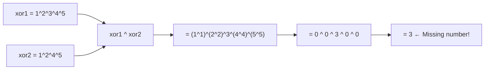

# Missing Number in Array

## Problem Link
🔗 [GFG — Missing Number in Array](https://www.geeksforgeeks.org/problems/missing-number-in-array1416/1)

---

## What is this Problem?

Given an array of size `n-1` containing **distinct integers from 1 to n** with **exactly one number missing**, find the missing number.

**Examples:**
```
arr = [1, 2, 4, 5]   (n = 5)
Output: 3

arr = [8, 2, 4, 5, 3, 7, 1]   (n = 8)
Output: 6

arr = [1]   (n = 2)
Output: 2
```

---

## The Problem Explained

Think of it like **taking attendance in a class**:

```
Class has students numbered 1 to 8.
Roll call list (array): [8, 2, 4, 5, 3, 7, 1]

Student 6 didn't show up → missing number is 6.

We know exactly who SHOULD be there (1 to n).
We know who IS there (the array).
The one who's absent = the answer.
```

**Key idea:** XOR every number that **should** be there (1 to n) against every number that **is** there (the array). Same numbers cancel out (`x ^ x = 0`). What's left is the missing one!

---

## HOOK TO REMEMBER FOREVER

**"XOR ALL EXPECTED, XOR ALL PRESENT, LEFTOVERS = MISSING"**

Every time you see "find the one missing number from 1 to n":
- ✅ XOR all numbers 1 to n → `xor1`
- ✅ XOR all array elements → `xor2`
- ✅ Return `xor1 ^ xor2` — duplicates cancel, missing one survives
- ✅ O(n) time, O(1) space — no extra array, no formula, no overflow risk

**Remember: XOR is self-cancelling. Every number that exists in both sides vanishes. Only the missing number has no pair to cancel with!** ⚡

---

## XOR — The Core Concept

Before diving in, here's why XOR is perfect for this problem.

**XOR truth table:**
```
0 ^ 0 = 0
1 ^ 1 = 0   ← same numbers CANCEL
0 ^ 1 = 1
1 ^ 0 = 1   ← different numbers SURVIVE
```

**Three properties that make it work:**

```
1. Self-cancellation:   x ^ x = 0       (same value XORed = 0)
2. Identity:            x ^ 0 = x       (XOR with 0 = itself)
3. Commutative:         a ^ b = b ^ a   (order doesn't matter)
```

**Why this solves our problem:**

```
Expected set: {1, 2, 3, 4, 5}
Present set:  {1, 2, 4, 5}      ← 3 is missing

XOR all expected: 1^2^3^4^5
XOR all present:  1^2^4^5

XOR both results together:
  (1^2^3^4^5) ^ (1^2^4^5)
= 1^1 ^ 2^2 ^ 3 ^ 4^4 ^ 5^5    ← regroup pairs
=  0  ^  0  ^ 3 ^  0  ^  0
= 3 ✓

Every number that EXISTS in both cancels to 0.
The MISSING number has no pair → survives!
```

---

## How XOR Cancellation Works



---

## How It Works Step By Step

### The Strategy

```
arr = [8, 2, 4, 5, 3, 7, 1]
n = arr.size() + 1 = 8
Expected range: 1 to 8

Step 1: XOR all numbers from 1 to 8
  xor1 = 1^2^3^4^5^6^7^8

Step 2: XOR all array elements
  xor2 = 8^2^4^5^3^7^1

Step 3: XOR xor1 and xor2
  xor1 ^ xor2 = (1^2^3^4^5^6^7^8) ^ (8^2^4^5^3^7^1)

Pair up matching numbers (they cancel):
  1^1=0,  2^2=0,  3^3=0,  4^4=0
  5^5=0,  7^7=0,  8^8=0

Only 6 has no pair → 0^0^0^6^0^0^0 = 6

Return 6 ✓
```

### Step-by-Step XOR Computation

```
xor1 (1 to 8):
  Start: 0
  ^1  = 1
  ^2  = 3
  ^3  = 0
  ^4  = 4
  ^5  = 1
  ^6  = 7
  ^7  = 0
  ^8  = 8
  xor1 = 8

xor2 (array elements):
  Start: 0
  ^8  = 8
  ^2  = 10
  ^4  = 14
  ^5  = 11
  ^3  = 8
  ^7  = 15
  ^1  = 14
  xor2 = 14

Answer: xor1 ^ xor2 = 8 ^ 14
  8  = 0 1 0 0 0  (binary)
  14 = 0 1 1 1 0  (binary)
  XOR= 0 0 1 1 0  = 6 ✓
```

---

## Code Full Solution

```cpp
#include <iostream>
#include <vector>
using namespace std;

int missingNum(vector<int>& arr) {
    int n = arr.size() + 1;
    int xor1 = 0, xor2 = 0;

    // XOR all array elements
    for (int i = 0; i < n - 1; i++) {
        xor2 ^= arr[i];
    }

    // XOR all numbers from 1 to n
    for (int i = 1; i <= n; i++) {
        xor1 ^= i;
    }

    // Missing number = xor of both
    return xor1 ^ xor2;
}

int main() {
    vector<int> arr = {8, 2, 4, 5, 3, 7, 1};
    int res = missingNum(arr);
    cout << res << endl;  // Output: 6
    return 0;
}
```

---

## Code Explanation

### Find n

```cpp
int n = arr.size() + 1;
```

The array has `n-1` elements (one is missing). So the full range is `1 to n` where `n = array size + 1`.

---

### XOR All Array Elements

```cpp
int xor2 = 0;
for (int i = 0; i < n - 1; i++) {
    xor2 ^= arr[i];
}
```

- Starts at 0 (identity element for XOR — `x ^ 0 = x`)
- XORs every element present in the array
- Result: a single number encoding "what we have"

---

### XOR All Numbers 1 to n

```cpp
int xor1 = 0;
for (int i = 1; i <= n; i++) {
    xor1 ^= i;
}
```

- XORs every number from 1 to n (the complete expected set)
- Result: a single number encoding "what we should have"

---

### The Final XOR

```cpp
return xor1 ^ xor2;
```

- Every number present in the array exists in both `xor1` and `xor2`
- Those pairs cancel out (`x ^ x = 0`)
- The missing number only exists in `xor1` — it has no pair → survives
- Returns the missing number directly

---

## Complete Example Traces

### Trace 1: Standard Case

```
arr = [8, 2, 4, 5, 3, 7, 1], n = 8

xor2 = 0^8^2^4^5^3^7^1 = 14
xor1 = 0^1^2^3^4^5^6^7^8 = 8

xor1 ^ xor2 = 8 ^ 14 = 6

Return 6 ✓
```

### Trace 2: Missing First Element

```
arr = [2, 3, 4, 5], n = 5

xor2 = 0^2^3^4^5 = 2
xor1 = 0^1^2^3^4^5 = 1

xor1 ^ xor2 = 1 ^ 2 = 3? Wait:
  xor1 = 1^2^3^4^5
       = 1 (order of XOR doesn't matter for result)

Let's compute properly:
  xor1: 0^1=1, ^2=3, ^3=0, ^4=4, ^5=1 → xor1=1
  xor2: 0^2=2, ^3=1, ^4=5, ^5=0       → xor2=0

  Hmm, let me recompute:
  xor1: 1^2=3, 3^3=0, 0^4=4, 4^5=1    → xor1=1
  xor2: 2^3=1, 1^4=5, 5^5=0           → xor2=0

  xor1^xor2 = 1^0 = 1 ✓

Return 1 ✓  (missing first element)
```

### Trace 3: Missing Last Element

```
arr = [1, 2, 3, 4], n = 5

xor2 = 1^2^3^4 = 4
xor1 = 1^2^3^4^5

xor1^xor2 = (1^2^3^4^5)^(1^2^3^4)
           = 5 (all others cancel)

Return 5 ✓  (missing last element)
```

### Trace 4: Single Element Array

```
arr = [1], n = 2

xor2 = 1
xor1 = 1^2 = 3

xor1^xor2 = 3^1 = 2

Return 2 ✓
```

### Trace 5: Missing Middle Element

```
arr = [1, 2, 4, 5, 6], n = 6

xor1 = 1^2^3^4^5^6
xor2 = 1^2^4^5^6

xor1^xor2: all pairs cancel except 3

Return 3 ✓
```

---

## Edge Cases

### Case 1: n = 1 (empty array, missing 1)

```
arr = [], n = 1
xor2 = 0 (loop doesn't run)
xor1 = 1
xor1^xor2 = 1
Output: 1 ✓
```

### Case 2: Missing the Only Element at End

```
arr = [1, 2, ..., n-1], missing = n
xor1 XORs n extra compared to xor2 → returns n ✓
```

### Case 3: Array in Any Order

```
arr = [3, 1, 4, 2]  missing 5, n=5
XOR is commutative — order doesn't affect the result.
Output: 5 ✓
```

---

## Time Complexity

- **O(n)** — two separate loops, each running at most n times
- Every element processed exactly once
- Total: **O(n)**

---

## Space Complexity

- **O(1)** — only two integer variables `xor1` and `xor2`
- No extra array or hash map needed
- Total: **O(1)**

---

## Key Insights

### Why XOR and Not Sum Formula?

There's a simpler-looking formula approach:

```
Expected sum = n*(n+1)/2
Actual sum   = sum of array elements
Missing      = Expected sum - Actual sum
```

**This works but has a flaw:**

```
For large n, n*(n+1)/2 can OVERFLOW int.
  n = 100,000 → n*(n+1)/2 = 5,000,050,000 → exceeds INT_MAX (≈2.1 billion) ❌

XOR approach:
  XOR of numbers never overflows — it's always bounded by the values themselves.
  No multiplication, no large intermediate values.
  Safe for any n. ✓
```

### XOR vs HashMap

```
HashMap approach:
  Store all array elements in a set.
  Loop 1 to n, find which isn't in the set.
  Time: O(n)   Space: O(n) ❌ (extra space for the map)

XOR approach:
  Time: O(n)   Space: O(1) ✓

Same time complexity, but XOR wins on space.
No hash collisions, no memory allocation, just two integers.
```

### The Beauty of XOR Self-Cancellation

```
You don't need to sort, search, or store anything.
Just accumulate ALL expected numbers and ALL present numbers
into two XOR accumulators.

At the end, it's as if you laid both sets on top of each other.
Every matching pair disappears. The lone survivor is your answer.

This technique generalizes to:
  → Find the one number appearing odd times in an array
  → Find two missing numbers (XOR + bit trick)
  → Swap two numbers without a temp variable (a^=b; b^=a; a^=b)
```

---

## References

- 🔗 [GFG — Missing Number in Array](https://www.geeksforgeeks.org/problems/missing-number-in-array1416/1)