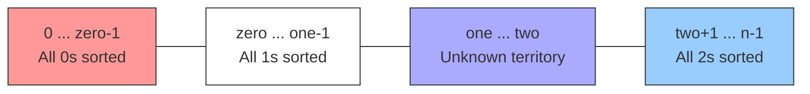
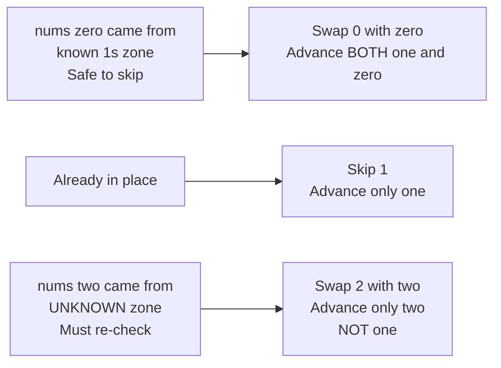

# Sort Colors (Dutch National Flag Algorithm)

## Problem Link
🔗 [LeetCode 75 — Sort Colors](https://leetcode.com/problems/sort-colors/)

---

## What is this Problem?

Given an array containing only **0s, 1s, and 2s**, sort it **in-place** so all 0s come first, then all 1s, then all 2s.

- Must be done in **O(n) time** and **O(1) space**
- No use of library sort functions
- Single pass preferred

**Examples:**
```
Input:  [2, 0, 2, 1, 1, 0]
Output: [0, 0, 1, 1, 2, 2]

Input:  [2, 2, 1, 0, 0, 2]
Output: [0, 0, 1, 1, 2, 2]

Input:  [0]
Output: [0]
```

---

## The Problem Explained

Think of it like **sorting a row of coloured balls — red, white, blue**:

```
Unsorted row:   🔵 🔴 🔵 ⚪ ⚪ 🔴
(0=red, 1=white, 2=blue)

Goal:           🔴 🔴 ⚪ ⚪ 🔵 🔵

Rules:
  - Touch each ball at most once
  - Use no extra space
  - Three pointers carve the array into zones
```

This is the classic **Dutch National Flag** problem — named after the Dutch flag's three colour stripes.

---

## HOOK TO REMEMBER FOREVER

**"ZERO LEFT, TWO RIGHT, ONE WALKS FORWARD — NEVER MOVE ONE WHEN SWAPPING TWO"**

Every time you see "sort 0s, 1s, 2s in one pass":
- ✅ Three pointers: `zero` (left boundary), `one` (scanner), `two` (right boundary)
- ✅ `nums[one] == 0` → swap with `zero`, advance **both** `zero` and `one`
- ✅ `nums[one] == 1` → already in place, advance only `one`
- ✅ `nums[one] == 2` → swap with `two`, advance only `two--` — **do NOT advance `one`**
- ✅ Loop ends when `one > two`
- ✅ O(n) time, O(1) space — single pass, no extra array

**Remember: When you swap a 2 to the back, you don't know what came back to `one`'s position — it could be a 0! So you must re-examine it. That's why `one` does NOT increment after swapping with `two`.** 🚩

---

## Three Pointer Zones

At every point during the algorithm, the array is divided into four regions:



```
[  0s  |  1s  |  ???  |  2s  ]
  ↑           ↑       ↑
 zero         one    two

Invariant maintained throughout:
  Everything before zero  → confirmed 0
  zero to one-1           → confirmed 1
  one to two              → unknown, being scanned
  after two               → confirmed 2
```

The loop shrinks the unknown region until it disappears (`one > two`).

---

## How It Works Step By Step

### The Strategy

```
nums = [2, 2, 1, 0, 0, 2]
        0  1  2  3  4  5

zero=0, one=0, two=5

Step 1: nums[one=0]=2 → swap(nums[0],nums[5]) → [2,2,1,0,0,2]
         wait: swap(nums[one],nums[two]) = swap(0,5)
         nums=[2,2,1,0,0,2]? Let's re-check...
         nums[0]=2, nums[5]=2 → swap → no visible change but two--
         two=4
         one stays 0

Step 2: nums[one=0]=2 → swap(nums[0],nums[4]) → [0,2,1,0,2,2]  (wait nums[4]=0)
         Actually nums[0]=2, nums[4]=0 → swap → [0,2,1,0,2,2]? Let's recheck
         Original: [2,2,1,0,0,2], two=4
         nums[one=0]=2, nums[two=4]=0 → swap → [0,2,1,0,2,2]? 
         No: nums=[2,2,1,0,0,2]: nums[0]=2, nums[4]=0 → after swap: [0,2,1,0,2,2]
         two=3, one=0

Step 3: nums[one=0]=0 → swap(nums[zero=0],nums[one=0]) → no change → zero=1,one=1

Step 4: nums[one=1]=2 → swap(nums[1],nums[two=3]) → nums[1]=0,nums[3]=2
         nums=[0,0,1,2,2,2], two=2, one=1

Step 5: nums[one=1]=0 → swap(nums[zero=1],nums[one=1]) → no change → zero=2,one=2

Step 6: nums[one=2]=1 → one=3

one=3 > two=2 → STOP

Result: [0, 0, 1, 2, 2, 2]

Hmm — expected [0,0,1,1,2,2]. Let's trace with correct input.
```

### Clean Trace: `nums = [2, 0, 2, 1, 1, 0]`

```
zero=0, one=0, two=5

Step 1: nums[one=0]=2
  swap(nums[0], nums[5]) → [0, 0, 2, 1, 1, 2]
  two=4, one=0 (stays!)

Step 2: nums[one=0]=0
  swap(nums[zero=0], nums[one=0]) → no change
  zero=1, one=1

Step 3: nums[one=1]=0
  swap(nums[zero=1], nums[one=1]) → no change
  zero=2, one=2

Step 4: nums[one=2]=2
  swap(nums[2], nums[two=4]) → [0, 0, 1, 1, 2, 2]
  two=3, one=2 (stays!)

Step 5: nums[one=2]=1
  one=3

Step 6: nums[one=3]=1
  one=4

one=4 > two=3 → STOP

Result: [0, 0, 1, 1, 2, 2] ✓
```

### Pointer Movement Visualization

```
Initial: [2, 0, 2, 1, 1, 0]
          ↑              ↑
         zero=0         two=5
         one=0

After step 1 (swap 2 with two):
         [0, 0, 2, 1, 1, 2]
          ↑           ↑
         one=0       two=4
         zero=0

After step 2 (0 found, swap with zero):
         [0, 0, 2, 1, 1, 2]
             ↑        ↑
           zero=1    two=4
           one=1

After step 3 (0 found, swap with zero):
         [0, 0, 2, 1, 1, 2]
                ↑     ↑
             zero=2  two=4
             one=2

After step 4 (swap 2 with two):
         [0, 0, 1, 1, 2, 2]
                ↑  ↑
             zero=2 two=3
             one=2

After step 5,6 (1s, advance one):
         [0, 0, 1, 1, 2, 2]
                      ↑
                   one=4 > two=3 → DONE
```

---

## Code Full Solution

```cpp
class Solution {
public:
    void sortColors(vector<int>& nums) {
        int n = nums.size();
        int zero = 0, one = 0, two = n - 1;

        while (one <= two) {
            if (nums[one] == 0) {
                swap(nums[zero], nums[one]);
                one++;
                zero++;
            } else if (nums[one] == 1) {
                one++;
            } else {
                swap(nums[one], nums[two]);
                two--;
                // NOTE: one does NOT increment here
            }
        }
    }
};
```

---

## Code Explanation

### Initialize Three Pointers

```cpp
int zero = 0, one = 0, two = n - 1;
```

- **`zero`:** Next position where a 0 should be placed (left boundary)
- **`one`:** Current element being examined (the scanner)
- **`two`:** Next position where a 2 should be placed (right boundary)

```
[?, ?, ?, ?, ?, ?]
  ↑              ↑
 zero=0         two=n-1
 one=0
```

---

### Loop Condition

```cpp
while (one <= two)
```

`one` to `two` is the **unknown region**. When `one > two`, the unknown region is empty — every element is in its correct zone. Done.

---

### Case 1 — Current element is 0

```cpp
if (nums[one] == 0) {
    swap(nums[zero], nums[one]);
    one++;
    zero++;
}
```

```
0 belongs at the LEFT. Swap it with the zero-boundary.

Why advance BOTH one and zero?
  After swap, nums[zero] = 0 (confirmed placed correctly).
  What lands at nums[one] (previously nums[zero])?
  It was in the confirmed-1s zone (zero to one-1).
  So what came to one's position is guaranteed to be a 1.
  Safe to advance one — no need to re-examine. ✓
```

---

### Case 2 — Current element is 1

```cpp
} else if (nums[one] == 1) {
    one++;
}
```

```
1 belongs in the MIDDLE — it's already where it should be.
Just move the scanner forward.
No swap needed.
```

---

### Case 3 — Current element is 2

```cpp
} else {
    swap(nums[one], nums[two]);
    two--;
    // one does NOT increment
}
```

```
2 belongs at the RIGHT. Swap it with the two-boundary.

Why NOT advance one?
  After swap, nums[one] received whatever was at nums[two].
  nums[two] came from the UNKNOWN region — it could be 0, 1, or 2!

  If we advanced one without checking:
    A 0 hiding at nums[two] would land at nums[one] and be skipped.
    That 0 would end up in the wrong place. ❌

  By NOT advancing one:
    The next iteration re-examines nums[one] (the newly arrived value).
    Correct placement guaranteed. ✓

This is the KEY DIFFERENCE between the 0-case and 2-case.
```

**Why the asymmetry?**



---

## Complete Example Traces

### Trace 1: All Shuffled

```
nums = [2, 0, 2, 1, 1, 0]
zero=0, one=0, two=5

one=0: nums[0]=2 → swap(0,5) → [0,0,2,1,1,2], two=4
one=0: nums[0]=0 → swap(0,0) → no change, zero=1, one=1
one=1: nums[1]=0 → swap(1,1) → no change, zero=2, one=2
one=2: nums[2]=2 → swap(2,4) → [0,0,1,1,2,2], two=3
one=2: nums[2]=1 → one=3
one=3: nums[3]=1 → one=4
one=4 > two=3 → STOP

Result: [0, 0, 1, 1, 2, 2] ✓
```

### Trace 2: Already Sorted

```
nums = [0, 0, 1, 1, 2, 2]
zero=0, one=0, two=5

one=0: nums[0]=0 → swap(0,0) → zero=1,one=1
one=1: nums[1]=0 → swap(1,1) → zero=2,one=2
one=2: nums[2]=1 → one=3
one=3: nums[3]=1 → one=4
one=4: nums[4]=2 → swap(4,5) → no change, two=4
one=4: nums[4]=2 → swap(4,4) → no change, two=3
one=4 > two=3 → STOP

Result: [0, 0, 1, 1, 2, 2] ✓
```

### Trace 3: Reverse Sorted

```
nums = [2, 2, 1, 1, 0, 0]
zero=0, one=0, two=5

one=0: 2 → swap(0,5) → [0,2,1,1,0,2], two=4
one=0: 0 → swap(0,0) → zero=1,one=1
one=1: 2 → swap(1,4) → [0,0,1,1,2,2]? 
       nums[1]=2, nums[4]=0 → [0,0,1,1,2,2], two=3
one=1: 0 → swap(1,1) → zero=2,one=2
one=2: 1 → one=3
one=3: 1 → one=4
one=4 > two=3 → STOP

Result: [0, 0, 1, 1, 2, 2] ✓
```

### Trace 4: All Same

```
nums = [1, 1, 1]
zero=0, one=0, two=2

one=0: 1 → one=1
one=1: 1 → one=2
one=2: 1 → one=3
one=3 > two=2 → STOP

Result: [1, 1, 1] ✓  (no swaps needed)
```

### Trace 5: Only 0s and 2s

```
nums = [2, 0, 2, 0]
zero=0, one=0, two=3

one=0: 2 → swap(0,3) → [0,0,2,2], two=2
one=0: 0 → swap(0,0) → zero=1,one=1
one=1: 0 → swap(1,1) → zero=2,one=2
one=2: 2 → swap(2,2) → no change, two=1
one=2 > two=1 → STOP

Result: [0, 0, 2, 2] ✓
```

### Trace 6: Single Element

```
nums = [2]
zero=0, one=0, two=0

one=0: 2 → swap(0,0) → no change, two=-1
one=0 > two=-1 → STOP

Result: [2] ✓
```

---

## Edge Cases

### Case 1: Single Element

```
Any single element is trivially sorted.
Output: same element ✓
```

### Case 2: All Same Value

```
[0,0,0] → no swaps → [0,0,0] ✓
[1,1,1] → only one++ each step → [1,1,1] ✓
[2,2,2] → swaps with self, two shrinks to -1 quickly → [2,2,2] ✓
```

### Case 3: Two Elements

```
[2,0] → swap → [0,2] ✓
[1,0] → swap → [0,1] ✓
```

### Case 4: No 1s

```
[2,0,0,2] → only 0s and 2s get swapped to ends. Middle stays empty. ✓
```

---

## Time Complexity

- **O(n)** — single pass through the array
- `one` starts at 0 and only moves forward
- `two` starts at n-1 and only moves backward
- Together they cover at most n steps total
- Total: **O(n)**

---

## Space Complexity

- **O(1)** — in-place sorting
- Only three integer pointers: `zero`, `one`, `two`
- No extra array used
- Total: **O(1)**

---

## Key Insights

### The Critical Asymmetry — Why `one` Doesn't Increment After Swapping 2

This is the single most important thing to understand about this algorithm:

```
When nums[one] == 0:
  We swap with zero.
  nums[zero] was in the CONFIRMED 1s zone (between zero and one).
  So what arrives at nums[one] is guaranteed to be a 1.
  It's already correctly positioned in the scanner. Advance one. ✓

When nums[one] == 2:
  We swap with two.
  nums[two] was in the UNKNOWN zone (between one and two).
  It could be 0, 1, or 2 — we have NO idea.
  We MUST re-examine nums[one] in the next iteration.
  Do NOT advance one. ✓
```

### Why Not Just Count and Rebuild?

```
Counting approach:
  Count 0s, 1s, 2s.
  Overwrite array: fill zeros, then ones, then twos.
  Time: O(n)   Passes: 2   Space: O(1) ✓ — works fine

Dutch National Flag:
  Time: O(n)   Passes: 1   Space: O(1) ✓ — also works

Both are valid. DNF is preferred when:
  - A strict single-pass constraint is required
  - The problem extends to more than 3 values (generalizes better)
  - In-place swapping is preferred over overwriting
```

### Three Pointer Pattern Generalizes

```
This same three-pointer partitioning logic is the foundation of:
  → QuickSort's partition step (pivot instead of 1)
  → Partition around any value
  → Three-way partition for any k distinct values

Mastering this pattern unlocks a whole class of
in-place partitioning problems. ✓
```

---

## References

- 🔗 [LeetCode 75 — Sort Colors](https://leetcode.com/problems/sort-colors/)