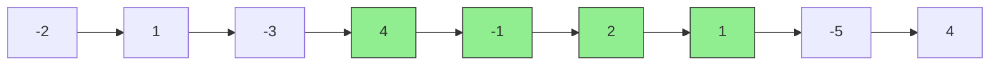

# Maximum Subarray (Kadane's Algorithm)

## Problem Link
🔗 [LeetCode 53 — Maximum Subarray](https://leetcode.com/problems/maximum-subarray/)

---

## What is this Problem?

Given an integer array `nums`, find the **contiguous subarray** (containing at least one element) which has the **largest sum** and return that sum.

**Examples:**
```
nums = [-2, 1, -3, 4, -1, 2, 1, -5, 4]
Output: 6
Subarray: [4, -1, 2, 1]

nums = [1]
Output: 1

nums = [-1, -2, -3]
Output: -1   ← best we can do is take the least negative
```

---

## The Problem Explained

Think of it like **a stock trader deciding when to start and stop a run**:

```
Daily profit/loss: [-2, 1, -3, 4, -1, 2, 1, -5, 4]

You're allowed to pick any consecutive stretch of days.
You want to maximise total profit.

If your running total dips below 0 → abandon the current run.
Starting fresh from 0 is always better than carrying a loss.

Run 1: start at -2 → total -2 → below 0, abandon.
Run 2: start at  1 → total 1 → then -3 → total -2 → below 0, abandon.
Run 3: start at  4 → total 4 → then -1 → total 3 → then 2 → total 5
       → then 1 → total 6 → then -5 → total 1 → then 4 → total 5.
Best seen: 6. ✓
```

**Key idea:** Keep a running sum. The moment it goes negative, reset it to 0 — a negative running total only drags down future elements. Track the best sum seen at every step.

---

## HOOK TO REMEMBER FOREVER

**"ADD ELEMENT, UPDATE MAX, RESET SUM IF NEGATIVE"**

Every time you see "maximum sum contiguous subarray":
- ✅ Start `sum` and `maxSum` both at `nums[0]`
- ✅ For each next element: add it to `sum`
- ✅ Update `maxSum = max(maxSum, sum)` after adding
- ✅ If `sum < 0` → reset `sum = 0` (fresh start)
- ✅ If current element alone beats `maxSum` → update both `maxSum` and `sum`
- ✅ O(n) time, O(1) space — single pass, two variables

**Remember: A negative running sum is dead weight. Cut it loose and start fresh. The max is updated at every step, not just at resets!** 💹

---

## How It Works Step By Step

### The Strategy

```
nums = [-2, 1, -3, 4, -1, 2, 1, -5, 4]

sum=nums[0]=-2, maxSum=-2

i=1: sum=-2+1=-1. maxSum=-1. sum<0 → sum=0. nums[1]=1>maxSum=-1 → maxSum=1, sum=1
i=2: sum=1+(-3)=-2. -2<maxSum=1. sum<0 → sum=0. nums[2]=-3 < maxSum=1, no change.
i=3: sum=0+4=4. maxSum=4. sum=4. nums[3]=4==maxSum, no change.
i=4: sum=4+(-1)=3. 3<maxSum=4. sum=3≥0. nums[4]=-1 < maxSum=4, no change.
i=5: sum=3+2=5. maxSum=5. sum=5.
i=6: sum=5+1=6. maxSum=6. sum=6.
i=7: sum=6+(-5)=1. 1<maxSum=6. sum=1.
i=8: sum=1+4=5. 5<maxSum=6.

Return maxSum = 6 ✓
```

### Visual — Running Sum vs Max

```
Index:   0   1   2   3   4   5   6   7   8
nums:   -2   1  -3   4  -1   2   1  -5   4
         ↓   ↓   ↓   ↓   ↓   ↓   ↓   ↓   ↓
sum:    -2   1   0   4   3   5   6   1   5
                 ↑           ↑   ↑
              RESET        peaks  NEW MAX
              (sum<0)

maxSum: -2   1   1   4   4   5   6   6   6
                              best subarray
                              ends here ↑
```

### The Winning Subarray



Subarray `[4, -1, 2, 1]` gives the maximum sum of **6**.

---

## Code Full Solution

```cpp
class Solution {
public:
    int maxSubArray(vector<int>& nums) {
        int sum = nums[0];
        int maxSum = nums[0];
        int n = nums.size();

        for (int i = 1; i < n; i++) {
            sum += nums[i];
            if (sum > maxSum) maxSum = sum;
            if (sum < 0) sum = 0;
            if (nums[i] > maxSum) {
                maxSum = nums[i];
                sum = nums[i];
            }
        }

        return maxSum;
    }
};
```

---

## Code Explanation

### Initialize with First Element

```cpp
int sum = nums[0];
int maxSum = nums[0];
```

**Why start at `nums[0]` and not 0?**
```
If we initialised maxSum = 0 and all elements are negative:
  nums = [-3, -1, -2]
  sum would reset to 0 immediately every step.
  maxSum would stay 0.
  Return 0 — WRONG! ❌

The problem requires at least one element.
Starting at nums[0] handles all-negative arrays correctly.
Return value is always the least negative element. ✓
```

---

### Step 1 — Add Current Element

```cpp
sum += nums[i];
```

Extend the current subarray by including `nums[i]`.

---

### Step 2 — Update Max

```cpp
if (sum > maxSum) maxSum = sum;
```

Before resetting anything, check if the current running total is a new best. This captures the peak of any subarray ending at position `i`.

---

### Step 3 — Reset if Negative

```cpp
if (sum < 0) sum = 0;
```

**The core of Kadane's algorithm:**
```
If carrying the current sum into the next element only drags it down,
cut the loss and start fresh.

A sum of 0 means "I have no current subarray — I'll start a new one
from the next element I encounter."

Why 0 and not nums[i+1] directly?
  After reset, the next iteration adds nums[i+1] to 0,
  effectively starting a new subarray from nums[i+1]. ✓
```

---

### Step 4 — Single Element Beats Everything

```cpp
if (nums[i] > maxSum) {
    maxSum = nums[i];
    sum = nums[i];
}
```

**Handles the case where a single element is the best subarray:**
```
Example: [-5, -1, -3]
  After reset logic, sum stays 0.
  But maxSum was initialised to -5.
  nums[1]=-1 > maxSum=-5 → update maxSum=-1, sum=-1.
  Next: sum=-1+(-3)=-4. maxSum=-1. sum<0 → sum=0.
        nums[2]=-3. -3 < maxSum=-1. No update.
  Return -1 ✓   (the best single element)

Without this check, the reset to 0 would mask
individual elements that beat the current maxSum.
```

> ⚠️ **Note on this implementation:** The four-step logic in this code is a careful manual version. The classic Kadane's is slightly more compact — combining steps 3 and 4 into `sum = max(nums[i], sum + nums[i])`. Both produce identical results.

---

## Complete Example Traces

### Trace 1: Mixed Positives and Negatives

```
nums = [-2, 1, -3, 4, -1, 2, 1, -5, 4]
sum=-2, maxSum=-2

i=1: sum=-1. maxSum=-1. sum<0→sum=0. nums[1]=1>-1→maxSum=1,sum=1
i=2: sum=-2. maxSum=1.  sum<0→sum=0. nums[2]=-3<1. no change.
i=3: sum=4.  maxSum=4.  sum≥0.       nums[3]=4==4. no change.
i=4: sum=3.  maxSum=4.  sum≥0.
i=5: sum=5.  maxSum=5.  sum≥0.
i=6: sum=6.  maxSum=6.  sum≥0.
i=7: sum=1.  maxSum=6.  sum≥0.
i=8: sum=5.  maxSum=6.

Return 6 ✓
```

### Trace 2: All Negative Numbers

```
nums = [-3, -1, -2]
sum=-3, maxSum=-3

i=1: sum=-4. maxSum=-3. sum<0→sum=0. nums[1]=-1>-3→maxSum=-1,sum=-1
i=2: sum=-3. maxSum=-1. sum<0→sum=0. nums[2]=-2>-1? NO. no change.

Return -1 ✓  (least negative element wins)
```

### Trace 3: All Positive Numbers

```
nums = [1, 2, 3, 4]
sum=1, maxSum=1

i=1: sum=3.  maxSum=3.
i=2: sum=6.  maxSum=6.
i=3: sum=10. maxSum=10.

Return 10 ✓  (entire array, sum never resets)
```

### Trace 4: Single Element

```
nums = [5]
sum=5, maxSum=5
Loop doesn't run.

Return 5 ✓
```

### Trace 5: Reset Happens Mid-Array

```
nums = [3, -10, 4, 5]
sum=3, maxSum=3

i=1: sum=-7. maxSum=3. sum<0→sum=0. nums[1]=-10<3. no change.
i=2: sum=4.  maxSum=4.
i=3: sum=9.  maxSum=9.

Return 9 ✓  (fresh start after the -10 gives [4,5]=9, beats [3]=3)
```

### Trace 6: Negative Sandwich

```
nums = [5, -2, 3]   (is it better to include -2 or split?)
sum=5, maxSum=5

i=1: sum=3. maxSum=5. sum≥0. (3 < 5, no update)
i=2: sum=6. maxSum=6.

Return 6 ✓  ([5,-2,3]=6 is better than [5]=5 or [3]=3)
The -2 is worth tolerating because 3 makes up for it.
```

---

## Edge Cases

### Case 1: Single Positive

```
Input: [42]
Output: 42 ✓
```

### Case 2: Single Negative

```
Input: [-42]
Output: -42 ✓
```

### Case 3: Large Spike After Negatives

```
Input: [-1, -2, 100, -1]
sum=-1, maxSum=-1
i=1: sum=-3 < 0 → reset. -2 < -1 → no update.
i=2: sum=100. maxSum=100.
i=3: sum=99. maxSum=100.
Output: 100 ✓
```

### Case 4: Two Elements, Both Negative

```
Input: [-2, -1]
sum=-2, maxSum=-2
i=1: sum=-3. maxSum=-2. sum<0→reset. nums[1]=-1>-2 → maxSum=-1,sum=-1
Output: -1 ✓
```

---

## Time Complexity

- **O(n)** — single pass through the array
- Each element processed exactly once
- All operations inside loop are O(1)
- Total: **O(n)**

---

## Space Complexity

- **O(1)** — constant extra space
- Only `sum` and `maxSum` used
- No auxiliary array, no recursion
- Total: **O(1)**

---

## Key Insights

### The Classic Kadane's — One-Line Core

```cpp
// Classic form (equivalent result):
for (int i = 0; i < n; i++) {
    sum = max(nums[i], sum + nums[i]);
    maxSum = max(maxSum, sum);
}
```

```
max(nums[i], sum + nums[i]) asks:
  "Is it better to start a new subarray at i,
   or extend the existing one?"

If sum + nums[i] < nums[i]:
  → sum was negative, drag. Start fresh at nums[i].
If sum + nums[i] >= nums[i]:
  → sum was non-negative, worth keeping. Extend.

This is identical to the reset-to-0 logic,
just expressed more cleanly. ✓
```

### Why Reset to 0 and Not to the Next Element Directly

```
After sum < 0 → sum = 0.
Next iteration: sum = 0 + nums[i+1] = nums[i+1].

So resetting to 0 effectively means:
  "I am starting a new subarray from the next element."

It's a lazy reset — no need to look ahead. ✓
```

### Negative Running Sum = Dead Weight

```
Suppose sum = -3 and next element = 7.

Option A (keep negative sum):
  New total = -3 + 7 = 4

Option B (start fresh):
  New total = 0 + 7 = 7

Starting fresh is always better when sum < 0.
The negative prefix only hurts. ✓
```

### This Problem Extends to Several Harder Variants

```
Variants built on the same Kadane's logic:
  → Maximum product subarray (track both max and min — negatives flip)
  → Maximum subarray with at least k elements
  → Circular subarray maximum (total sum - minimum subarray)
  → Maximum sum of two non-overlapping subarrays

Mastering the reset-or-extend decision is the key to all of them.
```

---

## References

- 🔗 [LeetCode 53 — Maximum Subarray](https://leetcode.com/problems/maximum-subarray/)