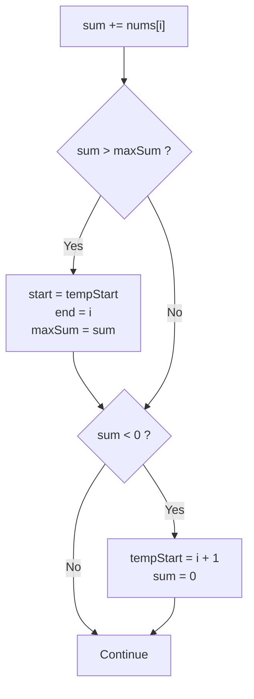
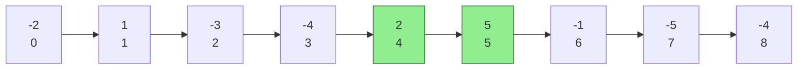

# Maximum Subarray — With Start & End Index Tracking

## Problem Link
🔗 [LeetCode 53 — Maximum Subarray](https://leetcode.com/problems/maximum-subarray/)

---

## What is this Problem?

Same as Kadane's Algorithm — find the **maximum sum contiguous subarray** — but this version also tracks **exactly which subarray** (start and end index) produces that maximum sum.

> 💡 This is the **index-tracking extension** of Kadane's Algorithm. If you haven't read the basic Kadane's README, the core reset logic is identical — this version just adds bookkeeping for where the best subarray begins and ends.

**Examples:**
```
nums = [-2, 1, -3, 4, -1, 2, 1, -5, 4]
Output: maxSum=6, start=3, end=6
Subarray: nums[3..6] = [4, -1, 2, 1]

nums = [-2, 1, -3, -4, 2, 5, -1, -5, -4]
Output: maxSum=7, start=4, end=5
Subarray: nums[4..5] = [2, 5]
```

---

## The Problem Explained

Think of it like a **stock trading log** where you want to know not just *how much* profit you made but *exactly which days* you were invested:

```
Daily gains: [-2, 1, -3, -4, 2, 5, -1, -5, -4]
              0   1   2   3  4   5   6   7   8

You want:
  Best profit = 7
  Invested from: day 4 to day 5

Not just the number — but the window of days too.
```

**Key idea:** Every time the running sum exceeds the current best, **snapshot** the `tempStart` as the new `start` and the current index as the new `end`. When the sum resets to 0, update `tempStart` to the next index — the next potential subarray begins there.

---

## HOOK TO REMEMBER FOREVER

**"SNAPSHOT START AND END WHEN SUM BEATS MAX. MOVE TEMPSTART FORWARD ON RESET."**

Every time you need the actual subarray, not just its sum:
- ✅ Maintain `tempStart` — the start of the **current** running subarray
- ✅ When `sum > maxSum` → lock in `start = tempStart`, `end = i`, `maxSum = sum`
- ✅ When `sum < 0` → reset `sum = 0`, move `tempStart = i + 1`
- ✅ `start` and `end` only ever update together when a new best is found
- ✅ `tempStart` is speculative — becomes `start` only if this subarray beats the max

**Remember: `tempStart` is the "candidate start". It becomes the real `start` only when the subarray ending at `i` beats the current best.** 📌

---

## How Tracking Works — Four Variables



```
start     → confirmed start of the BEST subarray found so far
end       → confirmed end of the BEST subarray found so far
tempStart → speculative start of the CURRENT running subarray
sum       → running total of the current subarray
maxSum    → best sum ever recorded
```

---

## How It Works Step By Step

### Input

```
nums = [-2, 1, -3, -4, 2, 5, -1, -5, -4]
        0   1   2   3  4   5   6   7   8
```

### Step-by-Step Trace Table

```
i  nums[i]  sum    sum>maxSum?  start end maxSum  sum<0?  tempStart
──────────────────────────────────────────────────────────────────
   (init)    0                                 -∞            0
0    -2     -2     -2>-∞ YES    0     0    -2   YES          1
1     1     -1     -1>-2 YES    1     1    -1   YES          2
2    -3     -4     NO               -1   YES                 3
3    -4     -8     NO               -1   YES                 4
4     2      2     2>-1  YES    4     4     2   NO           4
5     5      7     7>2   YES    4     5     7   NO           4
6    -1      6     NO               7   NO                  4
7    -5      1     NO               7   NO                  4
8    -4     -3     NO               7   YES                  9

Final: start=4, end=5, maxSum=7

Subarray: nums[4..5] = [2, 5] → sum = 7 ✓
```

### Visual — Subarray Windows



Best subarray `[2, 5]` at indices 4 to 5 with sum **7**.

---

## Code Full Solution

```cpp
class Solution {
public:
    int maxSubArray(vector<int>& nums) {
        int start = 0;
        int end = 0;
        int maxSum = INT_MIN;
        int sum = 0;
        int tempStart = 0;

        for (int i = 0; i < nums.size(); i++) {
            sum += nums[i];

            if (sum > maxSum) {
                start = tempStart;
                end = i;
                maxSum = sum;
            }

            if (sum < 0) {
                tempStart = i + 1;
                sum = 0;
            }
        }

        cout << start << " " << end << endl;
        return maxSum;
    }
};
```

---

## Code Explanation

### Initialize

```cpp
int start = 0, end = 0;
int maxSum = INT_MIN;
int sum = 0;
int tempStart = 0;
```

- **`maxSum = INT_MIN`** — handles all-negative arrays. Any real sum will beat it on first update.
- **`sum = 0`** — unlike the previous version that started at `nums[0]`, this version starts at 0 and relies on `INT_MIN` to correctly handle all-negative arrays.
- **`tempStart`** — tracks where the current running subarray began. Only promoted to `start` when a new best is found.

---

### Add Element

```cpp
sum += nums[i];
```

Extend the current subarray by `nums[i]`. Always happens first, before any comparisons.

---

### Check for New Best

```cpp
if (sum > maxSum) {
    start = tempStart;
    end = i;
    maxSum = sum;
}
```

**Why update `start` from `tempStart` here (not earlier)?**

```
tempStart is speculative — it marks "if a new best happens,
this is where the winning subarray will have begun."

But we only care about it when it actually becomes the best.
Locking it in ONLY at this moment means start and end always
point to a verified subarray with sum == maxSum. ✓

Example: tempStart=3, but sum never beats maxSum
  → tempStart=3 is discarded, never becomes start.
  → start stays pointing at the actual best subarray. ✓
```

---

### Reset on Negative Sum

```cpp
if (sum < 0) {
    tempStart = i + 1;
    sum = 0;
}
```

**Two things happen simultaneously:**

```
1. sum = 0
   Current subarray is a liability — negative prefix drags down future elements.
   Start fresh from the next element.

2. tempStart = i + 1
   The next potential best subarray starts from i+1.
   If i+1 eventually leads to a new maxSum, this tempStart
   will be locked in as the new start.
```

**Why `i + 1` and not `i`?**

```
Element at i is already included in sum, which just went negative.
Including i in the next subarray would mean carrying that negativity.
The fresh start must begin AFTER i. ✓
```

---

### Order of the Two Checks Matters

```cpp
// CORRECT order:
if (sum > maxSum) { ... }   // check FIRST
if (sum < 0) { ... }        // reset SECOND

// Why not swap them?
If we reset first:
  sum becomes 0 before we check sum > maxSum.
  A negative element that's still the best so far
  (e.g. first element in all-negative array) would
  never be recorded as the max. ❌

Check new best BEFORE resetting. Always. ✓
```

---

## Complete Example Traces

### Trace 1: Main Example

```
nums = [-2, 1, -3, -4, 2, 5, -1, -5, -4]

i=0: sum=-2. -2>INT_MIN → start=0,end=0,maxSum=-2. sum<0 → tempStart=1,sum=0
i=1: sum=1.  1>-2 → start=1,end=1,maxSum=1. sum≥0.
i=2: sum=-2. -2<1. sum<0 → tempStart=3,sum=0
i=3: sum=-4. -4<1. sum<0 → tempStart=4,sum=0
i=4: sum=2.  2>1 → start=4,end=4,maxSum=2. sum≥0.
i=5: sum=7.  7>2 → start=4,end=5,maxSum=7. sum≥0.
i=6: sum=6.  6<7. sum≥0.
i=7: sum=1.  1<7. sum≥0.
i=8: sum=-3. -3<7. sum<0 → tempStart=9,sum=0.

Output: start=4, end=5, maxSum=7
Subarray: [2, 5] ✓
```

### Trace 2: Classic Kadane Example

```
nums = [-2, 1, -3, 4, -1, 2, 1, -5, 4]

Key updates:
  i=0: maxSum=-2, start=0, end=0. Reset.
  i=1: maxSum=1,  start=1, end=1. Reset.
  i=3: sum=4, maxSum=4,  start=3, end=3.
  i=5: sum=5, maxSum=5,  start=3, end=5.
  i=6: sum=6, maxSum=6,  start=3, end=6.

Output: start=3, end=6, maxSum=6
Subarray: [4, -1, 2, 1] ✓
```

### Trace 3: All Negative Numbers

```
nums = [-5, -3, -1, -4]

i=0: sum=-5. -5>INT_MIN → start=0,end=0,maxSum=-5. Reset. tempStart=1.
i=1: sum=-3. -3>-5 → start=1,end=1,maxSum=-3. Reset. tempStart=2.
i=2: sum=-1. -1>-3 → start=2,end=2,maxSum=-1. Reset. tempStart=3.
i=3: sum=-4. -4<-1. Reset. tempStart=4.

Output: start=2, end=2, maxSum=-1
Subarray: [-1] ✓  (least negative single element)
```

### Trace 4: All Positive Numbers

```
nums = [1, 2, 3, 4]

i=0: sum=1. maxSum=1, start=0, end=0.
i=1: sum=3. maxSum=3, start=0, end=1.
i=2: sum=6. maxSum=6, start=0, end=2.
i=3: sum=10. maxSum=10, start=0, end=3.

Output: start=0, end=3, maxSum=10
Subarray: [1, 2, 3, 4] ✓ (entire array)
```

### Trace 5: Multiple Resets, Best at the End

```
nums = [-10, -5, 3, 4]

i=0: sum=-10. maxSum=-10. Reset. tempStart=1.
i=1: sum=-5.  -5>-10 → maxSum=-5, start=1, end=1. Reset. tempStart=2.
i=2: sum=3.   3>-5 → maxSum=3, start=2, end=2.
i=3: sum=7.   7>3 → maxSum=7, start=2, end=3.

Output: start=2, end=3, maxSum=7
Subarray: [3, 4] ✓
```

### Trace 6: Single Element

```
nums = [42]

i=0: sum=42. 42>INT_MIN → start=0,end=0,maxSum=42.

Output: start=0, end=0, maxSum=42 ✓
```

---

## Edge Cases

### Case 1: Two Elements, Both Negative

```
Input: [-3, -1]
i=0: maxSum=-3, start=0, end=0. Reset.
i=1: sum=-1. -1>-3 → maxSum=-1, start=1, end=1. Reset.
Output: start=1, end=1, maxSum=-1 ✓
```

### Case 2: Reset at Last Index

```
Input: [5, 3, -100]
Best subarray is [5,3] even though we reset at the end.
The start/end snapshot at i=1 holds permanently. ✓
```

### Case 3: Tie — Two Subarrays with Same Sum

```
Input: [2, -2, 2]
i=0: sum=2, maxSum=2, start=0, end=0.
i=1: sum=0. 0<2. sum not <0 (equals 0, no reset!).
i=2: sum=2. 2 > maxSum=2? NO (not strictly greater).

Output: start=0, end=0, maxSum=2
The FIRST maximum subarray wins (strict > means ties don't update). ✓
```

---

## Time Complexity

- **O(n)** — single pass through the array
- Each element processed exactly once
- All index bookkeeping is O(1) per step
- Total: **O(n)**

---

## Space Complexity

- **O(1)** — constant extra space
- Five variables: `start`, `end`, `maxSum`, `sum`, `tempStart`
- No auxiliary array
- Total: **O(1)**

---

## Key Insights

### `tempStart` vs `start` — The Two-Phase Commit

```
tempStart is a "draft" start — it gets updated freely
whenever the current subarray resets.

start is a "committed" start — it only updates when
the current subarray actually beats the global max.

This two-phase pattern ensures start and end always
point to the verified best subarray, never to a
speculative candidate that didn't pan out. ✓
```

### Why `INT_MIN` Instead of `nums[0]`

```
Previous version: maxSum = nums[0], loop starts at i=1.
This version:     maxSum = INT_MIN,  loop starts at i=0.

Both work correctly, but INT_MIN initialization lets the
first element naturally compete like all others.
No special-casing the first index. Cleaner loop structure. ✓

Caveat: sum must also start at 0 (not nums[0]) for this to work.
```

### The Update Order is Load-Bearing

```
For each element, the correct order is:
  1. sum += nums[i]
  2. if sum > maxSum → update start, end, maxSum
  3. if sum < 0 → update tempStart, reset sum

Swapping 2 and 3:
  If we reset BEFORE checking maxSum:
    A negative value that's still the best (all-negative array)
    would be wiped out before being recorded. ❌

Swapping 1 and 2:
  We'd compare the old sum (before adding nums[i]).
  The new element would never be considered. ❌

Order is not arbitrary — each step depends on the previous one.
```

---

## References

- 🔗 [LeetCode 53 — Maximum Subarray](https://leetcode.com/problems/maximum-subarray/)