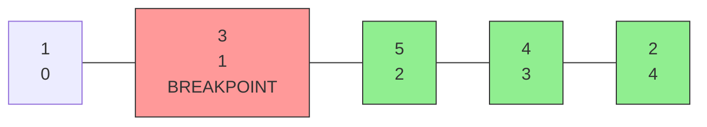

# Next Permutation

## Problem Link
🔗 [LeetCode 31 — Next Permutation](https://leetcode.com/problems/next-permutation/)

---

## What is this Problem?

Given an array of integers `nums`, rearrange it into the **lexicographically next greater permutation** of its elements, **in-place**. If no such permutation exists (array is the highest possible permutation), rearrange to the **lowest possible order** (sorted ascending).

**Examples:**
```
nums = [1, 2, 3]
Output: [1, 3, 2]

nums = [3, 2, 1]
Output: [1, 2, 3]   ← already the highest, wrap around to lowest

nums = [1, 1, 5]
Output: [1, 5, 1]

nums = [1, 3, 2]
Output: [2, 1, 3]
```

---

## The Problem Explained

Think of it like a **digital odometer with digits that must use the same set of numbers**:

```
All permutations of [1,2,3] in sorted order:
  123 → 132 → 213 → 231 → 312 → 321 → (back to 123)

Given 123, the next one is 132.
Given 321 (the largest), wrap around to 123 (the smallest).

The question: given ANY permutation, find its immediate successor
in this sorted list — WITHOUT generating all permutations.
```

**Key idea:** To get the *next* permutation, make the **smallest possible increase**. This means: change as little as possible, as late (right) as possible in the array.

---

## HOOK TO REMEMBER FOREVER

**"FIND THE BREAKPOINT FROM THE RIGHT, SWAP WITH JUST-LARGER, REVERSE THE TAIL"**

Every time you see "next permutation":
- ✅ Step 1: Scan from the right, find the first index `ind` where `nums[ind] < nums[ind+1]` (the "breakpoint")
- ✅ If no such index exists → array is the highest permutation → reverse entire array → done
- ✅ Step 2: From the right, find the first element `> nums[ind]` and swap it with `nums[ind]`
- ✅ Step 3: Reverse everything after index `ind` (the suffix is in descending order — reverse makes it the smallest arrangement)
- ✅ O(n) time, O(1) space

**Remember: The suffix after the breakpoint is always in DESCENDING order. That's how you find the breakpoint — it's the last place the descending pattern breaks!** 🔢

---

## The Core Insight — Why This Works

```
Take nums = [1, 2, 3]

Look from the RIGHT for where the sequence stops being
"non-increasing" (i.e., where nums[i] < nums[i+1]):

  index 2: nums[2]=3            (last element, no comparison)
  index 1: nums[1]=2 < nums[2]=3 → FOUND! ind=1

Everything AFTER index 1 (just "3") is the longest
DESCENDING suffix. This suffix is already at its
LARGEST possible arrangement — it can't get any bigger.

To get the NEXT permutation, we must increase nums[ind]=2
by swapping it with the SMALLEST element in the suffix
that is STILL LARGER than it. Here, that's 3.

After swap: [1, 3, 2]

The suffix after ind is still descending (just "2") —
reverse it to make it the smallest arrangement (no-op here).

Result: [1, 3, 2] ✓ (the immediate next permutation)
```

## How It Works Step By Step

### Example: `[1, 3, 5, 4, 2]` → Next Permutation

**Step 1 — Find the breakpoint (scanning from the right):**

```
Index:   0  1  2  3  4
nums:    1  3  5  4  2

i=3: nums[3]=4, nums[4]=2. Is 4 < 2? NO.
i=2: nums[2]=5, nums[3]=4. Is 5 < 4? NO.
i=1: nums[1]=3, nums[2]=5. Is 3 < 5? YES! ind=1. STOP.
```



The suffix `[5,4,2]` (indices 2-4) is in descending order — already maximal.

**Step 2 — Find the smallest element in the suffix that's greater than `nums[ind]=3`:**

```
Scan from the right (suffix is descending, so first match found
from the right is the SMALLEST element greater than nums[ind]):

i=4: nums[4]=2. Is 2 > 3? NO.
i=3: nums[3]=4. Is 4 > 3? YES! Swap with index 1.
```

```
Before swap: [1, 3, 5, 4, 2]
After swap:  [1, 4, 5, 3, 2]
                 ↑        ↑
              was 3     was 4
```

**Step 3 — Reverse everything after `ind`:**

```
Before reverse: [1, 4, 5, 3, 2]
                       └──┬──┘
                    reverse this part

After reverse:  [1, 4, 2, 3, 5]
```

**Result: `[1, 4, 2, 3, 5]` ✓**

---

## Code Full Solution

```cpp
class Solution {
public:
    void nextPermutation(vector<int>& nums) {
        int n = nums.size();
        int ind = -1;

        // Step 1: Find the breakpoint from the right
        for (int i = n - 2; i >= 0; i--) {
            if (nums[i] < nums[i + 1]) {
                ind = i;
                break;
            }
        }

        // If no breakpoint found, this is the highest permutation
        if (ind == -1) {
            reverse(nums.begin(), nums.end());
            return;
        }

        // Step 2: Find the smallest element > nums[ind] from the right, swap
        for (int i = n - 1; i > ind; i--) {
            if (nums[i] > nums[ind]) {
                swap(nums[i], nums[ind]);
                break;
            }
        }

        // Step 3: Reverse the suffix after ind
        reverse(nums.begin() + ind + 1, nums.end());
    }
};
```

---

## Code Explanation

### Step 1 — Find the Breakpoint

```cpp
int ind = -1;
for (int i = n - 2; i >= 0; i--) {
    if (nums[i] < nums[i + 1]) {
        ind = i;
        break;
    }
}
```

**Why start from `n-2` and scan leftward?**
```
We're looking for the LONGEST descending suffix.
A descending suffix means: nums[i] >= nums[i+1] for all i in that range.

Scanning from the right, the moment we find nums[i] < nums[i+1],
we've found where the descending pattern BREAKS.
Everything to the right of i (inclusive of i+1) is descending.

ind = that breakpoint index.
```

**Why `break` immediately?**
```
We want the RIGHTMOST breakpoint — the smallest possible change.
The first one found scanning right-to-left IS the rightmost. ✓
```

---

### Handle the "No Breakpoint" Case

```cpp
if (ind == -1) {
    reverse(nums.begin(), nums.end());
    return;
}
```

```
If ind stays -1, the ENTIRE array is descending.
This means nums is the LARGEST possible permutation
(e.g., [3,2,1] for the set {1,2,3}).

The problem says: wrap around to the SMALLEST permutation.
A fully descending array, when reversed, becomes fully ascending
— which is the smallest permutation. ✓

Example: [3,2,1] → reverse → [1,2,3]
```

---

### Step 2 — Find and Swap

```cpp
for (int i = n - 1; i > ind; i--) {
    if (nums[i] > nums[ind]) {
        swap(nums[i], nums[ind]);
        break;
    }
}
```

**Why scan from the right again?**
```
The suffix (ind+1 to n-1) is DESCENDING.
Scanning from the right means we encounter elements
in ASCENDING order (right to left through a descending array
= ascending order of values).

The FIRST element greater than nums[ind] that we find
(scanning right to left) is the SMALLEST element in the
suffix that's still bigger than nums[ind].

This gives the SMALLEST POSSIBLE INCREASE — exactly
what "next permutation" requires. ✓
```

**Why must such an element always exist?**
```
By definition of ind: nums[ind] < nums[ind+1].
nums[ind+1] is part of the suffix and is greater than nums[ind].
So at minimum, nums[ind+1] itself satisfies the condition.
The loop is guaranteed to find a swap candidate. ✓
```

---

### Step 3 — Reverse the Suffix

```cpp
reverse(nums.begin() + ind + 1, nums.end());
```

**Why reverse, and why does this give the SMALLEST arrangement?**
```
After the swap, the suffix (ind+1 to n-1) is STILL in
descending order (swapping doesn't change this — both swapped
elements maintain relative order within the descending sequence).

A descending sequence reversed becomes ASCENDING.
The ascending arrangement of a fixed set of elements is
the SMALLEST possible arrangement of those elements.

We want the overall result to be the NEXT permutation —
meaning: minimal increase at nums[ind], and the SMALLEST
possible suffix after that. Reversing achieves both. ✓
```

---

## Complete Example Traces

### Trace 1: Simple Case

```
nums = [1, 2, 3]

Step 1: i=1: nums[1]=2 < nums[2]=3 → ind=1
Step 2: i=2: nums[2]=3 > nums[1]=2 → swap → [1, 3, 2]
Step 3: reverse(index 2 to end) → [1, 3, 2] (single element, no change)

Return [1, 3, 2] ✓
```

### Trace 2: Highest Permutation — Wrap Around

```
nums = [3, 2, 1]

Step 1: i=1: nums[1]=2 < nums[2]=1? NO.
        i=0: nums[0]=3 < nums[1]=2? NO.
        ind stays -1.

ind == -1 → reverse entire array → [1, 2, 3]

Return [1, 2, 3] ✓
```

### Trace 3: Breakpoint in the Middle

```
nums = [1, 3, 5, 4, 2]

Step 1: i=3: 4 < 2? NO.
        i=2: 5 < 4? NO.
        i=1: 3 < 5? YES → ind=1

Step 2: i=4: nums[4]=2 > nums[1]=3? NO.
        i=3: nums[3]=4 > nums[1]=3? YES → swap(3,1)
        → [1, 4, 5, 3, 2]

Step 3: reverse(index 2 to 4) → reverse([5,3,2]) → [2,3,5]
        → [1, 4, 2, 3, 5]

Return [1, 4, 2, 3, 5] ✓
```

### Trace 4: Duplicates

```
nums = [1, 1, 5]

Step 1: i=1: nums[1]=1 < nums[2]=5? YES → ind=1

Step 2: i=2: nums[2]=5 > nums[1]=1? YES → swap(2,1)
        → [1, 5, 1]

Step 3: reverse(index 2 to 2) → [1] (single element, no change)
        → [1, 5, 1]

Return [1, 5, 1] ✓
```

### Trace 5: Breakpoint at Index 0

```
nums = [1, 3, 2]

Step 1: i=1: nums[1]=3 < nums[2]=2? NO.
        i=0: nums[0]=1 < nums[1]=3? YES → ind=0

Step 2: i=2: nums[2]=2 > nums[0]=1? YES → swap(2,0)
        → [2, 3, 1]

Step 3: reverse(index 1 to 2) → reverse([3,1]) → [1,3]
        → [2, 1, 3]

Return [2, 1, 3] ✓
```

### Trace 6: Two Elements

```
nums = [1, 2]
Step 1: i=0: nums[0]=1 < nums[1]=2? YES → ind=0
Step 2: i=1: nums[1]=2 > nums[0]=1? YES → swap → [2, 1]
Step 3: reverse(index 1 to 1) → no change

Return [2, 1] ✓
```

```
nums = [2, 1]
Step 1: i=0: nums[0]=2 < nums[1]=1? NO. ind=-1.
reverse entire array → [1, 2]

Return [1, 2] ✓
```

### Trace 7: All Same Elements

```
nums = [2, 2, 2]

Step 1: i=1: nums[1]=2 < nums[2]=2? NO (not strictly less).
        i=0: nums[0]=2 < nums[1]=2? NO.
        ind=-1.

reverse entire array → [2, 2, 2] (no visible change)

Return [2, 2, 2] ✓  (only one possible permutation of identical elements)
```

---

## Edge Cases

### Case 1: Single Element

```
Input: [5]
Loop for i=n-2=-1 doesn't run (range is empty).
ind=-1 → reverse([5]) → [5]
Output: [5] ✓
```

### Case 2: Two Elements, Ascending

```
Input: [1, 2]
ind=0 found. Swap → [2,1]. Reverse suffix (just 1 elem) → [2,1].
Output: [2, 1] ✓
```

### Case 3: Two Elements, Descending

```
Input: [2, 1]
No breakpoint. Reverse → [1, 2].
Output: [1, 2] ✓
```

### Case 4: All Duplicates

```
Input: [1, 1, 1]
No breakpoint (1 < 1 is always false).
Reverse → [1, 1, 1] (no change).
Output: [1, 1, 1] ✓
```

---

## Time Complexity

- **O(n)** — three linear scans, each at most O(n)
- Step 1: O(n) — scan for breakpoint
- Step 2: O(n) — scan for swap candidate
- Step 3: O(n) — reverse the suffix
- Total: **O(n)**

---

## Space Complexity

- **O(1)** — in-place modification
- Only the integer `ind` used as extra space
- `reverse()` operates in-place
- Total: **O(1)**

---

## Key Insights

### Why the Suffix After `ind` is Always Descending

```
By definition, ind is the RIGHTMOST index where nums[i] < nums[i+1].

This means for all indices j > ind:
  nums[j] >= nums[j+1]   (otherwise j would be a later breakpoint)

So the entire suffix from ind+1 to n-1 is non-increasing
(descending or equal) — it's already at its MAXIMUM
possible arrangement for that set of values.

To get a bigger permutation overall, we MUST change
something at or before ind. Changing the suffix alone
can't produce anything larger — it's already maximal. ✓
```

### Why Swap with the SMALLEST Greater Element

```
We want the NEXT permutation — the smallest increase possible.

If we swapped nums[ind] with a LARGER-than-necessary element
from the suffix, the result would jump too far ahead,
skipping valid permutations in between.

Example: nums = [1, 5, 3, 2]  (ind=0, nums[ind]=1)
  Suffix = [5,3,2]. Elements > 1: 5, 3, 2 (all of them).

  Swap with 5 (too big): [5,1,3,2] → way too large a jump
  Swap with 2 (smallest > 1): [2,1,3,5]? wait let's verify ind

Actually for [1,5,3,2]: i=2: nums[2]=3<nums[3]=2? NO.
  i=1: nums[1]=5<nums[2]=3? NO.
  i=0: nums[0]=1<nums[1]=5? YES → ind=0

Scan from right for first > nums[0]=1:
  i=3: nums[3]=2 > 1? YES → swap with index 0!
  → [2, 5, 3, 1]
  reverse suffix (index 1-3, currently [5,3,1]) → [1,3,5]
  → [2, 1, 3, 5]

This is the smallest possible increase from [1,5,3,2]. ✓
Swapping with 2 (not 5 or 3) gives the minimal jump.
```

### The Three Steps Mirror "Increment an Odometer"

```
Think of digits 0-9 on an odometer, but with a FIXED set of digits
that must all be reused (a permutation).

To increment:
  1. Find the rightmost digit that CAN be increased
     (i.e., there's a larger digit somewhere to its right)
  2. Replace it with the SMALLEST larger digit available
  3. Arrange everything after it in the SMALLEST possible order
     (ascending — hence the reverse of the descending suffix)

This is EXACTLY next permutation. ✓
```

### Connection to Lexicographic Ordering

```
"Lexicographic" = dictionary order, applied to sequences of numbers.

[1,2,3] < [1,3,2] < [2,1,3] < [2,3,1] < [3,1,2] < [3,2,1]

This algorithm finds the immediate successor in this ordering
without generating all n! permutations — O(n) instead of O(n!). ✓
```

---

## References

- 🔗 [LeetCode 31 — Next Permutation](https://leetcode.com/problems/next-permutation/)