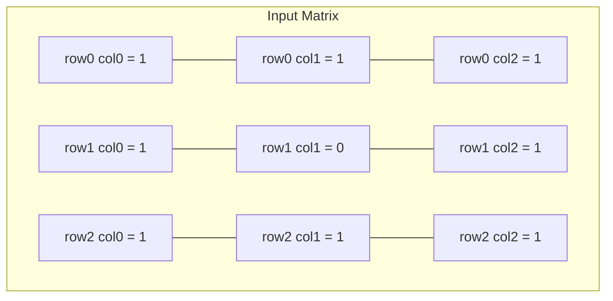
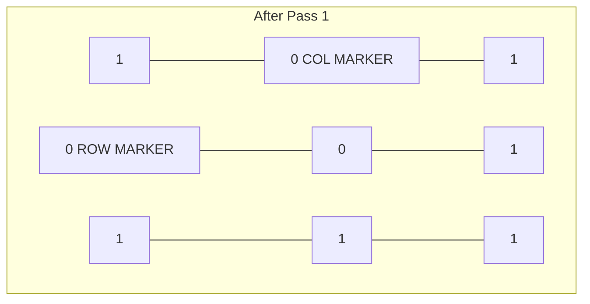
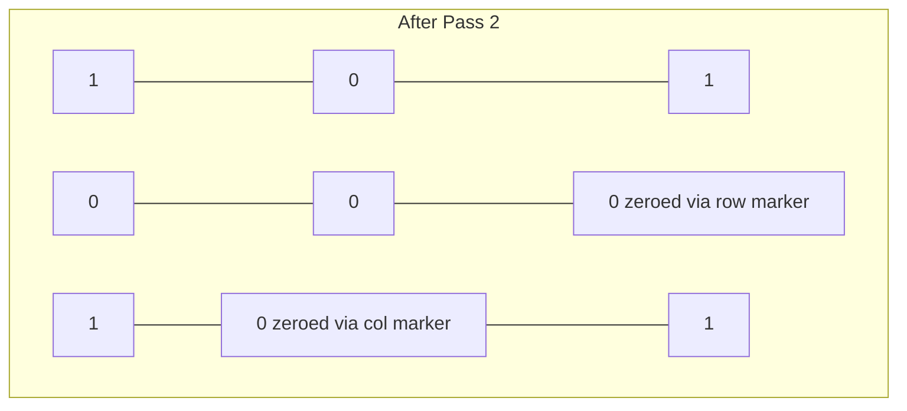
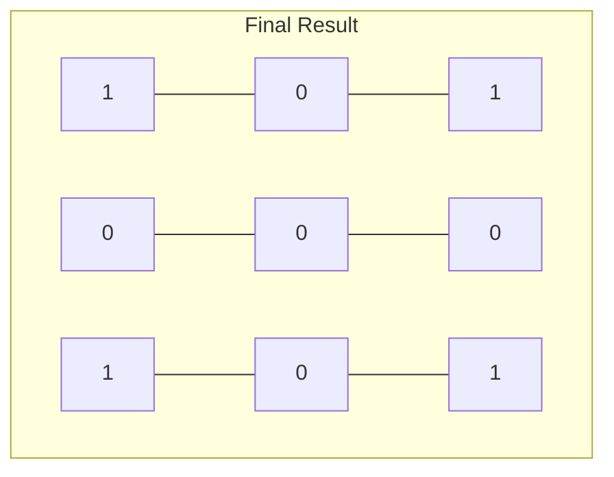
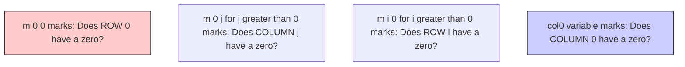

# Set Matrix Zeroes

## Problem Link
🔗 [LeetCode 73 — Set Matrix Zeroes](https://leetcode.com/problems/set-matrix-zeroes/)

---

## What is this Problem?

Given an `m x n` matrix, if an element is `0`, set its **entire row and column** to `0`. Do this **in-place**, using **O(1) extra space**.

**Examples:**
```
Input:               Output:
[[1,1,1],            [[1,0,1],
 [1,0,1],             [0,0,0],
 [1,1,1]]             [1,0,1]]

Input:               Output:
[[0,1,2,0],          [[0,0,0,0],
 [3,4,5,2],           [0,4,5,0],
 [1,3,1,5]]           [0,3,1,0]]
```

---

## The Problem Explained

Think of it like **spilled ink spreading across rows and columns**:

```
Original:           Cell (1,1) = 0 means:
[1, 1, 1]             → Wipe out ENTIRE row 1
[1, 0, 1]             → Wipe out ENTIRE column 1
[1, 1, 1]

Result:
[1, 0, 1]
[0, 0, 0]
[1, 0, 1]
```

**The naive approach:**
```
Make a copy of the matrix. Scan the copy for zeros.
For each zero found, zero out the row/column in the ORIGINAL.

Why a copy? Because if you zero out cells as you find them,
you create NEW zeros, which would incorrectly trigger
more row/column wipes!

Naive: O(m×n) extra space for the copy.
```

**Key idea (O(1) space):** Instead of a separate copy, use the **first row and first column of the matrix itself** as markers. The matrix becomes its own "scratch space."

---

## HOOK TO REMEMBER FOREVER

**"FIRST ROW/COL ARE YOUR MARKERS. col0 IS THE SPECIAL FLAG FOR CELL (0,0)."**

Every time you see "in-place row/column zeroing with O(1) space":
- ✅ Use `m[0][j]` as the marker for "column j has a zero somewhere"
- ✅ Use `m[i][0]` as the marker for "row i has a zero somewhere"
- ✅ **Problem:** `m[0][0]` can't mark BOTH row 0 AND column 0 → use a separate `col0` variable for column 0
- ✅ Pass 1: scan matrix, set markers in row 0 and column 0
- ✅ Pass 2: for cells (1,1) onward, zero out based on markers
- ✅ Pass 3: handle row 0 using `m[0][0]`, handle column 0 using `col0`
- ✅ O(m×n) time, O(1) space

**Remember: The matrix's own border becomes the "visited" tracker. The ONLY conflict is cell (0,0) — that's why `col0` exists as a separate variable!** 🎯

---

## The Core Challenge — Why `col0` is Needed

```
m[0][0] is at the intersection of row 0 and column 0.

If we use m[0][0] to mark "row 0 has a zero":
  Then we CAN'T also use it to mark "column 0 has a zero"
  — one cell, two jobs, conflict!

Solution: 
  m[0][0] → marks ROW 0 (does row 0 contain a zero?)
  col0    → separate variable, marks COLUMN 0 (does column 0 contain a zero?)

This is the ONLY special case in the entire algorithm.
Everything else uses the matrix itself as storage. ✓
```

---

## How It Works Step By Step

### Input Matrix



```
m = [[1,1,1],
     [1,0,1],
     [1,1,1]]

m[1][1] = 0 → row 1 and column 1 must become all 0s.
```

### Pass 1 — Mark Row 0 and Column 0

```
For each cell m[i][j] == 0:
  Set m[i][0] = 0   (mark its row)
  If j==0: col0 = 0  (mark column 0 separately)
  Else:    m[0][j] = 0  (mark its column using row 0)

i=0,j=0: m[0][0]=1, not 0, skip
i=0,j=1: m[0][1]=1, skip
i=0,j=2: m[0][2]=1, skip
i=1,j=0: m[1][0]=1, skip
i=1,j=1: m[1][1]=0!
  → m[1][0] = 0   (mark row 1)
  → j=1≠0 → m[0][1] = 0  (mark column 1)
i=1,j=2: m[1][2]=1, skip
i=2,*: all 1s, skip

After Pass 1:
m = [[1, 0, 1],     ← m[0][1]=0 marks "column 1 has a zero"
     [0, 0, 1],     ← m[1][0]=0 marks "row 1 has a zero"
     [1, 1, 1]]

col0 = 1 (unchanged — column 0 never had a zero)
```



### Pass 2 — Zero Out Inner Cells Based on Markers

```
For i=1 to rows-1, j=1 to cols-1:
  if m[i][j] != 0 and (m[0][j]==0 OR m[i][0]==0):
    m[i][j] = 0

i=1,j=1: m[1][1]=0 already, skip (the if checks m[i][j]!=0)
i=1,j=2: m[1][2]=1. Check m[0][2]=1 and m[1][0]=0 → m[i][0]==0 → SET TO 0!
i=2,j=1: m[2][1]=1. Check m[0][1]=0 → SET TO 0!
i=2,j=2: m[2][2]=1. Check m[0][2]=1 and m[2][0]=1 → neither marker → stays 1

After Pass 2:
m = [[1, 0, 1],
     [0, 0, 0],
     [1, 0, 1]]
```



### Pass 3 — Fix Row 0 and Column 0

```
Check m[0][0]:
  m[0][0] = 1 (unchanged) → row 0 does NOT need zeroing entirely
  (skip the row-0 zeroing block)

Check col0:
  col0 = 1 (unchanged) → column 0 does NOT need zeroing entirely
  (skip the column-0 zeroing block)

Final matrix:
m = [[1, 0, 1],
     [0, 0, 0],
     [1, 0, 1]] ✓
```



---

## Code Full Solution

```cpp
class Solution {
public:
    void setZeroes(vector<vector<int>>& m) {
        int rown = m.size();
        int colm = m[0].size();
        int col0 = 1;

        // Pass 1: Mark using first row and first column
        for (int i = 0; i < rown; i++) {
            for (int j = 0; j < colm; j++) {
                if (m[i][j] == 0) {
                    m[i][0] = 0;
                    if (j == 0) {
                        col0 = 0;
                    } else {
                        m[0][j] = 0;
                    }
                }
            }
        }

        // Pass 2: Zero out inner cells based on markers
        for (int i = 1; i < rown; i++) {
            for (int j = 1; j < colm; j++) {
                if (m[i][j] != 0) {
                    if (m[0][j] == 0 || m[i][0] == 0) {
                        m[i][j] = 0;
                    }
                }
            }
        }

        // Pass 3a: Fix row 0
        if (m[0][0] == 0) {
            for (int j = 0; j < colm; j++) {
                m[0][j] = 0;
            }
        }

        // Pass 3b: Fix column 0
        if (col0 == 0) {
            for (int i = 0; i < rown; i++) {
                m[i][0] = 0;
            }
        }
    }
};
```

---

## Code Explanation

### Pass 1 — Building the Markers

```cpp
if (m[i][j] == 0) {
    m[i][0] = 0;
    if (j == 0) {
        col0 = 0;
    } else {
        m[0][j] = 0;
    }
}
```

**Three things happen when a zero is found at `(i, j)`:**

```
1. m[i][0] = 0
   "Row i contains a zero" — mark the start of this row.
   This works even if j==0 (m[i][0] is the zero itself, marking itself).

2. If j == 0:
   This zero IS in column 0. We can't safely write to m[0][0]
   because m[0][0] is reserved for marking ROW 0.
   So we use the separate variable col0 = 0 instead.

3. If j != 0:
   "Column j contains a zero" — mark it using m[0][j].
   This is safe because m[0][j] for j>0 doesn't conflict with anything.
```

---

### Pass 2 — Propagating the Markers

```cpp
for (int i = 1; i < rown; i++) {
    for (int j = 1; j < colm; j++) {
        if (m[i][j] != 0) {
            if (m[0][j] == 0 || m[i][0] == 0) {
                m[i][j] = 0;
            }
        }
    }
}
```

**Why start from `i=1, j=1`?**
```
Row 0 and column 0 are RESERVED as marker storage.
We must NOT overwrite them yet — Pass 3 still needs to read them
(m[0][0] and col0 determine whether to wipe row 0 / column 0).

Only cells (1,1) onward are "real" data cells in this pass.
```

**The condition `m[0][j] == 0 || m[i][0] == 0`:**
```
m[0][j] == 0  → column j was marked as having a zero → wipe this cell
m[i][0] == 0  → row i was marked as having a zero    → wipe this cell

Either condition is enough — OR, not AND.
```

**Why check `m[i][j] != 0` first?**
```
This is a minor optimization — avoids redundant writes
to cells that are already 0. Functionally, writing 0 to 0
wouldn't change correctness, but the check skips unnecessary work.
```

---

### Pass 3a — Fix Row 0

```cpp
if (m[0][0] == 0) {
    for (int j = 0; j < colm; j++) {
        m[0][j] = 0;
    }
}
```

```
m[0][0] was our marker for "does row 0 contain a zero?"
  - If m[0][0] itself was originally 0, OR pass 1's
    "m[i][0]=0" rule applied with i=0
  - Then m[0][0]==0 means row 0 needs to be entirely zeroed.

Loop zeroes the ENTIRE row 0, including m[0][0] itself
(redundant but harmless — it's already 0).
```

---

### Pass 3b — Fix Column 0

```cpp
if (col0 == 0) {
    for (int i = 0; i < rown; i++) {
        m[i][0] = 0;
    }
}
```

```
col0 was set to 0 during Pass 1 ONLY if some m[i][0]==0
in the ORIGINAL matrix (a zero was found in column 0).

If col0==0, zero out the entire column 0 (including m[0][0]).
```

**Does the order of 3a and 3b matter?**
```
Both write 0s and don't depend on each other's writes
to DIFFERENT cells — m[0][0] could be written by BOTH passes,
but writing 0 twice is harmless. Order between 3a and 3b
is interchangeable. ✓

What DOES matter: Pass 3 must run AFTER Pass 2,
because Pass 2 reads m[0][j] and m[i][0] as markers.
If Pass 3 ran first, it would destroy the markers
before Pass 2 could use them.
```

---

## Complete Example Traces

### Trace 1: Single Zero in Middle

```
m = [[1,1,1],
     [1,0,1],
     [1,1,1]]

Pass 1: m[1][1]=0 found.
  m[1][0]=0 (mark row 1)
  j=1≠0 → m[0][1]=0 (mark column 1)
  col0 stays 1

After Pass 1:
m = [[1,0,1],
     [0,0,1],
     [1,1,1]]

Pass 2 (i=1..2, j=1..2):
  (1,1): m[1][1]=0, skip (already 0)
  (1,2): m[1][2]=1. m[1][0]=0 → set m[1][2]=0
  (2,1): m[2][1]=1. m[0][1]=0 → set m[2][1]=0
  (2,2): m[2][2]=1. m[0][2]=1, m[2][0]=1 → no change

After Pass 2:
m = [[1,0,1],
     [0,0,0],
     [1,0,1]]

Pass 3a: m[0][0]=1 → skip
Pass 3b: col0=1 → skip

Final:
m = [[1,0,1],
     [0,0,0],
     [1,0,1]] ✓
```

### Trace 2: Zero at (0,0)

```
m = [[0,1,2],
     [3,4,5],
     [6,7,8]]

Pass 1: m[0][0]=0 found.
  m[0][0]=0 (mark row 0 — writes to itself)
  j=0 → col0=0

No other zeros.

After Pass 1:
m = [[0,1,2],
     [3,4,5],
     [6,7,8]]  (m[0][0] was already 0, no visible change)

Pass 2 (i=1..2, j=1..2):
  m[0][j] for j=1,2 are 1,2 (not 0) → no column markers
  m[i][0] for i=1,2 are 3,6 (not 0) → no row markers
  → no cells zeroed

Pass 3a: m[0][0]==0 → zero entire row 0
  m = [[0,0,0],
       [3,4,5],
       [6,7,8]]

Pass 3b: col0==0 → zero entire column 0
  m = [[0,0,0],
       [0,4,5],
       [0,7,8]]

Final:
m = [[0,0,0],
     [0,4,5],
     [0,7,8]] ✓
```

### Trace 3: Multiple Zeros

```
m = [[0,1,2,0],
     [3,4,5,2],
     [1,3,1,5]]

Pass 1:
  (0,0)=0: m[0][0]=0, j==0 → col0=0
  (0,3)=0: m[0][0]=0 (again, no-op), j=3≠0 → m[0][3]=0

After Pass 1:
m = [[0,1,2,0],
     [3,4,5,2],
     [1,3,1,5]]
col0=0

Pass 2 (i=1..2, j=1..3):
  (1,1): m[0][1]=1, m[1][0]=3 → neither 0 → no change
  (1,2): m[0][2]=2, m[1][0]=3 → no change
  (1,3): m[0][3]=0 → ZERO → m[1][3]=0
  (2,1): m[0][1]=1, m[2][0]=1 → no change
  (2,2): m[0][2]=2, m[2][0]=1 → no change
  (2,3): m[0][3]=0 → ZERO → m[2][3]=0

After Pass 2:
m = [[0,1,2,0],
     [3,4,5,0],
     [1,3,1,0]]

Pass 3a: m[0][0]=0 → zero entire row 0
  m = [[0,0,0,0],
       [3,4,5,0],
       [1,3,1,0]]

Pass 3b: col0=0 → zero entire column 0
  m = [[0,0,0,0],
       [0,4,5,0],
       [0,3,1,0]]

Final:
m = [[0,0,0,0],
     [0,4,5,0],
     [0,3,1,0]] ✓
```

### Trace 4: No Zeros

```
m = [[1,2],[3,4]]

Pass 1: no zeros found. col0 stays 1. m unchanged.
Pass 2: m[0][j] and m[i][0] all nonzero → no changes.
Pass 3a: m[0][0]=1 → skip
Pass 3b: col0=1 → skip

Final: m = [[1,2],[3,4]] ✓ (unchanged)
```

### Trace 5: Entire First Row and Column Already Contain Zeros

```
m = [[0,0],
     [0,1]]

Pass 1:
  (0,0)=0: m[0][0]=0, j==0 → col0=0
  (0,1)=0: m[0][0]=0 (no-op), j=1≠0 → m[0][1]=0
  (1,0)=0: m[1][0]=0, j==0 → col0=0 (already 0)

After Pass 1: m unchanged (all already correct values)
col0=0

Pass 2 (i=1,j=1):
  m[1][1]=1. m[0][1]=0 → ZERO → m[1][1]=0

After Pass 2:
m = [[0,0],
     [0,0]]

Pass 3a: m[0][0]=0 → zero row 0 (no-op, already 0)
Pass 3b: col0=0 → zero column 0 (no-op, already 0)

Final: m = [[0,0],[0,0]] ✓
```

---

## Edge Cases

### Case 1: Single Cell

```
Input: [[0]]
Pass 1: m[0][0]=0 → m[0][0]=0, col0=0
Pass 2: loop doesn't run (no i=1, j=1 for 1x1)
Pass 3a: m[0][0]==0 → zero row 0 → [[0]]
Pass 3b: col0==0 → zero col 0 → [[0]]
Output: [[0]] ✓
```

### Case 2: Single Row

```
Input: [[1,0,3]]
Pass 1: (0,1)=0 → m[0][0]=0, j≠0 → m[0][1]=0
After: [[0,0,3]]
Pass 2: loop doesn't run (no i=1 for 1 row)
Pass 3a: m[0][0]==0 → zero entire row 0 → [[0,0,0]]
Pass 3b: col0==1 → skip
Output: [[0,0,0]] ✓
```

### Case 3: Single Column

```
Input: [[1],[0],[3]]
Pass 1: (1,0)=0 → m[1][0]=0, j==0 → col0=0
Pass 2: loop doesn't run (no j=1 for 1 column)
Pass 3a: m[0][0]==1 → skip
Pass 3b: col0==0 → zero entire column 0 → [[0],[0],[0]]
Output: [[0],[0],[0]] ✓
```

### Case 4: All Zeros

```
Input: [[0,0],[0,0]]
Pass 1: every cell is 0. m[0][0]=0 multiple times, col0=0, m[0][1]=0.
Pass 2: m[0][j]==0 for all j → all inner cells zeroed (already 0).
Pass 3a & 3b: both trigger, zero row 0 and column 0 (already 0).
Output: [[0,0],[0,0]] ✓
```

---

## Time Complexity

- **O(m × n)** — three passes, each O(m×n) or less
- Pass 1: O(m×n)
- Pass 2: O((m-1)×(n-1))
- Pass 3: O(m) + O(n)
- Total: **O(m × n)**

---

## Space Complexity

- **O(1)** — no extra array
- The matrix's own first row and column serve as marker storage
- One extra variable: `col0`
- Total: **O(1)**

---

## Key Insights

### Why Not Just Use Two Boolean Arrays (rows[], cols[])?

```
Simple approach:
  vector<bool> rowZero(m, false), colZero(n, false);
  Pass 1: mark rowZero[i] and colZero[j] for every zero found.
  Pass 2: zero out m[i][j] if rowZero[i] or colZero[j].

  Time: O(m×n)   Space: O(m+n)

This is simpler to understand but uses O(m+n) extra space.

The in-place version reuses m[0][...] and m[...][0]
as those exact boolean arrays — reducing space to O(1)
at the cost of the col0 special case. ✓
```

### Why Pass 2 Must Come Before Pass 3

```
Pass 2 relies on READING m[0][j] and m[i][0] as markers.

If Pass 3 ran first:
  It might zero out row 0 or column 0 entirely,
  destroying the markers BEFORE Pass 2 can read them.

  Example: if m[0][0]==0 triggers zeroing row 0 first,
  then m[0][5] (a column marker) becomes 0 regardless
  of whether column 5 actually had a zero — false positives!

Strict order: Pass 1 (write markers) → Pass 2 (read markers,
write data) → Pass 3 (read markers one last time, then
overwrite markers themselves). ✓
```

### The `col0` Trick Generalizes

```
Any time you need TWO pieces of "marker" information
but only have ONE shared storage cell, you need an
extra variable for one of them.

This pattern (using array boundaries as scratch space,
plus one extra variable for the corner conflict) appears
in various in-place matrix problems where O(1) space
is required but a natural marker location is shared.
```

### Visualizing the Marker Roles



Four roles, three of them live inside the matrix itself, one lives in a separate variable — purely because of the corner conflict at `(0,0)`.

---

## References

- 🔗 [LeetCode 73 — Set Matrix Zeroes](https://leetcode.com/problems/set-matrix-zeroes/)