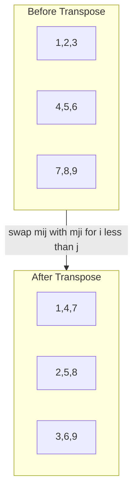
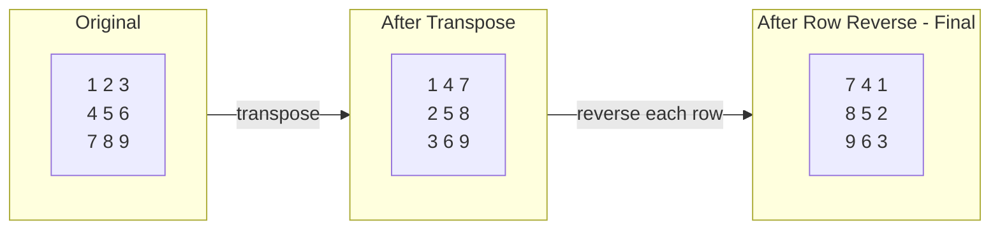
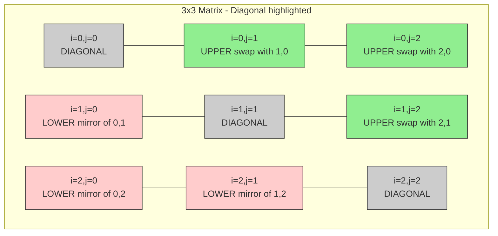

# Rotate Image

## Problem Link
🔗 [LeetCode 48 — Rotate Image](https://leetcode.com/problems/rotate-image/)

---

## What is this Problem?

Given an `n x n` 2D matrix representing an image, rotate the image by **90 degrees clockwise**, **in-place** (O(1) extra space).

**Examples:**
```
Input:               Output:
[[1,2,3],            [[7,4,1],
 [4,5,6],             [8,5,2],
 [7,8,9]]             [9,6,3]]

Input:               Output:
[[5,1,9,11],         [[15,13,2,5],
 [2,4,8,10],          [14,3,4,1],
 [13,3,6,7],          [12,6,8,9],
 [15,14,12,16]]       [16,7,10,11]]
```

---

## The Problem Explained

Think of it like **physically rotating a printed photo 90° clockwise**:

```
Before:          After (rotate 90° CW):
1 2 3             7 4 1
4 5 6      →      8 5 2
7 8 9             9 6 3

Notice:
  - Column 0 (1,4,7) reversed → becomes Row 0 (7,4,1)
  - Column 1 (2,5,8) reversed → becomes Row 1 (8,5,2)
  - Column 2 (3,6,9) reversed → becomes Row 2 (9,6,3)

Each COLUMN (read bottom to top) becomes a ROW (read left to right)
```

**The two-step trick:** A 90° clockwise rotation = **Transpose** + **Reverse each row**.

```
Step 1 — Transpose (flip across the main diagonal):
1 2 3        1 4 7
4 5 6   →    2 5 8
7 8 9        3 6 9

Step 2 — Reverse each row:
1 4 7        7 4 1
2 5 8   →    8 5 2
3 6 9        9 6 3
                ↑
        This IS the 90° CW rotation! ✓
```

---

## HOOK TO REMEMBER FOREVER

**"TRANSPOSE THEN REVERSE EACH ROW = ROTATE 90° CLOCKWISE"**

Every time you see "rotate matrix 90° in-place":
- ✅ **Transpose:** swap `m[i][j]` with `m[j][i]` for all `i < j` (upper triangle only!)
- ✅ **Reverse:** reverse each row of the matrix
- ✅ For **counter-clockwise** rotation: reverse each row FIRST, then transpose (or transpose then reverse columns)
- ✅ O(n²) time, O(1) space — in-place, no extra matrix

**Remember: Transpose flips along the diagonal. Reversing rows then "completes the spin" to clockwise. Two simple operations, zero extra space!** 🔄

---

## Why Transpose + Row-Reverse = 90° Clockwise

```
Take element at position (i, j) in the original matrix.

After transpose: element moves to (j, i)
After row-reverse: element at (j, i) in a row of length n
                     moves to (j, n-1-i)

So overall: (i, j) → (j, n-1-i)

Verify with the 90° clockwise rotation formula:
  new_row = j
  new_col = n-1-i

This matches the standard rotation formula! ✓

Example: n=3, element at (0,0)=1
  → (0, 2)  →  in output, position (0,2) = 1 ✓ (top-left becomes top-right)
```

---

## Mermaid — Transpose Visualization



```
Original:        Transposed (swap across diagonal):
1 2 3            1 4 7
4 5 6     →      2 5 8
7 8 9            3 6 9

Diagonal elements (1,5,9) stay in place.
Off-diagonal pairs swap: (0,1)↔(1,0), (0,2)↔(2,0), (1,2)↔(2,1)
```

---

## How It Works Step By Step

### Input

```
m = [[1,2,3],
     [4,5,6],
     [7,8,9]]
n = 3
```

### Step 1 — Transpose (Upper Triangle Swaps Only)

```cpp
for (int i = 0; i < n-1; i++) {
    for (int j = i+1; j < n; j++) {
        swap(m[i][j], m[j][i]);
    }
}
```

```
i=0:
  j=1: swap(m[0][1], m[1][0]) → swap(2,4)
       m = [[1,4,3],
            [2,5,6],
            [7,8,9]]
  j=2: swap(m[0][2], m[2][0]) → swap(3,7)
       m = [[1,4,7],
            [2,5,6],
            [3,8,9]]

i=1:
  j=2: swap(m[1][2], m[2][1]) → swap(6,8)
       m = [[1,4,7],
            [2,5,8],
            [3,6,9]]

i=2: j starts at 3, loop doesn't run (j < n=3 fails immediately)

After transpose:
m = [[1,4,7],
     [2,5,8],
     [3,6,9]]
```

### Step 2 — Reverse Each Row

```cpp
for (int i = 0; i < n; i++) {
    reverse(m[i].begin(), m[i].end());
}
```

```
Row 0: [1,4,7] → reverse → [7,4,1]
Row 1: [2,5,8] → reverse → [8,5,2]
Row 2: [3,6,9] → reverse → [9,6,3]

Final m:
[[7,4,1],
 [8,5,2],
 [9,6,3]] ✓
```

### Full Visualization



---

## Code Full Solution

```cpp
class Solution {
public:
    void rotate(vector<vector<int>>& m) {
        int n = m.size();

        // Step 1: Transpose (swap across main diagonal)
        for (int i = 0; i < n - 1; i++) {
            for (int j = i + 1; j < n; j++) {
                swap(m[i][j], m[j][i]);
            }
        }

        // Step 2: Reverse each row
        for (int i = 0; i < n; i++) {
            reverse(m[i].begin(), m[i].end());
        }
    }
};
```

---

## Code Explanation

### Step 1 — The Transpose Loop

```cpp
for (int i = 0; i < n - 1; i++) {
    for (int j = i + 1; j < n; j++) {
        swap(m[i][j], m[j][i]);
    }
}
```

**Why `j` starts at `i+1`, not `0`?**

```
Transpose swaps m[i][j] with m[j][i].

If j started at 0:
  i=0, j=0: swap(m[0][0], m[0][0]) → no-op, harmless
  i=0, j=1: swap(m[0][1], m[1][0]) → swaps the pair
  i=1, j=0: swap(m[1][0], m[0][1]) → SWAPS BACK! Undoes the previous swap! ❌

Starting j at i+1:
  Each pair (i,j) with i<j is swapped EXACTLY ONCE.
  We only ever touch the UPPER triangle (above the diagonal),
  and each swap moves an upper-triangle element to its
  lower-triangle mirror position. ✓
```

**Why `i` goes only to `n-2` (i.e., `i < n-1`)?**

```
When i = n-1 (last row), there's no j > i within bounds
(j would need to be ≥ n, out of range).
The inner loop simply wouldn't execute — but i < n-1
makes this explicit and avoids a wasted iteration.
```



Diagonal cells (grey) never move. Upper triangle (green) swaps with lower triangle (red) — each pair touched exactly once.

---

### Step 2 — Reversing Each Row

```cpp
for (int i = 0; i < n; i++) {
    reverse(m[i].begin(), m[i].end());
}
```

```
After transpose, columns of the original have become rows.
But they're in the WRONG order (top-to-bottom instead of
bottom-to-top).

Reversing each row flips that order — completing the
90° clockwise rotation.

Original column 0 (top→bottom): 1,4,7
After transpose, row 0: 1,4,7
After reverse, row 0:   7,4,1   ← this is column 0 read BOTTOM to TOP
                                    which is exactly what becomes
                                    the new TOP row in a CW rotation ✓
```

---

## Complete Example Traces

### Trace 1: 3x3 Matrix

```
m = [[1,2,3],
     [4,5,6],
     [7,8,9]]

Transpose:
  swap(m[0][1],m[1][0]): swap(2,4) → [[1,4,3],[2,5,6],[7,8,9]]
  swap(m[0][2],m[2][0]): swap(3,7) → [[1,4,7],[2,5,6],[3,8,9]]
  swap(m[1][2],m[2][1]): swap(6,8) → [[1,4,7],[2,5,8],[3,6,9]]

Reverse each row:
  [1,4,7] → [7,4,1]
  [2,5,8] → [8,5,2]
  [3,6,9] → [9,6,3]

Result: [[7,4,1],[8,5,2],[9,6,3]] ✓
```

### Trace 2: 4x4 Matrix

```
m = [[5,1,9,11],
     [2,4,8,10],
     [13,3,6,7],
     [15,14,12,16]]

Transpose (swap all (i,j) with i<j):
  (0,1)↔(1,0): swap(1,2)
  (0,2)↔(2,0): swap(9,13)
  (0,3)↔(3,0): swap(11,15)
  (1,2)↔(2,1): swap(8,3)
  (1,3)↔(3,1): swap(10,14)
  (2,3)↔(3,2): swap(7,12)

After transpose:
m = [[5,2,13,15],
     [1,4,3,14],
     [9,8,6,12],
     [11,10,7,16]]

Reverse each row:
  [5,2,13,15] → [15,13,2,5]
  [1,4,3,14]  → [14,3,4,1]
  [9,8,6,12]  → [12,6,8,9]
  [11,10,7,16]→ [16,7,10,11]

Result:
[[15,13,2,5],
 [14,3,4,1],
 [12,6,8,9],
 [16,7,10,11]] ✓
```

### Trace 3: 2x2 Matrix

```
m = [[1,2],
     [3,4]]

Transpose:
  swap(m[0][1],m[1][0]): swap(2,3) → [[1,3],[2,4]]

Reverse each row:
  [1,3] → [3,1]
  [2,4] → [4,2]

Result: [[3,1],[4,2]] ✓

Verify visually: 1 2     3 1
                 3 4  →  4 2
                 (rotated 90° CW)
```

### Trace 4: 1x1 Matrix

```
m = [[5]]

Transpose: i goes 0 to n-2=-1, loop doesn't run.
Reverse row 0: [5] reversed = [5]

Result: [[5]] ✓ (single element, rotation has no visible effect)
```

---

## Edge Cases

### Case 1: 1x1 Matrix

```
Input: [[1]]
No transpose needed (loop doesn't execute).
Reversing a single-element row is a no-op.
Output: [[1]] ✓
```

### Case 2: 2x2 Matrix

```
Input: [[1,2],[3,4]]
Output: [[3,1],[4,2]] ✓
```

### Case 3: All Same Values

```
Input: [[5,5],[5,5]]
Transpose: swap identical values, no visible change.
Reverse rows: [5,5] stays [5,5].
Output: [[5,5],[5,5]] ✓
```

### Case 4: Large n (Performance)

```
For n×n matrix:
  Transpose: n(n-1)/2 swaps
  Reverse: n rows, each O(n)

Both O(n²) total — efficient for any practical n. ✓
```

---

## Time Complexity

- **O(n²)** where n = matrix dimension
- Transpose: visits each off-diagonal pair once → n(n-1)/2 swaps → O(n²)
- Row reversal: n rows, each reversed in O(n) → O(n²)
- Total: **O(n²)**

---

## Space Complexity

- **O(1)** — in-place
- Only swap operations and `reverse()` (in-place STL function)
- No auxiliary matrix
- Total: **O(1)**

---

## Key Insights

### Transpose + Reverse Rows = Clockwise. What About Counter-Clockwise?

```
For 90° COUNTER-CLOCKWISE rotation, two equivalent approaches:

Approach A: Reverse rows FIRST, then transpose
  1 2 3        3 2 1        3 6 9
  4 5 6   →    6 5 4   →    2 5 8
  7 8 9        9 8 7        1 4 7
  (reverse each row)  (transpose)
  
  Result: [[3,6,9],[2,5,8],[1,4,7]]
  Verify: this is 90° CCW from original ✓

Approach B: Transpose first, then reverse each COLUMN
  (equivalent result, different order of operations)

Clockwise uses ROW reversal AFTER transpose.
Counter-clockwise uses ROW reversal BEFORE transpose
(or column reversal after).
```

### Why In-Place is Possible Here

```
Naive approach: create a new n×n matrix, compute
new_matrix[j][n-1-i] = old_matrix[i][j], copy back.
Space: O(n²)

In-place approach works because:
  Transpose is a SELF-INVERSE operation on pairs —
  swapping (i,j) with (j,i) doesn't require knowing
  any OTHER cell's value. Each swap is independent.

  Row reversal is also independent per row —
  reversing row i doesn't affect row i+1.

Both operations can be done with simple pairwise swaps,
hence O(1) extra space. ✓
```

### The General Formula

```
For a 90° clockwise rotation of an n×n matrix:
  new[j][n-1-i] = old[i][j]

This single formula is what transpose+reverse achieves
in two simple, easy-to-code steps — instead of computing
this formula directly (which would require careful
index math and likely an auxiliary matrix to avoid
overwriting values before they're read).
```

### Pattern: Decompose Complex Transformations into Simple Ones

```
Many geometric operations are easier as a SEQUENCE
of simpler, well-understood operations:

  Rotate 90° CW  = Transpose + Reverse rows
  Rotate 90° CCW = Reverse rows + Transpose
  Rotate 180°    = Reverse rows + Reverse columns
                 (or: rotate 90° twice)
  Flip horizontal = Reverse each row
  Flip vertical   = Reverse the row order

Memorizing these compositions avoids re-deriving
index formulas from scratch every time.
```

---

## References

- 🔗 [LeetCode 48 — Rotate Image](https://leetcode.com/problems/rotate-image/)