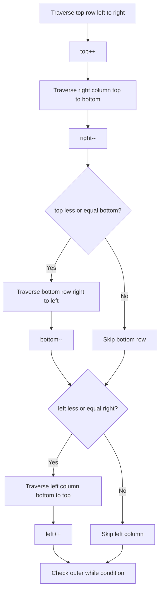
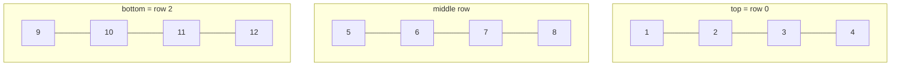
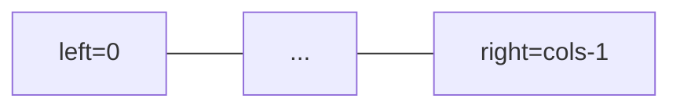
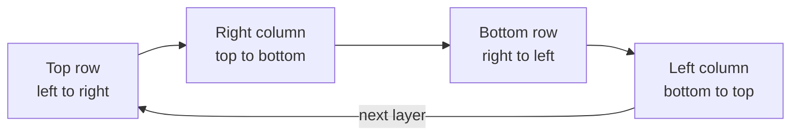

# Spiral Matrix

## Problem Link
🔗 [LeetCode 54 — Spiral Matrix](https://leetcode.com/problems/spiral-matrix/)

---

## What is this Problem?

Given an `m x n` matrix, return **all elements of the matrix in spiral order** — starting from the top-left, going right, then down, then left, then up, spiraling inward.

**Examples:**
```
Input:               Output:
[[1,2,3],            [1,2,3,6,9,8,7,4,5]
 [4,5,6],
 [7,8,9]]

Input:                       Output:
[[1,2,3,4],                  [1,2,3,4,8,12,11,10,9,5,6,7]
 [5,6,7,8],
 [9,10,11,12]]
```

---

## The Problem Explained

Think of it like **peeling an onion, layer by layer, in a spiral**:

```
[1,  2,  3,  4]
[5,  6,  7,  8]
[9, 10, 11, 12]

Spiral path:
  → → → →   (top row, left to right)
          ↓
  ↑ ← ← ←   (bottom row, right to left)
  ↑
  → → →     (next inner row, left to right)

1 → 2 → 3 → 4
            ↓
8 ← 7 ← 6 ← 5? No wait — let's trace properly:

1,2,3,4 (top row left→right)
8,12    (right column top→bottom, excluding corner already visited)
11,10,9 (bottom row right→left)
5       (left column bottom→top)
6,7     (next inner row left→right)

Result: [1,2,3,4,8,12,11,10,9,5,6,7] ✓
```

**Key idea:** Maintain **four boundaries** — `top`, `bottom`, `left`, `right`. Traverse the top row, then the right column, then the bottom row, then the left column. After each traversal, **shrink the corresponding boundary inward**. Repeat until boundaries cross.

---

## HOOK TO REMEMBER FOREVER

**"RIGHT ALONG TOP, DOWN ALONG RIGHT, LEFT ALONG BOTTOM, UP ALONG LEFT — SHRINK AFTER EACH"**

Every time you see "traverse matrix in spiral order":
- ✅ Four boundaries: `top`, `bottom`, `left`, `right`
- ✅ Traverse **top row** (left→right) → `top++`
- ✅ Traverse **right column** (top→bottom) → `right--`
- ✅ **Check `top <= bottom`** before traversing **bottom row** (right→left) → `bottom--`
- ✅ **Check `left <= right`** before traversing **left column** (bottom→top) → `left++`
- ✅ Loop while `top <= bottom && left <= right`
- ✅ O(m×n) time, O(1) extra space (excluding output)

**Remember: The two EXTRA checks (`top<=bottom` and `left<=right`) before the 3rd and 4th traversals exist because after shrinking twice, the remaining region might be a single row or column — traversing it AGAIN in the opposite direction would duplicate elements!** 🌀

---

## Why the Extra Checks Are Needed

This is the trickiest part of the problem. Here's a concrete example:

```
Single row matrix: [[1, 2, 3]]
top=0, bottom=0, left=0, right=2

Iteration 1:
  Traverse top row (left→right): 1,2,3.  top++ → top=1
  Traverse right column (top→bottom): top=1 > bottom=0, loop doesn't run.  right-- → right=1

  Now top=1, bottom=0.  top > bottom!

  Without the check, traversing the "bottom row" again would
  re-visit row 0 (right→left): 3,2,1 → DUPLICATES! ❌

  WITH the check `if (top <= bottom)`:
    top=1 > bottom=0 → SKIP bottom row traversal entirely. ✓

  Similarly, left=0, right=1. left <= right is true,
  but top > bottom already broke the outer while loop next iteration.

Final result: [1, 2, 3] ✓ (no duplicates)
```
 


---

## How It Works Step By Step

### Input

```
m = [[1, 2, 3, 4],
     [5, 6, 7, 8],
     [9,10,11,12]]

top=0, bottom=2, left=0, right=3
```

### Mermaid — Matrix with Boundary Labels



```
left=col0  right=col3
```

### Iteration 1

```
top<=bottom (0<=2) && left<=right (0<=3) → ENTER LOOP

Traverse top row (row 0, left to right):
  ans = [1, 2, 3, 4]
top++ → top=1

Traverse right column (col 3, top to bottom, rows 1 to 2):
  ans += [8, 12]
  ans = [1,2,3,4,8,12]
right-- → right=2

Check top<=bottom: 1<=2 TRUE
  Traverse bottom row (row 2, right to left, cols 2 to 0):
    ans += [11,10,9]
    ans = [1,2,3,4,8,12,11,10,9]
  bottom-- → bottom=1

Check left<=right: 0<=2 TRUE
  Traverse left column (col 0, bottom to top, rows 1 to 1):
    ans += [5]
    ans = [1,2,3,4,8,12,11,10,9,5]
  left++ → left=1
```

### Iteration 2

```
top<=bottom (1<=1) && left<=right (1<=2) → ENTER LOOP

Traverse top row (row 1, cols 1 to 2):
  ans += [6, 7]
  ans = [1,2,3,4,8,12,11,10,9,5,6,7]
top++ → top=2

Traverse right column (col 2, rows 2 to 1):
  top=2 > bottom=1 → loop doesn't execute
right-- → right=1

Check top<=bottom: 2<=1 FALSE → skip bottom row

Check left<=right: 1<=1 TRUE
  Traverse left column (col 1, rows... bottom=1 to top=2):
  bottom=1 < top=2 → loop range i from 1 down to 2 → doesn't execute
  left++ → left=2
```

### Iteration 3 — Loop Ends

```
top<=bottom: 2<=1 FALSE → EXIT WHILE LOOP

Final ans = [1,2,3,4,8,12,11,10,9,5,6,7] ✓
```

---

## Code Full Solution

```cpp
class Solution {
public:
    vector<int> spiralOrder(vector<vector<int>>& m) {
        int n = m.size();
        int colmm = m[0].size();
        vector<int> ans;

        int top = 0, left = 0, right = colmm - 1, bottom = n - 1;

        while (top <= bottom && left <= right) {

            // Traverse top row, left to right
            for (int i = left; i <= right; i++) {
                ans.push_back(m[top][i]);
            }
            top++;

            // Traverse right column, top to bottom
            for (int i = top; i <= bottom; i++) {
                ans.push_back(m[i][right]);
            }
            right--;

            // Traverse bottom row, right to left (if a row remains)
            if (top <= bottom) {
                for (int i = right; i >= left; i--) {
                    ans.push_back(m[bottom][i]);
                }
                bottom--;
            }

            // Traverse left column, bottom to top (if a column remains)
            if (left <= right) {
                for (int i = bottom; i >= top; i--) {
                    ans.push_back(m[i][left]);
                }
                left++;
            }
        }
        return ans;
    }
};
```

---

## Code Explanation

### Initialize Four Boundaries

```cpp
int top = 0, left = 0, right = colmm - 1, bottom = n - 1;
```

```
top    → topmost unvisited row
bottom → bottommost unvisited row
left   → leftmost unvisited column
right  → rightmost unvisited column

Together they define a shrinking rectangle of unvisited cells.
```



---

### Traverse Top Row

```cpp
for (int i = left; i <= right; i++) {
    ans.push_back(m[top][i]);
}
top++;
```

```
Walk along row `top`, from column `left` to column `right`.
After finishing, this row is "consumed" — shrink top boundary
downward: top++.
```

---

### Traverse Right Column

```cpp
for (int i = top; i <= bottom; i++) {
    ans.push_back(m[i][right]);
}
right--;
```

```
Walk down column `right`, from row `top` (the NEW top, after
top++ above — so we don't re-visit the top-right corner)
to row `bottom`.

After finishing, shrink right boundary leftward: right--.
```

---

### Traverse Bottom Row (with Guard)

```cpp
if (top <= bottom) {
    for (int i = right; i >= left; i--) {
        ans.push_back(m[bottom][i]);
    }
    bottom--;
}
```

**Why the guard `top <= bottom`?**

```
After the first two traversals, top and bottom may have
already crossed (top > bottom) — meaning there are NO
unvisited rows left.

If we traversed the bottom row anyway:
  We'd be re-traversing a row that was ALREADY covered
  by the top-row traversal (since top now equals
  what used to be bottom, or has passed it).

This happens specifically for matrices with a SINGLE
remaining row at this point — e.g., a 1×n matrix,
or the middle row of an odd-sized square matrix.

The guard prevents this duplicate traversal. ✓
```

---

### Traverse Left Column (with Guard)

```cpp
if (left <= right) {
    for (int i = bottom; i >= top; i--) {
        ans.push_back(m[i][left]);
    }
    left++;
}
```

**Why the guard `left <= right`?**

```
Symmetric reasoning to the bottom-row guard.

After the first three traversals, left and right may have
crossed (left > right) — no unvisited columns remain.

This happens for matrices with a SINGLE remaining column
at this point — e.g., an n×1 matrix, or the middle column
of an odd-sized square matrix.

The guard prevents re-traversing an already-visited column. ✓
```

---

### Why No Guards on the First Two Traversals?

```
The outer while loop condition `top<=bottom && left<=right`
ALREADY guarantees both are valid BEFORE the first two
traversals run in each iteration.

But AFTER top++ and right--, these conditions might break —
hence the guards before traversals 3 and 4, but not 1 and 2.
```

---

## Complete Example Traces

### Trace 1: 3x3 Square Matrix

```
m = [[1,2,3],
     [4,5,6],
     [7,8,9]]

top=0,bottom=2,left=0,right=2

Iter 1:
  Top row (row0, col0-2): ans=[1,2,3]. top=1
  Right col (col2, row1-2): ans+=[6,9] → [1,2,3,6,9]. right=1
  top<=bottom (1<=2): Bottom row (row2, col1-0): ans+=[8,7] → [1,2,3,6,9,8,7]. bottom=1
  left<=right (0<=1): Left col (col0, row1-1): ans+=[4] → [1,2,3,6,9,8,7,4]. left=1

Iter 2:
  top<=bottom (1<=1) && left<=right (1<=1) → ENTER

  Top row (row1, col1-1): ans+=[5] → [1,2,3,6,9,8,7,4,5]. top=2
  Right col (col1, row2-1): top=2>bottom=1, no iterations. right=0
  top<=bottom (2<=1) FALSE → skip bottom row
  left<=right (1<=0) FALSE → skip left col

Iter 3:
  top<=bottom (2<=1) FALSE → EXIT

Return [1,2,3,6,9,8,7,4,5] ✓
```

### Trace 2: Single Row

```
m = [[1,2,3,4]]
top=0,bottom=0,left=0,right=3

Iter 1:
  Top row: ans=[1,2,3,4]. top=1
  Right col (row1-0): top=1>bottom=0, no iterations. right=2
  top<=bottom (1<=0) FALSE → skip bottom row
  left<=right (0<=2) TRUE → Left col (row bottom=0 to top=1): 0>=1? 
    i=bottom=0, i>=top=1? 0>=1 FALSE → no iterations. left=1

Iter 2:
  top<=bottom (1<=0) FALSE → EXIT

Return [1,2,3,4] ✓ (no duplicates!)
```

### Trace 3: Single Column

```
m = [[1],[2],[3]]
top=0,bottom=2,left=0,right=0

Iter 1:
  Top row (row0, col0-0): ans=[1]. top=1
  Right col (col0, row1-2): ans+=[2,3] → [1,2,3]. right=-1
  top<=bottom (1<=2) TRUE → Bottom row (row2, col right=-1 to left=0):
    i=right=-1, i>=left=0? -1>=0 FALSE → no iterations. bottom=1
  left<=right (0<=-1) FALSE → skip left col

Iter 2:
  top<=bottom (1<=1) && left<=right (0<=-1 FALSE) → loop condition fails → EXIT

Return [1,2,3] ✓ (no duplicates!)
```

### Trace 4: Single Element

```
m = [[5]]
top=0,bottom=0,left=0,right=0

Iter 1:
  Top row: ans=[5]. top=1
  Right col (row1-0): top=1>bottom=0, no iterations. right=-1
  top<=bottom (1<=0) FALSE → skip bottom row
  left<=right (0<=-1) FALSE → skip left col

Iter 2:
  top<=bottom (1<=0) FALSE → EXIT

Return [5] ✓
```

### Trace 5: Rectangular (More Rows than Cols)

```
m = [[1,2],
     [3,4],
     [5,6]]
top=0,bottom=2,left=0,right=1

Iter 1:
  Top row (row0): ans=[1,2]. top=1
  Right col (col1, row1-2): ans+=[4,6] → [1,2,4,6]. right=0
  top<=bottom (1<=2): Bottom row (row2, col0-0): ans+=[5] → [1,2,4,6,5]. bottom=1
  left<=right (0<=0): Left col (col0, row1-1): ans+=[3] → [1,2,4,6,5,3]. left=1

Iter 2:
  top<=bottom (1<=1) && left<=right (1<=0 FALSE) → EXIT

Return [1,2,4,6,5,3] ✓
```

---

## Edge Cases

### Case 1: 1x1 Matrix

```
Input: [[1]]
Output: [1] ✓
```

### Case 2: Single Row

```
Input: [[1,2,3]]
Output: [1,2,3] ✓ (guards prevent reverse re-traversal)
```

### Case 3: Single Column

```
Input: [[1],[2],[3]]
Output: [1,2,3] ✓ (guards prevent reverse re-traversal)
```

### Case 4: Non-Square Rectangle

```
Input: 2x3 or 3x2 matrices
Both guards may or may not trigger depending on which
dimension is exhausted first. Both handled correctly. ✓
```

---

## Time Complexity

- **O(m × n)** where m = rows, n = columns
- Every cell visited exactly once
- The four boundaries collectively shrink to cover the entire matrix
- Total: **O(m × n)**

---

## Space Complexity

- **O(1)** extra space (excluding output)
- `ans` holds m×n elements — required output, not auxiliary
- Only four boundary integers used
- Total auxiliary space: **O(1)**

---

## Key Insights

### The Two Guards Solve the Same Problem in Two Dimensions

```
Guard 1 (top <= bottom): protects against re-traversing
  a ROW that's already fully covered — happens when
  the matrix runs out of ROWS (becomes 1×k or 0×k).

Guard 2 (left <= right): protects against re-traversing
  a COLUMN that's already fully covered — happens when
  the matrix runs out of COLUMNS (becomes k×1 or k×0).

Both guards exist for the SAME reason: after shrinking
twice (top++ and right--), we might have already
covered everything — traversals 3 and 4 would be
redundant or even read already-consumed cells.
```

### Visualizing Why Order Matters: Top → Right → Bottom → Left



```
This is a CLOCKWISE spiral. Each traversal's starting
point is exactly where the previous traversal ended
(minus the boundary shrink), so no cell is ever
double-counted or skipped — as long as the guards
are in place for degenerate (1-row or 1-column) cases.
```

### Why `top++` and `right--` Happen Immediately (No Guards)

```
The FIRST traversal (top row) is guaranteed valid by the
while loop's condition (top<=bottom && left<=right).

The SECOND traversal (right column) starts from the NEW
top (after top++). Even if this range is empty
(top > bottom already), the for loop simply doesn't
execute — no special guard needed, because an empty
for-loop is harmless (unlike duplicating output).

Guards are only needed where an EMPTY-LOOKING traversal
could still produce DUPLICATE output — which happens
specifically for traversals 3 and 4 in degenerate cases.
```

### Generalizes to "Boundary Shrinking" Pattern

```
The four-boundary shrinking technique appears in:
  → Spiral Matrix (this problem)
  → Spiral Matrix II (generate, not traverse)
  → Rotate matrix layer-by-layer (similar boundaries)
  → Print matrix in diagonal order (different traversal,
    same boundary-tracking spirit)

Master tracking top/bottom/left/right as a shrinking
rectangle — it's reusable across many matrix problems.
```

---

## References

- 🔗 [LeetCode 54 — Spiral Matrix](https://leetcode.com/problems/spiral-matrix/)