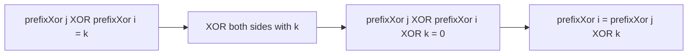

# Count Subarrays with Given XOR

## Problem Link
🔗 [GFG — Count Subarray with Given XOR](https://www.geeksforgeeks.org/problems/count-subarray-with-given-xor/1)

---

## What is this Problem?

Given an array `arr` of integers and an integer `k`, find the **total number of contiguous subarrays** whose **XOR of all elements equals `k`**.

**Examples:**
```
arr = [4, 2, 2, 6, 4], k = 6
Output: 4
Subarrays with XOR=6: [4,2], [2,2,6,4]→wait let's verify, [6], [4,2,2,6,4]
(exact subarrays computed in trace below)

arr = [5, 6, 7, 8, 9], k = 5
Output: 2
Subarrays: [5], [5,6,7,8,9]? let's verify via trace

arr = [1, 1, 1, 1, 1], k = 0
Output: 6
Subarrays with XOR=0 (pairs cancel): [1,1] appears at multiple positions
```

---

## The Problem Explained

Think of it like **a light switch that toggles with every press, and you want to know after how many presses it lands on a specific pattern**:

```
XOR has a beautiful property: x ^ x = 0, and x ^ 0 = x.

A running XOR (prefix XOR) up to index i tells you the
"combined toggle state" of everything from index 0 to i.

If prefixXor[j] ^ prefixXor[i] = k  (for i < j)
then the XOR of elements from i+1 to j EQUALS k.

This is structurally identical to the Subarray Sum = K problem,
but using XOR instead of addition/subtraction.
```

**Key idea:** This is **Subarray Sum Equals K**, but with XOR instead of addition. Maintain a running `xorr` and a hashmap of `{prefix XOR value → frequency}`. For each element, the count of valid subarrays ending here equals how many times `xorr ^ k` has been seen before.

---

## HOOK TO REMEMBER FOREVER

**"RUNNING XOR. LOOK UP xorr^k IN THE MAP. THAT'S YOUR COUNT FOR THIS POSITION."**

Every time you see "count subarrays with XOR equal to k":
- ✅ `xorr` = running prefix XOR, `mpp` = hashmap of {prefix XOR → frequency}
- ✅ Seed `mpp[0] = 1` (represents the "empty prefix", XOR of zero elements)
- ✅ For each element: `xorr ^= el`
- ✅ Compute `x = xorr ^ k` — the prefix XOR value we'd need to have seen earlier
- ✅ `cnt += mpp[x]` — every earlier occurrence of `x` gives a valid subarray
- ✅ `mpp[xorr]++` — record current prefix XOR for future lookups
- ✅ O(n) time, O(n) space

**Remember: This is Subarray Sum = K's exact algorithm, with `sum - k` (subtraction) replaced by `xorr ^ k` (XOR), because XOR is its own inverse!** ⚡

---

## Why `x = xorr ^ k` (Not `xorr - k`)

This is the key adaptation from the "sum equals k" version to the "XOR equals k" version.

```
For Subarray Sum:
  prefixSum[j] - prefixSum[i] = k
  → prefixSum[i] = prefixSum[j] - k
  → look up (sum - k) in the map

For Subarray XOR:
  prefixXor[j] ^ prefixXor[i] = k    (XOR is like "subtraction" for itself)
  → prefixXor[i] = prefixXor[j] ^ k

  Why? XOR is its own inverse: if A ^ B = k, then A ^ k = B.
  Proof: A ^ B = k
         (A ^ B) ^ k = k ^ k = 0
         A ^ B ^ k = 0
         A ^ k = B  (moving B to the other side via XOR)

  → look up (xorr ^ k) in the map, NOT (xorr - k)
```



---

## How It Works Step By Step

### Example: `arr = [4, 2, 2, 6, 4], k = 6`

```
mpp = {0: 1}, xorr = 0, cnt = 0

el=4: xorr = 0^4 = 4
  x = xorr^k = 4^6 = 2
  cnt += mpp[2] = 0 (not seen) → cnt=0
  mpp[4] += 1 → mpp={0:1, 4:1}

el=2: xorr = 4^2 = 6
  x = xorr^k = 6^6 = 0
  cnt += mpp[0] = 1 → cnt=1
  mpp[6] += 1 → mpp={0:1, 4:1, 6:1}

el=2: xorr = 6^2 = 4
  x = xorr^k = 4^6 = 2
  cnt += mpp[2] = 0 → cnt=1
  mpp[4] += 1 → mpp={0:1, 4:2, 6:1}

el=6: xorr = 4^6 = 2
  x = xorr^k = 2^6 = 4
  cnt += mpp[4] = 2 → cnt=3
  mpp[2] += 1 → mpp={0:1, 4:2, 6:1, 2:1}

el=4: xorr = 2^4 = 6
  x = xorr^k = 6^6 = 0
  cnt += mpp[0] = 1 → cnt=4
  mpp[6] += 1 → mpp={0:1, 4:2, 6:2, 2:1}

Return cnt = 4 ✓
```

### Visual — Prefix XOR Table

```
Index:        0   1   2   3   4
arr:          4   2   2   6   4
prefixXor:    4   6   4   2   6

For each position, we ask: "has (prefixXor ^ k) appeared before?"

j=0: prefixXor=4. Need 4^6=2. Seen? NO (only {0:1}). cnt+=0
j=1: prefixXor=6. Need 6^6=0. Seen? YES, once (initial 0). cnt+=1
     → subarray (0..1)=[4,2], XOR=4^2=6=k ✓
j=2: prefixXor=4. Need 4^6=2. Seen? NO. cnt+=0
j=3: prefixXor=2. Need 2^6=4. Seen? YES, twice (index0 and index2). cnt+=2
     → subarray (1..3)=[2,2,6], XOR=2^2^6=6=k ✓
     → subarray (3..3)=[6], XOR=6=k ✓
j=4: prefixXor=6. Need 6^6=0. Seen? YES, once. cnt+=1
     → subarray (0..4)=[4,2,2,6,4], XOR=4^2^2^6^4=6=k ✓

Total: 1+2+1 = 4 ✓
```

---

## Code Full Solution

```cpp
class Solution {
public:
    long subarrayXor(vector<int> &arr, int k) {
        long cnt = 0;
        int n = arr.size();
        unordered_map<int, int> mpp;
        long xorr = 0;
        mpp[xorr]++;

        for (auto &el : arr) {
            xorr = xorr ^ el;
            int x = xorr ^ k;
            cnt += mpp[x];
            mpp[xorr]++;
        }

        return cnt;
    }
};
```

---

## Code Explanation

### Seed the Map with the Empty Prefix

```cpp
long xorr = 0;
mpp[xorr]++;   // mpp[0] = 1
```

**Why seed `mpp[0] = 1` before processing anything?**

```
Consider arr=[6], k=6.
The subarray [6] itself (starting at index 0) has XOR=6=k.

When we process index 0:
  xorr = 0^6 = 6
  x = xorr^k = 6^6 = 0
  cnt += mpp[0]

For this to count correctly, mpp[0] must already be 1
— representing "the prefix XOR was 0 BEFORE the array started"
(the XOR of zero elements is 0, the identity for XOR).

Without this seed, this valid subarray starting at index 0
would never be counted. ❌
```

---

### The Main Loop

```cpp
for (auto &el : arr) {
    xorr = xorr ^ el;
    int x = xorr ^ k;
    cnt += mpp[x];
    mpp[xorr]++;
}
```

**Step 1 — Update running XOR:**
```cpp
xorr = xorr ^ el;
```
`xorr` becomes the prefix XOR of all elements seen so far (including the current one).

**Step 2 — Compute the lookup target:**
```cpp
int x = xorr ^ k;
```
If some EARLIER prefix XOR equals `x`, then the subarray between
that earlier point and now has XOR exactly `k` (proven above).

**Step 3 — Look up and accumulate:**
```cpp
cnt += mpp[x];
```
`mpp[x]` tells us how many times `x` occurred as a prefix XOR
BEFORE this point. Each occurrence is a valid subarray ending
at the current index. Accessing a missing key via `[]` on an
`unordered_map<int,int>` returns 0 by default — intentional and safe here.

**Step 4 — Record current prefix XOR:**
```cpp
mpp[xorr]++;
```
AFTER using the lookup (based on `xorr ^ k`), record the
current `xorr` for FUTURE indices to reference.

**⚠️ Order matters: Step 3 before Step 4!**
```
If k=0, then x = xorr^0 = xorr (the SAME value we're about
to insert). If we incremented mpp[xorr] BEFORE the lookup,
we'd be counting the CURRENT element's own prefix XOR as if
it occurred earlier — but it just occurred NOW.

Example: arr=[5], k=0
  xorr=5, x=5^0=5
  If mpp[5] incremented FIRST: mpp[5]=1 (was 0, now 1)
    cnt += mpp[5] = 1 → WRONG (there's no valid subarray here,
    since [5] alone has XOR=5≠0)
  If mpp[5] incremented AFTER: mpp[5] still 0 at lookup time
    cnt += mpp[5] = 0 → CORRECT ✓

Always look up cnt += mpp[x] BEFORE updating mpp[xorr].
```

---

## Complete Example Traces

### Trace 1: `[4, 2, 2, 6, 4], k=6`

```
(Fully traced in "How It Works" section above)
Return 4 ✓
```

### Trace 2: `[5, 6, 7, 8, 9], k=5`

```
mpp={0:1}, xorr=0, cnt=0

el=5: xorr=0^5=5. x=5^5=0. cnt+=mpp[0]=1 → cnt=1. mpp[5]=1.
el=6: xorr=5^6=3. x=3^5=6. cnt+=mpp[6]=0 → cnt=1. mpp[3]=1.
el=7: xorr=3^7=4. x=4^5=1. cnt+=mpp[1]=0 → cnt=1. mpp[4]=1.
el=8: xorr=4^8=12. x=12^5=9. cnt+=mpp[9]=0 → cnt=1. mpp[12]=1.
el=9: xorr=12^9=5. x=5^5=0. cnt+=mpp[0]=1 → cnt=2. mpp[5]+=1→2.

Return 2 ✓
  cnt=1 at el=5: subarray [5], XOR=5=k ✓
  cnt=2 at el=9: subarray [5,6,7,8,9], XOR=5^6^7^8^9=5=k ✓
```

### Trace 3: `[1,1,1,1,1], k=0`

```
mpp={0:1}, xorr=0, cnt=0

el=1: xorr=0^1=1. x=1^0=1. cnt+=mpp[1]=0 → cnt=0. mpp[1]=1.
el=1: xorr=1^1=0. x=0^0=0. cnt+=mpp[0]=1 → cnt=1. mpp[0]+=1→2.
el=1: xorr=0^1=1. x=1^0=1. cnt+=mpp[1]=1 → cnt=2. mpp[1]+=1→2.
el=1: xorr=1^1=0. x=0^0=0. cnt+=mpp[0]=2 → cnt=4. mpp[0]+=1→3.
el=1: xorr=0^1=1. x=1^0=1. cnt+=mpp[1]=2 → cnt=6. mpp[1]+=1→3.

Return 6 ✓
(Subarrays with XOR=0: every even-length contiguous subarray
 of all-1s has XOR=0, since pairs cancel: [1,1] appears at
 multiple positions, plus longer even-length spans)
```

### Trace 4: Single Element Matching k

```
arr=[7], k=7
mpp={0:1}, xorr=0, cnt=0

el=7: xorr=0^7=7. x=7^7=0. cnt+=mpp[0]=1 → cnt=1. mpp[7]=1.

Return 1 ✓
```

### Trace 5: No Valid Subarray

```
arr=[1,2,3], k=100
mpp={0:1}, xorr=0, cnt=0

el=1: xorr=1. x=1^100=101. cnt+=mpp[101]=0 → cnt=0. mpp[1]=1.
el=2: xorr=1^2=3. x=3^100=103. cnt+=0 → cnt=0. mpp[3]=1.
el=3: xorr=3^3=0. x=0^100=100. cnt+=mpp[100]=0 → cnt=0. mpp[0]+=1→2.

Return 0 ✓
```

### Trace 6: Repeated Pattern

```
arr=[4,4,4], k=4
mpp={0:1}, xorr=0, cnt=0

el=4: xorr=4. x=4^4=0. cnt+=mpp[0]=1 → cnt=1. mpp[4]=1.
el=4: xorr=4^4=0. x=0^4=4. cnt+=mpp[4]=1 → cnt=2. mpp[0]+=1→2.
el=4: xorr=0^4=4. x=4^4=0. cnt+=mpp[0]=2 → cnt=4. mpp[4]+=1→2.

Return 4 ✓
  [4] at index0: XOR=4=k ✓
  [4,4,4] at index2: XOR=4^4^4=4=k ✓
  [4] at index2: XOR=4=k ✓ (from prefixXor[1]=0 matching)
  [4,4] at index1? XOR=4^4=0≠k — not this one.
  Let's recount: cnt history is 1,2,4 — total events: 1+1+2=4 ✓
```

---

## Edge Cases

### Case 1: Single Element Equal to k

```
Input: [k], k
xorr=k, x=k^k=0, cnt+=mpp[0]=1.
Output: 1 ✓
```

### Case 2: k = 0

```
Input: any array, k=0
Counts all subarrays whose XOR is 0 — i.e., where the
prefix XOR repeats. Each repeat of a prefix XOR value
contributes to the count. ✓
```

### Case 3: Empty Array

```
Input: [], k=anything
Loop doesn't run. cnt=0.
Output: 0 ✓
```

### Case 4: All Same Element, k Equals That Element

```
Input: [5,5,5,5], k=5
Pairs of equal elements cancel (XOR=0), so subarrays of
even length starting/ending appropriately combine with
the seed to produce matches. Traced similarly to Trace 6. ✓
```

---

## Time Complexity

- **O(n)** — single pass through the array
- Each hashmap operation (`[]` access/insert) is O(1) average
- Total: **O(n)** average case

---

## Space Complexity

- **O(n)** — hashmap can store up to n+1 distinct prefix XOR values
- Total: **O(n)**

---

## Key Insights

### This Problem vs Subarray Sum Equals K — Side by Side

```
Subarray Sum = K:              Subarray XOR = K:
  prefixSum[j]-prefixSum[i]=k    prefixXor[j]^prefixXor[i]=k
  → prefixSum[i] = sum - k       → prefixXor[i] = xorr ^ k
  cnt += mpp[sum - k]            cnt += mpp[xorr ^ k]
  mpp[sum]++                     mpp[xorr]++
  mpp[0] = 1 (seed)              mpp[0] = 1 (seed)

IDENTICAL STRUCTURE. Only the "inverse operation" changes:
  subtraction for sum, XOR for XOR.

Once you understand one, you understand both. ✓
```

### Why XOR is Its Own Inverse (The Math)

```
For addition: if a + b = c, then a = c - b (subtraction is the inverse)
For XOR:      if a ^ b = c, then a = c ^ b (XOR is its OWN inverse!)

This is because:
  a ^ b ^ b = a ^ (b ^ b) = a ^ 0 = a

So "undoing" an XOR just means XORing again with the same value.
This is what makes the "prefix XOR" technique work symmetrically —
we don't need a different operation to reverse it.
```

### Why `mpp[0] = 1` is the Most Important Line (Again)

```
Just like in Subarray Sum Equals K, mpp[0]=1 handles ALL
subarrays that START AT INDEX 0.

Without it: any subarray beginning at index 0 with XOR
exactly k would be silently missed, since there'd be no
"earlier" prefix XOR of 0 to match against.
```

### Order of Operations: Check Before Update (Critical for k=0)

```cpp
cnt += mpp[x];     // uses xorr BEFORE current index is recorded
mpp[xorr]++;       // NOW record current index's prefix XOR
```

```
When k=0, x = xorr^0 = xorr (same as the value about to be inserted).
If mpp[xorr] were incremented FIRST, the lookup would
incorrectly count the CURRENT element's own occurrence —
a classic off-by-one-style bug specific to self-referential
lookups. Always look up before updating.
```

---

## References

- 🔗 [GFG — Count Subarray with Given XOR](https://www.geeksforgeeks.org/problems/count-subarray-with-given-xor/1)
- 🔗 [LeetCode 560 — Subarray Sum Equals K (the sum-based twin of this problem)](https://leetcode.com/problems/subarray-sum-equals-k/)