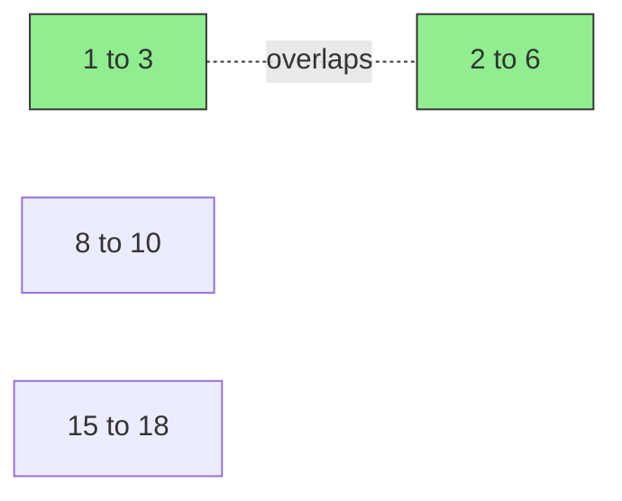
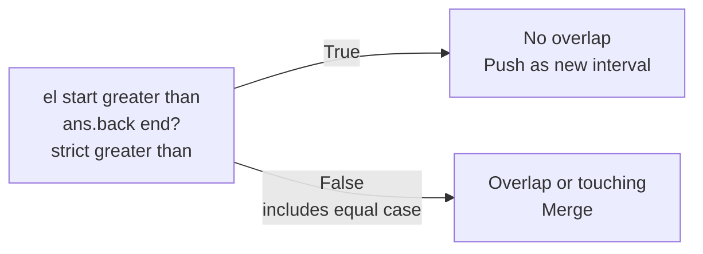

# Merge Intervals

## Problem Link
🔗 [LeetCode 56 — Merge Intervals](https://leetcode.com/problems/merge-intervals/)

---

## What is this Problem?

Given an array of `intervals` where `intervals[i] = [start, end]`, merge all **overlapping intervals** and return an array of the **non-overlapping** intervals that cover all the intervals in the input.

**Examples:**
```
Input:  [[1,3],[2,6],[8,10],[15,18]]
Output: [[1,6],[8,10],[15,18]]
([1,3] and [2,6] overlap → merged into [1,6])

Input:  [[1,4],[4,5]]
Output: [[1,5]]
(touching at 4 counts as overlapping)

Input:  [[1,4],[0,4]]
Output: [[0,4]]
```

---

## The Problem Explained

Think of it like **merging overlapping meeting times on a calendar**:

```
Meetings: [1,3], [2,6], [8,10], [15,18]

Sorted by start time:
  [1,3]   [2,6]   [8,10]   [15,18]

[1,3] and [2,6] overlap (3 ≥ 2) → merge into [1,6]
[1,6] and [8,10]: do they overlap? 6 < 8 → NO overlap → keep separate
[8,10] and [15,18]: 10 < 15 → NO overlap → keep separate

Result: [1,6], [8,10], [15,18]
```

**Key idea:** Sort intervals by **start time**. Walk through them one by one. If the current interval's start is **within or touching** the last merged interval's end, merge them (extend the end). Otherwise, the current interval starts a brand new group.

---

## HOOK TO REMEMBER FOREVER

**"SORT BY START. IF NEXT START ≤ LAST END, MERGE. ELSE, START A NEW GROUP."**

Every time you see "merge overlapping intervals":
- ✅ **Sort** intervals by start value first — this is non-negotiable
- ✅ Initialize `ans` with the first interval (or build it as you go)
- ✅ For each interval: if it starts AFTER the last merged interval ends → push as new
- ✅ Otherwise → extend the last merged interval's end to `max(current end, last end)`
- ✅ O(n log n) time (dominated by sort), O(n) space for output

**Remember: After sorting, you only ever need to look BACKWARD at the last merged interval — never forward. One pass is enough!** 📅

---

## Why Sorting by Start is Essential

```
Without sorting, intervals could appear in ANY order:
  [[15,18],[1,3],[8,10],[2,6]]

You'd need to check EVERY pair against EVERY other pair
to find overlaps — O(n²) comparisons, and even then,
merging logic gets complicated (an interval might need
to merge with something that comes LATER in the array).

After sorting by start:
  [[1,3],[2,6],[8,10],[15,18]]

Now overlaps can ONLY happen between ADJACENT intervals
in the sorted order (or chains of adjacent ones).
A single left-to-right pass is guaranteed sufficient. ✓
```

## How It Works Step By Step

### Input

```
intervals = [[1,3],[2,6],[8,10],[15,18]]
```

### Step 1 — Sort by Start

```
Already sorted: [[1,3],[2,6],[8,10],[15,18]]
```

### Step 2 — Walk Through and Merge

```
ans = []

el=[1,3]: ans is empty → push. ans=[[1,3]]

el=[2,6]: ans.back()=[1,3]. el[0]=2 > ans.back()[1]=3? NO (2 ≤ 3, overlap!)
  → MERGE: ans.back()[1] = max(6, 3) = 6
  ans = [[1,6]]

el=[8,10]: ans.back()=[1,6]. el[0]=8 > ans.back()[1]=6? YES (no overlap)
  → push new. ans = [[1,6],[8,10]]

el=[15,18]: ans.back()=[8,10]. el[0]=15 > ans.back()[1]=10? YES
  → push new. ans = [[1,6],[8,10],[15,18]]

Return [[1,6],[8,10],[15,18]] ✓
```

### Visual — Interval Timeline



```
Number line:
0   1   2   3   4   5   6   7   8   9   10  ...  15  ...  18
    [---1,3---]
        [-----2,6-----]
                            [---8,10---]
                                              [--15,18--]

After merging [1,3] and [2,6]:
    [--------1,6--------]
                            [---8,10---]
                                              [--15,18--]
```

---

## Code Full Solution

```cpp
class Solution {
public:
    vector<vector<int>> merge(vector<vector<int>>& a) {
        sort(a.begin(), a.end());
        vector<vector<int>> ans;

        for (auto &el : a) {
            if (ans.empty() || el[0] > ans.back()[1]) {
                ans.push_back(el);
            } else {
                ans.back()[1] = max(el[1], ans.back()[1]);
            }
        }
        return ans;
    }
};
```

---

## Code Explanation

### Sort First

```cpp
sort(a.begin(), a.end());
```

**Why does default `sort()` work for sorting by start value?**

```
For vector<vector<int>>, the default comparator does
LEXICOGRAPHIC comparison — compares the first element,
then the second if the first is tied.

[[2,6],[1,3]] sorted → [[1,3],[2,6]]
  Compares 2 vs 1 → 1 is smaller → [1,3] comes first.

This is EXACTLY sorting by start value (with end value
as a tiebreaker), which is what we need. No custom
comparator required. ✓
```

---

### The Merge Decision

```cpp
if (ans.empty() || el[0] > ans.back()[1]) {
    ans.push_back(el);
} else {
    ans.back()[1] = max(el[1], ans.back()[1]);
}
```

**Condition breakdown:**

```
ans.empty():
  First interval ever — nothing to compare against. Just push it.

el[0] > ans.back()[1]:
  Current interval's START is STRICTLY GREATER than the
  last merged interval's END.
  → No overlap, not even touching. Push as a new group.

Else (el[0] <= ans.back()[1]):
  Current interval starts AT OR BEFORE the last interval ends.
  → They overlap (or touch exactly). MERGE them.
```

**Why `>` and not `>=`? (touching counts as overlapping)**

```
Example: [[1,4],[4,5]]

el=[4,5]: ans.back()=[1,4]. el[0]=4 > ans.back()[1]=4? NO (4 is not > 4)
  → falls into ELSE branch → MERGE

If we used >= instead:
  4 >= 4 → TRUE → would push as separate → [[1,4],[4,5]]
  WRONG! The problem expects touching intervals to merge: [[1,5]] ✓

Using strict > ensures touching intervals (where one ends
exactly where another begins) are correctly merged.
```

---

### The Merge Itself

```cpp
ans.back()[1] = max(el[1], ans.back()[1]);
```

**Why `max()` and not just `el[1]`?**

```
Consider: [[1,10],[2,3]]

After sorting: [[1,10],[2,3]] (1 < 2, so [1,10] comes first)

el=[2,3]: el[0]=2 <= ans.back()[1]=10 → MERGE
  ans.back()[1] = max(3, 10) = 10   ← stays 10, NOT 3!

If we naively set ans.back()[1] = el[1] = 3:
  We'd SHRINK the merged interval from [1,10] to [1,3] — WRONG!
  [2,3] is entirely CONTAINED within [1,10]; merging should
  not shrink the result.

max() ensures the merged interval's end is always the
FARTHEST end seen among all overlapping intervals so far. ✓
```

**We only update `[1]` (end), never `[0]` (start) — why?**

```
Since intervals are sorted by start, ans.back()[0] is
ALWAYS the smallest (or equal) start among all intervals
merged into this group. The current el[0] can never be
smaller than ans.back()[0] (sorted order guarantees this).

So the start of the merged interval never needs updating —
only the end might need to extend further right.
```

---

## Complete Example Traces

### Trace 1: Standard Overlapping Case

```
intervals = [[1,3],[2,6],[8,10],[15,18]]
Sorted (already): [[1,3],[2,6],[8,10],[15,18]]

el=[1,3]: ans empty → push. ans=[[1,3]]
el=[2,6]: 2 > 3? NO → merge. ans.back()[1]=max(6,3)=6. ans=[[1,6]]
el=[8,10]: 8 > 6? YES → push. ans=[[1,6],[8,10]]
el=[15,18]: 15 > 10? YES → push. ans=[[1,6],[8,10],[15,18]]

Return [[1,6],[8,10],[15,18]] ✓
```

### Trace 2: Touching Intervals

```
intervals = [[1,4],[4,5]]
Sorted: [[1,4],[4,5]]

el=[1,4]: ans empty → push. ans=[[1,4]]
el=[4,5]: 4 > 4? NO → merge. ans.back()[1]=max(5,4)=5. ans=[[1,5]]

Return [[1,5]] ✓
```

### Trace 3: One Interval Contains Another

```
intervals = [[1,4],[2,3]]
Sorted: [[1,4],[2,3]]

el=[1,4]: ans empty → push. ans=[[1,4]]
el=[2,3]: 2 > 4? NO → merge. ans.back()[1]=max(3,4)=4. ans=[[1,4]]

Return [[1,4]] ✓ (the contained interval doesn't shrink anything)
```

### Trace 4: Unsorted Input

```
intervals = [[1,4],[0,4]]
Sorted: [[0,4],[1,4]]   ← sort reorders by start!

el=[0,4]: ans empty → push. ans=[[0,4]]
el=[1,4]: 1 > 4? NO → merge. ans.back()[1]=max(4,4)=4. ans=[[0,4]]

Return [[0,4]] ✓
```

### Trace 5: No Overlaps At All

```
intervals = [[1,2],[3,4],[5,6]]
Sorted (already): [[1,2],[3,4],[5,6]]

el=[1,2]: push. ans=[[1,2]]
el=[3,4]: 3 > 2? YES → push. ans=[[1,2],[3,4]]
el=[5,6]: 5 > 4? YES → push. ans=[[1,2],[3,4],[5,6]]

Return [[1,2],[3,4],[5,6]] ✓ (unchanged, no merges needed)
```

### Trace 6: Chain of Overlaps (All Merge into One)

```
intervals = [[1,4],[2,5],[3,6],[4,7]]
Sorted (already): [[1,4],[2,5],[3,6],[4,7]]

el=[1,4]: push. ans=[[1,4]]
el=[2,5]: 2>4? NO → merge. max(5,4)=5. ans=[[1,5]]
el=[3,6]: 3>5? NO → merge. max(6,5)=6. ans=[[1,6]]
el=[4,7]: 4>6? NO → merge. max(7,6)=7. ans=[[1,7]]

Return [[1,7]] ✓ (all four intervals chain-merge into one)
```

---

## Edge Cases

### Case 1: Single Interval

```
Input: [[1,5]]
ans empty → push. ans=[[1,5]]
Output: [[1,5]] ✓
```

### Case 2: All Intervals Identical

```
Input: [[1,3],[1,3],[1,3]]
Sorted: [[1,3],[1,3],[1,3]]
el1: push. ans=[[1,3]]
el2: 1>3? NO → merge. max(3,3)=3. ans=[[1,3]]
el3: same → ans stays [[1,3]]
Output: [[1,3]] ✓
```

### Case 3: All Intervals Overlap into One Giant Interval

```
Input: [[1,10],[2,3],[4,5],[6,7]]
After sort and merge, all get absorbed since they're all
within or extending [1,10].
Output: [[1,10]] ✓
```

### Case 4: Negative Numbers

```
Input: [[-5,-1],[-3,2],[4,6]]
Sorted: [[-5,-1],[-3,2],[4,6]]
el=[-5,-1]: push. ans=[[-5,-1]]
el=[-3,2]: -3 > -1? NO → merge. max(2,-1)=2. ans=[[-5,2]]
el=[4,6]: 4 > 2? YES → push. ans=[[-5,2],[4,6]]
Output: [[-5,2],[4,6]] ✓
```

---

## Time Complexity

- **O(n log n)** — dominated by the initial sort
- Sorting: O(n log n)
- Single linear pass through sorted intervals: O(n)
- Total: **O(n log n)**

---

## Space Complexity

- **O(n)** for the output array (in the worst case, no merges happen and all n intervals are returned)
- Sorting may use O(log n) additional stack space internally (implementation-dependent)
- Total: **O(n)**

---

## Key Insights

### Why a Single Backward Look Is Always Sufficient

```
Claim: after sorting by start, an interval can ONLY
possibly overlap with the LAST interval currently in `ans`
— never with anything earlier.

Proof sketch: ans is maintained such that all intervals
in it are mutually non-overlapping and sorted by start.
Since the current el has the LARGEST start seen so far
(sorted order), if it doesn't overlap with the last
(rightmost-ending) interval in ans, it can't overlap
with anything before that either — those all end even
earlier or equal.

This is why ans.back() is the ONLY thing we ever need
to check. No need to scan the whole ans array. ✓
```

### Strict `>` vs `>=` — The Boundary Decision



```
Using strict > (not >=) means EQUAL values fall into the
merge branch. This correctly handles the "touching" case:
[1,4] and [4,5] share the boundary point 4 — the problem
considers this an overlap (they form a continuous range
[1,5] with no gap), so they should merge.
```

### Why `max()` for the End, Not Just Overwrite

```
The merged interval's end must be the LARGEST end among
ALL intervals that have been absorbed into this group —
not just the most recently processed one.

This handles the "nested interval" case ([2,3] fully
inside [1,10]) correctly: the smaller nested interval
doesn't shrink the already-larger merged range.
```

### This Pattern Generalizes

```
The "sort, then single backward-looking pass" technique
appears in:
  → Merge Intervals (this problem)
  → Insert Interval (insert one new interval into a sorted list)
  → Non-overlapping Intervals (minimum removals to make non-overlapping)
  → Meeting Rooms I & II (scheduling feasibility)

Master this pattern: SORT BY START, COMPARE TO LAST MERGED,
EXTEND OR START NEW. It unlocks an entire family of
interval-based problems.
```

---

## References

- 🔗 [LeetCode 56 — Merge Intervals](https://leetcode.com/problems/merge-intervals/)