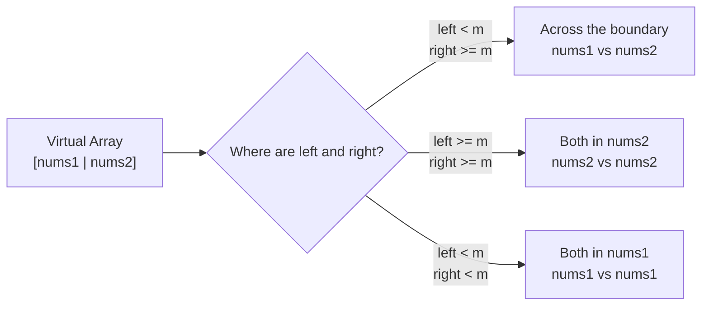

# Merge Two Sorted Arrays Without Extra Space

## Problem Link
🔗 [GFG — Merge Two Sorted Arrays Without Extra Space](https://www.geeksforgeeks.org/merge-two-sorted-arrays-without-using-extra-space/)

---

## What is this Problem?

Given two sorted arrays `nums1` (size m) and `nums2` (size n), merge them **in-place** such that both arrays together are in sorted order. No extra array allowed.

```
nums1 = [1, 3, 5, 7]
nums2 = [0, 2, 6, 8]

After merge:
nums1 = [0, 1, 2, 3]
nums2 = [5, 6, 7, 8]
```

---

## The Problem Explained

The classic merge (like in Merge Sort) needs an extra O(m+n) array. Can we sort two arrays **in-place**?

**Shell Sort idea:** In shell sort, instead of comparing adjacent elements, we compare elements that are **far apart**, and keep halving the gap. This naturally fixes order across long distances before cleaning up locally.

We apply the same idea here — treat both arrays as one big virtual array and do shell sort over it.

---

## HOOK TO REMEMBER FOREVER

**"THINK OF BOTH ARRAYS AS ONE. GAP = CEIL(LEN/2). COMPARE ELEMENTS THAT ARE `gap` APART. SWAP IF OUT OF ORDER. HALVE THE GAP. REPEAT."**

- ✅ Virtual length `len = m + n`
- ✅ Start gap = `ceil(len / 2)`
- ✅ Each iteration: slide a window of size `gap` across the virtual array, swap-if-greater
- ✅ Reduce gap: `nextGap = ceil(gap / 2)`
- ✅ Stop when gap becomes 0
- ✅ O(n log n) time, O(1) space

---

## The Core Concept — The Virtual Array

```
Treat nums1 and nums2 as one virtual array of length m+n:

Virtual index:  0   1   2   3   4   5   6   7
                [nums1          ] [nums2          ]
Values:          1   3   5   7   0   2   6   8

left and right are indices into this virtual array.
```

**Accessing the virtual array:**
```
If index < m  → it's in nums1[index]
If index >= m → it's in nums2[index - m]
```

This is why there are THREE cases in the while loop:
```
left in nums1, right in nums2  → compare nums1[left] vs nums2[right-m]
left in nums2, right in nums2  → compare nums2[left-m] vs nums2[right-m]
left in nums1, right in nums1  → compare nums1[left] vs nums1[right]
```

---

## How the Gap Technique Works

### Step-by-step with `nums1=[1,3,5,7], nums2=[0,2,6,8]`

**Virtual array:** `[1, 3, 5, 7, 0, 2, 6, 8]`  
len=8, gap starts at `ceil(8/2) = 4`

**Gap = 4:** Compare elements 4 apart
```
left=0, right=4: virtual[0]=1 vs virtual[4]=0. 1>0 → SWAP
  → [0, 3, 5, 7, 1, 2, 6, 8]
left=1, right=5: 3 vs 2 → SWAP  → [0, 2, 5, 7, 1, 3, 6, 8]
left=2, right=6: 5 vs 6 → ok
left=3, right=7: 7 vs 8 → ok

nums1=[0,2,5,7], nums2=[1,3,6,8]
```

**Gap = ceil(4/2) = 2:** Compare elements 2 apart
```
left=0,right=2: 0 vs 5 → ok
left=1,right=3: 2 vs 7 → ok
left=2,right=4: 5 vs 1 → SWAP → nums1=[0,2,1,7], nums2=[5,3,6,8]
left=3,right=5: 7 vs 3 → SWAP → nums1=[0,2,1,3], nums2=[5,7,6,8]
left=4,right=6: 5 vs 6 → ok
left=5,right=7: 7 vs 8 → ok

nums1=[0,2,1,3], nums2=[5,7,6,8]
```

**Gap = ceil(2/2) = 1:** Compare adjacent elements
```
left=0,right=1: 0 vs 2 → ok
left=1,right=2: 2 vs 1 → SWAP → nums1=[0,1,2,3]
left=2,right=3: 2 vs 3 → ok
left=3,right=4: 3 vs 5 → ok
left=4,right=5: 5 vs 7 → ok
left=5,right=6: 7 vs 6 → SWAP → nums2=[5,6,7,8]
left=6,right=7: 7 vs 8 → ok

nums1=[0,1,2,3], nums2=[5,6,7,8]
```

**Gap = ceil(1/2) = 0 → STOP**

---

## Why `nextGap` Returns 0 for len ≤ 1

```cpp
if (len <= 1) return 0;
return (len / 2) + (len % 2);  // same as ceil(len/2)
```

```
If len = 1: ceil(1/2) = 1. Gap stays 1 forever → INFINITE LOOP ❌
So we hardcode: return 0 when len ≤ 1. Loop terminates. ✓
```

---

## Code Full Solution

```cpp
void swapifgreater(vector<long long>& a, vector<long long>& b, int i, int j) {
    if (a[i] > b[j]) swap(a[i], b[j]);
}

int nextGap(int len) {
    if (len <= 1) return 0;
    return (len / 2) + (len % 2);  // ceil(len / 2)
}

void mergeTwoSortedArraysWithoutExtraSpace(vector<long long>& nums1, vector<long long>& nums2) {
    int m = nums1.size(), n = nums2.size();
    int len = m + n;
    int gap = nextGap(len);

    while (gap > 0) {
        int left = 0, right = left + gap;

        while (right < len) {
            if (left < m && right >= m)       // nums1 → nums2
                swapifgreater(nums1, nums2, left, right - m);
            else if (left >= m)               // nums2 → nums2
                swapifgreater(nums2, nums2, left - m, right - m);
            else                              // nums1 → nums1
                swapifgreater(nums1, nums1, left, right);

            left++;
            right++;
        }
        gap = nextGap(gap);
    }
}
```

---

## The Three Cases — Visualized



---

## Gap Sequence for len = 8

```
Gap:  4 → 2 → 1 → 0 (stop)

Round 1 (gap=4): Fix large-distance disorders
Round 2 (gap=2): Fix medium-distance disorders
Round 3 (gap=1): Final cleanup (like bubble sort pass)
```

---

## Edge Cases

### Case 1: Already Sorted Together
```
nums1=[1,2], nums2=[3,4]
All comparisons → no swaps needed.
Result unchanged. ✓
```

### Case 2: nums2 Entirely Smaller
```
nums1=[5,6], nums2=[1,2]
Gap=2: 5vs1 SWAP, 6vs2 SWAP → nums1=[1,2], nums2=[5,6]
Gap=1: 1vs2 ok, 2vs5 ok
Done. ✓
```

### Case 3: Single Element Arrays
```
nums1=[3], nums2=[1]
len=2, gap=1
left=0,right=1: 3 vs 1 → SWAP → nums1=[1], nums2=[3]
gap=nextGap(1)=0 → STOP ✓
```

---

## Complexity

| | Value |
|---|---|
| Time | O((m+n) log(m+n)) — shell sort over m+n elements |
| Space | O(1) — truly in-place, no extra arrays |

---

## Key Insights

### Why Not Just Swap Elements at the Boundary?

```
A simple idea: if nums1[m-1] > nums2[0], swap them and
re-sort each array. But this fails for:

nums1=[1,7], nums2=[2,3]

Swap 7 and 2 → nums1=[1,2], nums2=[7,3] → nums2 is unsorted.
Need to sort nums2 again: O(n log n) just for one swap.
And we'd need MANY such swaps. Messy.

The gap technique handles ALL out-of-order pairs in a clean,
systematic way — no manual sorting needed per swap.
```

### The Shell Sort Connection

```
This is EXACTLY Shell Sort, applied to a virtual
concatenation of the two arrays. Shell Sort works by:
  1. Compare far-apart elements → fix big inversions
  2. Shrink gap → fix medium inversions
  3. Gap=1 → bubble sort pass, but almost everything is in order by now

The O(n log n) guarantee comes from this gap-halving strategy. ✓
```

---

## References

- 🔗 [GFG — Merge Without Extra Space](https://www.geeksforgeeks.org/merge-two-sorted-arrays-without-using-extra-space/)