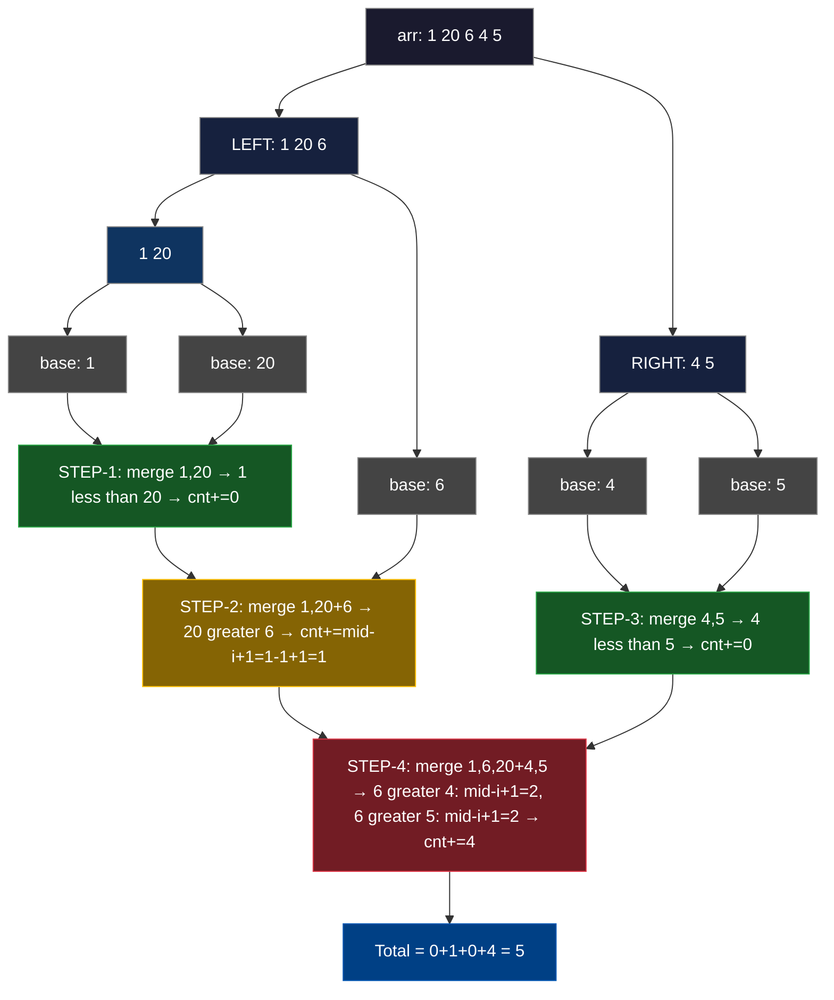
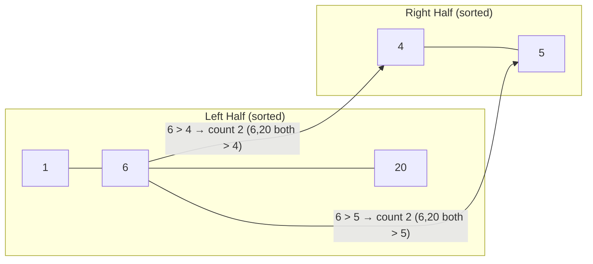

# Count Inversions

## Problem Link
🔗 [GFG — Count Inversions](https://www.geeksforgeeks.org/problems/inversion-of-array-1587115620/1)

---

## What is this Problem?

Given an array, count the number of **inversions**.

An **inversion** is a pair `(i, j)` where `i < j` but `arr[i] > arr[j]`  
(a bigger number appears **before** a smaller number).

**Example:**
```
arr = [1, 20, 6, 4, 5]

Inversions:
  (20,6), (20,4), (20,5), (6,4), (6,5)

Total = 5
```

---

## The Problem Explained

Think of it like a **queue where people are out of order**.

If a taller person is standing **in front of** a shorter person, that's an inversion — they shouldn't be in that order.

```
arr = [2, 4, 1, 3, 5]

Who is out of order?
  (2,1) → 2 > 1 and 2 comes before 1 ✓ inversion
  (4,1) → 4 > 1 and 4 comes before 1 ✓ inversion
  (4,3) → 4 > 3 and 4 comes before 3 ✓ inversion 

Total = 3
```

---

## HOOK TO REMEMBER FOREVER

**"USE MERGE SORT — COUNT INVERSIONS WHILE MERGING"**

- ✅ Brute force (2 loops) = O(n²) → Too slow
- ✅ Merge Sort approach = **O(n log n)** → Optimal
- ✅ Key insight: when merging two sorted halves, if `left[i] > right[j]`, then ALL remaining elements in the left half are also > `right[j]` → count them all at once

---

## The Key Insight — Array Split + `cnt` Update

### 🔀 Recursion Tree



---

### 📊 Formula: How `cnt` is Calculated at Each Step

| Step | Merge | Comparison | Formula `mid-i+1` | cnt added | Total cnt |
|---|---|---|---|---|---|
| 1 | `[1]` + `[20]` | 1 < 20 → no inversion | — | **+0** | 0 |
| 2 | `[1,20]` + `[6]` | 1 < 6 → skip | — | — | 0 |
|   |  | **20 > 6** → inversion | `mid=1, i=1` → `1-1+1 = 1` | **+1** | **1** |
| 3 | `[4]` + `[5]` | 4 < 5 → no inversion | — | **+0** | 1 |
| 4 | `[1,6,20]` + `[4,5]` | 1 < 4 → skip | — | — | 1 |
|   |  | **6 > 4** → inversion | `mid=2, i=1` → `2-1+1 = 2` | **+2** | **3** |
|   |  | **6 > 5** → inversion | `mid=2, i=1` → `2-1+1 = 2` | **+2** | **5** |

> ✅ **Final Answer = 5**  
> `mid-i+1` = number of elements remaining in left half from index `i` to `mid` — all of them are greater than `right[j]` since left is sorted!

---


## How Merge Step Counts Inversions

When merging **sorted** left `[i...mid]` and right `[mid+1...high]`:

```
Left  (sorted): [1, 6, 20]
Right (sorted): [4, 5]

Compare left[i] vs right[j]:

  i=0 (1) vs j=0 (4):  1 < 4  → no inversion, take 1
  i=1 (6) vs j=0 (4):  6 > 4  → 6 AND everything after it in left > 4
                                → count = (mid - i + 1) = 2  [6, 20]
                                → take 4
  i=1 (6) vs j=1 (5):  6 > 5  → 6 AND everything after > 5
                                → count = (mid - i + 1) = 2  [6, 20]
                                → take 5
  Right exhausted → take remaining left [6, 20] → no more inversions

Cross inversions = 2 + 2 = 4
```



---

## Code — Full Solution (with Line-by-Line Explanation)

---

### `merge` function

```cpp
int merge(vector<int>& nums, int low, int high, int mid) {
```
> Merges two sorted halves `[low...mid]` and `[mid+1...high]` and **returns inversion count** from cross comparisons.

---

```cpp
    int i = low, j = mid + 1;
```
> `i` starts at the **beginning of the left half**, `j` at the **beginning of the right half**.  
> These are the two pointers walking through both halves simultaneously.

---

```cpp
    vector<int> temp;
    int cnt = 0;
```
> `temp` = a helper array to store the merged (sorted) result.  
> `cnt` = inversion counter, starts at 0.

---

```cpp
    while (i <= mid && j <= high) {
        if (nums[i] <= nums[j]) {
            temp.push_back(nums[i++]);
```
> If left element ≤ right element → **no inversion**. Just pick it and move `i` forward.

---

```cpp
        } else {
            cnt += (mid - i + 1);   // ⭐ THE KEY LINE
            temp.push_back(nums[j++]);
        }
```
> `nums[i] > nums[j]` → inversion found!  
> **Why `(mid - i + 1)`?**  
> Because the left half is **already sorted**, every element from `i` to `mid` is also `> nums[j]`.  
> So instead of checking each one, we add them **all at once** in O(1).  
> Then pick `nums[j]` (the smaller one) into temp and move `j` forward.

---

```cpp
    while (i <= mid)  temp.push_back(nums[i++]);
    while (j <= high) temp.push_back(nums[j++]);
```
> One half may still have leftover elements after the main loop ends.  
> Pick them all — **no new inversions here** (right half is already exhausted or left half elements have no right partner left to compare against).

---

```cpp
    for (int i = low; i <= high; i++)
        nums[i] = temp[i - low];
```
> Copy the sorted `temp` array back into the original `nums`.  
> `temp[0]` corresponds to `nums[low]`, so offset = `i - low`.

---

### `mergeSort` function

```cpp
int mergeSort(vector<int>& nums, int low, int high) {
    if (low >= high) return 0;
```
> **Base case**: a single element (or empty) has **0 inversions**. Stop recursing.

---

```cpp
    int mid = (low + high) / 2;
```
> Find the midpoint to split the array into two halves.

---

```cpp
    cnt += mergeSort(nums, low, mid);       // inversions entirely in left half
    cnt += mergeSort(nums, mid + 1, high);  // inversions entirely in right half
    cnt += merge(nums, low, high, mid);     // inversions across left and right
```
> **Three sources of inversions:**
> 1. Both elements in the left half
> 2. Both elements in the right half
> 3. Left element > right element (cross inversions) — counted during merge

---

```cpp
    return cnt;
}
```
> Return the total inversion count accumulated so far up the recursion tree.

---

## Step-by-Step Trace

```
arr = [1, 20, 6, 4, 5]

mergeSort(0,4)
  ├── mergeSort(0,2) → sort [1,20,6]
  │     ├── mergeSort(0,1) → sort [1,20] → inversions = 0
  │     ├── mergeSort(2,2) → [6] → inversions = 0
  │     └── merge [1,20] and [6] → [1,6,20], inversions = 1  (20 > 6)
  │
  ├── mergeSort(3,4) → sort [4,5]
  │     └── merge [4] and [5] → [4,5], inversions = 0
  │
  └── merge [1,6,20] and [4,5] → [1,4,5,6,20]
        (6 > 4 → +2), (6 > 5 → +2) = 4 cross inversions

Total = 0 + 1 + 0 + 4 = 5 ✓
```

---

## Why `cnt += (mid - i + 1)`?

```
When nums[i] > nums[j]:

Left half is sorted, so nums[i], nums[i+1], ..., nums[mid]
are ALL greater than nums[j].

That's (mid - i + 1) elements — count them all in ONE shot!

This is why Merge Sort gives O(n log n) instead of O(n²).
```

---

## Time & Space Complexity

| | Complexity |
|---|---|
| **Time** | O(n log n) |
| **Space** | O(n) — temp array in merge |

---

## References

- 🔗 [GFG — Count Inversions](https://www.geeksforgeeks.org/problems/inversion-of-array-1587115620/1)
