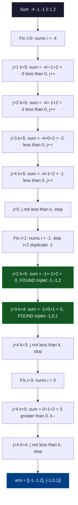

# Three Sum

## Problem Link
🔗 [LeetCode 15 — 3Sum](https://leetcode.com/problems/3sum/)  
🔗 [GFG — Three Sum](https://www.geeksforgeeks.org/find-a-triplet-that-sum-to-a-given-value/)

---

## What is this Problem?

Given an array `nums`, find **all unique triplets** `[a, b, c]` such that:

```
a + b + c = 0
```

No duplicate triplets allowed in the answer.

**Example:**
```
nums = [-1, 0, 1, 2, -1, -4]

Output: [[-1, -1, 2], [-1, 0, 1]]

nums = [0, 0, 0]
Output: [[0, 0, 0]]

nums = [1, 2, 3]
Output: []  (no triplet sums to 0)
```

---

## The Problem Explained

Think of it like finding **3 friends whose scores cancel out to zero**.

One has -2, one has 1, one has 1 → they balance out!

```
nums = [-4, -1, -1, 0, 1, 2]
         ↑           ↑   ↑
         i           j   k

Fix i = -4, then find j and k such that j + k = 4
Fix i = -1, then find j and k such that j + k = 1 → (-1,0,1) and (-1,-1,2)
```

---

## HOOK TO REMEMBER FOREVER

**"SORT + FIX ONE + TWO POINTERS ON THE REST"**

- ✅ **Sort** the array first
- ✅ **Fix `i`** (outer loop), then use **two pointers** `j = i+1` and `k = n-1`
- ✅ If `sum > 0` → `k--` (need smaller), if `sum < 0` → `j++` (need bigger)
- ✅ If `sum == 0` → store triplet, then **skip duplicates** for both `j` and `k`
- ✅ Skip duplicate `i` with `if (i > 0 && nums[i] == nums[i-1]) continue`
- ✅ O(n²) time, O(1) extra space

---

## The Key Insight — Two Pointer After Sorting

### 🔀 How It Works



---

### 📊 Two Pointer Logic at Each Step

| `i` fixed | `j` | `k` | sum | Action |
|---|---|---|---|---|
| -4 | -1 | 2 | -3 | sum less than 0 → `j++` |
| -4 | 0 | 2 | -2 | sum less than 0 → `j++` |
| -4 | 1 | 2 | -1 | sum less than 0 → `j++` |
| **-1** | **-1** | **2** | **0** | ✅ **Found! store [-1,-1,2]** |
| **-1** | **0** | **1** | **0** | ✅ **Found! store [-1,0,1]** |
| 0 | 1 | 2 | 3 | sum greater than 0 → `k--` |

---

## Code — Full Solution (with Line-by-Line Explanation)

---

```cpp
sort(nums.begin(), nums.end());
```
> **Why sort?** Three reasons:
> 1. **Two pointers only work on sorted arrays** — we need the guarantee that moving `j` right always increases the value and moving `k` left always decreases it. Without sorting, this guarantee breaks.
> 2. **Easy duplicate skipping** — after sorting, all duplicates are adjacent, so we can skip them with a simple `nums[i] == nums[i-1]` check.
> 3. **Avoids extra data structure** — without sorting, you'd need a HashSet to detect duplicates, costing O(n) extra space.

---

```cpp
for (int i = 0; i < n; i++) {
    if (i > 0 && nums[i] == nums[i - 1])
        continue;
```
> **Skip duplicate `i`.**  
> `i > 0` check avoids going out of bounds at index `-1`.  
> If `nums[i]` is same as previous `nums[i-1]`, we already processed this value — skip to avoid duplicate triplets.

---

```cpp
    int j = i + 1;
    int k = n - 1;
```
> `j` starts just after `i`, `k` starts at the end.  
> Together they cover all remaining elements with two pointers approaching each other.

---

```cpp
    while (j < k) {
        int sum = nums[i] + nums[j] + nums[k];
        if (sum > 0) {
            k--;
        } else if (sum < 0) {
            j++;
        } else {
```
> **Two pointer decision:**  
> `sum > 0` → right side is too big → move `k` left to get a smaller number  
> `sum < 0` → left side is too small → move `j` right to get a bigger number  
> `sum == 0` → triplet found!

---

```cpp
            ans.push_back({nums[i], nums[j], nums[k]});
            j++;
            k--;
            while (j < k && nums[j] == nums[j - 1])
                j++;
            while (j < k && nums[k] == nums[k + 1])
                k--;
```
> After storing the triplet, move both pointers inward.  
> **Skip duplicate `j`:** if `nums[j]` equals the previous value, we'd form the same triplet again — skip.  
> **Skip duplicate `k`:** same reason for the right pointer.  
> `j < k` guard prevents crossing over.

---

## Step-by-Step Trace

```
nums = [-1, 0, 1, 2, -1, -4]
After sort: [-4, -1, -1, 0, 1, 2]
             0    1   2  3  4  5

i=0 (nums[i]=-4): j=1, k=5
  sum = -4 + -1 + 2 = -3 < 0 → j++
  sum = -4 + -1 + 2 = -3 < 0 → j++  (j=2)
  sum = -4 + 0 + 2  = -2 < 0 → j++  (j=3)
  sum = -4 + 1 + 2  = -1 < 0 → j++  (j=4)
  sum = -4 + 1 + 2  = -1 < 0 → j++  (j=5)
  j=5 not < k=5 → stop

i=1 (nums[i]=-1): j=2, k=5
  sum = -1 + -1 + 2 = 0 ✅ → store [-1,-1,2], j=3, k=4
  skip dup j: nums[3]=0 ≠ nums[2]=-1, no skip
  skip dup k: nums[4]=1 ≠ nums[5]=2, no skip
  sum = -1 + 0 + 1 = 0 ✅ → store [-1,0,1], j=4, k=3
  j=4 not < k=3 → stop

i=2 (nums[i]=-1): nums[2]==nums[1] → skip (duplicate i)

i=3 (nums[i]=0): j=4, k=5
  sum = 0 + 1 + 2 = 3 > 0 → k--
  k=4, j=4 not < k=4 → stop

ans = [[-1,-1,2], [-1,0,1]] ✅
```

---

## Why Skip Duplicates After Finding a Triplet?

```
Suppose sorted array has: ... -1 -1 -1 0 1 ...
                                      ↑       ↑
                                      j       k

After storing [-1, 0, 1]:
j moves to next -1 → same triplet again! ❌

So we skip all j where nums[j] == nums[j-1]
Same logic for k going left.
```

---

## Time & Space Complexity

| | Complexity |
|---|---|
| **Time** | O(n²) — outer loop O(n) × two pointers O(n) |
| **Space** | O(1) extra (output array not counted) |

---

## References

- 🔗 [LeetCode 15 — 3Sum](https://leetcode.com/problems/3sum/)
- 🔗 [GFG — Three Sum](https://www.geeksforgeeks.org/find-a-triplet-that-sum-to-a-given-value/)
