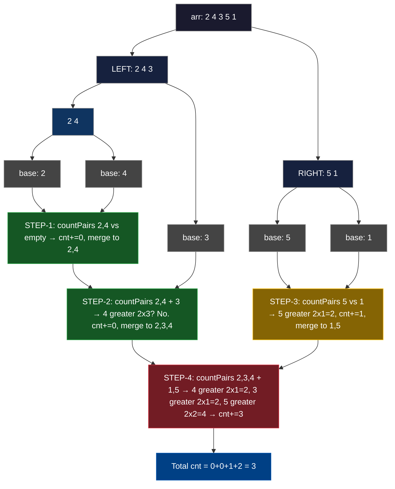

# Reverse Pairs

## Problem Link
🔗 [LeetCode 493 — Reverse Pairs](https://leetcode.com/problems/reverse-pairs/)  
🔗 [GFG — Count Reverse Pairs](https://www.geeksforgeeks.org/count-reverse-pairs/)

---

## What is this Problem?

Given an array `nums`, count the number of **reverse pairs**.

A **reverse pair** is a pair `(i, j)` where `i < j` AND `nums[i] > 2 * nums[j]`.

**Example:**
```
nums = [2, 4, 3, 5, 1]

Reverse pairs (i < j and nums[i] > 2*nums[j]):
  (4, 1) → 4 > 2*1 = 2 ✓
  (3, 1) → 3 > 2*1 = 2 ✓
  (5, 1) → 5 > 2*1 = 2 ✓
  (5, 2) → 5 > 2*2 = 4 ✓ (wait, 5>4 ✓)

Total = 3
```

---

## The Problem Explained

Think of it like a **"twice as big" rule in a queue**.

A reverse pair exists when someone standing earlier is **more than double** the value of someone standing later.

```
nums = [2, 4, 3, 5, 1]

Check who is "more than twice" of someone after them:
  5 is before 1 → 5 > 2×1 = 2 ✓ reverse pair
  4 is before 1 → 4 > 2×1 = 2 ✓ reverse pair
  3 is before 1 → 3 > 2×1 = 2 ✓ reverse pair
```

> ⚠️ **Difference from Count Inversions:** Here the condition is `nums[i] > 2 * nums[j]`, NOT just `nums[i] > nums[j]`.

---

## HOOK TO REMEMBER FOREVER

**"MERGE SORT — COUNT PAIRS BEFORE MERGING, MERGE AFTER"**

- ✅ Same Merge Sort skeleton as Count Inversions
- ✅ **Key difference:** `countPairs()` runs **BEFORE** `merge()` — because merge sorts the array, destroying pair relationships
- ✅ In `countPairs()`: for each `i` in left half, count how many `j` in right half satisfy `nums[i] > 2 * nums[j]`
- ✅ Right pointer `right` never resets — it only moves forward (both halves sorted → monotonic)
- ✅ `cnt += right - (mid + 1)` counts all valid right-half elements for current `i`

---

## The Key Insight — Why countPairs BEFORE merge?

```
countPairs uses the fact that both halves are already SORTED.
If you merge first → left and right halves get mixed → you lose track of which
element came from left and which from right → counting becomes impossible.

So always:
  1. Sort left half (recursive)
  2. Sort right half (recursive)
  3. countPairs on two sorted halves  ← BEFORE merge
  4. merge the two sorted halves
```

---

## The Key Insight — How countPairs Works

### 🔀 Recursion Tree + cnt Update



---

### 📊 Formula: How `cnt` is Calculated in `countPairs`

| Left i | Right j | Condition | Formula `right - (mid+1)` | cnt added | Total cnt |
|---|---|---|---|---|---|
| STEP-1: no pairs across | | | | **+0** | 0 |
| STEP-2: 4 vs 3 | 4 greater 2×3=6? No | — | 0 | **+0** | 0 |
| STEP-3: 5 vs 1 | 5 greater 2×1=2? Yes | `right=2, mid+1=1` → `2-1=1` | **+1** | **1** |
| STEP-4: 4 vs 1 | 4 greater 2×1=2? Yes, right moves | `right=mid+2` | — | — | 1 |
|  | 4 vs 5 | 4 greater 2×5=10? No, stop | `right-(mid+1) = 1` | **+1** | 2 |
|  | 3 vs 1 | 3 greater 2×1=2? Yes, right already at mid+2 | `right-(mid+1) = 1` | **+1** | 3 |

> ✅ **Final Answer = 3**  
> `right - (mid+1)` counts how many right-half elements from `mid+1` to `right-1` satisfy `nums[i] > 2 * nums[j]`.  
> Since left is sorted and right is sorted, `right` pointer **never goes back** — O(n) per merge level.

---

## Code — Full Solution (with Line-by-Line Explanation)

---

### `countPairs` function

```cpp
int countPairs(vector<int>& nums, int low, int mid, int high) {
```
> Called on two **already-sorted** halves: `[low...mid]` and `[mid+1...high]`.  
> Returns count of pairs `(i, j)` where `nums[i] > 2 * nums[j]`.

---

```cpp
    int right = mid + 1;
```
> `right` starts at the beginning of the right half.  
> This pointer **never resets** across iterations of `i` — because left is sorted, if `nums[i] > 2*nums[right]` fails, all future `nums[i]` (which are bigger) would also fail... wait, left is sorted ascending, so actually `right` only moves forward because left values increase.

---

```cpp
    for (int i = low; i <= mid; i++) {
        while (right <= high && nums[i] > 2 * nums[right])
            right++;
        cnt += right - (mid + 1);
    }
```
> For each `i` in the left half:  
> Advance `right` as long as `nums[i] > 2 * nums[right]`.  
> When `right` stops, all elements from `mid+1` to `right-1` are valid partners for this `i`.  
> **Count = `right - (mid+1)`**  
> Since left is sorted ascending, `right` only moves forward → O(n) total across all `i`.

---

### `mergeSort` function

```cpp
    cnt += countPairs(nums, low, mid, high);   // ← BEFORE merge
    merge(nums, low, high, mid);               // ← AFTER countPairs
```
> **Order matters critically.**  
> `countPairs` needs both halves sorted but unmixed.  
> `merge` destroys that separation by combining them.  
> So count first, then merge.

---

## Step-by-Step Trace

```
nums = [2, 4, 3, 5, 1]
       0   1  2  3  4

mergeSort(0,4)
  ├── mergeSort(0,2) → sort [2,4,3]
  │     ├── mergeSort(0,1) → sort [2,4]
  │     │     countPairs([2],[4]): 2 > 2×4=8? No → cnt=0
  │     │     merge → [2,4]
  │     ├── mergeSort(2,2) → [3] base case
  │     │
  │     └── countPairs([2,4],[3]):
  │           i=0 (2): 2 > 2×3=6? No → cnt += 0
  │           i=1 (4): 4 > 2×3=6? No → cnt += 0
  │           Total: cnt=0
  │           merge → [2,3,4]
  │
  ├── mergeSort(3,4) → sort [5,1]
  │     countPairs([5],[1]): 5 > 2×1=2? Yes, right=4+1=5
  │     cnt += 5-4 = 1
  │     merge → [1,5]
  │
  └── countPairs([2,3,4],[1,5]):
        i=0 (2): 2 > 2×1=2? No (not strictly greater) → right stays at 3, cnt += 3-3=0
        i=1 (3): 3 > 2×1=2? Yes → right=4, 3 > 2×5=10? No → cnt += 4-3=1
        i=2 (4): 4 > 2×1=2? right already at 4, 4>2×5=10? No → cnt += 4-3=1
        Cross cnt = 2
        merge → [1,2,3,4,5]

Total cnt = 0 + 0 + 1 + 2 = 3 ✅
```

---

## Difference: Count Inversions vs Reverse Pairs

| | Count Inversions | Reverse Pairs |
|---|---|---|
| **Condition** | `nums[i] > nums[j]` | `nums[i] > 2 * nums[j]` |
| **Count in merge?** | Yes, during merge | No, **separate countPairs before merge** |
| **Why different?** | During merge we know which is bigger | `2×` factor can't be tracked during merge |

---

## Time & Space Complexity

| | Complexity |
|---|---|
| **Time** | O(n log n) — Merge Sort + O(n) countPairs per level |
| **Space** | O(n) — temp array in merge |

---

## References

- 🔗 [LeetCode 493 — Reverse Pairs](https://leetcode.com/problems/reverse-pairs/)
- 🔗 [GFG — Count Reverse Pairs](https://www.geeksforgeeks.org/count-reverse-pairs/)
