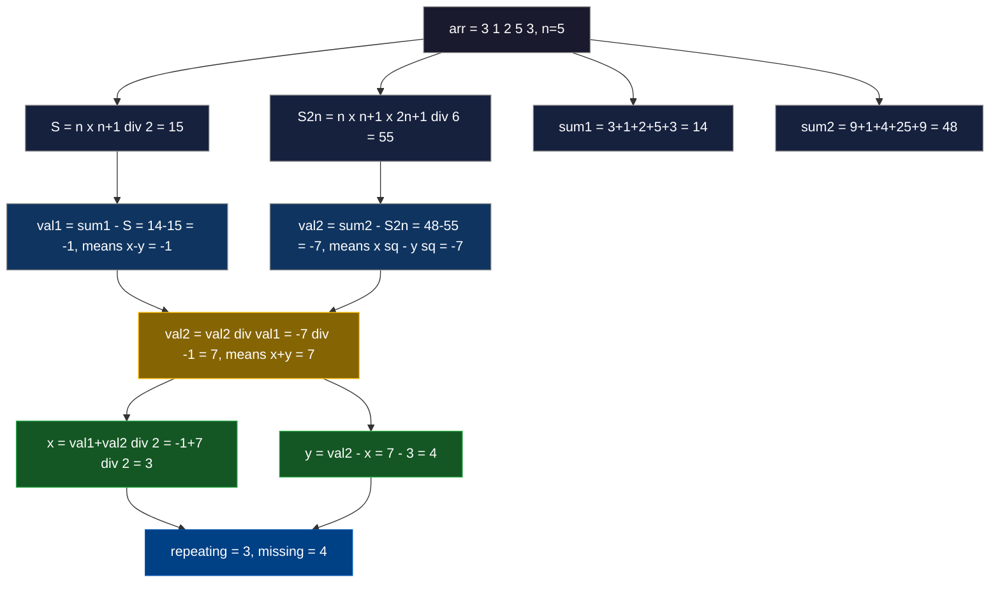

# Missing and Repeating Number

## Problem Link
🔗 [GFG — Missing and Repeating](https://www.geeksforgeeks.org/find-a-repeating-and-a-missing-number/)  
🔗 [LeetCode 645 — Set Mismatch](https://leetcode.com/problems/set-mismatch/)

---

## What is this Problem?

Given an array of size `n` containing numbers from `1 to n`, **one number repeats** and **one number is missing**.  
Find both: `[repeating, missing]`.

**Example:**
```
arr = [3, 1, 2, 5, 3]  (n=5, so should contain 1,2,3,4,5)

3 appears twice → repeating = 3
4 is missing   → missing   = 4

Output: [3, 4]
```

---

## The Problem Explained

Think of it like **attendance in a class of 5 students** (numbered 1 to 5).

One student came **twice** (duplicated roll number), and one student is **absent** (missing roll number).

```
Expected rolls: 1 2 3 4 5
Actual rolls:   1 2 3 3 5

3 came twice → repeating
4 never came → missing
```

---

## HOOK TO REMEMBER FOREVER

**"USE MATH — SUM AND SUM OF SQUARES EQUATIONS"**

- ✅ Let `x` = repeating number, `y` = missing number
- ✅ `val1 = sum(arr) - sum(1..n)` → gives `x - y`
- ✅ `val2 = sumSq(arr) - sumSq(1..n)` → gives `x² - y²` = `(x-y)(x+y)`
- ✅ `val2 / val1` → gives `x + y`
- ✅ Now solve: `x = (val1 + val2) / 2`, `y = val2 - x`
- ✅ Use `long long` to avoid overflow

---

## The Key Insight — Math Equations

### Setting Up the Equations

```
Let x = repeating number
Let y = missing number

Equation 1:
  sum(arr) - sum(1..n) = x - y
  → val1 = x - y

Equation 2:
  sumSq(arr) - sumSq(1..n) = x² - y²
                            = (x - y)(x + y)
  → val2 = (x - y)(x + y)

Divide eq2 by eq1:
  val2 / val1 = x + y
  → val2 = x + y   (reassigned)

Now solve two simple equations:
  x - y = val1
  x + y = val2
  ─────────────
  2x = val1 + val2  → x = (val1 + val2) / 2
  y  = val2 - x
```

---

### 🔀 Flow of Calculation



---

### 📊 Step-by-Step Calculation Table

| Variable | Formula | Value | Meaning |
|---|---|---|---|
| `S` | `n*(n+1)/2` | 15 | Expected sum of 1..5 |
| `S2n` | `n*(n+1)*(2n+1)/6` | 55 | Expected sum of squares 1²+..+5² |
| `sum1` | sum of array | 14 | Actual sum |
| `sum2` | sum of squares | 48 | Actual sum of squares |
| `val1` | `sum1 - S` | -1 | = x - y |
| `val2` | `sum2 - S2n` | -7 | = x² - y² = (x-y)(x+y) |
| `val2 /= val1` | `-7 / -1` | **7** | = x + y |
| `x` | `(val1 + val2) / 2` | **3** | repeating number |
| `y` | `val2 - x` | **4** | missing number |

---

## Code — Full Solution (with Line-by-Line Explanation)

---

```cpp
long long n = arr.size();
long long S = (n * (n + 1)) / 2;
long long S2n = (n * (n + 1) * (2 * n + 1)) / 6;
```
> `S` = expected sum of `1 + 2 + ... + n` using formula.  
> `S2n` = expected sum of squares `1² + 2² + ... + n²` using formula.  
> Both use `long long` to prevent **integer overflow** for large `n`.

---

```cpp
long long sum1 = 0;
long long sum2 = 0;

for (int &el : arr) {
    sum1 += el;
    sum2 += 1LL * el * el;
}
```
> `sum1` = actual sum of the array.  
> `sum2` = actual sum of squares.  
> `1LL * el * el` — multiplying `el * el` directly could overflow `int` for large values. Casting one operand to `long long` forces the whole multiplication to use 64-bit.

---

```cpp
long long val1 = sum1 - S;
long long val2 = sum2 - S2n;
```
> `val1 = x - y` (where x = repeating, y = missing).  
> `val2 = x² - y²` = `(x-y)(x+y)`.

---

```cpp
val2 = val2 / val1;
```
> **Divides equation 2 by equation 1:**  
> `(x-y)(x+y) / (x-y)` = `x + y`  
> Now `val2` is repurposed to store `x + y`.  
> Safe division because `val1 = x - y` is never 0 (repeating ≠ missing always).

---

```cpp
long long x = (val1 + val2) / 2;
long long y = val2 - x;
```
> **Solve the two equations:**  
> `x - y = val1` and `x + y = val2`  
> Adding them: `2x = val1 + val2` → `x = (val1 + val2) / 2`  
> Then `y = val2 - x` = `(x + y) - x` = `y` ✓

---

## Step-by-Step Trace

```
arr = [3, 1, 2, 5, 3], n = 5

Expected:
  S   = 5×6/2          = 15
  S2n = 5×6×11/6       = 55

Actual:
  sum1 = 3+1+2+5+3     = 14
  sum2 = 9+1+4+25+9    = 48

val1 = 14 - 15 = -1    → x - y = -1
val2 = 48 - 55 = -7    → x² - y² = -7

val2 = -7 / -1 = 7     → x + y = 7

x = (-1 + 7) / 2 = 3   → repeating = 3 ✓
y = 7 - 3       = 4    → missing   = 4 ✓

Output: [3, 4] ✅
```

---

## Why `long long`?

```
If n = 10^5:
  n * n = 10^10 → exceeds int max (≈ 2.1 × 10^9)

  sum2 can reach n³ level → must use long long throughout.
  1LL * el * el forces 64-bit multiplication.
```

---

## Time & Space Complexity

| | Complexity |
|---|---|
| **Time** | O(n) — single pass through the array |
| **Space** | O(1) — only variables, no extra array |

---

## References

- 🔗 [GFG — Missing and Repeating](https://www.geeksforgeeks.org/find-a-repeating-and-a-missing-number/)
- 🔗 [LeetCode 645 — Set Mismatch](https://leetcode.com/problems/set-mismatch/)
