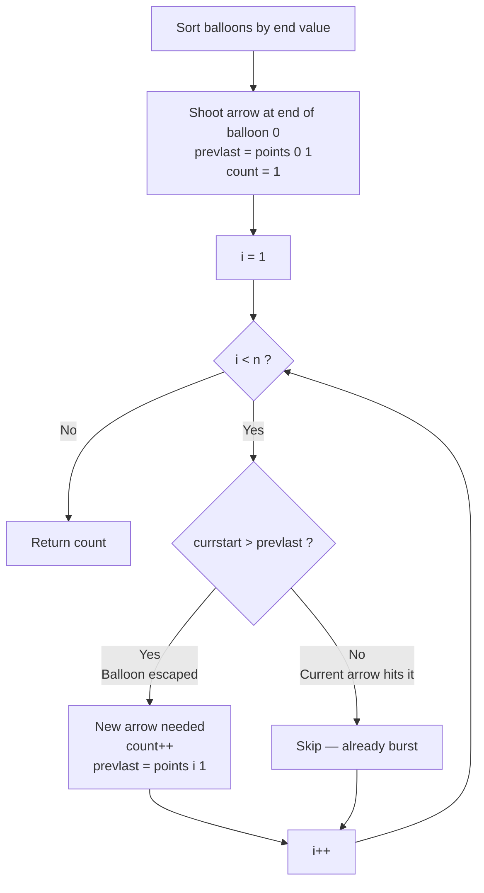
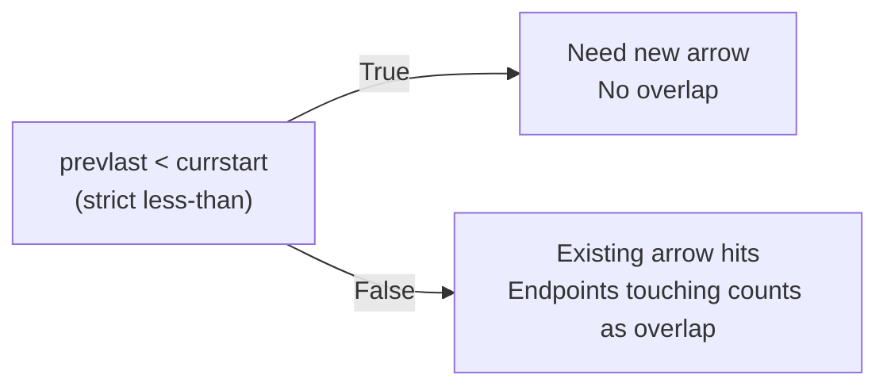
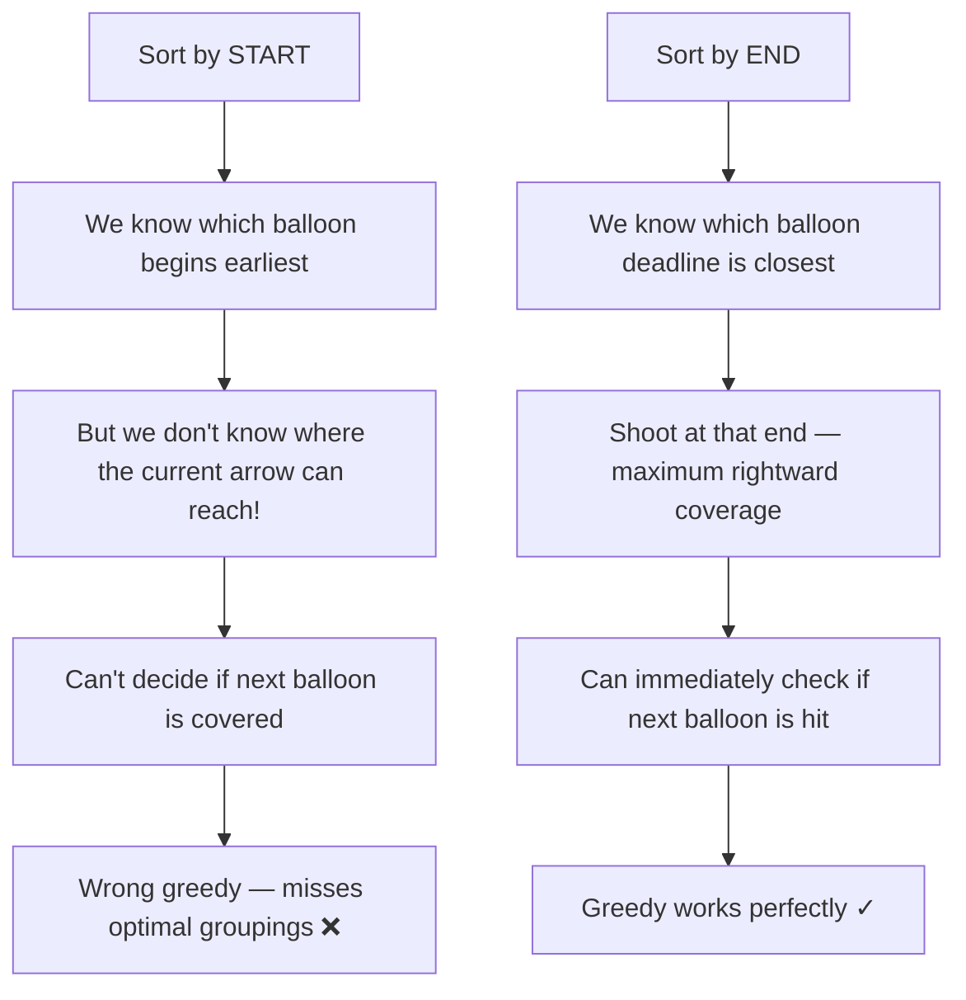

# Minimum Number of Arrows to Burst Balloons

## Problem Link
🔗 [LeetCode 452 — Minimum Number of Arrows to Burst Balloons](https://leetcode.com/problems/minimum-number-of-arrows-to-burst-balloons/)

---

## What is this Problem?

There are **balloons** spread along a wall. Each balloon occupies a horizontal range `[start, end]`. An arrow shot **vertically** at position `x` bursts every balloon whose range **includes** `x` (i.e. `start <= x <= end`).

Find the **minimum number of arrows** needed to burst **all balloons**.

**Examples:**
```
points = [[10,16],[2,8],[1,6],[7,12]]

Sorted by end:  [[1,6],[2,8],[7,12],[10,16]]

Arrow 1 at x=6:  bursts [1,6] and [2,8]
Arrow 2 at x=12: bursts [7,12] and [10,16]

Answer: 2 ✓


points = [[1,2],[3,4],[5,6],[7,8]]

No balloons overlap at all.
Each needs its own arrow.

Answer: 4 ✓


points = [[1,2],[2,3],[3,4],[4,5]]

Sorted by end: [[1,2],[2,3],[3,4],[4,5]]
Arrow 1 at x=2: bursts [1,2] and [2,3]
Arrow 2 at x=4: bursts [3,4] and [4,5]

Answer: 2 ✓
```

---

## The Problem Explained

Think of it like **skewering overlapping pancakes** on a stack:

```
Pancakes (balloons) laid out on a table:

[1  ──────  6]       balloon A
  [2  ─────────  8]  balloon B
              [7  ──────  12]  balloon C
                  [10  ──────────  16]  balloon D

Skewer 1 anywhere in [1,6] → goes through A and B (they overlap there)
Skewer 2 anywhere in [7,12] → goes through C and D

2 skewers = 2 arrows ✓

Key: find the positions where the MOST balloons overlap,
     and shoot there. Greedy!
```

**Key idea:** Sort balloons by their **end position**. Shoot an arrow at the end of the first balloon. It bursts every balloon that overlaps there. Skip all burst balloons. Repeat for the next unbursted one!

---

## HOOK TO REMEMBER FOREVER

**"SORT BY END, SHOOT AT END, SKIP OVERLAPS, COUNT NEW ARROWS"**

Every time you see "minimum arrows / intervals / shots to cover all ranges":
- ✅ Sort intervals by **end value** (not start!)
- ✅ Start with 1 arrow at `prevlast = points[0][1]` (end of first balloon)
- ✅ For each next balloon: if `currstart > prevlast` → it's NOT hit by the current arrow → need a new arrow → `count++`, update `prevlast`
- ✅ If `currstart <= prevlast` → current arrow already hits it → skip
- ✅ O(n log n) for sort + O(n) scan = **O(n log n)** total

**Remember: Shoot at the earliest end. If the next balloon starts after that shot, it escapes — fire again!** 🎯

---

## How It Works Step By Step

### Why Sort by END (not start)?

```
Greedy choice: always shoot at the END of the current balloon.

Why the end?
  Shooting at the end of balloon A maximizes the chance of
  also hitting balloons that start before A ends.
  Any balloon that starts AFTER A's end cannot be hit — needs new arrow.

If we sorted by start:
  We'd know which balloon starts earliest, but not
  whether the current arrow already handles the next one.
  Sorting by end gives us the "latest we can delay a new arrow."
```

### The Strategy

```
points = [[10,16],[2,8],[1,6],[7,12]]

Step 1: Sort by end
  [[1,6],[2,8],[7,12],[10,16]]
      ↑     ↑      ↑       ↑
    end=6  end=8  end=12  end=16

Step 2: Shoot first arrow at end of first balloon
  count=1, prevlast=6

Step 3: Scan remaining balloons
  [2,8]:   currstart=2, prevlast=6. 2 <= 6 → already hit! skip.
  [7,12]:  currstart=7, prevlast=6. 7 > 6  → ESCAPED! count=2, prevlast=12
  [10,16]: currstart=10, prevlast=12. 10 <= 12 → already hit! skip.

Return count = 2 ✓
```

### Visual — Balloon Ranges on a Number Line

```
Position:  1  2  3  4  5  6  7  8  9 10 11 12 13 14 15 16

[1,6]      ██████████████
[2,8]         ████████████████
[7,12]                     ██████████████
[10,16]                          ████████████████████████

Arrow 1:             ↑ (at x=6)
                  Hits [1,6] ✓  and  [2,8] ✓

Arrow 2:                           ↑ (at x=12)
                  Hits [7,12] ✓  and  [10,16] ✓
```

---

## Mermaid — Greedy Decision Flow



---

## Mermaid — Arrow Coverage on Sorted Intervals

```mermaid
gantt
    title Balloon Ranges (sorted by end)
    dateFormat X
    axisFormat %s

    section Balloon A
    [1 - 6]   : 1, 6
    section Balloon B
    [2 - 8]   : 2, 8
    section Balloon C
    [7 - 12]  : 7, 12
    section Balloon D
    [10 - 16] : 10, 16
```



---

## Code Full Solution

```cpp
class Solution {
public:
    static bool comp(vector<int> &v1, vector<int> &v2) {
        return v1[1] < v2[1];
    }

    int findMinArrowShots(vector<vector<int>>& points) {
        sort(points.begin(), points.end(), comp);

        int n = points.size();
        int count = 1;
        int prevlast = points[0][1];

        for (int i = 1; i < n; i++) {
            int currstart = points[i][0];
            if (prevlast < currstart) {
                count++;
                prevlast = points[i][1];
            }
        }

        return count;
    }
};
```

---

## Code Explanation

### Custom Comparator

```cpp
static bool comp(vector<int> &v1, vector<int> &v2) {
    return v1[1] < v2[1];
}
```

- Sorts balloons by their **end value** (`index [1]`) in ascending order
- The balloon that ends earliest comes first

**Why end value, not start?**
```
Sort by start → tells you who begins earliest, not who ends earliest.
  We can't decide if an arrow covers the next balloon without knowing
  where the current balloon ENDS.

Sort by end → the first balloon we process always has the
  earliest deadline. Shooting at its end is the greediest
  valid shot — it covers as many following balloons as possible.

This is the classic "interval scheduling" greedy insight. ✓
```

---

### Initialize the First Arrow

```cpp
int count = 1;
int prevlast = points[0][1];
```

- **`count = 1`:** We always need at least one arrow (input is non-empty)
- **`prevlast`:** The x-position of the last arrow fired = end of first balloon

```
After sorting, points[0] is the balloon with the smallest end.
We MUST shoot at or before its end to burst it.
Shooting exactly AT its end is optimal — gives maximum reach rightward.

prevlast = points[0][1]  ← shoot here
```

---

### The Greedy Scan

```cpp
for (int i = 1; i < n; i++) {
    int currstart = points[i][0];
    if (prevlast < currstart) {
        count++;
        prevlast = points[i][1];
    }
}
```

**Two cases every iteration:**

```
Case 1 — Balloon is already hit (prevlast >= currstart):
  The current arrow's position falls within [currstart, ...]
  → This balloon is burst by the existing arrow
  → Do nothing, continue

Case 2 — Balloon escapes (prevlast < currstart):
  The current arrow lands BEFORE this balloon starts
  → This balloon is NOT hit
  → Fire a new arrow at the END of this balloon (prevlast = points[i][1])
  → count++
```

**Why update `prevlast` to `points[i][1]` (end) and not `points[i][0]` (start)?**
```
When we fire a new arrow, we aim at the END of the current balloon.
Shooting at the end maximizes the chance of catching future balloons
that start anywhere up to that end position.

If we set prevlast = currstart (the start):
  We'd fire too early and miss balloons that start between
  currstart and the end of the current balloon. ❌

prevlast = points[i][1] = end → greedy optimal shot ✓
```

---

## Complete Example Traces

### Trace 1: Standard Case

```
points = [[10,16],[2,8],[1,6],[7,12]]

After sort by end:
  [[1,6],[2,8],[7,12],[10,16]]

count=1, prevlast=6

i=1: [2,8]   currstart=2,  prevlast=6.  2<=6  → skip (hit by arrow 1)
i=2: [7,12]  currstart=7,  prevlast=6.  7>6   → NEW ARROW. count=2, prevlast=12
i=3: [10,16] currstart=10, prevlast=12. 10<=12 → skip (hit by arrow 2)

Return 2 ✓
```

### Trace 2: No Overlaps

```
points = [[1,2],[3,4],[5,6],[7,8]]

After sort by end (already sorted):
  [[1,2],[3,4],[5,6],[7,8]]

count=1, prevlast=2

i=1: [3,4]  currstart=3, prevlast=2.  3>2 → NEW ARROW. count=2, prevlast=4
i=2: [5,6]  currstart=5, prevlast=4.  5>4 → NEW ARROW. count=3, prevlast=6
i=3: [7,8]  currstart=7, prevlast=6.  7>6 → NEW ARROW. count=4, prevlast=8

Return 4 ✓
(Every balloon needs its own arrow — no overlaps at all)
```

### Trace 3: Touching at Endpoints

```
points = [[1,2],[2,3],[3,4],[4,5]]

After sort by end (already sorted):
  [[1,2],[2,3],[3,4],[4,5]]

count=1, prevlast=2

i=1: [2,3]  currstart=2, prevlast=2.  2<=2 → skip (touching counts as overlap!)
i=2: [3,4]  currstart=3, prevlast=2.  3>2  → NEW ARROW. count=2, prevlast=4
i=3: [4,5]  currstart=4, prevlast=4.  4<=4 → skip (touching counts!)

Return 2 ✓

Key: prevlast < currstart (strict less-than) means touching endpoints
     are considered overlapping → one arrow bursts both. ✓
```

### Trace 4: All Balloons Fully Overlapping

```
points = [[1,10],[2,9],[3,8],[4,7]]

After sort by end:
  [[4,7],[3,8],[2,9],[1,10]]

count=1, prevlast=7

i=1: [3,8]  currstart=3, prevlast=7. 3<=7 → skip
i=2: [2,9]  currstart=2, prevlast=7. 2<=7 → skip
i=3: [1,10] currstart=1, prevlast=7. 1<=7 → skip

Return 1 ✓
(All balloons share a common point — one arrow at x=7 bursts all!)
```

### Trace 5: Single Balloon

```
points = [[3,9]]

count=1, prevlast=9
Loop doesn't run (n=1, i starts at 1).

Return 1 ✓
```

### Trace 6: Interleaved Ranges

```
points = [[1,5],[4,8],[6,10],[9,12]]

After sort by end (already sorted):
  [[1,5],[4,8],[6,10],[9,12]]

count=1, prevlast=5

i=1: [4,8]   currstart=4, prevlast=5.  4<=5 → skip (hit)
i=2: [6,10]  currstart=6, prevlast=5.  6>5  → NEW ARROW. count=2, prevlast=10
i=3: [9,12]  currstart=9, prevlast=10. 9<=10 → skip (hit)

Return 2 ✓
```

---

## Edge Cases

### Case 1: Single Balloon

```
Input: [[5,10]]
count=1, loop doesn't run.
Output: 1 ✓
```

### Case 2: All Same Range

```
Input: [[1,5],[1,5],[1,5]]
After sort: [[1,5],[1,5],[1,5]]
count=1, prevlast=5.
All currstart=1 <= prevlast=5 → all skipped.
Output: 1 ✓
```

### Case 3: Touching Endpoints `[1,2],[2,3]`

```
prevlast=2, currstart=2. 2 < 2 is FALSE → skip → 1 arrow.
Output: 1 ✓  (strict < means endpoints touching = overlapping)
```

### Case 4: Barely Not Overlapping `[1,2],[3,4]`

```
prevlast=2, currstart=3. 2 < 3 is TRUE → new arrow.
Output: 2 ✓
```

### Case 5: Large Negative Coordinates

```
Input: [[-2147483646,-2147483645],[2147483646,2147483647]]
sort by end works fine — no overflow in comparison.
No overlap → 2 arrows.
Output: 2 ✓
```

---

## Time Complexity

- **O(n log n)** — dominated by the sort
- Sorting n balloons by end: O(n log n)
- Single linear scan: O(n)
- Total: **O(n log n)**

---

## Space Complexity

- **O(1)** extra space (excluding input)
- Sort is in-place
- Only `count`, `prevlast`, `currstart` used
- Total extra space: **O(1)**

---

## Key Insights

### Greedy Correctness — Why Shooting at `prevlast` is Optimal

```
After sorting by end, whenever we fire an arrow, we fire it at
the END of the current unbursted balloon (prevlast = points[i][1]).

Could shooting EARLIER (before the end) be better?
  No. Shooting earlier would only reduce the coverage rightward.
  Any balloon that overlaps at the end also overlaps anywhere before it.
  Shooting at the end covers all of them AND maximizes right-side reach.

Could shooting LATER (after the end) be better?
  No. The balloon we MUST burst ends at points[i][1].
  Shooting after it would miss it entirely.

Shooting exactly at the end is the unique optimal choice. ✓
```

### Strict `<` vs `<=` — The Boundary Decision



```
prevlast < currstart  (STRICT):
  Touching endpoints [1,2] and [2,3]:
    prevlast=2, currstart=2 → 2 < 2 is FALSE → same arrow ✓
  An arrow at x=2 bursts both → correct.

If we used prevlast <= currstart (non-strict):
  Touching endpoints would be treated as NOT overlapping → wrong! ❌
```

### This Pattern Solects Many Interval Problems

```
The core greedy skeleton:
  1. Sort by end
  2. Track prevlast (the reach of the last action)
  3. If next interval starts beyond prevlast → new action needed

This same skeleton solves:
  → Minimum arrows to burst balloons (this problem)
  → Maximum non-overlapping intervals (count skipped intervals)
  → Activity selection problem
  → Interval scheduling maximization

Memorize: SORT BY END. TRACK PREVLAST. COUNT GAPS.
```

### Why Not Sort by Start?



---

## References

- 🔗 [LeetCode Problem — Minimum Number of Arrows to Burst Balloons](https://leetcode.com/problems/minimum-number-of-arrows-to-burst-balloons/)
- 🔗 [Concept — Minimum Number of Arrows to Burst Balloons](https://www.youtube.com/watch?v=zfcGwzfDNu0)