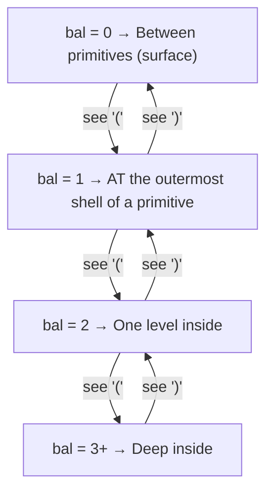

# Remove Outer Parentheses

## Problem Link
🔗 [LeetCode 1021 — Remove Outermost Parentheses](https://leetcode.com/problems/remove-outermost-parentheses/)

---

## What is this Problem?

A **primitive** string is a non-empty parentheses string that **cannot be split** into two non-empty valid parentheses strings.

Given a valid parentheses string `s`, remove the **outermost parentheses** of every primitive part and return the result.

**Examples:**
```
Input:  s = "(()())(())"
Output: "()()()"

Primitives: "(()())"  and  "(())"
Remove outer bracket of each:
  "(()())" → "()()"
  "(())"   → "()"
Result: "()()()" ✓

Input:  s = "(()())(())(()(()))"
Output: "()()()()(())"

Input:  s = "()()"
Output: ""
Both "()" are primitives.
Each has outer brackets removed → "" + "" = "" ✓
```

---

## The Problem Explained

Think of it like **nested boxes with a lid**:

```
Primitive: "(()())"

The OUTERMOST ( and ) are the LID of the box.
Everything INSIDE is the content.

  (  ()()  )
  ↑        ↑
 lid      lid   ← throw these away
    ↑↑↑↑
   content     ← keep this

Result: "()()"
```

Multiple primitives sit **side by side** in the string:

```
"(()())(())"
 ──────────   ← whole string
 ┌──────┐┌──┐
 │(()())││(())│
 └──────┘└──┘
    P1      P2

Remove outer ( ) of P1: "()()"
Remove outer ( ) of P2: "()"
Combine: "()()()"
```

**Key idea:** Use a **balance counter** to track depth. When `bal > 0`, you are **inside** a primitive (not at the outermost layer) — only then do you keep the character!

---

## HOOK TO REMEMBER FOREVER

**"BAL > 0 BEFORE OPEN = INNER. BAL > 0 AFTER CLOSE = INNER. ONLY INNER GETS KEPT."**

Every time you see "remove outermost parentheses":
- ✅ Use a `bal` counter — tracks how deep inside a primitive you are
- ✅ On `(`: add to result only if `bal > 0` (it's not the outermost open), then increment `bal`
- ✅ On `)`: decrement `bal` first, add to result only if `bal > 0` (it's not the outermost close)
- ✅ When `bal` drops to 0, one primitive is fully consumed — next `(` starts fresh
- ✅ O(n) time, O(1) extra space (excluding output)

**Remember: The outermost `(` sees bal=0 before increment. The outermost `)` sees bal=0 after decrement. Those are the only ones we skip!** 🔑

---

## How It Works Step By Step

### The Strategy

```
s = "(()())(())"

Think of bal as a DEPTH METER:
  bal = 0 → we're between primitives (at the surface)
  bal = 1 → we're at the outermost layer of a primitive
  bal > 1 → we're deep inside a primitive

Rule:
  '(' → if bal > 0 (not outermost open) → keep. Then bal++.
  ')' → bal-- first. If bal > 0 (not outermost close) → keep.
```

### Character-by-Character Walkthrough

```
s = "(()())(())"
     0123456789

i=0: s[i]='(' → bal=0, skip. bal→1
i=1: s[i]='(' → bal=1>0, KEEP. bal→2     result="("
i=2: s[i]=')' → bal→1, bal=1>0, KEEP.    result="()"
i=3: s[i]='(' → bal=1>0, KEEP. bal→2     result="()("
i=4: s[i]=')' → bal→1, bal=1>0, KEEP.    result="()()"
i=5: s[i]=')' → bal→0, bal=0, skip.      result="()()"   ← P1 ends
i=6: s[i]='(' → bal=0, skip. bal→1
i=7: s[i]='(' → bal=1>0, KEEP. bal→2     result="()()("
i=8: s[i]=')' → bal→1, bal=1>0, KEEP.    result="()()()"
i=9: s[i]=')' → bal→0, bal=0, skip.      result="()()()" ← P2 ends

Return "()()()" ✓
```

---

## Mermaid — Decision Flow per Character

```mermaid
flowchart TD
    A[Read character s_i] --> B{s_i == '(' ?}

    B -- Yes --> C{bal > 0 ?}
    C -- Yes --> D[Add '(' to result]
    C -- No  --> E[Skip — outermost open]
    D --> F[bal++]
    E --> F

    B -- No, it's ')' --> G[bal--]
    G --> H{bal > 0 ?}
    H -- Yes --> I[Add ')' to result]
    H -- No  --> J[Skip — outermost close]

    I --> K[Next character]
    J --> K
    F --> K
```

---

## Mermaid — Balance Tracker for `(()())(())`

```mermaid
graph LR
    S([Start bal=0])
    S -->|i=0 '(' skip| A[bal=1]
    A -->|i=1 '(' keep| B[bal=2]
    B -->|i=2 ')' keep| C[bal=1]
    C -->|i=3 '(' keep| D[bal=2]
    D -->|i=4 ')' keep| E[bal=1]
    E -->|i=5 ')' skip| F[bal=0 P1 ends]
    F -->|i=6 '(' skip| G[bal=1]
    G -->|i=7 '(' keep| H[bal=2]
    H -->|i=8 ')' keep| I[bal=1]
    I -->|i=9 ')' skip| J[bal=0 P2 ends]
```

---

## Code Full Solution

```cpp
class Solution {
public:
    string removeOuterParentheses(string s) {
        string result = "";
        int bal = 0;

        for (int i = 0; i < s.size(); i++) {
            if (s[i] == '(') {
                if (bal > 0) {
                    result += s[i];
                }
                bal++;
            } else {
                bal--;
                if (bal > 0) {
                    result += s[i];
                }
            }
        }

        return result;
    }
};
```

---

## Code Explanation

### Initialize

```cpp
string result = "";
int bal = 0;
```

- **`result`:** Accumulates all characters that are NOT outermost brackets
- **`bal`:** Balance counter — depth meter for how far inside a primitive we are

---

### Handling `(`

```cpp
if (s[i] == '(') {
    if (bal > 0) {
        result += s[i];
    }
    bal++;
}
```

**Order matters: check BEFORE incrementing**

```
Outermost '(' arrives when bal = 0:
  Check: bal > 0? → NO → skip (don't add to result)
  bal++ → bal becomes 1

Inner '(' arrives when bal ≥ 1:
  Check: bal > 0? → YES → keep it
  bal++ → go deeper

By checking BEFORE the increment:
  bal=0 means "I am the outermost open bracket" → skip
  bal>0 means "I am inside an existing primitive" → keep
```

---

### Handling `)`

```cpp
} else {
    bal--;
    if (bal > 0) {
        result += s[i];
    }
}
```

**Order matters: decrement BEFORE checking**

```
Outermost ')' arrives when bal = 1:
  bal-- → bal becomes 0
  Check: bal > 0? → NO → skip (outermost close)

Inner ')' arrives when bal ≥ 2:
  bal-- → still > 0
  Check: bal > 0? → YES → keep it

By decrementing BEFORE the check:
  bal drops to 0 means "I was the outermost close bracket" → skip
  bal stays > 0 means "still inside the primitive" → keep
```

**Symmetry of the two rules:**

```
'(' → check then increment:   skip if bal==0 before, keep otherwise
')' → decrement then check:   skip if bal==0 after,  keep otherwise

The outermost ( sees bal=0 BEFORE the increment.
The outermost ) sees bal=0 AFTER the decrement.
Perfect mirror logic. ✓
```

---

## Complete Example Traces

### Trace 1: `(()())(())`

```
i  char  bal(before) action        bal(after)  result
─────────────────────────────────────────────────────
0   (      0         skip (outer)      1        ""
1   (      1         keep              2        "("
2   )      2→1       keep              1        "()"
3   (      1         keep              2        "()("
4   )      2→1       keep              1        "()()"
5   )      1→0       skip (outer)      0        "()()"   ← P1 done
6   (      0         skip (outer)      1        "()()"
7   (      1         keep              2        "()()("
8   )      2→1       keep              1        "()()()"
9   )      1→0       skip (outer)      0        "()()()" ← P2 done

Return "()()()" ✓
```

### Trace 2: `(()())(())(()(()))`

```
Primitives:
  P1 = "(()())" → inner = "()()"
  P2 = "(())"   → inner = "()"
  P3 = "(()(()))" → inner = "()(())"

i   char  bal  action      result (running)
────────────────────────────────────────────────
0    (    0    skip         ""
1    (    1    keep         "("
2    )    1→0* keep(bal=1)  "()"       *bal-- first=1, then check
     wait: bal before-- = 2, after-- = 1 → keep
(recalculating carefully)

P1 = "(()())" indices 0-5:
  0 '(' bal=0 skip → bal=1
  1 '(' bal=1 keep → bal=2   result="("
  2 ')' bal=2→1 keep         result="()"
  3 '(' bal=1 keep → bal=2   result="()("
  4 ')' bal=2→1 keep         result="()()"
  5 ')' bal=1→0 skip         result="()()"

P2 = "(())" indices 6-9:
  6 '(' bal=0 skip → bal=1
  7 '(' bal=1 keep → bal=2   result="()()("
  8 ')' bal=2→1 keep         result="()()()"
  9 ')' bal=1→0 skip         result="()()()"

P3 = "(()(()))" indices 10-17:
  10 '(' bal=0 skip → bal=1
  11 '(' bal=1 keep → bal=2  result="()()()(  "
  12 ')' bal=2→1 keep        result="()()()()"
  13 '(' bal=1 keep → bal=2  result="()()()()("
  14 '(' bal=2 keep → bal=3  result="()()()()(("
  15 ')' bal=3→2 keep        result="()()()()(()"
  16 ')' bal=2→1 keep        result="()()()()(())"
  17 ')' bal=1→0 skip        result="()()()()(())"

Return "()()()()(())" ✓
```

### Trace 3: `()()` — All Outermost

```
i  char  bal  action   result
0   (    0    skip       ""
1   )    0→?  bal-- = -1? No — bal was 1 after i=0!

Corrected:
i=0: '(' bal=0 skip → bal=1
i=1: ')' bal=1→0 skip  result=""  ← P1 done
i=2: '(' bal=0 skip → bal=1
i=3: ')' bal=1→0 skip  result=""  ← P2 done

Return "" ✓
(Both primitives are just "()" — nothing left after removing outer brackets)
```

### Trace 4: `((()))` — Deeply Nested

```
One primitive: "((()))"
Inner content: "(())"

i=0: '(' bal=0 skip  → bal=1
i=1: '(' bal=1 keep  → bal=2   result="("
i=2: '(' bal=2 keep  → bal=3   result="(("
i=3: ')' bal=3→2 keep           result="(()"
i=4: ')' bal=2→1 keep           result="(())"
i=5: ')' bal=1→0 skip           result="(())"

Return "(())" ✓
```

### Trace 5: Single Primitive `()`

```
i=0: '(' bal=0 skip → bal=1
i=1: ')' bal=1→0 skip  result=""

Return "" ✓
(Smallest primitive — nothing left inside)
```

### Trace 6: `(())()`

```
P1 = "(())" , P2 = "()"

i=0: '(' bal=0 skip → bal=1
i=1: '(' bal=1 keep → bal=2    result="("
i=2: ')' bal=2→1 keep           result="()"
i=3: ')' bal=1→0 skip           result="()"   ← P1 done
i=4: '(' bal=0 skip → bal=1
i=5: ')' bal=1→0 skip           result="()"   ← P2 done

Return "()" ✓
```

---

## Edge Cases

### Case 1: Single `()`

```
Input: "()"
Only one primitive, outermost brackets removed.
Output: "" ✓
```

### Case 2: All Same Depth `()()()`

```
Input: "()()()"
Three primitives, all "()" — no inner content.
Output: "" ✓
```

### Case 3: Heavily Nested `(((())))`

```
One primitive. Inner content is "((()))".
Output: "(())" ✓
```

### Case 4: Long String, Many Primitives

```
Input: "()" repeated n times
Each "()" → contributes "" to result.
Output: "" ✓ (O(n) time, handled cleanly)
```

---

## Time Complexity

- **O(n)** where n = length of string `s`
- Single pass through every character — one loop, no nesting
- Each character is processed in O(1)
- Total: **O(n)**

---

## Space Complexity

- **O(1)** extra space (excluding output string)
- Only one integer `bal` used
- `result` holds the output — O(n) in worst case but that's the required output itself, not auxiliary space

---

## Key Insights

### Why Order of Operations is Critical

```
For '(':   check THEN increment
For ')':   decrement THEN check

Swapping these breaks everything:

For '(' — if we incremented first then checked:
  Outermost '(' would increment bal to 1, then check bal>0 → TRUE → KEEP!
  We'd keep the outermost open bracket. Wrong! ❌

For ')' — if we checked then decremented:
  Outermost ')' would check bal>0 (still 1) → TRUE → KEEP!
  We'd keep the outermost close bracket. Wrong! ❌

The order IS the logic. Don't swap it.
```

### The `bal` Counter as a Depth Meter



We keep characters only when `bal > 0` (open) or after decrement `bal > 0` (close).
The outermost shell (`bal` touching 1 → 0 or 0 → 1) is always skipped.

### Primitives Are Detected Automatically

```
We never explicitly find where primitives start and end.
The balance counter does it for us:

  bal drops to 0 → current primitive just ended
  next '(' with bal=0 → new primitive just started

No need to pre-split the string. One pass handles everything. ✓
```

### Why Not Use a Stack?

```
A stack-based approach would push/pop brackets and check depth.
That works but uses O(n) space.

The balance counter IS a stack — compressed into one integer.
Since we only care about depth (not which brackets are where),
an integer is all we need.

bal = stack.size()   ← conceptually identical, O(1) space ✓
```

---

## References

- 🔗 [LeetCode Problem — Remove Outermost Parentheses](https://leetcode.com/problems/remove-outermost-parentheses/)