# Cycle Detection in Undirected Graph (BFS)

## Problem Link
🔗 [GFG — Detect Cycle in an Undirected Graph](https://www.geeksforgeeks.org/problems/detect-cycle-in-an-undirected-graph/1)

---

## What is this Problem?

Given an **undirected graph** with `V` vertices and a list of edges, determine whether the graph contains a **cycle**.

A **cycle** exists when you can start at a node, travel through edges, and return to the same node without reusing any edge.

**Examples:**
```
V=5, edges=[[0,1],[1,2],[2,3],[3,4],[4,1]]
Output: true

V=4, edges=[[0,1],[1,2],[2,3]]
Output: false
```

---

## Example Graphs

**Graph with a cycle:**

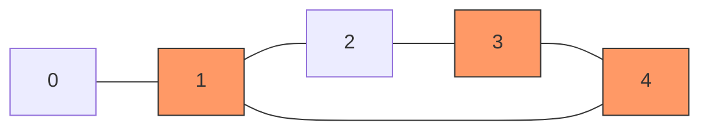

Node 1 → 2 → 3 → 4 → 1 forms a cycle (highlighted in orange).

**Graph without a cycle:**

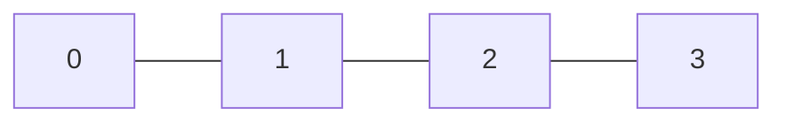

Simple chain — no way to return to any node.

---

## The Problem Explained

Think of it like **exploring a city with two-way roads**:

```
You start walking from your hotel (node 0).
You mark every place you visit.
You remember where you came FROM at each step.

If you ever reach a place that is:
  ✅ Already visited
  ❌ NOT the place you just came from

→ You've found a back road that loops you back!
→ A CYCLE EXISTS.

The "parent" tracking is critical:
  In an undirected graph, every edge A-B means
  A sees B as neighbour AND B sees A as neighbour.
  Without tracking parent, B would immediately "revisit" A
  and falsely report a cycle.
```

**Key idea:** BFS from every unvisited node, tracking each node's **parent**. If you reach an already-visited neighbour that is **not your parent**, a cycle is confirmed.

---

## HOOK TO REMEMBER FOREVER

**"VISITED NEIGHBOUR + NOT MY PARENT = CYCLE FOUND"**

Every time you see "detect cycle in undirected graph":
- ✅ Build adjacency list from edge list
- ✅ BFS with queue storing `{node, parent}` pairs
- ✅ Mark node visited on push (not pop)
- ✅ For each neighbour: if unvisited → push with current node as parent
- ✅ If visited AND not the parent → **cycle detected → return true**
- ✅ Run BFS from every unvisited node (handles disconnected graphs)
- ✅ O(V + E) time, O(V) space

**Remember: The parent is your "how I got here" tracker. Any visited node that isn't your parent means there's another path to it — that's your cycle!** 🔄

---

## The Core Trick — Why Track Parent?

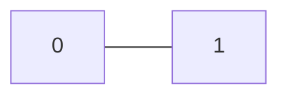

```
Adjacency list:
  adj[0] = [1]
  adj[1] = [0]   ← undirected, so both directions exist

BFS from node 0:
  Push {0, -1}  (node=0, no parent)
  Pop  {0, -1}
    Neighbour 1: not visited → push {1, parent=0}

  Pop  {1, 0}
    Neighbour 0: VISITED. Is 0 == parent(0)? YES → SKIP.

Without parent check:
  Neighbour 0 is visited → return true → FALSE CYCLE ❌

With parent check:
  Neighbour 0 is visited BUT it's my parent → skip ✓
```

**The parent check filters out the "I just came from there" false positive.**

---

## How It Works Step By Step

### Input Graph

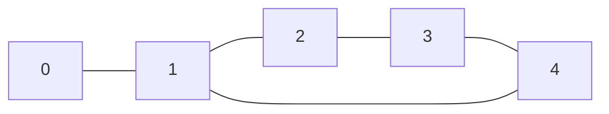

```
adj[0] = [1]
adj[1] = [0, 2, 4]
adj[2] = [1, 3]
adj[3] = [2, 4]
adj[4] = [3, 1]
```

### BFS Traversal Tree

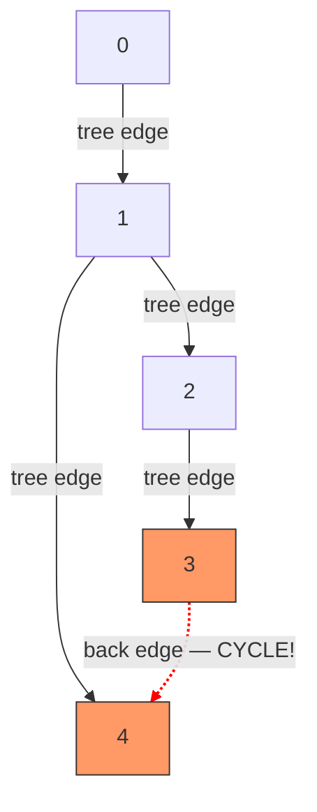

When node 4 is popped, its neighbour 3 is already visited and is NOT 4's parent (parent of 4 is 1) → **cycle detected**.

### Step-by-Step Queue Trace

```
vis = [0, 0, 0, 0, 0]

BFS(0):
  Push {0,-1},  vis[0]=1
  Queue: [{0,-1}]

  Pop {0,-1}:
    nei=1 → push {1,0},  vis[1]=1
  Queue: [{1,0}]

  Pop {1,0}:
    nei=0 → visited, parent=0 → SKIP
    nei=2 → push {2,1},  vis[2]=1
    nei=4 → push {4,1},  vis[4]=1
  Queue: [{2,1},{4,1}]

  Pop {2,1}:
    nei=1 → visited, parent=1 → SKIP
    nei=3 → push {3,2},  vis[3]=1
  Queue: [{4,1},{3,2}]

  Pop {4,1}:
    nei=3 → visited. parent=1. 3 ≠ 1 → CYCLE! return true ✓
```

---

## Code Full Solution

```cpp
class Solution {
private:
    bool bfs(int node, vector<vector<int>> &adj, vector<int> &vis) {
        queue<pair<int,int>> q;
        vis[node] = 1;
        q.push({node, -1});

        while (!q.empty()) {
            auto [node, parent] = q.front();
            q.pop();

            for (auto &nei : adj[node]) {
                if (!vis[nei]) {
                    q.push({nei, node});
                    vis[nei] = 1;
                }
                else if (parent != nei) return true;
            }
        }
        return false;
    }

public:
    bool isCycle(int V, vector<vector<int>>& edges) {
        vector<vector<int>> adj(V);

        for (auto &edge : edges) {
            adj[edge[0]].push_back(edge[1]);
            adj[edge[1]].push_back(edge[0]);
        }

        vector<int> vis(V, 0);

        for (int node = 0; node < V; node++) {
            if (!vis[node]) {
                if (bfs(node, adj, vis)) return true;
            }
        }

        return false;
    }
};
```

---

## Code Explanation

### Build Adjacency List

```cpp
vector<vector<int>> adj(V);
for (auto &edge : edges) {
    adj[edge[0]].push_back(edge[1]);
    adj[edge[1]].push_back(edge[0]);
}
```

- Input is an **edge list** → convert to **adjacency list**
- Undirected graph → every edge `[u, v]` adds both `u→v` and `v→u`

---

### Outer Loop — Handles Disconnected Graphs

```cpp
for (int node = 0; node < V; node++) {
    if (!vis[node]) {
        if (bfs(node, adj, vis)) return true;
    }
}
```

**Why loop over all nodes?**

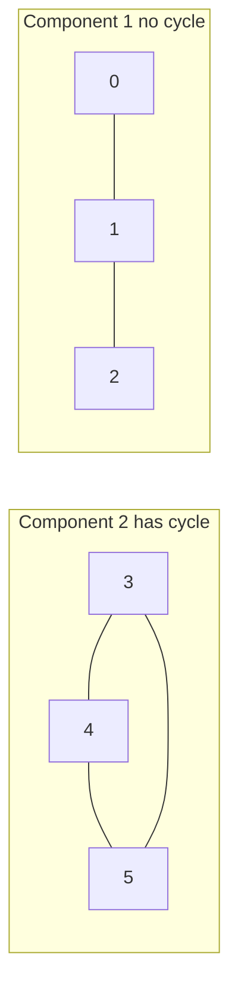

```
BFS from node 0 only visits {0, 1, 2}.
The cycle in Component 2 is never discovered!

Outer loop reaches node 3 → not visited → BFS(3) → cycle found ✓

One BFS per connected component. Shared vis[] ensures
no node is processed twice.
```

---

### BFS with Parent Tracking

```cpp
queue<pair<int,int>> q;
vis[node] = 1;
q.push({node, -1});
```

- Queue stores `{node, parent}` pairs
- Starting node has parent `-1` (sentinel — no parent)
- Mark visited on **push**, not pop (prevents duplicate queue entries)

```cpp
auto [node, parent] = q.front();
q.pop();
```

C++17 structured bindings — cleanly unpacks the pair into named variables.

---

### The Neighbour Check

```cpp
for (auto &nei : adj[node]) {
    if (!vis[nei]) {
        q.push({nei, node});
        vis[nei] = 1;
    }
    else if (parent != nei) return true;
}
```

```
Branch 1 — Neighbour not visited:
  Normal BFS. Push with current node as parent. Mark visited.

Branch 2 — Neighbour already visited:
  nei == parent → came from there. Harmless. Skip.
  nei != parent → reached via another path. Cycle! Return true.
```

---

## Complete Example Traces

### Trace 1: Cycle Exists

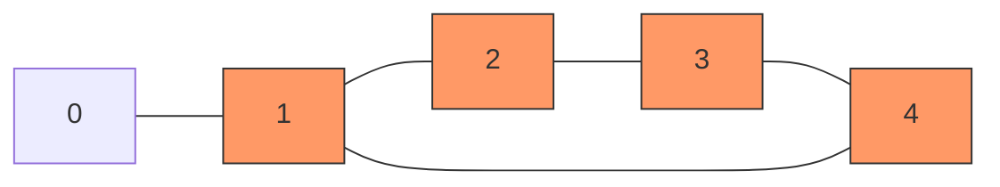

```
BFS(0): Queue → {0,-1} → {1,0} → {2,1},{4,1} → {4,1},{3,2}
Pop {4,1}: nei=3 visited, 3 ≠ parent(1) → CYCLE! return true ✓
```

### Trace 2: No Cycle (Linear Chain)


```
BFS(0): 0→1→2→3
Each visited neighbour is always the parent.
Queue empties. Return false ✓
```

### Trace 3: Disconnected — Cycle in Second Component

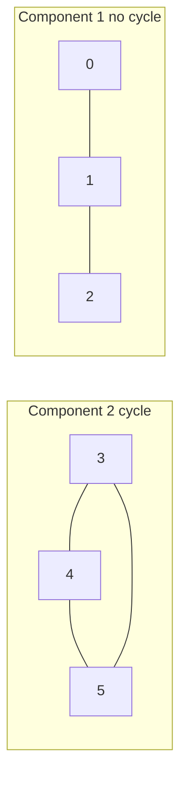

```
BFS(0): visits {0,1,2}. No cycle. Return false.
BFS(3): nei=5 visited, 5 ≠ parent(3) → CYCLE! return true ✓
```

### Trace 4: Tree — No Cycle

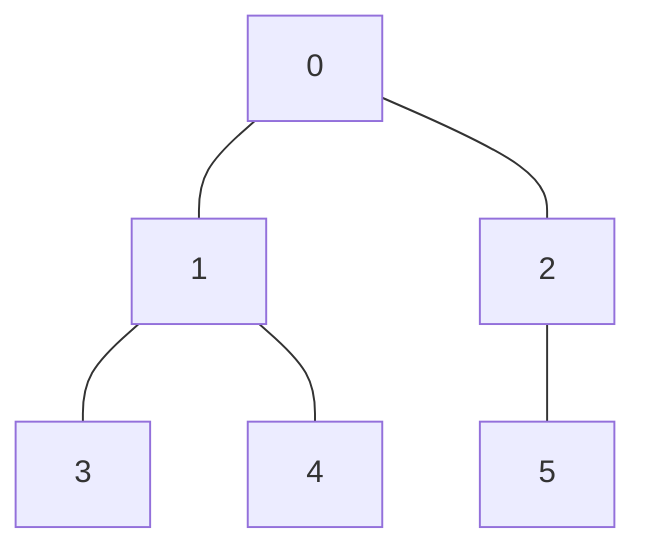

```
A tree with V nodes has exactly V-1 edges.
Every visited neighbour during BFS is always the parent.
BFS(0) visits all nodes. Returns false ✓
```

### Trace 5: Single Node

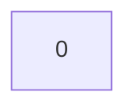

```
adj[0] = [] (no edges)
BFS(0): push {0,-1}. Pop. No neighbours. Return false ✓
```

### Trace 6: Self-Loop

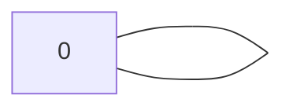

```
adj[0] = [0]
BFS(0): Pop {0,-1}:
  nei=0 → visited. 0 == parent(-1)? NO → CYCLE! return true ✓
```

---

## Edge Cases

### Case 1: No Edges

```
Input: V=5, edges=[]
All adj lists empty. Every BFS finds no neighbours.
Output: false ✓
```

### Case 2: Complete Graph

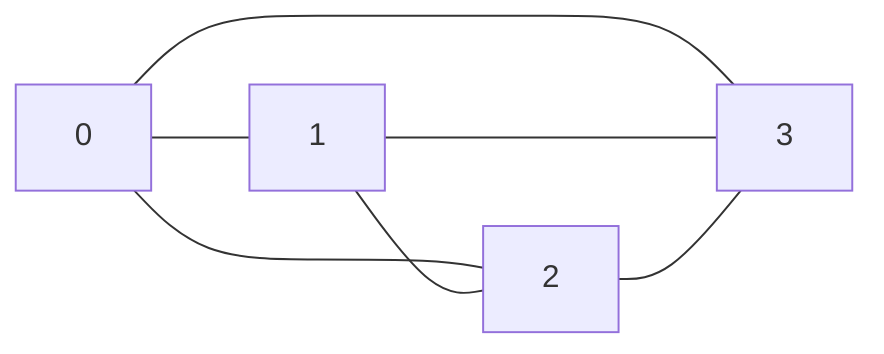

```
Many back edges found immediately.
Output: true ✓
```

### Case 3: Two Nodes, One Edge


```
BFS(0): nei=1 pushed. Pop {1,0}: nei=0 visited, 0==parent → SKIP.
Output: false ✓
```

---

## Time Complexity

- **O(V + E)** where V = vertices, E = edges
- Building adjacency list: O(E)
- BFS across all components: each node pushed/popped once → O(V), each edge examined twice (undirected) → O(E)
- Total: **O(V + E)**

---

## Space Complexity

- **O(V + E)** total
- Adjacency list: O(V + E)
- `vis` array: O(V)
- BFS queue: O(V) in worst case
- Total: **O(V + E)**

---

## Key Insights

### Why `-1` as the Initial Parent Sentinel?

```
Starting node has no parent — it wasn't reached from anywhere.
-1 is safe because valid node indices are 0 to V-1.

When checking nei == parent:
  nei is always a valid node (0 to V-1)
  parent = -1 for the start node → nei == -1 is always false
  → No valid neighbour is ever falsely skipped ✓
```

### BFS vs DFS for Cycle Detection

```
Both work for undirected graphs. Same core logic:
  Track parent → visited neighbour ≠ parent → cycle

BFS: iterative queue, no stack overflow risk
DFS: recursive or explicit stack, slightly simpler code

For DIRECTED graphs:
  This BFS approach breaks — a visited node that isn't
  your parent might just be a converging path in a DAG, not a cycle.
  Use DFS with a "currently in recursion stack" flag instead.
```

### The Visited + Parent Combination is the Complete Algorithm

```
No timestamps, no colours, no finish times needed.
Just two pieces of info per queued node:
  1. Who am I?
  2. How did I get here?

These two expose every cycle in an undirected graph. ✓
```

---

## References

- 🔗 [GFG — Detect Cycle in an Undirected Graph](https://www.geeksforgeeks.org/problems/detect-cycle-in-an-undirected-graph/1)
- 🔗 [Concept — Detect Cycle in an Undirected Graph](https://www.youtube.com/watch?v=BPlrALf1LDU)