# Cycle Detection in Undirected Graph (DFS)

## Problem Link
🔗 [Detect Cycle in an Undirected Graph](https://www.geeksforgeeks.org/problems/detect-cycle-in-an-undirected-graph/1)

---

## What is this Problem?

Given an **undirected graph** with `V` vertices and a list of edges, determine whether the graph contains a **cycle**.

> 💡 This is the **DFS version** of the same problem. If you haven't read the BFS version, the core idea (parent tracking) is identical — only the traversal mechanism changes.

**Examples:**
```
V=5, edges=[[0,1],[1,2],[2,3],[3,4],[4,1]]
Output: true

V=4, edges=[[0,1],[1,2],[2,3]]
Output: false
```

---

## Example Graphs

**Graph with a cycle:**

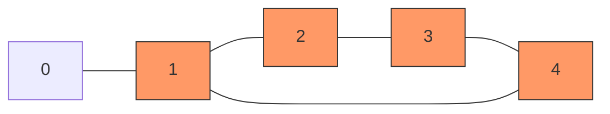

**Graph without a cycle:**

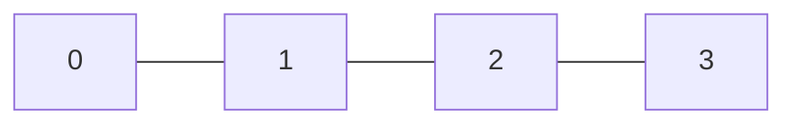

---

## The Problem Explained

Think of it like **exploring a cave with a rope tied to you**:

```
You enter the cave from the entrance (node 0).
You tie a rope as you go deeper, marking every chamber visited.
You always remember which chamber you came FROM.

If you open a door and find a chamber that is:
  ✅ Already marked (visited)
  ❌ NOT the chamber you came from

→ Your rope loops back through a different route.
→ A CYCLE EXISTS.

DFS goes as deep as possible before backtracking —
the call stack IS the rope, naturally tracking the path.
```

**Key idea:** DFS recursively explores neighbours, passing the **parent** at each call. If a visited neighbour is found that is **not the parent**, a back edge is detected — cycle confirmed.

---

## HOOK TO REMEMBER FOREVER

**"RECURSE DEEP, PASS PARENT, VISITED NON-PARENT = CYCLE"**

Every time you see "detect cycle in undirected graph with DFS":
- ✅ Build adjacency list from edge list
- ✅ DFS passing `(node, parent)` at every recursive call
- ✅ Mark node visited at the top of DFS
- ✅ For each neighbour: if unvisited → recurse with current node as parent
- ✅ If visited AND not parent → **cycle detected → return true**
- ✅ If DFS returns true → bubble it up immediately
- ✅ Run from every unvisited node to handle disconnected graphs
- ✅ O(V + E) time, O(V) space

**Remember: DFS and BFS use the exact same parent-tracking logic. DFS passes parent as a parameter. BFS stores it in the queue pair.** 🔄

---

## DFS vs BFS — Same Logic, Different Mechanism

```
BFS approach:                    DFS approach:
  queue<{node, parent}>            dfs(node, parent, ...)
  push {nei, node}                 dfs(nei, node, ...)
  check on pop                     check on visit

Both ask the same question:
  "Is this neighbour visited AND not my parent?"
  YES → cycle exists.

DFS is slightly shorter code.
BFS has no stack overflow risk for very deep graphs.
```

---

## How It Works Step By Step

### Input Graph

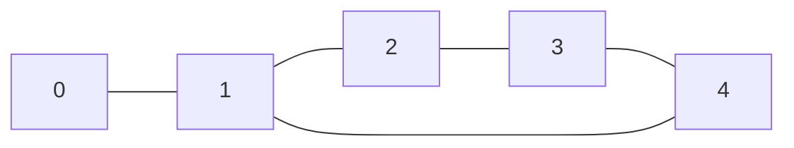

### DFS Traversal Tree

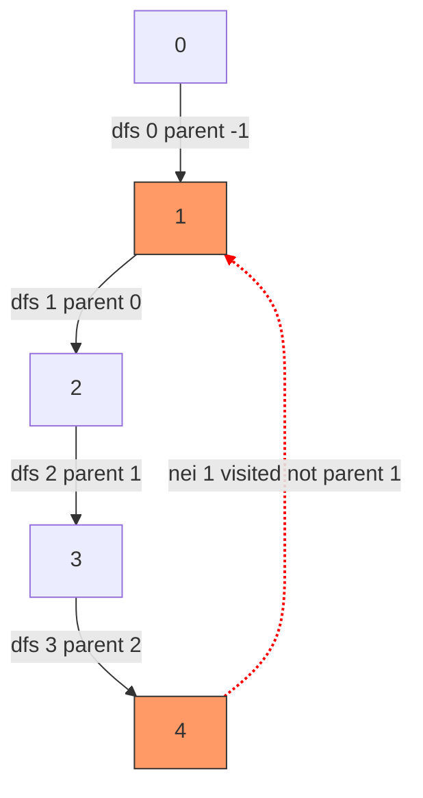

When DFS is at node 4 (parent=3), it sees neighbour 1. Node 1 is visited and 1 ≠ parent(3) → **cycle detected → return true**.

### Step-by-Step Recursive Trace

```
vis = [0,0,0,0,0]

dfs(0, -1):
  vis[0]=1
  nei=1: not visited → dfs(1, 0)
    vis[1]=1
    nei=0: visited, 0==parent(0) → SKIP
    nei=2: not visited → dfs(2, 1)
      vis[2]=1
      nei=1: visited, 1==parent(1) → SKIP
      nei=3: not visited → dfs(3, 2)
        vis[3]=1
        nei=2: visited, 2==parent(2) → SKIP
        nei=4: not visited → dfs(4, 3)
          vis[4]=1
          nei=3: visited, 3==parent(3) → SKIP
          nei=1: visited, 1 ≠ parent(3) → CYCLE! return true
        ← dfs(4,3) returned true → return true
      ← dfs(3,2) returned true → return true
    ← dfs(2,1) returned true → return true
  ← dfs(1,0) returned true → return true
← dfs(0,-1) returned true → return true ✓
```

Notice how `true` **bubbles all the way up** the call stack the moment the cycle is found.

---

##  DFS Cycle Detection Logic

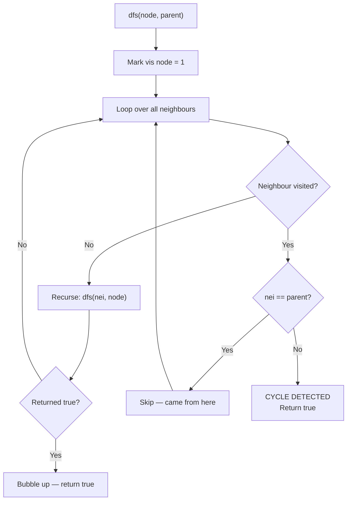

---

## Code Full Solution

```cpp
class Solution {
private:
    bool dfs(int node, int parent, vector<vector<int>> &adj, vector<int> &vis) {
        vis[node] = 1;
        for (auto &nei : adj[node]) {
            if (!vis[nei]) {
                if (dfs(nei, node, adj, vis)) return true;
            }
            else if (nei != parent) return true;
        }
        return false;
    }

public:
    bool isCycle(int V, vector<vector<int>>& edges) {
        vector<vector<int>> adj(V);

        for (auto &edge : edges) {
            adj[edge[0]].push_back(edge[1]);
            adj[edge[1]].push_back(edge[0]);
        }

        vector<int> vis(V, 0);

        for (int node = 0; node < V; node++) {
            if (!vis[node]) {
                if (dfs(node, -1, adj, vis)) return true;
            }
        }
        return false;
    }
};
```

---

## Code Explanation

### The DFS Function Signature

```cpp
bool dfs(int node, int parent, vector<vector<int>> &adj, vector<int> &vis)
```

- **`node`:** Current node being explored
- **`parent`:** The node we came from (passed explicitly at every call)
- **`adj`:** Adjacency list (passed by reference — shared across all calls)
- **`vis`:** Visited array (passed by reference — shared across all calls)

**Why pass `parent` as a parameter instead of storing it?**
```
DFS is recursive. Each call has its own stack frame.
The parent of each node is naturally different at every level.

Passing it as a parameter means:
  dfs(0,-1) → dfs(1,0) → dfs(2,1) → dfs(3,2) → dfs(4,3)
  Each frame knows exactly who its parent is. ✓

In BFS we stored {node,parent} in the queue.
In DFS the call stack itself stores this — cleaner. ✓
```

---

### Mark Visited at the Top

```cpp
vis[node] = 1;
```

First thing on entering any DFS call. Prevents the same node from being recursed into twice.

---

### Neighbour Loop — Two Branches

```cpp
for (auto &nei : adj[node]) {
    if (!vis[nei]) {
        if (dfs(nei, node, adj, vis)) return true;  // unvisited
    }
    else if (nei != parent) return true;            // visited + not parent
}
```

**Branch 1 — Unvisited neighbour:**
```
Recurse deeper: dfs(nei, node, adj, vis)
  - nei  → new node to explore
  - node → becomes the parent in the next call

If the recursive call returns true (cycle found deeper),
immediately return true to bubble it up.
```

**Branch 2 — Visited neighbour:**
```
Two sub-cases:
  nei == parent  → we literally just came from there (the edge we arrived on).
                   Harmless. Skip.
  nei != parent  → this node was visited via a DIFFERENT path.
                   That means there are two paths to nei → CYCLE.
                   Return true immediately.
```

---

### Outer Loop — Handles Disconnected Graphs

```cpp
for (int node = 0; node < V; node++) {
    if (!vis[node]) {
        if (dfs(node, -1, adj, vis)) return true;
    }
}
```

- Starts DFS from every unvisited node
- Each unvisited node is the root of a new connected component
- `-1` as parent sentinel — no real node has index -1

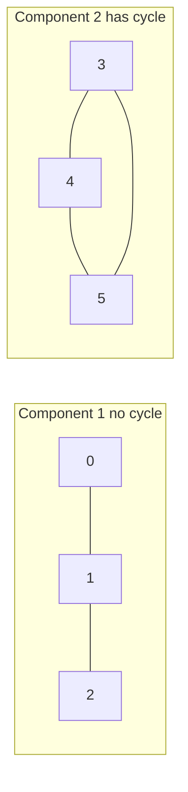

```
DFS(0,-1): explores {0,1,2}. No cycle. Returns false.
Loop reaches node 3 (unvisited) → DFS(3,-1) → cycle found ✓
```

---

## Complete Example Traces

### Trace 1: Cycle Exists

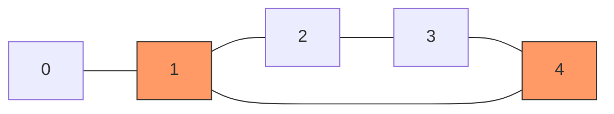

```
dfs(0,-1) → dfs(1,0) → dfs(2,1) → dfs(3,2) → dfs(4,3)
  At dfs(4,3): nei=1, vis[1]=1, 1 ≠ parent(3) → return true

true bubbles up through all frames → return true ✓
```

### Trace 2: No Cycle — Linear Chain


```
dfs(0,-1) → dfs(1,0) → dfs(2,1) → dfs(3,2)
  At dfs(3,2): nei=2 visited, 2==parent → SKIP. No more neighbours.
  Return false.

All frames return false → return false ✓
```

### Trace 3: Disconnected — Cycle in Second Component


```
DFS(0,-1): visits {0,1,2}. No cycle. Returns false.
DFS(3,-1):
  dfs(3,-1) → dfs(4,3) → dfs(5,4)
    At dfs(5,4): nei=3, vis[3]=1, 3 ≠ parent(4) → return true ✓
```

### Trace 4: Tree — No Cycle

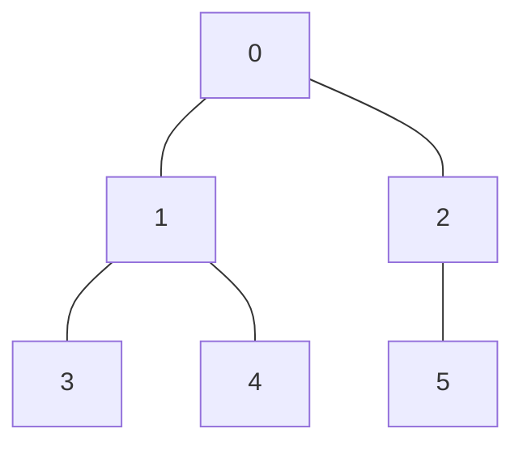

```
DFS visits every node. Every visited neighbour is always the parent.
No back edge ever found. Return false ✓
```

### Trace 5: Triangle — Smallest Possible Cycle

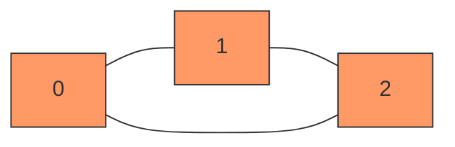

```
dfs(0,-1):
  vis[0]=1
  nei=1 → dfs(1,0):
    vis[1]=1
    nei=0: visited, 0==parent → SKIP
    nei=2 → dfs(2,1):
      vis[2]=1
      nei=1: visited, 1==parent → SKIP
      nei=0: visited, 0 ≠ parent(1) → CYCLE! return true ✓
```

### Trace 6: Two Nodes, One Edge

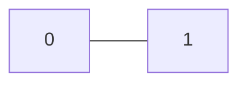

```
dfs(0,-1):
  vis[0]=1
  nei=1 → dfs(1,0):
    vis[1]=1
    nei=0: visited, 0==parent(0) → SKIP
    Return false
Return false ✓
```

---

## Edge Cases

### Case 1: Single Node, No Edges

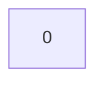

```
adj[0]=[], dfs(0,-1): no neighbours. Return false ✓
```

### Case 2: No Edges at All

```
All adjacency lists empty.
Every DFS call returns false immediately.
Output: false ✓
```

### Case 3: Self-Loop

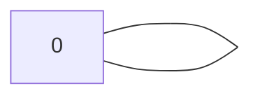

```
adj[0]=[0]
dfs(0,-1): vis[0]=1
  nei=0: visited. 0 ≠ parent(-1) → CYCLE! return true ✓
```

---

## Time Complexity

- **O(V + E)** where V = vertices, E = edges
- Building adjacency list: O(E)
- DFS visits every node once, examines every edge twice: O(V + E)
- Total: **O(V + E)**

---

## Space Complexity

- **O(V + E)** total
- Adjacency list: O(V + E)
- `vis` array: O(V)
- Recursion call stack depth: O(V) in worst case (linear chain)
- Total: **O(V + E)**

---

## Key Insights

### The `true` Bubbles Up Immediately

```cpp
if (dfs(nei, node, adj, vis)) return true;
```

```
The moment any recursive call detects a cycle,
it returns true. Every caller up the stack
checks and immediately returns true as well.

No need to finish exploring the rest of the graph.
One back edge found → done. ✓

This is the beauty of recursion for this problem —
early exit propagates naturally through the call stack.
```

### DFS Call Stack = Path from Root to Current Node

```
When dfs(4,3) is running, the call stack looks like:

  dfs(0,-1)   ← bottom
  dfs(1, 0)
  dfs(2, 1)
  dfs(3, 2)
  dfs(4, 3)   ← top (currently running)

This is exactly the current path from the source node to node 4.
If node 4 finds a visited non-parent neighbour,
it means that neighbour is somewhere lower in this stack —
forming a cycle back to it. ✓
```

### Why This Doesn't Work for Directed Graphs

```
Undirected edge 0-1:
  adj[0] contains 1
  adj[1] contains 0
  Parent check handles the "came from" false positive ✓

Directed edge 0→1:
  adj[0] contains 1
  adj[1] does NOT contain 0

  A visited non-parent neighbour in a directed graph might
  just be a node reachable from a different source — not a cycle.

  Example (DAG, no cycle):
    0→2, 1→2

  DFS from 0 visits 2. DFS from 1 also sees 2 (visited, not parent).
  This would return true → WRONG ❌

  For directed graphs: use DFS with a "in current recursion stack"
  boolean array (not just visited). That's a separate problem.
```

---

## References

- 🔗 [GFG — Detect Cycle in an Undirected Graph](https://www.geeksforgeeks.org/problems/detect-cycle-in-an-undirected-graph/1)
- 🔗 [Detect Cycle in an Undirected Graph](https://www.youtube.com/watch?v=zQ3zgFypzX4)