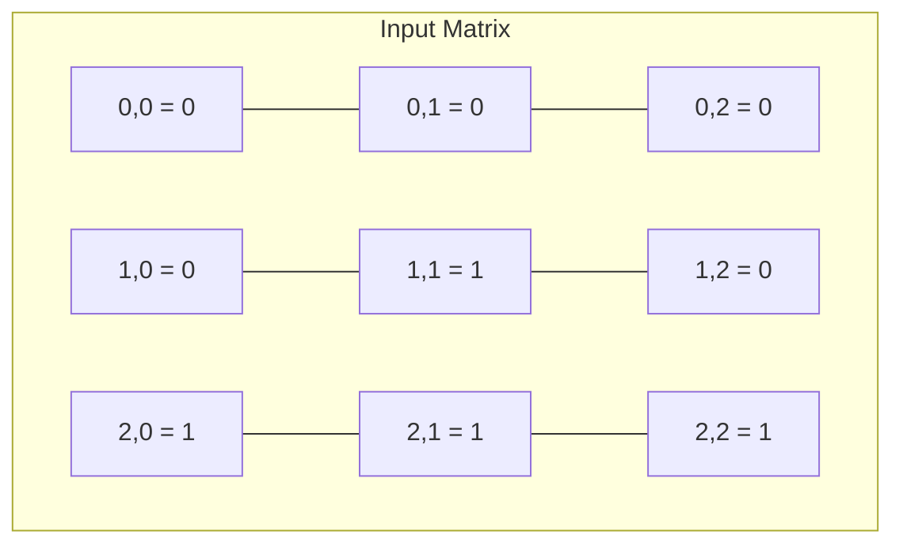
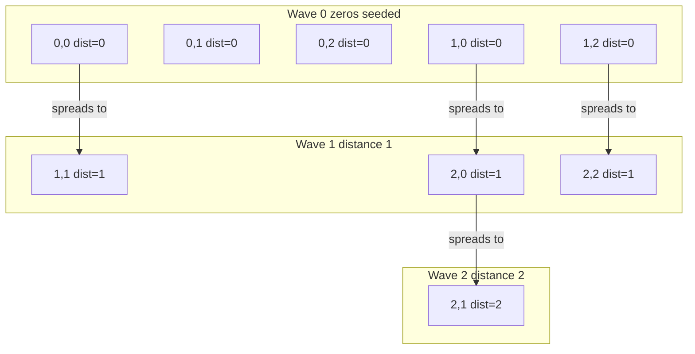
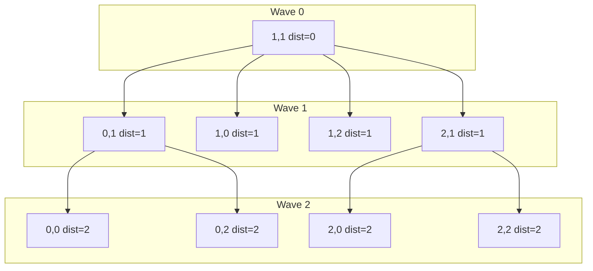

# 01 Matrix — Distance to Nearest 0

## Problem Link
🔗 [LeetCode 542 — 01 Matrix](https://leetcode.com/problems/01-matrix/)

---

## What is this Problem?

Given a binary matrix `mat` of 0s and 1s, return a matrix where each cell contains the **distance to its nearest 0**. Distance is measured in steps moving **up, down, left, right** (no diagonals).

**Examples:**
```
Input:              Output:
[[0, 0, 0],         [[0, 0, 0],
 [0, 1, 0],          [0, 1, 0],
 [1, 1, 1]]          [1, 2, 1]]

Input:              Output:
[[0, 1, 1],         [[0, 1, 2],
 [1, 1, 1],          [1, 2, 3],
 [1, 1, 0]]          [2, 3, 0]]   ← bottom-right 0 is closest for some cells
                                      but top-left 0 is closer for others
```

---

## The Problem Explained

Think of it like **dropping stones in multiple ponds simultaneously**:

```
Every 0-cell is a stone dropped in a pond.
Ripples spread outward in all 4 directions, one step per minute.

[[0, 1, 1],        Minute 0: ripples start at all 0s
 [1, 1, 1],        Minute 1: ripples reach adjacent 1s
 [1, 1, 0]]        Minute 2: ripples reach the next ring
                   Minute 3: ripples reach the farthest cell

The first time a ripple reaches a cell = that cell's answer.
```

This is **multi-source BFS** — every 0 is a source, all spreading simultaneously. The distance recorded is the BFS level at which each cell is first reached.

---

## HOOK TO REMEMBER FOREVER

**"SEED ALL ZEROS FIRST, BFS SPREADS DISTANCE OUTWARD, FIRST TOUCH = ANSWER"**

Every time you see "distance to nearest 0 / nearest source in a grid":
- ✅ Push ALL 0-cells into the queue at distance 0, mark them visited
- ✅ Multi-source BFS — all zeros spread simultaneously
- ✅ When a 1-cell is first reached, record `steps + 1` as its distance
- ✅ Mark visited on push — prevents a cell from being updated twice
- ✅ BFS guarantees the **first** time you reach a cell = **minimum** distance
- ✅ O(n × m) time and space

**Remember: This is Rotting Oranges in disguise — zeros rot the ones. The first wave to reach a cell wins!** 🌊

---

## How It Works Step By Step

### Input Matrix



```
mat:               Expected answer:
[[0, 0, 0],        [[0, 0, 0],
 [0, 1, 0],         [0, 1, 0],
 [1, 1, 1]]         [1, 2, 1]]
```

### Phase 1 — Seed All Zeros

```
Scan every cell. Push all 0-cells into queue at distance 0.
Mark them visited immediately.

Queue after seeding:
  [{(0,0),0}, {(0,1),0}, {(0,2),0}, {(1,0),0}, {(1,2),0}]

vis:                ans (so far):
[[1, 1, 1],         [[0, 0, 0],
 [1, 0, 1],          [0, 0, 0],
 [0, 0, 0]]          [0, 0, 0]]
```

### Phase 2 — BFS Spreads Outward

```
Process (0,0) dist=0: ans[0][0]=0. Neighbours (1,0) visited → skip.
Process (0,1) dist=0: ans[0][1]=0. Neighbours already visited.
Process (0,2) dist=0: ans[0][2]=0. Neighbours (1,2) visited → skip.
Process (1,0) dist=0: ans[1][0]=0. Neighbours: (2,0) unvisited → push {(2,0),1}
Process (1,2) dist=0: ans[1][2]=0. Neighbours: (2,2) unvisited → push {(2,2),1}

Queue: [{(1,1),1} was missed? Let's continue...
  Actually (1,1) is reached from (1,0) or (0,1) or (1,2):
  From (1,0) dist=0: nei (1,1) not visited → push {(1,1),1}, vis[1][1]=1

Queue now: [{(2,0),1},{(1,1),1},{(2,2),1}]

Process (2,0) dist=1: ans[2][0]=1. nei (2,1) unvisited → push {(2,1),2}
Process (1,1) dist=1: ans[1][1]=1. All neighbours visited.
Process (2,2) dist=1: ans[2][2]=1. nei (2,1) already pushed → skip.

Process (2,1) dist=2: ans[2][1]=2. All neighbours visited.

Final ans:
[[0, 0, 0],
 [0, 1, 0],
 [1, 2, 1]] ✓
```

### BFS Wave Visualization



---

## Code Full Solution

```cpp
class Solution {
public:
    vector<vector<int>> updateMatrix(vector<vector<int>>& mat) {
        int n = mat.size();
        int m = mat[0].size();
        vector<vector<int>> vis(n, vector<int>(m, 0));
        vector<vector<int>> ans(n, vector<int>(m, 0));

        int drow[] = {-1, 0, 1, 0};
        int dcol[] = {0, 1, 0, -1};

        queue<pair<pair<int,int>, int>> q;

        // Phase 1: Seed all 0-cells
        for (int i = 0; i < n; i++) {
            for (int j = 0; j < m; j++) {
                if (mat[i][j] == 0) {
                    q.push({{i, j}, 0});
                    vis[i][j] = 1;
                } else {
                    vis[i][j] = 0;
                }
            }
        }

        // Phase 2: Multi-source BFS
        while (!q.empty()) {
            int row   = q.front().first.first;
            int col   = q.front().first.second;
            int steps = q.front().second;
            q.pop();
            ans[row][col] = steps;

            for (int i = 0; i < 4; i++) {
                int nrow = row + drow[i];
                int ncol = col + dcol[i];
                if (nrow >= 0 && ncol >= 0 && nrow < n && ncol < m && !vis[nrow][ncol]) {
                    q.push({{nrow, ncol}, steps + 1});
                    vis[nrow][ncol] = 1;
                }
            }
        }

        return ans;
    }
};
```

---

## Code Explanation

### Two Separate Grids

```cpp
vector<vector<int>> vis(n, vector<int>(m, 0));
vector<vector<int>> ans(n, vector<int>(m, 0));
```

- **`vis`:** Tracks which cells have been pushed into the queue. Prevents double-processing.
- **`ans`:** Stores the final distance for each cell. Written when a cell is popped.

**Why not just use `ans` to track visited?**
```
ans[i][j] = 0 could mean:
  (a) this cell IS a zero → distance 0, or
  (b) this cell hasn't been processed yet → distance still 0

Separating vis and ans removes this ambiguity cleanly.
Vis says "have I queued this cell?", ans says "what's its distance?". ✓
```

---

### Phase 1 — Seed All Zeros

```cpp
if (mat[i][j] == 0) {
    q.push({{i, j}, 0});
    vis[i][j] = 1;
} else {
    vis[i][j] = 0;
}
```

**Why push ALL zeros at once?**
```
This problem has multiple sources (all zeros).
Each zero independently spreads its distance to neighbouring 1s.

If we pushed only one zero and started BFS:
  A cell near a different zero would get a larger (wrong) distance.

Pushing all zeros at distance 0 = they all spread simultaneously.
Every cell gets the distance from its NEAREST zero. ✓

This is identical to Rotting Oranges — all rotten cells seeded at t=0.
```

---

### Phase 2 — BFS Pop and Spread

```cpp
int row   = q.front().first.first;
int col   = q.front().first.second;
int steps = q.front().second;
q.pop();
ans[row][col] = steps;
```

- Extract row, col, and current distance from queue front
- Record the distance in `ans` when popped

```cpp
if (nrow >= 0 && ncol >= 0 && nrow < n && ncol < m && !vis[nrow][ncol]) {
    q.push({{nrow, ncol}, steps + 1});
    vis[nrow][ncol] = 1;
}
```

**Three things happen when pushing a neighbour:**
```
1. Bounds check: nrow/ncol within grid
2. Not visited: hasn't been queued before
3. Push with distance steps+1: one more step away from the nearest zero
4. Mark vis immediately: no other cell can claim it at a shorter distance
   (BFS guarantees first visit = minimum distance)
```

---

## Complete Example Traces

### Trace 1: Standard Case

```
mat:               Seeds:              ans:
[[0, 0, 0],        All row 0 cells,    [[0, 0, 0],
 [0, 1, 0],        (1,0), (1,2)         [0, 1, 0],
 [1, 1, 1]]        seeded at dist=0     [1, 2, 1]]

BFS levels:
  Level 0: (0,0),(0,1),(0,2),(1,0),(1,2)
  Level 1: (1,1),(2,0),(2,2)
  Level 2: (2,1)
```

### Trace 2: Corner Zeros

```
mat:               ans:
[[0, 1, 1],        [[0, 1, 2],
 [1, 1, 1],         [1, 2, 3],   ← but wait, (2,2) is also 0!
 [1, 1, 0]]         [2, 3, 0]]

Two sources: (0,0) and (2,2). Both seed at dist=0.
BFS from (0,0) spreads right and down.
BFS from (2,2) spreads left and up.
Each cell gets the minimum from either source. ✓
```

### Trace 3: All Zeros

```
mat:               ans:
[[0, 0],           [[0, 0],
 [0, 0]]            [0, 0]]

All cells seeded at dist=0. No 1s to expand into.
BFS processes all cells, all distances = 0. ✓
```

### Trace 4: Single Zero in Corner

```
mat:               ans:
[[1, 1, 1],        [[2, 1, 2],
 [1, 0, 1],         [1, 0, 1],
 [1, 1, 1]]         [2, 1, 2]]

One source at (1,1). BFS expands outward:
  Level 0: (1,1)
  Level 1: (0,1),(1,0),(1,2),(2,1)
  Level 2: (0,0),(0,2),(2,0),(2,2) — corners are 2 steps away
```



### Trace 5: Single Row

```
mat:   [1, 1, 0, 1, 1]
ans:   [2, 1, 0, 1, 2]

Source at index 2. BFS spreads left and right:
  Level 0: col 2
  Level 1: col 1, col 3
  Level 2: col 0, col 4
```

---

## Edge Cases

### Case 1: All Zeros

```
mat = [[0,0],[0,0]]
All seeded at dist=0. ans = [[0,0],[0,0]] ✓
```

### Case 2: Single Cell — Zero

```
mat = [[0]]
Seeded at dist=0. No neighbours. ans = [[0]] ✓
```

### Case 3: Single Cell — One

```
mat = [[1]]
vis[0][0]=0. Queue empty after seeding. 
BFS never runs. ans[0][0] = 0 (default).

⚠️ Note: The problem guarantees at least one 0 exists,
so a matrix of all 1s with no zeros is not a valid input.
```

### Case 4: Large Matrix, One Zero

```
Zero at (0,0). Farthest cell is (n-1, m-1).
BFS expands wave by wave. Farthest cell gets distance (n-1)+(m-1).
All cells processed in O(n×m). ✓
```

---

## Time Complexity

- **O(n × m)** where n = rows, m = columns
- Phase 1 (seeding): scan all cells → O(n×m)
- Phase 2 (BFS): each cell pushed and popped exactly once → O(n×m)
- Total: **O(n × m)**

---

## Space Complexity

- **O(n × m)** extra space
- `vis` grid: O(n×m)
- `ans` grid: O(n×m) — required output
- Queue: holds at most O(n×m) entries
- Total: **O(n × m)**

---

## Key Insights

### Why Multi-Source BFS and Not Single-Source?

```
Wrong approach — BFS from each 1 to find nearest 0:
  For every 1-cell, run a separate BFS until you hit a 0.
  Time: O((n×m)²) — for each of n×m cells, up to n×m BFS steps. ❌

Correct approach — BFS from all 0s simultaneously:
  All zeros spread outward at once.
  Every 1-cell gets tagged the moment the nearest zero's wave hits it.
  Time: O(n×m) — single BFS pass covers the whole grid. ✓

Inverting the direction of BFS (from targets outward instead of
from queries inward) is a classic trick that turns O(n²) into O(n).
```

### BFS Guarantees Minimum Distance

```
Why doesn't a cell need to be updated after first visit?

BFS processes cells level by level (distance 0, then 1, then 2...).
The FIRST time BFS reaches a cell, it arrives via the SHORTEST path.
Any later arrival would be at the same or greater distance.

Mark visited on PUSH → no cell is ever pushed twice.
First push = minimum distance. No re-evaluation needed. ✓
```

### This Problem vs Rotting Oranges

```
Rotting Oranges:          01 Matrix:
  Sources = rotten cells    Sources = zero cells
  Targets = fresh oranges   Targets = one cells
  Answer  = max time        Answer  = distance per cell
  Check   = unreachable?    Check   = none (always reachable)

Identical BFS skeleton. Different output format and post-check. ✓
```

---

## References

- 🔗 [LeetCode 542 — 01 Matrix](https://leetcode.com/problems/01-matrix/)