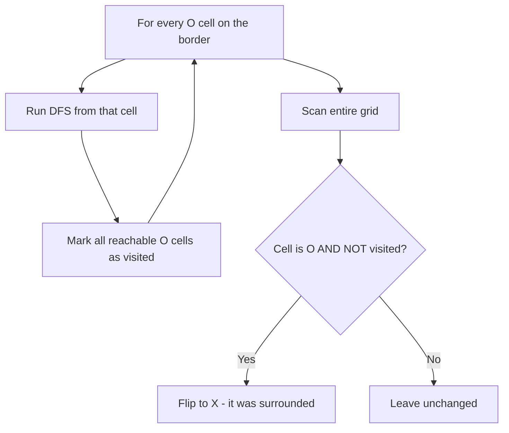
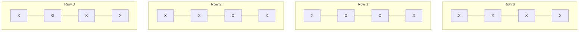
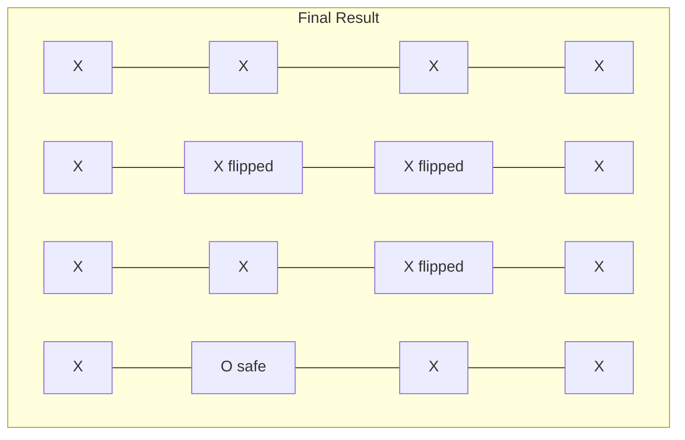

# Surrounded Regions

## Problem Link
🔗 [LeetCode 130 — Surrounded Regions](https://leetcode.com/problems/surrounded-regions/)

---

## What is this Problem?

Given an `m x n` matrix `mat` containing `'X'` and `'O'`, **capture** all regions of `'O'` that are **completely surrounded by `'X'`** — flip them to `'X'`. A region of `'O'`s connected to the **border** (directly or through other `'O'`s) is safe and stays `'O'`.

**Examples:**
```
Input:
X X X X
X O O X
X X O X
X O X X

Output:
X X X X
X X X X
X X X X
X O X X

The 'O' at (3,1) survives because it's isolated and NOT
connected to the border. The other 'O's form a region
touching row 2's boundary... wait let's verify with the
actual connectivity in the trace below.
```

---

## The Problem Explained

Think of it like **water filling a maze from the outside**:

```
Imagine pouring water along the OUTER BORDER of the grid.
Water flows through any 'O' cell, spreading to adjacent 'O's
(up/down/left/right) — but water canNOT pass through 'X' walls.

Any 'O' the water TOUCHES is "connected to the border" → SAFE.
Any 'O' the water NEVER REACHES is "surrounded" → gets CAPTURED (flipped to 'X').
```

**Key idea:** Instead of trying to find surrounded regions directly (hard — how do you know a region never touches the border without checking every path?), **flip the problem**: find all `'O'`s reachable FROM the border via DFS/BFS. Mark them as safe. Everything else that's still `'O'` must be surrounded — flip those to `'X'`.

---

## HOOK TO REMEMBER FOREVER

**"DON'T FIND SURROUNDED REGIONS DIRECTLY. FIND BORDER-CONNECTED 'O's INSTEAD. FLIP EVERYTHING ELSE."**

Every time you see "regions surrounded by boundary / capture enclosed regions":
- ✅ Run DFS/BFS starting from **every 'O' on the border** (all 4 edges of the grid)
- ✅ Mark every 'O' reachable from the border as `visited` — these are SAFE, never flip them
- ✅ After exploring, scan the ENTIRE grid: any `'O'` that is **NOT visited** is surrounded → flip to `'X'`
- ✅ O(n×m) time, O(n×m) space for the visited array

**Remember: This is "reverse thinking" — instead of proving a region IS surrounded, you prove which regions are NOT surrounded (border-connected), and everything left over must be surrounded!** 🌊

---

## Why This "Flip the Problem" Approach Works

```
Direct approach (hard): For each 'O' region, check if it touches
  the border by exploring in ALL directions and verifying NONE
  of its cells are on row 0, row n-1, col 0, or col m-1.
  Messy — you'd need to fully explore a region before knowing
  whether to flip it, and you might explore it multiple times.

Flipped approach (elegant): Start DFS ONLY from border 'O' cells.
  Anything these DFS calls reach is PROVEN border-connected
  (by construction — we started AT the border).
  Anything left unvisited after all border DFS calls finish
  is PROVEN to have no path to the border — surrounded, must flip.

This is a classic "identify the exception, then everything else
falls into the default category" pattern.
```

---

## Mermaid — Algorithm Flow



---

## How It Works Step By Step

### Input Grid



```
mat = [['X','X','X','X'],
       ['X','O','O','X'],
       ['X','X','O','X'],
       ['X','O','X','X']]
```

### Step 1 — Scan Border, Start DFS from Border 'O's

```
Row 0 (top border): X X X X → no 'O's here
Row 3 (bottom border): X O X X → mat[3][1]='O' → DFS(3,1)!
Col 0 (left border): X X X X → no 'O's here (already covered by row scan)
Col 3 (right border): X X X X → no 'O's here

Only ONE border 'O' exists: (3,1)
```

### Step 2 — DFS from (3,1)

```
DFS(3,1): vis[3][1]=1
  Check neighbors of (3,1):
    Up (2,1): mat[2][1]='X' → skip
    Right (3,2): mat[3][2]='X' → skip
    Down: out of bounds → skip
    Left (3,0): mat[3][0]='X' → skip

DFS(3,1) explores nothing further. Only (3,1) is marked visited.
```

### Step 3 — Scan Entire Grid, Flip Unvisited 'O's

```
(1,1)='O', not visited → FLIP to 'X'
(1,2)='O', not visited → FLIP to 'X'
(2,2)='O', not visited → FLIP to 'X'
(3,1)='O', VISITED → stays 'O' (safe, border-connected)

Final grid:
X X X X
X X X X
X X X X
X O X X
```



---

## Code Full Solution

```cpp
class Solution {
public:
    void dfs(int row, int col, vector<vector<char>>& mat, vector<vector<int>>& vis, int drow[], int dcol[]) {
        vis[row][col] = 1;
        int n = mat.size();
        int m = mat[0].size();

        for (int i = 0; i < 4; i++) {
            int nrow = row + drow[i];
            int ncol = col + dcol[i];

            if (nrow >= 0 && ncol >= 0 && nrow < n && ncol < m
                && !vis[nrow][ncol] && mat[nrow][ncol] == 'O') {
                vis[nrow][ncol] = 1;
                dfs(nrow, ncol, mat, vis, drow, dcol);
            }
        }
    }

    void solve(vector<vector<char>>& mat) {
        int n = mat.size();
        int m = mat[0].size();
        int drow[] = {-1, 0, 1, 0};
        int dcol[] = {0, 1, 0, -1};
        vector<vector<int>> vis(n, vector<int>(m, 0));

        // Top and bottom rows
        for (int j = 0; j < m; j++) {
            if (!vis[0][j] && mat[0][j] == 'O') dfs(0, j, mat, vis, drow, dcol);
            if (!vis[n-1][j] && mat[n-1][j] == 'O') dfs(n-1, j, mat, vis, drow, dcol);
        }

        // Left and right columns
        for (int i = 0; i < n; i++) {
            if (!vis[i][0] && mat[i][0] == 'O') dfs(i, 0, mat, vis, drow, dcol);
            if (!vis[i][m-1] && mat[i][m-1] == 'O') dfs(i, m-1, mat, vis, drow, dcol);
        }

        // Flip unvisited 'O's
        for (int i = 0; i < n; i++) {
            for (int j = 0; j < m; j++) {
                if (mat[i][j] == 'O' && !vis[i][j]) {
                    mat[i][j] = 'X';
                }
            }
        }
    }
};
```

---

## Code Explanation

### Phase 1 — Scan the Border, Launch DFS

```cpp
for (int j = 0; j < m; j++) {
    if (!vis[0][j] && mat[0][j] == 'O') dfs(0, j, mat, vis, drow, dcol);
    if (!vis[n-1][j] && mat[n-1][j] == 'O') dfs(n-1, j, mat, vis, drow, dcol);
}
for (int i = 0; i < n; i++) {
    if (!vis[i][0] && mat[i][0] == 'O') dfs(i, 0, mat, vis, drow, dcol);
    if (!vis[i][m-1] && mat[i][m-1] == 'O') dfs(i, m-1, mat, vis, drow, dcol);
}
```

```
Top row (i=0) and bottom row (i=n-1): looped via j from 0 to m-1
Left col (j=0) and right col (j=m-1): looped via i from 0 to n-1

Together, these four scans cover the ENTIRE border of the grid.

Why check !vis[...] before calling dfs?
  A corner cell (e.g., (0,0)) is checked by BOTH the row loop
  AND the column loop. Without the !vis check, we might call
  dfs on an already-explored cell — wasteful (though not
  incorrect, since dfs marks vis first thing and would just
  re-check already-visited neighbors and skip them all).
  The check is a minor optimization to avoid redundant dfs calls.
```

---

### The DFS Function

```cpp
void dfs(int row, int col, vector<vector<char>>& mat, vector<vector<int>>& vis, int drow[], int dcol[]) {
    vis[row][col] = 1;
    for (int i = 0; i < 4; i++) {
        int nrow = row + drow[i];
        int ncol = col + dcol[i];
        if (nrow>=0 && ncol>=0 && nrow<n && ncol<m && !vis[nrow][ncol] && mat[nrow][ncol]=='O') {
            vis[nrow][ncol] = 1;
            dfs(nrow, ncol, mat, vis, drow, dcol);
        }
    }
}
```

```
Standard 4-directional DFS. Marks the current cell visited,
then recurses into unvisited 'O' neighbors.

Note: vis[nrow][ncol] is marked BEFORE the recursive call
(not inside the next dfs call at its own top) — this is a
minor style choice that prevents pushing the same cell into
the "to visit" set twice via different paths, though marking
inside dfs() itself (as the first line) would also work correctly.
```

---

### Phase 2 — Flip Unvisited 'O's

```cpp
for (int i = 0; i < n; i++) {
    for (int j = 0; j < m; j++) {
        if (mat[i][j] == 'O' && !vis[i][j]) {
            mat[i][j] = 'X';
        }
    }
}
```

```
Scan every cell. If it's still 'O' AND was never reached by
any border DFS, it has no path to the border → surrounded → flip.

Cells that ARE visited stay 'O' (they're safe).
Cells that were always 'X' are untouched (condition mat[i][j]=='O' fails).
```

---

## Complete Example Traces

### Trace 1: Main Example (fully traced above)

```
Result:
X X X X
X X X X
X X X X
X O X X
```

### Trace 2: All Border, Nothing Surrounded

```
mat = [['O','O','O'],
       ['O','X','O'],
       ['O','O','O']]

All border cells are 'O'. DFS from any border 'O' explores
the entire ring (the center is 'X', blocking nothing since
we're only moving along O's, and the ring is fully connected).

All 8 'O' cells get visited. None flipped.

Result: unchanged ✓ (the ring is entirely border-connected)
```

### Trace 3: Fully Surrounded Region

```
mat = [['X','X','X'],
       ['X','O','X'],
       ['X','X','X']]

Border scan: all border cells are 'X' — no DFS ever launches.
vis remains all 0.

Flip phase: (1,1)='O', not visited → FLIP.

Result:
X X X
X X X
X X X
✓ (the single isolated O had no border connection)
```

### Trace 4: Region Connects to Border Through a Path

```
mat = [['X','O','X'],
       ['X','O','X'],
       ['X','O','X']]

Border scan: (0,1) is on top row and is 'O' → DFS(0,1)
  DFS explores: (0,1)→(1,1)→(2,1) — all connected vertically,
  (2,1) is ALSO on the bottom border (redundant, already visited).

All three 'O's get visited via one connected DFS chain.

Result: unchanged ✓ (the whole column touches both borders)
```

### Trace 5: Multiple Separate Regions

```
mat = [['X','X','X','X'],
       ['X','O','X','O'],
       ['X','X','X','O'],
       ['X','X','X','X']]

Border scan: (1,3) is on right border ('O') → DFS(1,3)
  DFS explores (1,3)→(2,3). Both visited.

(1,1) is 'O' but not on border. No DFS starts from it directly.
Its neighbors: (0,1)='X',(2,1)='X',(1,0)='X',(1,2)='X' — fully
walled in, DFS from border never reaches it.

Flip phase: (1,1) not visited → FLIP.
(1,3),(2,3) visited → stay 'O'.

Result:
X X X X
X X X O
X X X O
X X X X
✓
```

---

## Edge Cases

### Case 1: Single Cell

```
mat = [['O']]
This cell IS the border (only cell). DFS(0,0) runs, marks visited.
Result: unchanged, stays 'O' ✓
```

### Case 2: All 'X'

```
No 'O's anywhere. No DFS launches. Flip phase finds nothing to flip.
Result: unchanged ✓
```

### Case 3: Single Row or Column

```
mat = [['O','O','O']]  (1×3 grid)
Every cell is on the border (top row = bottom row = only row).
All 'O's get visited via border scan.
Result: unchanged ✓
```

### Case 4: Region Touches Border at Only One Cell

```
A large blob of 'O's where only ONE cell touches the border
edge — DFS still reaches the ENTIRE blob because they're
all connected. The whole region is safe, not just the
touching cell.
```

---

## Time Complexity

- **O(n × m)** where n = rows, m = columns
- Border scan: O(n + m) cells checked
- DFS total work across all calls: each cell visited at most once → O(n×m)
- Final flip scan: O(n×m)
- Total: **O(n × m)**

---

## Space Complexity

- **O(n × m)** for the `vis` array
- Recursion call stack: O(n×m) worst case (a single spiral-shaped region visiting every cell)
- Total: **O(n × m)**

---

## Key Insights

### The "Prove the Exception, Default the Rest" Pattern

```
This technique — instead of proving X is true directly,
find everything where X is FALSE, and everything else
defaults to X being true — appears in many problems:

  → Surrounded Regions (this problem): find border-connected
    'O's (the exception), everything else defaults to "surrounded"
  → Islands that can't reach the boundary (similar flip)
  → Nodes NOT reachable from a source in a graph
  → Detecting "unreachable" states in general

Whenever "surrounded / enclosed / trapped" appears in a
problem statement, consider whether the OPPOSITE condition
(border-connected / escapable) is easier to compute directly.
```

### Why We Can't Flip During the Border DFS

```
It might seem tempting to flip 'X' immediately whenever we
determine a region ISN'T border-connected. But we don't know
that until we've explored the ENTIRE region — and we're doing
DFS FROM the border, not from arbitrary interior cells.

The two-phase approach (mark safe cells first, flip everything
else after) avoids needing to "undo" any flips and keeps the
logic simple: Phase 1 = discovery, Phase 2 = action.
```

### Why the Border Check `!vis[...]` Before Calling `dfs`

```
Not strictly necessary for correctness (dfs() would just mark
and immediately return if called on an unvisited-but-actually-
already-explored... wait no, if !vis is false we simply don't
call dfs at all here). This check just avoids a redundant
function call for cells that a PREVIOUS border scan already
covered (e.g., corner cells checked by both row and column loops).
```

---

## References

- 🔗 [LeetCode 130 — Surrounded Regions](https://leetcode.com/problems/surrounded-regions/)