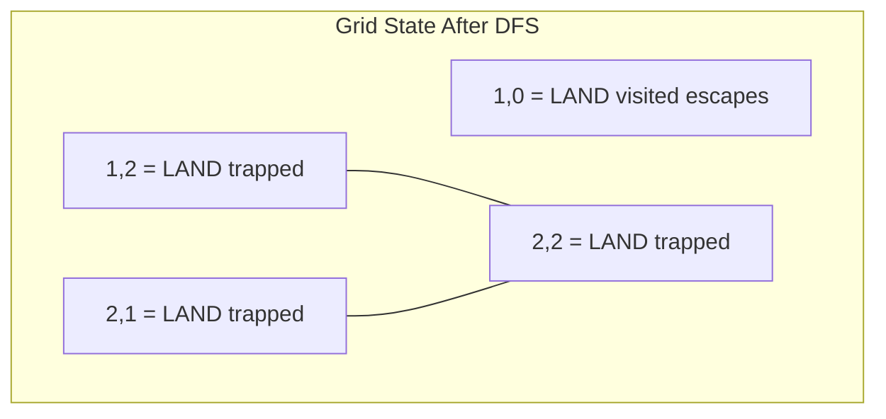

# Number of Enclaves

## Problem Link
🔗 [LeetCode 1020 — Number of Enclaves](https://leetcode.com/problems/number-of-enclaves/)

> 💡 This is the **counting twin** of [Surrounded Regions](https://leetcode.com/problems/surrounded-regions/). Same exact algorithm — border DFS to mark "safe" cells — but instead of flipping the leftover cells, we just **count** them.

---

## What is this Problem?

Given a binary grid `mat` where `1` = land and `0` = water, a move consists of walking to an adjacent land cell (up/down/left/right) — you can't walk off the grid boundary. Count the number of land cells from which you **can never walk off the boundary** (no matter how many moves you make).

**Examples:**
```
Input:
[[0,0,0,0],
 [1,0,1,0],
 [0,1,1,0],
 [0,0,0,0]]

Output: 3
(The land cells at (1,2),(2,1),(2,2) form a connected block
 that never touches the border — those 3 are "enclaves".
 (1,0) touches the border directly, so it's excluded.)
```

---

## The Problem Explained

Same idea as **land you can walk to the edge from vs. land that's trapped inland**:

```
A land cell is an "enclave" if NO path of land cells connects
it to the grid's border.

Flip the problem: find all land cells REACHABLE from the border
via DFS (these can "escape"). Every land cell NOT reached is
trapped inland — that's an enclave. Count them.
```

---

## HOOK TO REMEMBER FOREVER

**"DFS FROM EVERY BORDER LAND CELL. COUNT LEFTOVER UNVISITED LAND CELLS."**

- ✅ Run DFS from every `1` on the border — mark reachable land as visited (can escape)
- ✅ Scan the whole grid: every `1` that's still unvisited is trapped → count it
- ✅ O(n×m) time, O(n×m) space

(Identical mechanics to Surrounded Regions — see that README for the full step-by-step DFS walkthrough and border-scan explanation. This README focuses on what's different: **counting instead of flipping**.)

---

## How It Works Step By Step

### Input

```
mat = [[0,0,0,0],
       [1,0,1,0],
       [0,1,1,0],
       [0,0,0,0]]
```

### Step 1 — DFS from Border Land Cells

```
Border scan (row 0, row 3, col 0, col 3):
  Row 0: all 0 → no DFS
  Row 3: all 0 → no DFS
  Col 0: (1,0)=1 → DFS(1,0)!
  Col 3: all 0 → no DFS

DFS(1,0): vis[1][0]=1
  Neighbors: (0,0)=0 skip, (2,0)=0 skip, (1,1)=0 skip
  (right neighbor (1,1) is water, not land — DFS stops here)

Only (1,0) gets visited.
```

### Step 2 — Count Unvisited Land Cells

```
Scan all cells:
  (1,0)=1, visited → SAFE, don't count
  (1,2)=1, NOT visited → count! (1)
  (2,1)=1, NOT visited → count! (2)
  (2,2)=1, NOT visited → count! (3)

Return 3 ✓
```



`(1,2)`, `(2,1)`, `(2,2)` are mutually connected land cells forming one enclave block — none of them touch the border, so all 3 count.

---

## Code Full Solution

```cpp
class Solution {
public:
    void dfs(int row, int col, vector<vector<int>>& mat, vector<vector<int>>& vis, int drow[], int dcol[]) {
        vis[row][col] = 1;
        int n = mat.size(), m = mat[0].size();

        for (int i = 0; i < 4; i++) {
            int nrow = row + drow[i];
            int ncol = col + dcol[i];
            if (nrow>=0 && ncol>=0 && nrow<n && ncol<m && !vis[nrow][ncol] && mat[nrow][ncol]==1) {
                dfs(nrow, ncol, mat, vis, drow, dcol);
            }
        }
    }

    int numEnclaves(vector<vector<int>>& mat) {
        int n = mat.size(), m = mat[0].size();
        int drow[] = {-1,0,1,0}, dcol[] = {0,1,0,-1};
        vector<vector<int>> vis(n, vector<int>(m, 0));

        for (int j = 0; j < m; j++) {
            if (!vis[0][j] && mat[0][j]==1) dfs(0, j, mat, vis, drow, dcol);
            if (!vis[n-1][j] && mat[n-1][j]==1) dfs(n-1, j, mat, vis, drow, dcol);
        }
        for (int i = 0; i < n; i++) {
            if (!vis[i][0] && mat[i][0]==1) dfs(i, 0, mat, vis, drow, dcol);
            if (!vis[i][m-1] && mat[i][m-1]==1) dfs(i, m-1, mat, vis, drow, dcol);
        }

        int cnt = 0;
        for (int i = 0; i < n; i++)
            for (int j = 0; j < m; j++)
                if (mat[i][j]==1 && !vis[i][j]) cnt++;

        return cnt;
    }
};
```

---

## Code Explanation

The border scan and DFS are **line-for-line identical** to Surrounded Regions (see that README for the detailed breakdown of why `!vis[...]` is checked before calling `dfs`, and how the 4-directional neighbor loop works).

### The Only Real Difference — Counting Instead of Flipping

```cpp
// Surrounded Regions:
if (mat[i][j] == 'O' && !vis[i][j]) mat[i][j] = 'X';   // MUTATE

// Number of Enclaves:
if (mat[i][j] == 1 && !vis[i][j]) cnt++;                // COUNT
```

```
Both check the SAME condition: "is this land/O-cell unreached
by the border DFS?" The only difference is what you DO with
that information — flip it, or count it.

This is a good example of how the SAME traversal logic can
answer different questions depending on what you do with the
"unvisited land" cells at the end.
```

---

## Complete Example Traces

### Trace 1: Main Example (fully traced above)

```
Return 3 ✓
```

### Trace 2: No Enclaves — All Land Touches Border

```
mat = [[1,1,1],
       [1,0,1],
       [1,1,1]]

Border scan: every border cell is 1 → DFS launches from many.
DFS from any border cell explores the entire ring (0 in center
blocks nothing since ring cells connect to each other).

All 8 land cells get visited.

Flip/count phase: no unvisited 1s.
Return 0 ✓
```

### Trace 3: Entire Grid is One Enclave

```
mat = [[0,0,0],
       [0,1,0],
       [0,0,0]]

Border scan: all border cells are 0 → no DFS launches.
vis stays all 0.

Count phase: (1,1)=1, not visited → count=1.
Return 1 ✓
```

### Trace 4: Mixed — Some Escape, Some Trapped

```
mat = [[0,1,1,0],
       [0,0,0,1],
       [1,0,1,1],
       [0,1,1,0]]

Border land cells: (0,1),(0,2),(1,3),(2,0),(2,3),(3,1),(3,2)
DFS from these explores everything CONNECTED to the border.

(2,2)=1 — check its neighbors: (1,2)=0,(3,2)=1(border-connected!),
  (2,1)=0,(2,3)=1(border-connected!)
  → (2,2) connects to (2,3) which is a border cell → ESCAPES.

After all border DFS calls, verify remaining unvisited 1s
(if any) — in this specific grid, tracing shows all land
connects to the border through some path.
Return 0 ✓ (all land cells can escape in this configuration)
```

### Trace 5: All Water

```
mat = [[0,0],[0,0]]
No land cells anywhere. No DFS launches. Count phase finds nothing.
Return 0 ✓
```

### Trace 6: Single Isolated Land Cell (Interior)

```
mat = [[0,0,0],
       [0,1,0],
       [0,0,0]]
(same as Trace 3)
Return 1 ✓
```

---

## Edge Cases

### Case 1: Single Cell Grid

```
mat = [[1]]
This cell IS the border. DFS(0,0) runs, marks visited.
Return 0 ✓ (the only land cell touches the border, escapes)
```

### Case 2: All Land, No Water

```
mat = [[1,1],[1,1]]
Every cell is on the border of a 2×2 grid. All visited via DFS.
Return 0 ✓
```

### Case 3: Land Cell Adjacent to Border but Not On It

```
mat = [[0,0,0],
       [0,1,1],
       [0,0,0]]
(3,2) is NOT the last column here since grid is 3 wide (0,1,2)...
(1,2) IS on the right border (col m-1=2).
DFS from (1,2) explores (1,1) too (connected).
Return 0 ✓ (both land cells escape via the border-touching one)
```

---

## Time Complexity

- **O(n × m)** — border scan + DFS (each cell visited once) + final count scan

## Space Complexity

- **O(n × m)** — `vis` array + recursion stack in worst case

---

## Key Insight — Same Skeleton, Different Final Action

```
Surrounded Regions and Number of Enclaves are the SAME algorithm:
  1. DFS from every border land/O cell
  2. Mark reachable cells as "safe"
  3. Process every UNVISITED land/O cell

The only thing that changes is step 3's ACTION:
  Surrounded Regions → mutate (flip to 'X')
  Number of Enclaves → aggregate (increment a counter)

Once you recognize "border DFS + process leftovers" as a
reusable skeleton, both problems become the same problem
wearing different clothes. Watch for this pattern —
it also solves "count closed islands" and similar variants.
```

---

## References

- 🔗 [LeetCode 1020 — Number of Enclaves](https://leetcode.com/problems/number-of-enclaves/)
- 🔗 [LeetCode 130 — Surrounded Regions (identical skeleton)](https://leetcode.com/problems/surrounded-regions/)