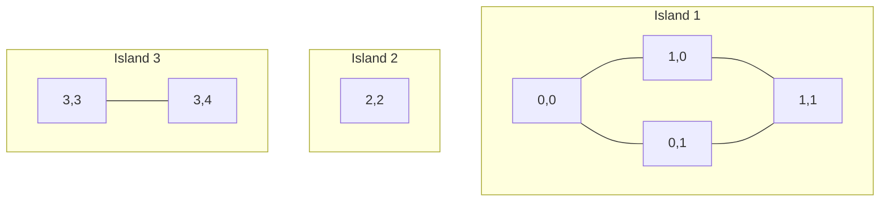

# Number of Islands

## Problem Link
🔗 [LeetCode 200 — Number of Islands](https://leetcode.com/problems/number-of-islands/)

> 💡 This is the **simplest form** of the "count connected components" pattern — no border complexity like [Number of Enclaves](https://leetcode.com/problems/number-of-enclaves/) or [Surrounded Regions](https://leetcode.com/problems/surrounded-regions/). Just count how many separate `'1'` regions exist.

---

## What is this Problem?

Given a 2D grid of `'1'`s (land) and `'0'`s (water), count the number of **islands**. An island is a maximal group of land cells connected horizontally or vertically.

```
grid = [
  ["1","1","0","0","0"],
  ["1","1","0","0","0"],
  ["0","0","1","0","0"],
  ["0","0","0","1","1"]
]
Output: 3

Island 1: top-left 2×2 block
Island 2: single cell at (2,2)
Island 3: two cells at (3,3) and (3,4)
```

---

## The Problem Explained

Think of it like **counting separate landmasses on a map**:

```
Every time you find an unvisited land cell ('1'), you've
discovered the "coastline" of a new island. Do a DFS to
explore and mark the ENTIRE island as visited. Increment
the island counter by 1. Move on.

The next unvisited '1' you encounter is guaranteed to be
on a DIFFERENT island (the previous one was fully marked).
```

This is exactly the **"count connected components"** problem — the same algorithm used in [Number of Provinces](https://www.geeksforgeeks.org/problems/number-of-provinces/1), but on a 2D grid instead of a graph.

---

## HOOK TO REMEMBER FOREVER

**"UNVISITED '1' FOUND → NEW ISLAND! DFS MARKS THE WHOLE ISLAND. INCREMENT COUNT. REPEAT."**

- ✅ Outer loop: scan every cell
- ✅ If cell is `'1'` AND unvisited → it's a new island → `cnt++`, DFS from it
- ✅ DFS marks the entire connected land region as visited
- ✅ Next unvisited `'1'` is guaranteed a different island
- ✅ O(n×m) time, O(n×m) space

---

## How It Works Step By Step

### Input

```
grid = [
  [1,1,0,0,0],
  [1,1,0,0,0],
  [0,0,1,0,0],
  [0,0,0,1,1]
]
```

### Scan and Count

```
(0,0)='1', not visited → cnt=1. DFS(0,0) floods entire top-left island.
  DFS marks: (0,0),(0,1),(1,0),(1,1) all visited.

(0,1): already visited → skip
(0,2)-(0,4): '0' → skip
(1,0),(1,1): already visited → skip
(1,2)-(1,4): '0' → skip

(2,2)='1', not visited → cnt=2. DFS(2,2) marks just (2,2).

(3,3)='1', not visited → cnt=3. DFS(3,3) floods (3,3)→(3,4).
  DFS marks: (3,3),(3,4) visited.

(3,4): already visited → skip

Return cnt=3 ✓
```



---

## Code Full Solution

```cpp
class Solution {
private:
    vector<int> drow = {-1,0,1,0};
    vector<int> dcol = {0,1,0,-1};

    void dfs(int row, int col, vector<vector<int>>& vis, vector<vector<char>>& grid, int n, int m) {
        vis[row][col] = 1;
        for (int i = 0; i < 4; i++) {
            int nrow = row + drow[i];
            int ncol = col + dcol[i];
            if (nrow>=0 && ncol>=0 && nrow<n && ncol<m && !vis[nrow][ncol] && grid[nrow][ncol]=='1') {
                dfs(nrow, ncol, vis, grid, n, m);
            }
        }
    }

public:
    int numIslands(vector<vector<char>>& grid) {
        int n = grid.size(), m = grid[0].size();
        vector<vector<int>> vis(n, vector<int>(m, 0));
        int cnt = 0;

        for (int i = 0; i < n; i++) {
            for (int j = 0; j < m; j++) {
                if (!vis[i][j] && grid[i][j] == '1') {
                    dfs(i, j, vis, grid, n, m);
                    cnt++;
                }
            }
        }
        return cnt;
    }
};
```

---

## Code Explanation

### The Outer Double Loop

```cpp
if (!vis[i][j] && grid[i][j] == '1') {
    dfs(i, j, vis, grid, n, m);
    cnt++;
}
```

```
Two conditions must BOTH be true:
  1. grid[i][j]=='1' — it's land (not water)
  2. !vis[i][j]     — it's a NEW island (not part of one we already counted)

Once DFS finishes, EVERY cell in this island is marked visited.
So the outer loop will never re-enter a DFS for any cell
that belonged to a previously discovered island. ✓
```

### The DFS — Standard 4-Directional Flood Fill

```
Mark current cell visited.
For each of 4 neighbors:
  If within bounds AND unvisited AND is land → recurse.

DFS floods the entire connected land region, marking every
cell visited. It stops at water ('0') or grid boundaries.
```

---

## Complete Example Traces

### Trace 1: 3 Separate Islands (main example)

```
(fully traced above)
Return 3 ✓
```

### Trace 2: One Giant Island

```
grid = [["1","1"],["1","1"]]

(0,0) not visited → cnt=1. DFS(0,0) marks all 4 cells.
All other cells already visited.

Return 1 ✓
```

### Trace 3: All Water

```
grid = [["0","0"],["0","0"]]

No '1' anywhere. DFS never called. cnt stays 0.
Return 0 ✓
```

### Trace 4: All Land

```
grid = [["1","1"],["1","1"]] (same as Trace 2)
Every cell is land AND connected → one island.
Return 1 ✓
```

### Trace 5: Diagonal Does NOT Connect

```
grid = [["1","0"],["0","1"]]

(0,0)='1' → cnt=1. DFS(0,0): neighbors (0,1)='0' and (1,0)='0' → stops.
(1,1)='1', not visited → cnt=2. DFS(1,1): neighbors '0' → stops.

Return 2 ✓ (diagonal cells are NOT connected — only 4 directions, not 8)
```

---

## Edge Cases

### Case 1: Single Cell Land

```
grid=[["1"]]
cnt=1. Return 1 ✓
```

### Case 2: Single Row, Alternating

```
grid=[["1","0","1","0","1"]]
Three isolated '1's, no connections.
Return 3 ✓
```

---

## Time and Space Complexity

| | Value |
|---|---|
| Time | O(n×m) — each cell visited at most once |
| Space | O(n×m) — vis array + recursion stack depth up to n×m |

---

## Key Insight — This IS "Count Connected Components"

```
Number of Islands is exactly:
  "How many connected components of '1's exist in this grid?"

It's structurally identical to:
  Number of Provinces (on a graph): outer loop over nodes,
    DFS/BFS marks the component, cnt++
  Number of Enclaves (counting unvisited border-DFS leftovers)
  Cycle detection (outer loop + DFS, but checking back edges)

The pattern:
  cnt = 0
  for each node/cell:
    if unvisited AND valid:
      DFS/BFS from here → marks entire component/island
      cnt++

This pattern appears in DOZENS of graph problems. Mastering
it here means you already know the skeleton for all of them.
```

---

## References

- 🔗 [LeetCode 200 — Number of Islands](https://leetcode.com/problems/number-of-islands/)
- 🔗 [Number of Provinces — the graph version of this problem](https://www.geeksforgeeks.org/problems/number-of-provinces/1)