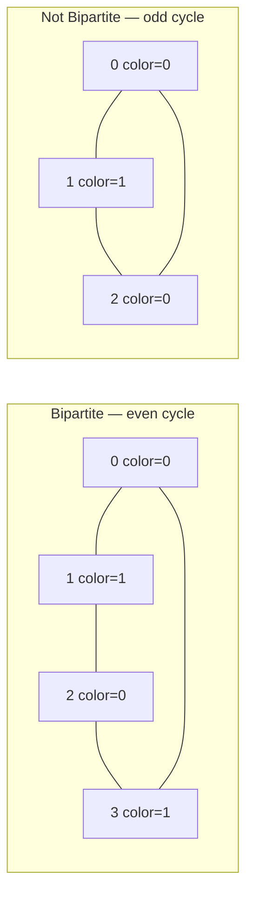

# Is Graph Bipartite?

## Problem Link
🔗 [LeetCode 785 — Is Graph Bipartite?](https://leetcode.com/problems/is-graph-bipartite/)

---

## What is this Problem?

Given an undirected graph, determine if it is **bipartite** — meaning you can split all nodes into **two groups** such that every edge connects a node in Group A to a node in Group B. No edge connects two nodes within the same group.

```
graph = [[1,3],[0,2],[1,3],[0,2]]

0 -- 1
|    |
3 -- 2

Group A: {0, 2}
Group B: {1, 3}

Every edge goes between groups: ✓ → BIPARTITE

graph = [[1,2,3],[0,2],[0,1,3],[0,2]]

0 -- 1
| \  |
|  \ |
3 -- 2

Triangle exists: 0-1-2-0 — can't 2-color a triangle ✗ → NOT BIPARTITE
```

---

## The Problem Explained

Think of it like **scheduling shifts** — can you divide all people into two teams so that no two teammates are ever paired together (on an edge)?

```
A graph is bipartite if and only if it has NO ODD-LENGTH CYCLE.

Equivalently: it's bipartite if and only if it's 2-COLORABLE —
you can color every node with one of two colors such that
no two adjacent nodes share the same color.

A triangle (3-cycle) is odd → can't 2-color it → not bipartite.
A square (4-cycle) is even → can 2-color it → bipartite.
```

**Key idea:** Try to 2-color the graph using DFS. Start any node with color 0. Color every neighbor with color 1. Color THEIR neighbors with color 0. If you ever try to color a node and it already has the SAME color as its parent → **odd cycle → not bipartite**.

---

## HOOK TO REMEMBER FOREVER

**"COLOR 0 THEN 1 THEN 0 ALTERNATING. IF NEIGHBOR ALREADY HAS YOUR COLOR → NOT BIPARTITE."**

- ✅ `color[]` initialized to `-1` (uncolored)
- ✅ DFS from each unvisited node with color `0`
- ✅ Each neighbor gets `1 - cl` (flips 0↔1)
- ✅ If neighbor is **already colored** AND has the **same color** as current → `return false`
- ✅ Handle disconnected graphs — outer loop tries DFS from every uncolored node
- ✅ O(V + E) time, O(V) space

---

## Mermaid — Bipartite vs Non-Bipartite



In the non-bipartite example, when DFS reaches edge `G→E`: node E already has color 0 and G also has color 0 → **CONFLICT** → return false.

---

## How It Works Step By Step

### Example: `graph = [[1,3],[0,2],[1,3],[0,2]]` (square)

```
color = [-1,-1,-1,-1]

i=0: color[0]==-1 → DFS(0, cl=0)
  color[0]=0

  nei=1: color[1]==-1 → DFS(1, cl=1)
    color[1]=1

    nei=0: color[0]=0 ≠ cl=1 → ok (different color, no conflict)
    nei=2: color[2]==-1 → DFS(2, cl=0)
      color[2]=0

      nei=1: color[1]=1 ≠ cl=0 → ok
      nei=3: color[3]==-1 → DFS(3, cl=1)
        color[3]=1

        nei=0: color[0]=0 ≠ cl=1 → ok
        nei=2: color[2]=0 ≠ cl=1 → ok
        return true
      DFS(2): all neighbors done → return true
    DFS(1): all neighbors done → return true
  
  nei=3: color[3]=1 ≠ cl=0 → ok (already colored, different)
  DFS(0): return true

DFS(0) returned true. Continue outer loop.
i=1,2,3: all already colored → skip.

Return true ✓ (BIPARTITE)
```

```
Final coloring:
  {0,2} → color 0 (Group A)
  {1,3} → color 1 (Group B)
```

### Example: `graph = [[1,2,3],[0,2],[0,1,3],[0,2]]` (triangle + extra)

```
DFS(0, cl=0): color[0]=0
  nei=1: DFS(1, cl=1): color[1]=1
    nei=0: color[0]=0 ≠ 1 → ok
    nei=2: DFS(2, cl=0): color[2]=0
      nei=0: color[0]=0 ≠ 0? SAME! cl=0, color[2]=0, nei=0 has color 0... 
      wait, checking nei=0 in DFS(2): color[0]=0, cl=0. cl==color[nei]? YES! return false.
    DFS(2) → false → DFS(1) → false → DFS(0) → false

DFS(0) returned false → return false immediately

Return false ✓ (NOT BIPARTITE — triangle 0-1-2)
```

---

## Code Full Solution

```cpp
class Solution {
public:
    bool dfs(int node, int cl, vector<int>& color, vector<vector<int>>& graph) {
        color[node] = cl;
        for (auto &nei : graph[node]) {
            if (color[nei] == -1) {
                if (dfs(nei, 1 - cl, color, graph) == false) return false;
            } else if (cl == color[nei]) {
                return false;
            }
        }
        return true;
    }

    bool isBipartite(vector<vector<int>>& graph) {
        int v = graph.size();
        vector<int> color(v, -1);
        for (int i = 0; i < v; i++) {
            if (color[i] == -1) {
                if (dfs(i, 0, color, graph) == false) return false;
            }
        }
        return true;
    }
};
```

---

## Code Explanation

### The Color Array

```cpp
vector<int> color(v, -1);
```

- `-1` → unvisited/uncolored
- `0` → Group A
- `1` → Group B

---

### `1 - cl` — The Color Flip

```cpp
dfs(nei, 1 - cl, color, graph)
```

```
cl=0 → 1-0=1 (neighbor gets color 1)
cl=1 → 1-1=0 (neighbor gets color 0)

Elegant one-liner to alternate between 0 and 1
without any if/else needed.
```

---

### Two Neighbor Cases

```cpp
if (color[nei] == -1) {
    if (dfs(nei, 1-cl, color, graph) == false) return false;
} else if (cl == color[nei]) {
    return false;
}
```

```
Case 1 — Neighbor uncolored:
  Color it with the opposite color and recurse.
  If the recursion finds a conflict deep inside, bubble false up.

Case 2 — Neighbor already colored:
  Check if it has the SAME color as us.
  Same color = two adjacent nodes in the same group = CONFLICT.
  Return false immediately.

  What if it has a DIFFERENT color? That's fine — it means
  this edge was already correctly handled when the neighbor
  was first colored. Do nothing.
```

---

### Outer Loop — Handles Disconnected Graphs

```cpp
for (int i = 0; i < v; i++) {
    if (color[i] == -1) {
        if (dfs(i, 0, color, graph) == false) return false;
    }
}
```

```
A graph can have multiple disconnected components.
DFS from one node only colors nodes REACHABLE from it.
The outer loop ensures every component gets checked.

If ANY component is non-bipartite, the whole graph is
non-bipartite → return false immediately (the comment
in the original code says this too: "immediately return false
if a component is returning false").
```

---

## Complete Example Traces

### Trace 1: Bipartite (Square)

```
(Fully traced above)
Color: 0→A, 1→B, 2→A, 3→B. No conflict. Return true ✓
```

### Trace 2: Not Bipartite (Triangle)

```
(Fully traced above)
0-1-2 forms an odd cycle. Conflict found. Return false ✓
```

### Trace 3: Single Node, No Edges

```
graph=[[]]
v=1, color=[-1]
i=0: color[0]==-1 → DFS(0, 0)
  color[0]=0. No neighbors. Return true.

Return true ✓ (trivially bipartite — nothing to conflict)
```

### Trace 4: Two Nodes Connected

```
graph=[[1],[0]]
DFS(0,0): color[0]=0
  nei=1: DFS(1,1): color[1]=1
    nei=0: color[0]=0 ≠ cl=1 → ok
    return true
  return true

Return true ✓ (one edge, two nodes → always bipartite)
```

### Trace 5: Disconnected Graph

```
graph=[[1],[0],[3],[2]]
Two separate edges: 0-1 and 2-3

i=0: DFS(0,0) colors {0,1}. Returns true.
i=1: already colored → skip
i=2: color[2]==-1 → DFS(2,0) colors {2,3}. Returns true.
i=3: already colored → skip

Return true ✓ (both components are bipartite)
```

### Trace 6: Disconnected — One Component Not Bipartite

```
graph=[[1],[0,2,3],[1,3],[1,2]]

Component 1: 0-1 (bipartite)
Component 2: 1-2-3-1 (triangle! not bipartite)

i=0: DFS colors {0,1}. True.
i=1: already colored → skip
i=2: already colored (from i=0's DFS reaching 1 which reaches 2) → skip
...conflict detected inside → return false

Return false ✓
```

---

## Edge Cases

### Case 1: No Edges (Empty Graph)

```
All nodes isolated. No conflicts possible.
Return true ✓
```

### Case 2: Even Cycle (Always Bipartite)

```
A cycle of length 4,6,8... → can alternate colors → bipartite ✓
```

### Case 3: Odd Cycle (Never Bipartite)

```
A cycle of length 3,5,7... → conflict always found → false ✓
```

---

## Time and Space Complexity

| | Value |
|---|---|
| Time | O(V + E) — each node and edge visited once |
| Space | O(V) — color array + recursion stack |

---

## Key Insights

### Bipartite ↔ No Odd Cycle ↔ 2-Colorable

```
These three statements are equivalent:
  1. The graph is bipartite
  2. The graph has no odd-length cycle
  3. The graph is 2-colorable

DFS-based 2-coloring DIRECTLY tests statement 3 —
but because all three are equivalent, a success/fail
of 2-coloring tells you about bipartiteness too.
```

### Why `-1` as "Uncolored" and Not a Boolean

```
We need THREE states: unvisited, color-0, color-1.
A boolean only gives two states (visited/unvisited).

Using -1/0/1 elegantly encodes all three in one integer.
Alternative: use a separate bool visited[] + int color[],
but that's two arrays for the same info.
```

### BFS Version Is Also Common

```
DFS is shown here. BFS works identically:
  Push node with color 0 into queue.
  Pop node, color all neighbors with 1-color(node).
  If any neighbor already has the SAME color → false.

Both are O(V+E). DFS is slightly more common in interviews
for this problem because it's fewer lines.
```

---

## References

- 🔗 [LeetCode 785 — Is Graph Bipartite?](https://leetcode.com/problems/is-graph-bipartite/)