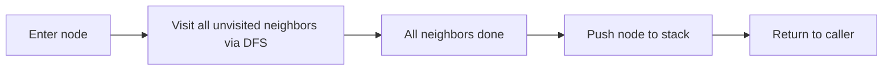
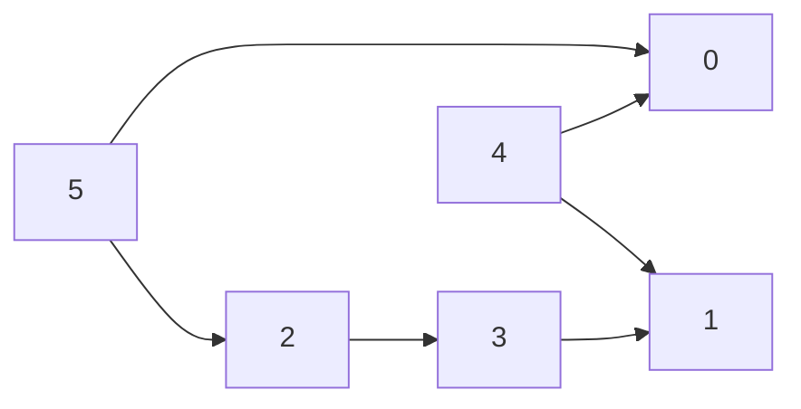

# Topological Sort (DFS)

## Problem Link
🔗 [GFG — Topological Sort](https://www.geeksforgeeks.org/problems/topological-sort/1)

---

## What is this Problem?

Given a **Directed Acyclic Graph (DAG)**, return a linear ordering of its nodes such that for every directed edge `u → v`, node `u` appears **before** node `v` in the ordering.

```
Edges: 5→0, 5→2, 4→0, 4→1, 2→3, 3→1

One valid order: [5, 4, 2, 3, 1, 0]
Another valid:   [4, 5, 2, 3, 0, 1]

Rule: if there's an arrow A→B, A must come before B.
Multiple valid answers exist.
```

---

## The Problem Explained

Think of it like **course prerequisites**:

```
To take "Advanced Algorithms" you must first take "Data Structures".
To take "Data Structures" you must first take "Programming Basics".

Topological order = the order you'd take courses if you
always completed all prerequisites before moving on.

A→B means: "do A before B"
Topo sort finds a valid "to-do order" for all tasks.
```

---

## HOOK TO REMEMBER FOREVER

**"DFS UNTIL DEAD END, THEN PUSH TO STACK. POP STACK FOR THE ANSWER."**

- ✅ Run DFS — but instead of recording nodes on ENTRY, record them on EXIT (when all their dependencies are done)
- ✅ A node is pushed to the stack only AFTER all its reachable descendants are pushed
- ✅ Popping the stack gives nodes in reverse-DFS-finish order = topological order
- ✅ Handle disconnected graphs — outer loop starts DFS from every unvisited node
- ✅ O(V + E) time, O(V) space

**Remember: A node goes on the stack when there's NOTHING LEFT TO DO after it. Popping then gives the "do this first" order.** 📚

---

## The Core Insight — Why Push on EXIT

```
In normal DFS, we process a node when we ENTER it.
For topo sort, we process (push) a node when we LEAVE it
— i.e., after all nodes reachable from it are already processed.

Why? Because if A→B exists, B will finish (be pushed) BEFORE A.
So when we pop the stack, A comes out before B. ✓

It's like saying: "I can only leave the meeting room
AFTER everyone I need to brief has also left."
```



---

## How It Works Step By Step

### Input

```
V=6, edges: 5→0, 5→2, 4→0, 4→1, 2→3, 3→1

Graph adjacency list:
  5 → [0, 2]
  4 → [0, 1]
  2 → [3]
  3 → [1]
  0 → []
  1 → []
```



### DFS Execution Trace

```
vis=[0,0,0,0,0,0], st=[]

i=0: vis[0]=0 → DFS(0)
  vis[0]=1. No neighbors. PUSH 0. st=[0]

i=1: vis[1]=0 → DFS(1)
  vis[1]=1. No neighbors. PUSH 1. st=[0,1]

i=2: vis[2]=0 → DFS(2)
  vis[2]=1. nei=3: vis[3]=0 → DFS(3)
    vis[3]=1. nei=1: vis[1]=1 → skip
    PUSH 3. st=[0,1,3]
  Back in DFS(2): all neighbors done.
  PUSH 2. st=[0,1,3,2]

i=3: vis[3]=1 → skip
i=4: vis[4]=0 → DFS(4)
  vis[4]=1. nei=0: vis[0]=1 → skip. nei=1: vis[1]=1 → skip.
  PUSH 4. st=[0,1,3,2,4]

i=5: vis[5]=0 → DFS(5)
  vis[5]=1. nei=0: skip. nei=2: skip.
  PUSH 5. st=[0,1,3,2,4,5]

Pop stack: 5,4,2,3,1,0
Answer: [5,4,2,3,1,0] ✓
```

### Why This Order is Correct

```
5 → 0 and 5 → 2: 5 comes before both ✓
5 → 2 → 3 → 1:  5 before 2 before 3 before 1 ✓
4 → 0 and 4 → 1: 4 comes before both ✓
```

---

## Code Full Solution

```cpp
class Solution {
private:
    void dfs(int node, vector<int>& vis, vector<vector<int>>& graph, stack<int>& st) {
        vis[node] = 1;
        for (auto &el : graph[node]) {
            if (!vis[el]) {
                dfs(el, vis, graph, st);
            }
        }
        st.push(node);  // ← pushed AFTER all neighbors are done
    }

public:
    vector<int> topoSort(int V, vector<vector<int>>& edges) {
        vector<vector<int>> graph(V);
        vector<int> vis(V, 0);
        vector<int> ans;
        stack<int> st;

        for (auto &el : edges) {
            graph[el[0]].push_back(el[1]);
        }

        for (int i = 0; i < V; i++) {
            if (!vis[i]) dfs(i, vis, graph, st);
        }

        while (!st.empty()) {
            ans.push_back(st.top());
            st.pop();
        }

        return ans;
    }
};
```

---

## Code Explanation

### Build the Adjacency List

```cpp
for (auto &el : edges) {
    graph[el[0]].push_back(el[1]);
}
```

Input is an **edge list** — convert to adjacency list first. Only add `el[0] → el[1]` (directed, not both directions).

---

### DFS — Push on Exit

```cpp
void dfs(int node, ...) {
    vis[node] = 1;
    for (auto &el : graph[node]) {
        if (!vis[el]) dfs(el, ...);
    }
    st.push(node);  ← KEY LINE
}
```

```
DFS goes as deep as it can (following edges).
Only when a node has no unvisited neighbors left does it push
itself onto the stack. This means descendants are ALWAYS pushed
before their ancestors. Stack pops in ancestor-first order. ✓
```

---

### Pop Stack = Topological Order

```cpp
while (!st.empty()) {
    ans.push_back(st.top());
    st.pop();
}
```

```
Stack = LIFO. Last pushed = first popped.
Nodes pushed last = those with the most dependencies (sources).
Popping gives them first = correct topological order.
```

---

## Complete Example Traces

### Trace 1: Linear Chain (1→2→3→4)

```
DFS(1)→DFS(2)→DFS(3)→DFS(4): push 4, push 3, push 2, push 1

st = [4,3,2,1]
Pop: 1,2,3,4

Answer: [1,2,3,4] ✓
```

### Trace 2: Disconnected Graph

```
Two components: A→B and C→D (no edges between components)

DFS from A: explores A→B. Push B, push A.
DFS from C: explores C→D. Push D, push C.

st = [B,A,D,C]
Pop: C,D,A,B

Answer: [C,D,A,B] — valid (C before D, A before B) ✓
```

### Trace 3: Single Node

```
V=1, no edges.
DFS(0): no neighbors. Push 0.
Pop: 0.

Answer: [0] ✓
```

---

## Edge Cases

### Case 1: No Edges

```
All nodes are isolated. Each DFS pushes its single node.
Any order is valid (no constraints). ✓
```

### Case 2: One Long Chain

```
0→1→2→3→...→n
DFS goes all the way to the end, then pushes n, n-1, ..., 1, 0.
Pop gives: 0,1,2,...,n ✓
```

---

## Time and Space Complexity

| | Value |
|---|---|
| Build graph | O(E) |
| DFS | O(V + E) |
| Pop stack | O(V) |
| **Total** | **O(V + E)** |
| Space | O(V) — vis + stack |

---

## Key Insights

### Why a Stack? Why Not Just Collect on Entry?

```
Collecting on ENTRY (normal DFS order):
  DFS(5): record 5. Then recurse into 0 (dead end, record 0),
  then into 2, recurse into 3, recurse into 1 (dead end, record 1),
  record 3, record 2.
  
  Order collected: 5, 0, 1, 3, 2 ← 5 comes first but 0 also comes
  early — but 5→0 requires 5 before 0. Looks ok here by luck,
  but for 4→0: 4 hasn't been visited yet, so 0 gets recorded
  before 4. Incorrect!

Collecting on EXIT via stack:
  Ensures every node's dependencies are ALREADY in the stack
  when the node itself is pushed. Order guaranteed correct.
```

### DFS Topo Sort vs Kahn's Algorithm (BFS-based)

```
DFS (this solution):
  Use a stack. Push on DFS exit. Pop for result.
  More elegant code.

Kahn's (BFS):
  Use in-degree array + queue.
  Start with all nodes of in-degree 0.
  Remove a node → decrement its neighbors' in-degrees.
  If any neighbor hits in-degree 0 → enqueue it.
  
  Advantage of Kahn's: naturally detects CYCLES
  (if result doesn't contain all V nodes, a cycle exists).

Both are O(V+E). For cycle detection, Kahn's is cleaner.
For just topo sort, DFS is the elegant choice.
```

### Topological Sort Only Works on DAGs

```
If the graph has a CYCLE (A→B→C→A), topological sort
is IMPOSSIBLE — there's no valid ordering where A comes
before C AND C comes before A simultaneously.

This code doesn't explicitly detect cycles. If given a
cyclic graph, it will still return SOME ordering, but
that ordering will violate at least one edge constraint.

To detect cycles: use DFS with a "currently in stack"
tracking array (separate from vis[]) — if you encounter
a node that's both visited AND currently in the call stack,
a back edge = cycle exists.
```

---

## References

- 🔗 [GFG — Topological Sort](https://www.geeksforgeeks.org/problems/topological-sort/1)