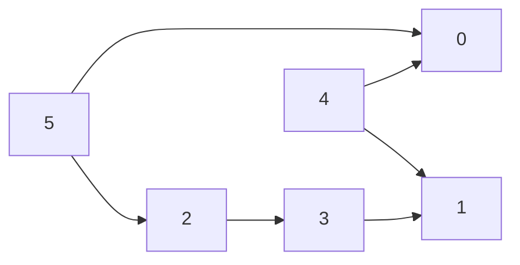

# Topological Sort (Kahn's Algorithm — BFS)

## Problem Link
🔗 [GFG — Topological Sort](https://www.geeksforgeeks.org/problems/topological-sort/1)

> 💡 This is the **BFS-based** approach to topological sort. See the [DFS version](https://www.geeksforgeeks.org/problems/topological-sort/1) for the stack-based alternative. Kahn's naturally detects **cycles** — a bonus the DFS version doesn't have.

---

## What is this Problem?

Same problem as the DFS version — linear ordering of a DAG where every `u→v` edge means `u` appears before `v`. Kahn's solves it using **in-degrees** and a **BFS queue**.

---

## The Problem Explained

Think of it like **a factory assembly line**:

```
A part can only be assembled when ALL its required components
are already done (all "incoming arrows" are cleared).

In-degree of a node = number of unfinished prerequisites.

When a part's in-degree hits 0 → all prerequisites done
→ it's ready to be processed next → add to the queue.

When you process a part, you "complete" it → reduce the
in-degree of everything that depended on it.
If any of those now hit 0 → they're also ready → queue them.
```

---

## HOOK TO REMEMBER FOREVER

**"IN-DEGREE 0 = READY. PROCESS IT. DECREMENT NEIGHBORS. NEW ZEROS JOIN THE QUEUE."**

- ✅ Build in-degree array: `inDegree[v]` = number of edges pointing INTO `v`
- ✅ Seed queue with all nodes where `inDegree == 0` (no prerequisites)
- ✅ Pop a node → add to answer → decrement all its neighbors' in-degrees
- ✅ If any neighbor's in-degree hits 0 → push to queue
- ✅ If final answer has fewer than V nodes → **cycle detected** (unreachable nodes)
- ✅ O(V + E) time, O(V) space

## How It Works Step By Step

### Input: `V=6, edges: 5→0, 5→2, 4→0, 4→1, 2→3, 3→1`



### Step 1 — Build In-Degrees

```
Node: 0  1  2  3  4  5
      ↑  ↑  ↑  ↑  ↑  ↑
5→0: +1     5→2: +1
4→0: +1  4→1: +1
         3→1: +1  2→3: +1

inDegree = [2, 2, 1, 1, 0, 0]
              ↑        ↑  ↑
           0,1 have  4,5 have
           two prereqs  zero prereqs
```

### Step 2 — Seed Queue with In-Degree 0

```
inDegree[4]=0 → push 4
inDegree[5]=0 → push 5

Queue: [4, 5]
```

### Step 3 — BFS Process

```
Pop 4: ans=[4]. Neighbors: 0,1
  inDegree[0]-- → 1. Not 0, don't push.
  inDegree[1]-- → 1. Not 0, don't push.
Queue: [5]

Pop 5: ans=[4,5]. Neighbors: 0,2
  inDegree[0]-- → 0. PUSH 0!
  inDegree[2]-- → 0. PUSH 2!
Queue: [0, 2]

Pop 0: ans=[4,5,0]. No neighbors (out-edges from 0: none).
Queue: [2]

Pop 2: ans=[4,5,0,2]. Neighbor: 3
  inDegree[3]-- → 0. PUSH 3!
Queue: [3]

Pop 3: ans=[4,5,0,2,3]. Neighbor: 1
  inDegree[1]-- → 0. PUSH 1!
Queue: [1]

Pop 1: ans=[4,5,0,2,3,1]. No out-edges.
Queue: []

ans.size()=6 = V → No cycle. Return [4,5,0,2,3,1] ✓
```

**Verify:** 5→0 ✓, 5→2 ✓, 4→0 ✓, 4→1 ✓, 2→3 ✓, 3→1 ✓ — all edges go left-to-right in the answer.

---

## Code Full Solution

```cpp
class Solution {
public:
    vector<int> topoSort(int V, vector<vector<int>>& edges) {
        vector<vector<int>> graph(V);
        queue<int> q;
        vector<int> inDegree(V, 0);
        vector<int> ans;

        for (auto &el : edges) {
            graph[el[0]].push_back(el[1]);
        }

        for (int i = 0; i < V; i++) {
            for (auto &el : graph[i]) {
                inDegree[el]++;
            }
        }

        for (int i = 0; i < V; i++) {
            if (inDegree[i] == 0) q.push(i);
        }

        while (!q.empty()) {
            auto node = q.front();
            q.pop();
            ans.push_back(node);

            for (auto &nei : graph[node]) {
                inDegree[nei]--;
                if (inDegree[nei] == 0) q.push(nei);
            }
        }

        return ans;
    }
};
```

> ⚠️ **Bug in original:** `ans` was used inside `topoSort` without being declared. Fixed by adding `vector<int> ans;` at the top of the function.

---

## Code Explanation

### Build In-Degree

```cpp
for (int i = 0; i < V; i++) {
    for (auto &el : graph[i]) {
        inDegree[el]++;
    }
}
```

For every edge `i → el`, node `el` gets one more incoming edge (in-degree += 1).

---

### Seed the Queue

```cpp
for (int i = 0; i < V; i++) {
    if (inDegree[i] == 0) q.push(i);
}
```

Nodes with in-degree 0 have **no prerequisites** — they can go first. These are the "sources" of the DAG.

---

### BFS Core

```cpp
auto node = q.front(); q.pop();
ans.push_back(node);

for (auto &nei : graph[node]) {
    inDegree[nei]--;
    if (inDegree[nei] == 0) q.push(nei);
}
```

```
Processing a node = "completing a task".
Decrementing a neighbor's in-degree = "one fewer prerequisite".
In-degree hitting 0 = "all prerequisites done → task is now ready".
```

---

## Complete Example Traces

### Trace 1: Linear Chain 0→1→2→3

```
inDegree = [0,1,1,1]
Queue starts: [0]

Pop 0 → ans=[0]. inDegree[1]--→0. Push 1.
Pop 1 → ans=[0,1]. inDegree[2]--→0. Push 2.
Pop 2 → ans=[0,1,2]. inDegree[3]--→0. Push 3.
Pop 3 → ans=[0,1,2,3].

Return [0,1,2,3] ✓
```

### Trace 2: Disconnected Graph

```
Edges: 0→1, 2→3 (two separate chains)

inDegree = [0,1,0,1]
Queue starts: [0,2]

Pop 0 → ans=[0]. inDegree[1]--→0. Push 1.
Pop 2 → ans=[0,2]. inDegree[3]--→0. Push 3.
Pop 1 → ans=[0,2,1].
Pop 3 → ans=[0,2,1,3].

Return [0,2,1,3] ✓
```

### Trace 3: Cycle Detected

```
Edges: 0→1, 1→2, 2→0 (triangle cycle!)

inDegree = [1,1,1]
Queue: EMPTY (no node with in-degree 0!)

While loop never runs. ans=[]. ans.size()=0 ≠ V=3.

Cycle detected! ✓
```

---

## Edge Cases

### Case 1: All Isolated Nodes

```
V=3, no edges. inDegree=[0,0,0].
All pushed to queue. Processed in index order.
Return [0,1,2] ✓ (any order valid with no constraints)
```

### Case 2: Single Node

```
V=1, no edges. inDegree=[0]. Push 0. Pop 0.
Return [0] ✓
```

---

## Time and Space Complexity

| | Value |
|---|---|
| Build graph | O(E) |
| Build in-degree | O(V + E) |
| Seed queue | O(V) |
| BFS | O(V + E) |
| **Total** | **O(V + E)** |
| Space | O(V) |

---

## Key Insights

### Kahn's Detects Cycles — DFS Version Doesn't

```
After BFS, check: ans.size() == V?

If YES → no cycle, valid topo sort returned.
If NO  → a cycle exists somewhere.
  Why? Nodes in a cycle NEVER get their in-degree to 0
  (each node in the cycle always has at least one unprocessed
  predecessor within the cycle). They're never added to the
  queue → never added to ans → ans is shorter than V.

The DFS version needs a separate "in current stack" boolean
array to detect cycles. Kahn's gets it for free.
```

### In-Degree = "How Many Blockers"

```
Think of in-degree as a countdown of blockers:
  0 blockers → FREE to process
  1+ blockers → waiting on prerequisites

Every time we process a node, we clear its "blocker" status
from all its successors. If that clears a successor's last
blocker, it joins the queue.

This is exactly how build systems (like Make or Gradle)
work: a task runs when all its dependencies are done.
```

### DFS vs Kahn's — When to Use Which

```
DFS Topo Sort:
  + Simpler code once DFS is natural
  + Common in interview "just sort this DAG" questions
  - Need extra logic for cycle detection

Kahn's Algorithm:
  + Built-in cycle detection (check ans.size() == V)
  + More intuitive — "start from what's ready"
  + Preferred for problems that mention cycle detection
  + Natural for scheduling/dependency systems

Both O(V+E). In interviews, knowing BOTH earns points.
```

---

## References

- 🔗 [GFG — Topological Sort](https://www.geeksforgeeks.org/problems/topological-sort/1)
- 🔗 [Topological Sort DFS version (stack-based)](https://www.geeksforgeeks.org/problems/topological-sort/1)