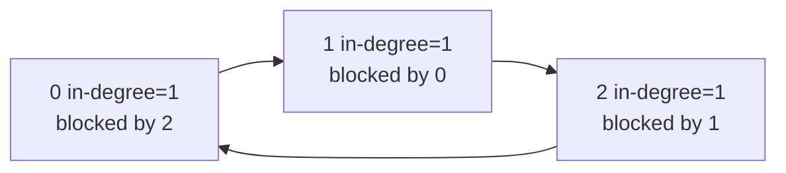

# Cycle Detection in Directed Graph (Topological Sort)

## Problem Link
🔗 [GFG — Detect Cycle in a Directed Graph](https://www.geeksforgeeks.org/problems/detect-cycle-in-a-directed-graph/1)

> 💡 This is a **one-line extension** of Kahn's Algorithm. If you haven't read the [Kahn's Topo Sort README](https://www.geeksforgeeks.org/problems/topological-sort/1), read that first — this README only covers what's different.

---

## What is this Problem?

Given a directed graph, detect whether it contains a **cycle**.

```
Edges: 0→1, 1→2, 2→0  → CYCLE exists (triangle)
Edges: 0→1, 1→2, 2→3  → No cycle (linear chain)
```

---

## The Single Insight

```
Kahn's algorithm processes nodes in topological order.
A topological order only EXISTS for DAGs (no cycles).

Key observation:
  Nodes trapped in a cycle NEVER get their in-degree to 0.
  (Each node in the cycle always has one unprocessed predecessor
  inside the same cycle, blocking it forever.)

  → They never enter the queue.
  → They never get added to ans.
  → ans.size() < V after BFS finishes.

If ans.size() == V → every node was processed → no cycle.
If ans.size() != V → some nodes were unreachable → cycle exists.
```

---

## The Only Difference from Kahn's Topo Sort

```cpp
// Kahn's Topo Sort returns:
return ans;               // the ordering itself

// Cycle Detection returns:
return ans.size() != V;   // true if cycle exists, false if no cycle
```

That's it. **Identical algorithm, different return statement.**

---

## Code Full Solution

```cpp
bool detectCycle(int V, vector<vector<int>>& edges) {
    vector<vector<int>> graph(V);
    queue<int> q;
    vector<int> indegree(V, 0);
    vector<int> ans;

    for (auto &el : edges)
        graph[el[0]].push_back(el[1]);

    for (int i = 0; i < V; i++)
        for (auto &el : graph[i])
            indegree[el]++;

    for (int i = 0; i < V; i++)
        if (indegree[i] == 0) q.push(i);

    while (!q.empty()) {
        auto node = q.front(); q.pop();
        ans.push_back(node);
        for (auto &nei : graph[node]) {
            indegree[nei]--;
            if (indegree[nei] == 0) q.push(nei);
        }
    }

    return ans.size() != V;  // true = cycle exists
}
```

---

## Why Cyclic Nodes Never Get Processed



```
Cycle: 0→1→2→0

indegree = [1, 1, 1]  ← no node has in-degree 0!

Queue starts EMPTY → BFS never runs → ans=[] → ans.size()=0 ≠ V=3

return true ✓ (cycle detected)
```

Now add one node outside the cycle:

```
Edges: 3→0, 0→1, 1→2, 2→0

indegree = [1, 1, 1, 0]  ← node 3 has in-degree 0

Queue: [3]
Pop 3: ans=[3]. indegree[0]-- → 0. Push 0.
Pop 0: ans=[3,0]. indegree[1]-- → 0. Push 1.
Pop 1: ans=[3,0,1]. indegree[2]-- → 0. Push 2.
Pop 2: ans=[3,0,1,2]. indegree[0]-- → -1? Wait:

indegree[0] was already decremented to 0 and pushed.
It's processed. 2→0 decrements it again, but 0 was
already in ans — it won't get re-queued (queue only gets
nodes when in-degree hits 0 from above 0).

Actually wait: the code pushes when indegree hits 0, but
node 0 was already processed. Its in-degree going to -1
doesn't re-push it. So ans=[3,0,1,2], size=4=V=4.

Hmm, this seems like no cycle is detected but there IS a cycle.
Let me re-examine: if 3→0 exists AND 2→0 exists, in-degree of 0 = 2.

indegree = [2, 1, 1, 0]

Pop 3: indegree[0]-- → 1. Not 0, don't push.
Queue: []  ← EMPTY after processing 3!

ans=[3]. size=1 ≠ 4 = V.

return true ✓ (cycle correctly detected even with external node)
```

---

## Complete Example Traces

### Trace 1: Simple Cycle

```
V=3, edges: 0→1, 1→2, 2→0

indegree=[1,1,1]. Queue: empty. ans=[]. size=0≠3.
return true ✓ (cycle detected)
```

### Trace 2: No Cycle (DAG)

```
V=4, edges: 0→1, 0→2, 1→3, 2→3

indegree=[0,1,1,2]. Queue: [0].

Pop 0: indegree[1]--→0, push. indegree[2]--→0, push.
Pop 1: indegree[3]--→1.
Pop 2: indegree[3]--→0, push.
Pop 3: no neighbors.

ans=[0,1,2,3]. size=4=V.
return false ✓ (no cycle)
```

### Trace 3: Self-Loop

```
V=1, edges: 0→0

indegree=[1]. Queue: empty. ans=[]. size=0≠1.
return true ✓ (self-loop IS a cycle)
```

### Trace 4: Disconnected — One Component Has Cycle

```
V=4, edges: 0→1, 2→3, 3→2

indegree=[0,1,1,1]. Queue: [0].

Pop 0: indegree[1]--→0. Push 1.
Pop 1: no neighbors.

ans=[0,1]. size=2≠4.
return true ✓ (nodes 2 and 3 are in a cycle, never processed)
```

---

## Time and Space Complexity

| | Value |
|---|---|
| Time | O(V + E) — same as Kahn's |
| Space | O(V) |

---

## Key Insights

### Why Kahn's Works But DFS Needs Extra Bookkeeping

```
DFS cycle detection (directed graphs):
  Need a "currently in call stack" array (separate from visited).
  A back edge = reaching a node that's IN THE CURRENT DFS PATH.
  Requires careful state management.

Kahn's cycle detection:
  No extra state needed.
  The ans.size() check at the end tells you everything.
  Simpler, harder to get wrong.
```

### This vs Cycle Detection in UNDIRECTED Graphs

```
Undirected graphs (BFS/DFS with parent tracking):
  See the "Cycle Detection in Undirected Graph" READMEs.
  The parent check prevents false positives from the "I came
  from here" edge being mistaken for a back edge.

Directed graphs (Kahn's or DFS with stack tracking):
  Direction matters — A→B and B→A is explicitly two separate
  edges, both must exist for a 2-cycle. The parent trick
  used in undirected graphs doesn't apply here.
  
  Always use the directed-specific approach for directed graphs.
```

---

## References

- 🔗 [GFG — Detect Cycle in a Directed Graph](https://www.geeksforgeeks.org/problems/detect-cycle-in-a-directed-graph/1)
- 🔗 [Kahn's Topological Sort — the base algorithm](https://www.geeksforgeeks.org/problems/topological-sort/1)