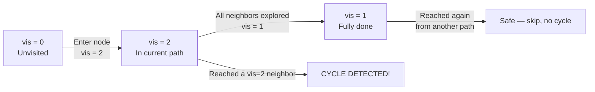
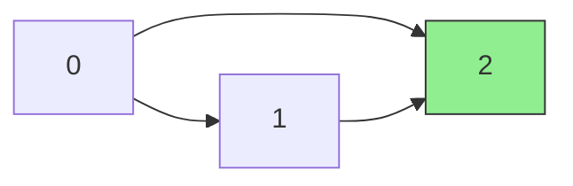
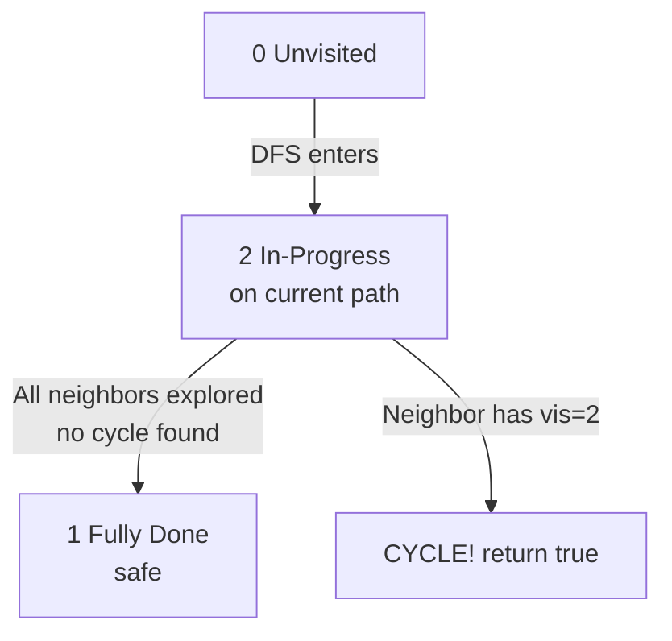

# Cycle Detection in Directed Graph (DFS)

## Problem Link
🔗 [GFG — Detect Cycle in a Directed Graph](https://www.geeksforgeeks.org/problems/detect-cycle-in-a-directed-graph/1)

> 💡 This is the **DFS approach** using a 3-state visited array. Compare with the [Kahn's (BFS) approach](https://www.geeksforgeeks.org/problems/detect-cycle-in-a-directed-graph/1) — both detect cycles, but the logic here is more explicit about WHY a cycle exists.

---

## What is this Problem?

Given a directed graph, detect whether it contains a **cycle**.

```
0→1→2→3 → No cycle
0→1→2→0 → Cycle! (back edge from 2 to 0)
```

---

## The Problem Explained

Think of it like **following a trail of breadcrumbs**:

```
You're exploring a graph. For each DFS path from a starting node:
  - Drop a breadcrumb at every node you ENTER (mark it "in-progress")
  - Pick up the breadcrumb when you fully LEAVE (mark it "done")

If you ever arrive at a node that STILL HAS ITS BREADCRUMB
(you entered it but haven't left yet) → you've found a BACK EDGE
→ there's a cycle: you looped back to your own current trail!

If you arrive at a node whose breadcrumb is already picked up
(fully processed in a previous DFS run) → NOT a cycle.
That node was explored, found safe, and closed out.
```

This is why we need **3 states** — "unvisited", "currently being explored (has breadcrumb)", and "fully done (breadcrumb picked up)".

---

## HOOK TO REMEMBER FOREVER

**"0 = UNVISITED. 2 = IN CURRENT PATH. 1 = DONE. SEEING A 2 = CYCLE!"**

- ✅ `vis[node] = 0` → not seen yet
- ✅ `vis[node] = 2` → currently on the active DFS stack (breadcrumb down)
- ✅ `vis[node] = 1` → fully explored and safe (breadcrumb picked up)
- ✅ If DFS reaches a neighbor with `vis == 2` → **cycle** (back edge to current path)
- ✅ If DFS reaches a neighbor with `vis == 1` → **safe** (already proven cycle-free)
- ✅ On DFS EXIT: change `vis[node]` from `2` → `1`

---

## Why 3 States and Not 2?

```
With 2 states (visited/unvisited):
  Graph: 0→1→2, 0→2

  DFS from 0: visit 0→1→2 (mark all visited).
  Back at 0, explore second path: 0→2. Node 2 is visited!
  2-state logic would say "visited neighbor = cycle" → WRONG!

  0→2 is NOT a cycle — it's just two paths to the same node.
  Node 2 was explored BEFORE, safe.

With 3 states:
  When 0→2 is explored, vis[2]=1 (DONE, not IN-PROGRESS).
  vis==1 means "safe, already processed." No cycle. ✓

  A cycle would look like: 0→1→2→0.
  When 2 tries to visit 0, vis[0]=2 (STILL IN-PROGRESS). Cycle! ✓
```



---

## How It Works Step By Step

### Example 1: Cycle — `0→1→2→0`

```
DFS(0): vis[0]=2
  nei=1: vis[1]=0 → DFS(1)
    vis[1]=2
    nei=2: vis[2]=0 → DFS(2)
      vis[2]=2
      nei=0: vis[0]=2 ← SAME AS CURRENT PATH!
        return true (CYCLE FOUND)
      DFS(2) → true → DFS(1) → true → DFS(0) → true

return true ✓
```

### Example 2: No Cycle — `0→1→2, 0→2`

```
DFS(0): vis[0]=2
  nei=1: DFS(1)
    vis[1]=2
    nei=2: DFS(2)
      vis[2]=2. No more neighbors.
      vis[2]=1 ← DONE
      return false
    vis[1]=1 ← DONE. return false.
  nei=2: vis[2]=1 ← already fully done!
    NOT a cycle (vis==1, not vis==2). Skip.
  vis[0]=1 ← DONE. return false.

return false ✓
```



```
When 0 tries to visit 2 (second path), vis[2]=1 (green = done).
No cycle.
```

---

## Code Full Solution

```cpp
class Solution {
public:
    bool dfs(int node, vector<int>& vis, vector<vector<int>>& graph) {
        vis[node] = 2;  // mark: currently being explored

        for (auto &nei : graph[node]) {
            if (vis[nei] == 0) {
                if (dfs(nei, vis, graph) == true) return true;
            } else if (vis[nei] == 2) {
                return true;  // back edge → cycle!
            }
            // vis[nei] == 1 → safe, skip
        }

        vis[node] = 1;  // mark: fully done
        return false;
    }

    bool isCyclic(int V, vector<vector<int>>& edges) {
        vector<vector<int>> graph(V);
        vector<int> vis(V, 0);

        for (auto &el : edges)
            graph[el[0]].push_back(el[1]);

        for (int i = 0; i < V; i++) {
            if (!vis[i]) {
                if (dfs(i, vis, graph) == true) return true;
            }
        }

        return false;
    }
};
```

---

## Code Explanation

### Mark 2 on ENTRY, 1 on EXIT

```cpp
vis[node] = 2;   // top of dfs
// ... explore all neighbors ...
vis[node] = 1;   // bottom of dfs (before return false)
```

```
2 = "I'm currently on this DFS path — my breadcrumb is here."
  Set FIRST so any path back to me is flagged immediately.

1 = "I finished exploring everything reachable from me. Safe."
  Set LAST, only after ALL neighbors are explored and returned false.
  If a cycle is found and we return true early, vis[node] stays 2
  (doesn't matter — we're already returning true up the call stack).
```

---

### Three Neighbor Cases

```cpp
if (vis[nei] == 0)        // unvisited → explore it
    if (dfs(nei,...)) return true;
else if (vis[nei] == 2)   // IN-PROGRESS → back edge → cycle!
    return true;
// vis[nei] == 1           // fully done → safe, do nothing
```

```
Only two cases have explicit branches because:
  vis==0: need to recurse
  vis==2: immediate cycle detection
  vis==1: do NOTHING (implicit else — skip over it)
```

---

### Outer Loop for Disconnected Graphs

```cpp
for (int i = 0; i < V; i++) {
    if (!vis[i]) {  // vis[i] == 0 (unvisited)
        if (dfs(i, vis, graph)) return true;
    }
}
```

`!vis[i]` is true when `vis[i] == 0`. Nodes with `vis[i] == 1` (done) are skipped — they were already explored in a previous DFS run and confirmed cycle-free.

---

## Complete Example Traces

### Trace 1: Direct Cycle 0→1→2→0

```
(Fully traced above) → return true ✓
```

### Trace 2: Two Paths, No Cycle

```
(Fully traced above) → return false ✓
```

### Trace 3: Disconnected — Second Component Has Cycle

```
V=4, edges: 0→1, 2→3, 3→2

i=0: vis[0]=0 → DFS(0)
  vis[0]=2. nei=1: DFS(1)
    vis[1]=2. No neighbors. vis[1]=1. return false.
  vis[0]=1. return false.

i=1: vis[1]=1 → skip
i=2: vis[2]=0 → DFS(2)
  vis[2]=2. nei=3: DFS(3)
    vis[3]=2. nei=2: vis[2]=2 → CYCLE! return true.
  return true.

return true ✓
```

### Trace 4: Self-Loop 0→0

```
DFS(0): vis[0]=2.
  nei=0: vis[0]=2 → CYCLE! return true.

return true ✓
```

### Trace 5: No Edges

```
All vis remain 0, then go 2→1 in each trivial DFS.
No neighbor ever seen as vis==2.
return false ✓
```

---

## Time and Space Complexity

| | Value |
|---|---|
| Time | O(V + E) — each node and edge visited once |
| Space | O(V) — vis array + recursion stack |

---

## Key Insights

### The State Transition Diagram



```
A node can never go:
  1 → 2 (done nodes are never re-entered: outer loop skips vis!=0)
  2 → 0 (impossible: once entered, goes to 1 or stays 2 on cycle)

The only valid transitions are 0→2→1 or 0→2→(CYCLE).
```

### DFS vs Kahn's for Directed Cycle Detection

```
Kahn's (BFS):
  Indirect detection: ans.size() != V means some nodes
  were stuck with in-degree > 0 (blocked by a cycle).
  Simple return condition, no extra state needed.

DFS (3-state):
  Direct detection: explicitly sees the back edge
  (vis==2 neighbor = "you're still on my current path").
  More intuitive REASON for why a cycle exists.
  Slightly more code, but reveals the exact moment a
  cycle is found.

Pick Kahn's for simplicity. Pick DFS when you want to
find or report the actual cycle path.
```

### Why Undirected Cycle Detection Is Different

```
Undirected graphs (parent tracking):
  Every edge goes both ways: A-B means adj[A] contains B
  AND adj[B] contains A. Without parent tracking, B would
  "see" A and falsely report a cycle.
  Solution: just check if a visited neighbor ISN'T the parent.

Directed graphs (3-state vis):
  Edges are one-way. No false back-edge issue.
  But now you need to distinguish "visited in this DFS run
  but on a different completed path" (vis=1) from "visited
  in THIS current path" (vis=2).
  Solution: 3-state vis array.

Never use parent tracking for directed graphs —
the parent concept doesn't apply to directed edges.
```

---

## References

- 🔗 [GFG — Detect Cycle in a Directed Graph](https://www.geeksforgeeks.org/problems/detect-cycle-in-a-directed-graph/1)
- 🔗 [Kahn's BFS approach — simpler alternative](https://www.geeksforgeeks.org/problems/detect-cycle-in-a-directed-graph/1)