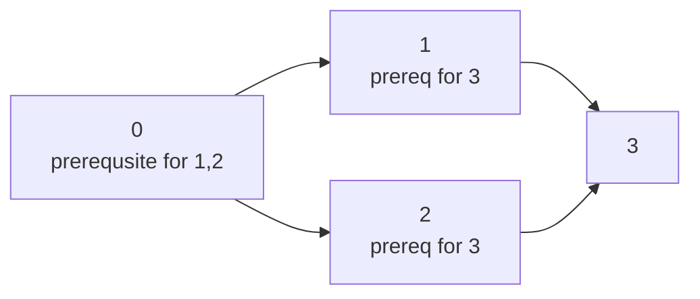

# Course Schedule II (Find Order)

## Problem Link
🔗 [LeetCode 210 — Course Schedule II](https://leetcode.com/problems/course-schedule-ii/)

> 💡 This is **Kahn's Algorithm applied to a real problem**. If you haven't read the [Kahn's Topo Sort README](https://www.geeksforgeeks.org/problems/topological-sort/1), read that first. This README focuses on what's different: **edge direction interpretation** and the **cycle check return**.

---

## What is this Problem?

There are `V` courses (numbered 0 to V-1). Some courses have prerequisites: `edges[i] = [course, prerequisite]` means you must take `prerequisite` BEFORE `course`.

Return an ordering to take all courses. If impossible (cycle exists), return `[]`.

```
V=4, edges=[[1,0],[2,0],[3,1],[3,2]]

To take 1, need 0 first.
To take 2, need 0 first.
To take 3, need 1 and 2.

Valid order: [0, 2, 1, 3] or [0, 1, 2, 3]
```

---

## The Only Tricky Part — Edge Direction

```
edges[i] = [course, prerequisite]

"prerequisite must be taken BEFORE course"
→ prerequisite → course  (arrow means "comes before")

In code:
  graph[el[1]].push_back(el[0]);
  
  el[0] = course, el[1] = prerequisite
  → graph[prerequisite].push_back(course)
  → prerequisite → course ✓
```

**Why reverse from what you might expect?**

```
Input gives [course, prerequisite].
But in the graph we need prerequisite → course
(the prereq has an outgoing edge TO the course that needs it).

The code reads el[1] (prerequisite) as the source
and el[0] (course) as the destination.

This is the ONE thing to get right — the rest is
identical to Kahn's topo sort.
```

---

## Mermaid — Example Graph



```
indegree: 0→0, 1→1, 2→1, 3→2

Queue starts with: [0]

Pop 0: enqueue 1 (indegree 1→0) and 2 (indegree 1→0).
Pop 1: enqueue nothing (3 still has indegree 1).
Pop 2: enqueue 3 (indegree 2→1→0).
Pop 3: done.

ans = [0, 1, 2, 3] ✓
```

---

## Code Full Solution

```cpp
class Solution {
public:
    vector<int> findOrder(int V, vector<vector<int>>& edges) {
        vector<vector<int>> graph(V);
        queue<int> q;
        vector<int> indegree(V, 0);
        vector<int> ans;

        // prerequisite → course
        for (auto &el : edges)
            graph[el[1]].push_back(el[0]);

        for (int i = 0; i < V; i++)
            for (auto &el : graph[i])
                indegree[el]++;

        for (int i = 0; i < V; i++)
            if (indegree[i] == 0) q.push(i);

        while (!q.empty()) {
            auto node = q.front(); q.pop();
            ans.push_back(node);
            for (auto &nei : graph[node]) {
                indegree[nei]--;
                if (indegree[nei] == 0) q.push(nei);
            }
        }

        if (ans.size() == V) return ans;
        return {};  // cycle detected — no valid order
    }
};
```

---

## What's Different from Plain Kahn's Topo Sort

| | Kahn's Topo Sort | Course Schedule II |
|---|---|---|
| Edge direction | `graph[el[0]].push_back(el[1])` | `graph[el[1]].push_back(el[0])` (reversed input) |
| Return on no cycle | `return ans` | `return ans` |
| Return on cycle | — | `return {}` |
| Cycle check | `ans.size() != V` (bool) | `ans.size() == V` (return ans or {}) |

That's the complete diff.

---

## Complete Example Traces

### Trace 1: Valid Order

```
V=4, edges=[[1,0],[2,0],[3,1],[3,2]]

graph[0]=[1,2], graph[1]=[3], graph[2]=[3]
indegree=[0,1,1,2]
Queue: [0]

Pop 0: ans=[0]. indegree[1]--→0, push. indegree[2]--→0, push.
Pop 1: ans=[0,1]. indegree[3]--→1. (not 0 yet)
Pop 2: ans=[0,1,2]. indegree[3]--→0, push.
Pop 3: ans=[0,1,2,3].

ans.size()=4=V → return [0,1,2,3] ✓
```

### Trace 2: Cycle — Impossible Schedule

```
V=2, edges=[[0,1],[1,0]]
(0 needs 1, and 1 needs 0 — impossible!)

graph[1]=[0], graph[0]=[1]
indegree=[1,1]
Queue: EMPTY

ans=[]. size=0≠2 → return {} ✓
```

### Trace 3: No Prerequisites

```
V=3, edges=[]

indegree=[0,0,0]. Queue: [0,1,2].
Pop all: ans=[0,1,2].

return [0,1,2] ✓ (any order valid with no constraints)
```

### Trace 4: Linear Chain of Prerequisites

```
V=3, edges=[[1,0],[2,1]]
(Must do 0, then 1, then 2)

graph[0]=[1], graph[1]=[2]
indegree=[0,1,1]
Queue: [0]

Pop 0 → push 1. Pop 1 → push 2. Pop 2.
ans=[0,1,2] ✓
```

---

## Edge Cases

### Case 1: Single Course, No Prerequisites

```
V=1, edges=[]
return [0] ✓
```

### Case 2: All Courses Have Each Other as Prerequisites (Cycle)

```
V=3, edges=[[0,1],[1,2],[2,0]]
indegree=[1,1,1]. Queue empty. return {} ✓
```

---

## Time and Space Complexity

| | Value |
|---|---|
| Time | O(V + E) |
| Space | O(V + E) — graph + indegree + queue |

---

## Key Insight — Read the Edge Direction Carefully

```
This problem's edges = [course, prerequisite]
→ prerequisite comes FIRST in topological order
→ add edge: prerequisite → course
→ graph[el[1]].push_back(el[0])

LeetCode 207 (Course Schedule I — just true/false):
  Same graph, same BFS, just return ans.size()==V instead of the order.

A different problem might give edges as [prerequisite, course]
→ then you'd write graph[el[0]].push_back(el[1]) (no swap).

Always check: "which direction does the dependency flow?"
then build the graph edge in that direction. ✓
```

---

## References

- 🔗 [LeetCode 210 — Course Schedule II](https://leetcode.com/problems/course-schedule-ii/)
- 🔗 [LeetCode 207 — Course Schedule I (just true/false)](https://leetcode.com/problems/course-schedule/)