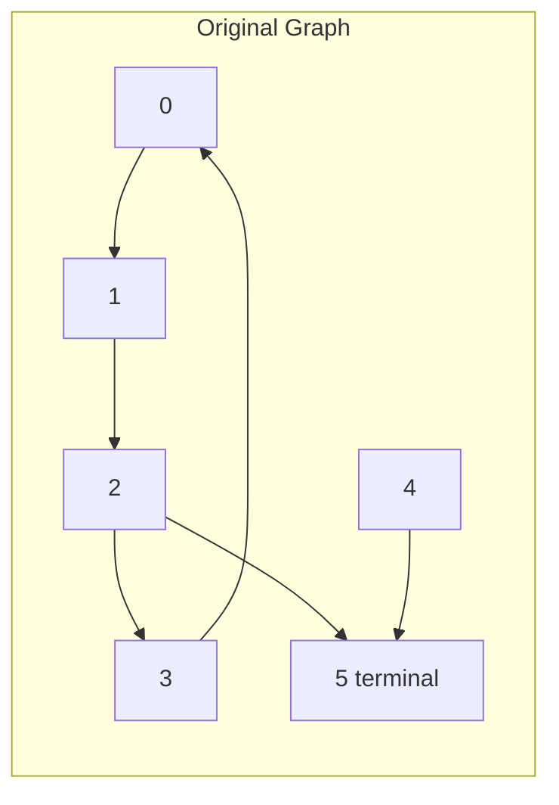
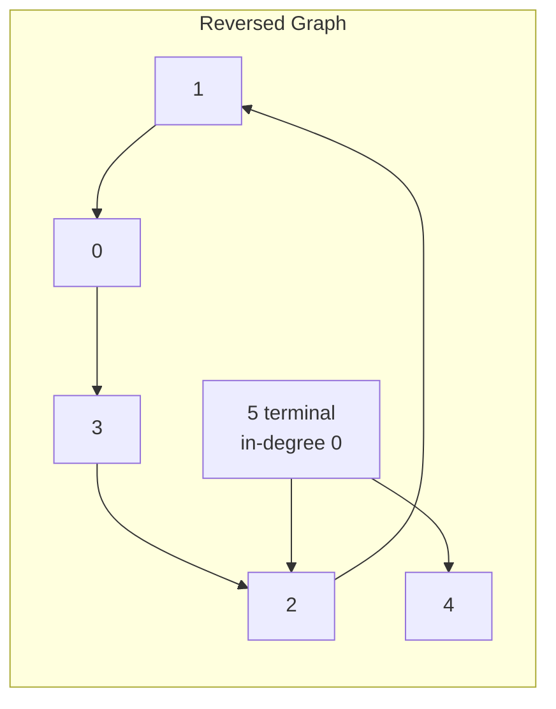

# Find Eventual Safe States

## Problem Link
🔗 [LeetCode 802 — Find Eventual Safe States](https://leetcode.com/problems/find-eventual-safe-states/)

> 💡 This is **Kahn's Algorithm on a reversed graph**. The key insight is recognizing that "safe nodes" are exactly the nodes NOT in or leading to a cycle — which maps perfectly to topo sort's by-product.

---

## What is this Problem?

Given a directed graph, a node is **safe** if every path starting from it eventually leads to a **terminal node** (a node with no outgoing edges). Return all safe nodes in sorted order.

```
graph = [[1,2],[2,3],[5],[0],[5],[],[]]

Node 5: terminal (no outgoing edges) → safe
Node 6: terminal → safe
Node 2: goes to 5 (safe) → safe
Node 4: goes to 5 (safe) → safe
Node 0: goes to 1 and 2. 1→2→3→0 forms a cycle → UNSAFE
Node 1: part of cycle → UNSAFE
Node 3: part of cycle → UNSAFE

Output: [2, 4, 5, 6] (sorted)
```

---

## The Core Insight — Reverse the Problem

**Unsafe nodes** = nodes that are on a cycle OR can reach a cycle.  
**Safe nodes** = nodes that are NOT on any cycle AND don't lead to one.

```
Direct approach (hard): find all cycles, then find all nodes
that can reach any of those cycles. Complex.

Elegant approach: flip all edges and run Kahn's topo sort.

Why?
  In the REVERSED graph, a terminal node (originally no
  out-edges → now no in-edges) has in-degree 0.
  Kahn's naturally processes nodes with no unprocessed
  predecessors first.

  In the reversed graph, nodes reachable from the terminals
  (i.e., nodes that LEAD to terminals in the original graph)
  get processed by Kahn's — these are exactly the safe nodes.

  Cyclic nodes in the original graph remain cyclic in the
  reversed graph → their in-degrees never hit 0 → they're
  never processed → they don't appear in ans.
```

---

## Mermaid — Original vs Reversed Graph





```
In reversed graph:
  Terminal nodes (5,6) have NO incoming edges in original
  → NO outgoing edges to reverse → in-degree 0 in reversed graph

  Kahn's starts from them, processes everything they can reach
  (in the reversed graph) = everything that can REACH terminals
  in the original graph = SAFE NODES ✓
```

---

## How It Works Step By Step

### Example: `graph=[[1,2],[2,3],[5],[0],[5],[],[]]`

```
Original edges:   0→1, 0→2, 1→2, 1→3, 2→5, 3→0, 4→5

Step 1 — Build reversed adjacency list and indegree
(indegree here = number of OUTGOING edges in original graph):

Original out-edges:
  0 has 2 out-edges → indegree[0]=2
  1 has 2 out-edges → indegree[1]=2
  2 has 1 out-edge  → indegree[2]=1
  3 has 1 out-edge  → indegree[3]=1
  4 has 1 out-edge  → indegree[4]=1
  5 has 0 out-edges → indegree[5]=0  ← terminal!
  6 has 0 out-edges → indegree[6]=0  ← terminal!

Reversed adj (original edge u→v becomes rev edge v→u):
  adj[1]=[0], adj[2]=[0,1], adj[5]=[2,4], adj[3]=[1], adj[0]=[3]
```

```
Step 2 — Seed queue with in-degree 0 (terminals):
  Queue: [5, 6]

Step 3 — Kahn's BFS:

Pop 5: ans=[5]. Neighbors in adj[5]=[2,4].
  indegree[2]-- → 0. Push 2.
  indegree[4]-- → 0. Push 4.
Queue: [6, 2, 4]

Pop 6: ans=[5,6]. adj[6]=[] (nothing reversed into 6).
Queue: [2, 4]

Pop 2: ans=[5,6,2]. adj[2]=[0,1].
  indegree[0]-- → 1. Not 0.
  indegree[1]-- → 1. Not 0.
Queue: [4]

Pop 4: ans=[5,6,2,4]. adj[4]=[] (nothing reversed into 4).
Queue: []

Done. Sort: [2,4,5,6].
Return [2,4,5,6] ✓
```

Nodes 0,1,3 (the cycle) never got enqueued — their in-degrees never hit 0.

---

## Code Full Solution

```cpp
class Solution {
public:
    vector<int> eventualSafeNodes(vector<vector<int>>& graph) {
        int V = graph.size();
        vector<vector<int>> adj(V);   // reversed graph
        vector<int> indegree(V, 0);
        vector<int> ans;
        queue<int> q;

        // Reverse all edges + count original out-degrees as indegrees
        for (int i = 0; i < V; i++) {
            for (auto &el : graph[i]) {
                adj[el].push_back(i);   // reverse: el→i becomes adj[el]=[i,...]
                indegree[i]++;           // i has one more out-edge (original)
            }
        }

        // Terminals: indegree 0 = no outgoing edges in original
        for (int i = 0; i < V; i++)
            if (indegree[i] == 0) q.push(i);

        // Kahn's on reversed graph
        while (!q.empty()) {
            int node = q.front(); q.pop();
            ans.push_back(node);
            for (int &nei : adj[node]) {
                indegree[nei]--;
                if (indegree[nei] == 0) q.push(nei);
            }
        }

        sort(ans.begin(), ans.end());
        return ans;
    }
};
```

---

## Code Explanation

### The Reversal + In-Degree in One Loop

```cpp
for (int i = 0; i < V; i++) {
    for (auto &el : graph[i]) {
        adj[el].push_back(i);  // reverse edge
        indegree[i]++;          // track original out-degree
    }
}
```

```
Original graph gives: i → el (i points to el)

We build:
  adj[el].push_back(i)  → reversed edge: el → i

  indegree[i]++         → "indegree" here isn't really in-degree —
                           it's i's ORIGINAL OUT-DEGREE.
                           We're counting how many edges still need
                           to be "cleared" before i becomes safe.
```

**Why use original out-degree as the "indegree" for Kahn's?**

```
In original graph: i is safe if ALL its outgoing paths lead to safety.
In reversed graph: i should be processed only when ALL its "reversed-in"
edges (= original out-edges) have been cleared.

Kahn's decrements when a neighbor is processed.
Here: when a node in adj[el] is processed (a node that i originally
pointed to is confirmed safe), we decrement indegree[i].
When indegree[i] hits 0 → all of i's original destinations are safe
→ i is safe too. ✓
```

---

### Why Sort at the End?

```cpp
sort(ans.begin(), ans.end());
```

Kahn's processes nodes in BFS order (by in-degree priority), not by node number. The problem requires the answer in **ascending node order** — sort gives us that.

---

## Complete Example Traces

### Trace 1: Main Example (fully traced above)

```
Return [2, 4, 5, 6] ✓
```

### Trace 2: All Nodes Safe (No Cycles)

```
graph = [[1],[2],[]]
Linear: 0→1→2 (terminal)

indegree=[1,1,0]. Queue: [2].
Pop 2: adj[2]=[1]. indegree[1]--→0. Push 1.
Pop 1: adj[1]=[0]. indegree[0]--→0. Push 0.
Pop 0: adj[0]=[]. Done.

ans=[2,1,0] → sorted → [0,1,2] ✓ (all safe)
```

### Trace 3: All Nodes Unsafe (One Big Cycle)

```
graph = [[1],[2],[0]]
Cycle: 0→1→2→0

indegree=[1,1,1]. Queue: EMPTY.

ans=[]. Return [] ✓
```

### Trace 4: Mix of Isolated and Cyclic Nodes

```
graph = [[1],[2],[0],[4],[]]
Cycle: 0→1→2→0. Safe: 3→4 (terminal).

indegree=[1,1,1,1,0]. Queue: [4].
Pop 4: adj[4]=[3]. indegree[3]--→0. Push 3.
Pop 3: adj[3]=[] (no reversed edges). Done.

ans=[4,3] → sorted → [3,4] ✓
```

---

## Edge Cases

### Case 1: Single Terminal Node

```
graph=[[]]  → indegree[0]=0. Queue:[0]. ans=[0]. Return [0] ✓
```

### Case 2: No Terminal Nodes (All Cyclic)

```
graph=[[1],[0]]  → indegree=[1,1]. Queue empty. Return [] ✓
```

---

## Time and Space Complexity

| | Value |
|---|---|
| Build reversed graph | O(V + E) |
| Kahn's BFS | O(V + E) |
| Sort | O(V log V) |
| **Total** | **O(V log V + E)** |
| Space | O(V + E) |

---

## Key Insights

### "Safe" = "Not in or leading to a cycle" = "Processed by Kahn's on reversed graph"

```
Three equivalent characterizations of a safe node:
  1. All paths from it terminate (no infinite loops)
  2. It's not on any cycle AND doesn't lead to any cycle
  3. It gets processed by Kahn's topo sort on the reversed graph

This equivalence is the entire insight of the problem.
Recognizing #3 makes the implementation trivial once you
know Kahn's algorithm.
```

### Why Reversing Works

```
Original graph: A → B means "A leads to B"
  If B is safe, that tells us nothing about A directly.
  (A might have OTHER paths that are unsafe)

Reversed graph: B → A means "B is needed by A"
  When B is confirmed safe AND A has no other unsatisfied
  out-edges, THEN A is confirmed safe.

Reversing transforms the "all my destinations are safe"
condition into the "all my in-degree is cleared" condition
that Kahn's naturally checks. ✓
```

---

## References

- 🔗 [LeetCode 802 — Find Eventual Safe States](https://leetcode.com/problems/find-eventual-safe-states/)