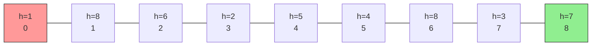

# Container With Most Water

## Problem Link
🔗 [LeetCode 11 — Container With Most Water](https://leetcode.com/problems/container-with-most-water/)

---

## What is this Problem?

Given an array `height` where `height[i]` is the height of the i-th vertical line, find two lines that together with the x-axis form a container that holds the **most water**.

```
Area = width × min(height[left], height[right])
Width = right - left
Height = the SHORTER of the two walls (water spills over the shorter one)
```

**Examples:**
```
height = [1, 8, 6, 2, 5, 4, 8, 3, 7]
Output: 49
(lines at index 1 and 8: width=7, min(8,7)=7, area=49)

height = [1, 1]
Output: 1
(only two lines: width=1, min(1,1)=1, area=1)

height = [4, 3, 2, 1, 4]
Output: 16
(lines at index 0 and 4: width=4, min(4,4)=4, area=16)
```

---

## The Problem Explained

Think of it like **choosing two walls to build a fish tank**:

```
Walls (heights): [1, 8, 6, 2, 5, 4, 8, 3, 7]
                  0  1  2  3  4  5  6  7  8

You pick two walls. The water level is limited by the SHORTER wall.
The wider apart your walls, the more base area — but a short wall kills capacity.

Tank A: walls at 1 and 8 (heights 8 and 7)
  Width = 7, water level = min(8,7) = 7, Area = 49 ✓

Tank B: walls at 1 and 6 (heights 8 and 8)
  Width = 5, water level = min(8,8) = 8, Area = 40 ✗ (less than 49)

Always bottlenecked by the shorter wall.
More width AND taller short-wall = more water.
```

**Key idea:** Start with the widest possible container (left=0, right=n-1). Move the pointer at the **shorter wall** inward — the taller wall can only help if paired with something even taller, so we never move the taller one.

---

## HOOK TO REMEMBER FOREVER

**"START WIDEST, MOVE THE SHORTER WALL INWARD, TRACK THE MAX"**

Every time you see "two lines forming maximum water container":
- ✅ Start with `left = 0`, `right = n-1` (maximum width)
- ✅ Compute area = `(right - left) × min(height[left], height[right])`
- ✅ Update `maxArea`
- ✅ Move the pointer at the **shorter** wall inward (`left++` or `right--`)
- ✅ If equal height → move either (both are equivalent)
- ✅ Stop when `left >= right`
- ✅ O(n) time, O(1) space

**Remember: Moving the taller wall inward can NEVER increase the area — width shrinks AND height is still capped by the shorter wall. Only moving the shorter wall gives a chance at a taller minimum.** 🐟

---

## Why Move the Shorter Wall? — The Greedy Proof

This is the non-obvious part. Here's why it's always correct:

```
Current state: left=L, right=R, height[L] < height[R]
Area = (R-L) × height[L]

Option A: move LEFT (shorter wall) → left = L+1
  New area could be larger if height[L+1] > height[L].
  We gain nothing by keeping the short wall — only moving it
  gives a chance at improvement.

Option B: move RIGHT (taller wall) → right = R-1
  New area = (R-1-L) × min(height[L], height[R-1])
           ≤ (R-1-L) × height[L]   (min is at most height[L])
           < (R-L)   × height[L]   (width decreased, height same or less)
  Area is GUARANTEED to be smaller or equal. Moving the taller
  wall never helps when the shorter wall is the bottleneck.

Conclusion: always move the shorter wall. ✓
```

## How It Works Step By Step

### Input

```
height = [1, 8, 6, 2, 5, 4, 8, 3, 7]
          0  1  2  3  4  5  6  7  8
```

### Visual — Pointer Movement



```
Step 1: left=0 (h=1), right=8 (h=7)
  Area = 8 × min(1,7) = 8 × 1 = 8. maxArea=8
  height[0]=1 < height[8]=7 → left++

Step 2: left=1 (h=8), right=8 (h=7)
  Area = 7 × min(8,7) = 7 × 7 = 49. maxArea=49
  height[1]=8 > height[8]=7 → right--

Step 3: left=1 (h=8), right=7 (h=3)
  Area = 6 × min(8,3) = 6 × 3 = 18. maxArea=49
  height[1]=8 > height[7]=3 → right--

Step 4: left=1 (h=8), right=6 (h=8)
  Area = 5 × min(8,8) = 5 × 8 = 40. maxArea=49
  height[1]==height[6] → right-- (equal: move either)

Step 5: left=1 (h=8), right=5 (h=4)
  Area = 4 × min(8,4) = 4 × 4 = 16. maxArea=49
  height[1]=8 > height[5]=4 → right--

Step 6: left=1 (h=8), right=4 (h=5)
  Area = 3 × min(8,5) = 3 × 5 = 15. maxArea=49
  height[1]=8 > height[4]=5 → right--

Step 7: left=1 (h=8), right=3 (h=2)
  Area = 2 × min(8,2) = 2 × 2 = 4. maxArea=49
  height[1]=8 > height[3]=2 → right--

Step 8: left=1 (h=8), right=2 (h=6)
  Area = 1 × min(8,6) = 1 × 6 = 6. maxArea=49
  height[1]=8 > height[2]=6 → right--

left=1, right=1 → left < right is FALSE → STOP

Return 49 ✓
```

---

## Code Full Solution

```cpp
class Solution {
public:
    int maxArea(vector<int>& height) {
        int maxArea = 0;
        int left = 0;
        int right = height.size() - 1;

        while (left < right) {
            maxArea = max(maxArea, (right - left) * min(height[left], height[right]));
            if (height[left] < height[right]) {
                left++;
            } else {
                right--;
            }
        }

        return maxArea;
    }
};
```

---

## Code Explanation

### Initialize

```cpp
int maxArea = 0;
int left = 0;
int right = height.size() - 1;
```

- **`left = 0, right = n-1`:** Start at maximum possible width. Every step shrinks width — we start from the widest and narrow inward.
- **`maxArea = 0`:** Safe because area is always non-negative (heights ≥ 0 guaranteed by problem).

---

### Compute Area

```cpp
maxArea = max(maxArea, (right - left) * min(height[left], height[right]));
```

```
(right - left)                  → current width
min(height[left], height[right]) → water level (shorter wall)
product                          → area of current container

max(maxArea, ...)                → keep the best seen so far
```

This runs BEFORE moving any pointer — we always evaluate the current pair first.

---

### Move the Shorter Wall

```cpp
if (height[left] < height[right]) {
    left++;
} else {
    right--;
}
```

```
height[left] < height[right]:
  Left wall is the bottleneck. Move it inward.
  Only chance to improve: find a taller left wall.

height[left] >= height[right]:
  Right wall is the bottleneck (or equal).
  Move it inward.

Equal heights: the else branch moves right--.
  Moving either is mathematically equivalent when equal.
  Moving left++ would also be correct. ✓
```

---

### Loop Condition

```cpp
while (left < right)
```

When `left == right`, both pointers are at the same line — a container needs two distinct walls. Stop here.

---

## Complete Example Traces

### Trace 1: Main Example

```
height = [1, 8, 6, 2, 5, 4, 8, 3, 7]

left  right  h[L]  h[R]  width  area  maxArea  move
  0     8      1     7     8      8      8      L++
  1     8      8     7     7     49     49      R--
  1     7      8     3     6     18     49      R--
  1     6      8     8     5     40     49      R--
  1     5      8     4     4     16     49      R--
  1     4      8     5     3     15     49      R--
  1     3      8     2     2      4     49      R--
  1     2      8     6     1      6     49      R--
  left=1 == right? No, left=1 right=1 → STOP (actually right=1 after last R--)

Return 49 ✓
```

### Trace 2: Symmetric Walls

```
height = [4, 3, 2, 1, 4]

left  right  h[L]  h[R]  width  area  maxArea  move
  0     4      4     4     4     16     16      R-- (equal → right--)
  0     3      4     1     3      3     16      L++ (4>1 → right--, wait: h[L]=4>h[R]=1 → R--)

Actually: h[left]=4, h[right]=1 → h[L]>=h[R] → R--
  0     3      4     1     3      3     16      R--
  0     2      4     2     2      4     16      R--
  0     1      4     3     1      3     16      R--
  left=0, right=1-1=0? right-- → right=0 → left not < right → STOP

Return 16 ✓
```

### Trace 3: Strictly Increasing Heights

```
height = [1, 2, 3, 4, 5]

left  right  h[L]  h[R]  area  move
  0     4      1     5     4   L++ (1<5)
  1     4      2     5     6   L++ (2<5)
  2     4      3     5     6   L++ (3<5)
  3     4      4     5     4   L++ (4<5)
  left=4 == right=4 → STOP

maxArea = 6  (walls 1 and 4, width=3, min(2,5)=2, area=6)
Return 6 ✓
```

### Trace 4: Two Elements

```
height = [3, 9]

left=0, right=1
Area = 1 × min(3,9) = 3. maxArea=3.
h[0]=3 < h[1]=9 → left++
left=1 == right=1 → STOP

Return 3 ✓
```

### Trace 5: All Same Heights

```
height = [5, 5, 5, 5]

left  right  area  move
  0     3     15   R-- (equal)
  0     2     10   R--
  0     1      5   R--
  left=0 right=0 → STOP

Return 15 ✓  (widest container always wins when all heights equal)
```

### Trace 6: One Very Tall Wall

```
height = [1, 1, 1, 1, 100]

left  right  h[L]  h[R]  area  move
  0     4      1    100    4   L++ (1<100)
  1     4      1    100    3   L++
  2     4      1    100    2   L++
  3     4      1    100    1   L++
  left=4 == right=4 → STOP

Return 4 ✓
(The tall wall at index 4 can only hold as much as its partner allows.
 All partners have height 1, so max area is capped at 1×width.)
```

---

## Edge Cases

### Case 1: Two Elements

```
Input: [1, 1]
Area = 1 × 1 = 1. One step. Output: 1 ✓
```

### Case 2: All Same Height

```
Input: [k, k, k, ..., k]
Best area = k × (n-1) — first and last walls.
The two-pointer naturally finds this first. ✓
```

### Case 3: Heights Descending then Ascending (Valley)

```
Input: [5, 3, 1, 3, 5]
Best: walls at 0 and 4, area = 4×5 = 20.
left=0 (h=5), right=4 (h=5): area=20, equal → R--
Then area only shrinks from here.
Output: 20 ✓
```

### Case 4: Single Tall Spike in Middle

```
Input: [1, 1, 100, 1, 1]
Best: walls at 0 and 4, area = 4×1 = 4.
The spike in the middle is never chosen as a wall
because the pointers converge from outside in.
Output: 4 ✓
```

---

## Time Complexity

- **O(n)** — single pass
- `left` starts at 0 and only moves right
- `right` starts at n-1 and only moves left
- Together they take at most n-1 steps total
- Total: **O(n)**

---

## Space Complexity

- **O(1)** — constant extra space
- Only `left`, `right`, `maxArea` used
- No auxiliary array
- Total: **O(1)**

---

## Key Insights

### Why the Greedy Always Finds the Global Maximum

```
Claim: we never skip the optimal pair.

Proof by contradiction:
  Suppose optimal pair is (i, j) with i < j and height[i] ≤ height[j].

  At some point, right pointer = j.
  At that moment, left pointer ≤ i (it hasn't passed i yet,
  since we only move left when it's the shorter wall).

  When left = i and right = j:
    We compute area(i, j) — the optimal area — and update maxArea. ✓

  So the optimal pair is always evaluated. QED.
```

### Moving the Taller Wall Can Never Help

```
Current: left=L, right=R, height[L] ≤ height[R]
Area = (R-L) × height[L]

If we move R inward (wrong move):
  New area = (R-1-L) × min(height[L], height[R-1])
           ≤ (R-1-L) × height[L]   ← min can only be ≤ height[L]
           < (R-L)   × height[L]   ← width strictly decreased

Strictly worse. Moving the taller wall guarantees a smaller area.
Moving the shorter wall is the ONLY move that has a chance of
finding a larger area (if the new wall is taller).
```

### This Pattern — Two Pointers Converging From Ends

```
This "start at both ends, move inward" pattern appears in:
  → Container with Most Water (this problem)
  → Two Sum in sorted array
  → Trapping Rain Water (more complex variant)
  → Three Sum (outer loop + inner two-pointer)

The pattern works whenever:
  - Moving one pointer in one direction monotonically changes a property
  - That property lets you safely discard one option at each step
```

---

## References

- 🔗 [LeetCode 11 — Container With Most Water](https://leetcode.com/problems/container-with-most-water/)