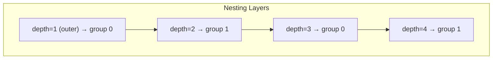

# Maximum Nesting Depth of Two Valid Parentheses Strings

## Problem Link
🔗 [LeetCode 1111 — Maximum Nesting Depth of Two Valid Parentheses Strings](https://leetcode.com/problems/maximum-nesting-depth-of-two-valid-parentheses-strings/)

---

## What is this Problem?

Given a valid parentheses string `s`, split each bracket (assign it group `0` or `1`) such that both groups form valid parentheses strings and the **maximum nesting depth among the two groups is minimized**.

Return an array `res` where `res[i] = 0` or `1` indicating which group bracket `i` belongs to.

```
s = "(()())"  → one valid split: res=[0,1,1,1,1,0]
  Group 0: "(    )" — depth 1
  Group 1: " ()() " — depth 1
  Max depth of either group = 1 ✓ (minimized!)

s = "()(())()" → res=[0,0,0,1,1,0,0,0]
```

---

## The Key Insight — Alternate Brackets by Depth

```
Instead of thinking about which brackets to assign where,
think about depth levels:

  s = "( ( ( ) ) )"
         1 2 3 2 1 0  ← depth AFTER processing each char

Odd-depth brackets → group 1
Even-depth brackets → group 0

The two groups alternate layers of nesting:
  Group 0 gets the "outer shell" brackets (depth 0,2,4...)
  Group 1 gets the "inner shell" brackets (depth 1,3,5...)

This perfectly balances the nesting between the two groups!
```



```
If original depth = n:
  Group 0 gets depths 1,3,5...   → max depth = ceil(n/2)
  Group 1 gets depths 2,4,6...   → max depth = floor(n/2)

This is the OPTIMAL split — you can't do better than ceil(n/2).
```

---

## The `depth % 2` Trick

```
depth % 2 = 0  →  assign to group 0
depth % 2 = 1  →  assign to group 1

No if-else, no bookkeeping — just one modulo decides the group!
```

---

## How It Works

### For `(` brackets

```cpp
if (s[i] == '(') {
    res[i] = depth % 2;
    depth++;
}
```

```
When we see '(', we're about to enter a new depth level.
The current depth (before incrementing) determines which group.

depth=0: res[i]=0, then depth becomes 1
depth=1: res[i]=1, then depth becomes 2
depth=2: res[i]=0, then depth becomes 3
```

### For `)` brackets

```cpp
else if (s[i] == ')') {
    depth--;
    res[i] = depth % 2;
}
```

```
When we see ')', we're leaving a depth level.
Decrement first, THEN assign — the ')' belongs to the
same depth as its matching '(', which is now depth after decrement.

'(' at depth 0 → group 0
')' at depth 1 → depth-- → depth=0 → group 0 ✓ (matching pair, same group)

'(' at depth 1 → group 1
')' at depth 2 → depth-- → depth=1 → group 1 ✓ (matching pair, same group)
```

**This guarantees each `()` pair is always assigned to the SAME group**, keeping both groups valid.

---

## Full Trace: `s = "(()())"`

```
depth=0, res=[]

i=0: '(' → res[0]=0%2=0. depth=1.
i=1: '(' → res[1]=1%2=1. depth=2.
i=2: ')' → depth=1. res[2]=1%2=1.
i=3: '(' → res[3]=1%2=1. depth=2.
i=4: ')' → depth=1. res[4]=1%2=1.
i=5: ')' → depth=0. res[5]=0%2=0.

res = [0, 1, 1, 1, 1, 0]

Group 0: positions 0,5 → "(    )" — depth 1
Group 1: positions 1,2,3,4 → "()() " → "()()" — depth 1

Max = 1 ✓
```

---

## Code Full Solution

```cpp
class Solution {
public:
    vector<int> maxDepthAfterSplit(string s) {
        int n = s.size();
        vector<int> res(n);
        int depth = 0;

        for (int i = 0; i < n; i++) {
            if (s[i] == '(') {
                res[i] = depth % 2;
                depth++;
            } else if (s[i] == ')') {
                depth--;
                res[i] = depth % 2;
            }
        }
        return res;
    }
};
```

> ⚠️ **Bug in original:** `auto s` as a parameter type is non-standard for LeetCode solutions. Use `string s` or `string& s`.

---

## Why Matching Pair Always Gets the Same Group

```
Any matching '(' and ')' pair:
  '(' is at depth d → assigned group d%2.
  ')' closes that '(' → depth decrements from d+1 to d → assigned (d)%2.

  Same depth d → same group. ✓

The pair always cooperates in the same group,
ensuring both groups form VALID parentheses strings.
```

---

## Edge Cases

### Single Pair `"()"`

```
i=0: '(' → res[0]=0. depth=1.
i=1: ')' → depth=0. res[1]=0.

Group 0: "()" — depth 1. Group 1: empty.
Return [0,0] ✓
```

### Already Depth 1 String `"()()()"` 

```
All pairs alternate:
  i=0:'(' depth=0→0. i=1:')' depth=1→0: res=[0,0]
  i=2:'(' depth=0→0. i=3:')' depth=1→0: res=[0,0,0,0]
  i=4:'(' depth=0→0. i=5:')' depth=1→0: res=[0,0,0,0,0,0]

All group 0. Group 1 is empty. Max depth = 1. ✓
```

---

## Time and Space Complexity

| | Value |
|---|---|
| Time | O(n) — single pass |
| Space | O(n) — result array |

---

## Key Insight

```
This problem looks like it needs complex assignment logic,
but the answer is just: alternate groups by nesting depth.

depth % 2 encodes "am I in an odd or even layer?"
Odd layers → one group. Even layers → the other.
The matching bracket is always at the same depth → same group.

The result: both groups have at most ceil(original_depth / 2)
nesting depth — the theoretical optimum split.

No backtracking, no trying combinations — pure math. ✓
```

---

## References

- 🔗 [LeetCode 1111 — Maximum Nesting Depth of Two Valid Parentheses Strings](https://leetcode.com/problems/maximum-nesting-depth-of-two-valid-parentheses-strings/)