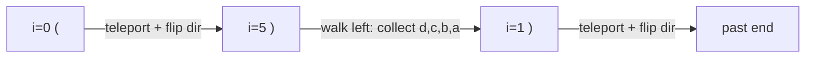

# Reverse Substrings Between Each Pair of Parentheses

## Problem Link
🔗 [LeetCode 1190 — Reverse Substrings Between Each Pair of Parentheses](https://leetcode.com/problems/reverse-substrings-between-each-pair-of-parentheses/)

---

## What is this Problem?

Given a string `s` with nested parentheses and lowercase letters, repeatedly reverse the contents of the innermost parentheses until none remain, then return the result (without brackets).

```
s = "(abcd)"       → "dcba"
s = "(u(love)i)"   → "iloveu"
s = "(ed(et(oc))el)" → "leetcode"
```

---

## The Naive Approach (O(n²))

```
Find innermost () → reverse its contents → remove the brackets.
Repeat until no brackets remain.

For "(ed(et(oc))el)":
  Step 1: reverse "oc" → "(ed(etco)el)"
  Step 2: reverse "etco" → "(edetcoeel)"... wait let me redo:
  
  "(ed(et(oc))el)"
    inner "(oc)" → "co": "(ed(etco)el)"
    inner "(etco)" → "octe": "(edocteel)"
    outer "(edocteel)" → "leetcode" ✓

Works but each reversal is O(n) and there can be O(n) pairs → O(n²).
```

---

## The Elegant O(n) Approach — Wormhole Navigation

This solution uses a brilliant trick: **pre-link matching brackets, then "teleport" between them while flipping direction**.

```
Think of it like a wormhole:
  When you hit a '(' or ')', instead of reversing anything,
  you TELEPORT to the matching bracket and FLIP your walking
  direction (left→right becomes right→left, or vice versa).

Walking forward through the string but flipping at brackets
produces the EXACT SAME result as actually reversing!
```

---

## Why Teleporting = Reversing

```
s = "(abcd)"
     0 1 2 3 4 5

Without brackets, answer = "dcba" (reversed).

Wormhole approach:
  Start at i=0 (the '('), dir=1 (going right).
  Hit '(' at 0 → teleport to matching ')' at 5. flip dir=-1.
  Now at i=5, walking LEFT.
  Visit d(4), c(3), b(2), a(1) → collect "dcba".
  Hit '(' at 0 again → teleport to ')' at 5. flip dir=1.
  i=5+1=6 → past end → done.

Result: "dcba" ✓ — same as reversing, without any actual reversal!
```



---

## Phase 1 — Pre-Link Matching Brackets

```cpp
stack<int> st;
vector<int> link(n);

for (int i = 0; i < n; i++) {
    if (s[i] == '(') {
        st.push(i);
    } else if (s[i] == ')') {
        link[i] = st.top();    // ')' links to matching '('
        link[st.top()] = i;    // '(' links to matching ')'
        st.pop();
    }
}
```

```
s = "(ed(et(oc))el)"
     0 1 2 3 4 5 6 7 8 9 10 11 12 13

Stack traces:
  i=0: '(' → push 0
  i=3: '(' → push 3
  i=6: '(' → push 6
  i=9: ')' → link[9]=6, link[6]=9. pop. st=[0,3]
  i=10: ')' → link[10]=3, link[3]=10. pop. st=[0]
  i=13: ')' → link[13]=0, link[0]=13. pop. st=[]

link = [13,_,_,10,_,_,9,_,_,6,3,_,_,0]
         ↑         ↑       ↑     ↑  ↑
         0         3       6     9  10 (brackets linked to their partners)
```

**Each bracket pair now knows exactly where its partner is — in O(n) using a stack.**

---

## Phase 2 — Navigate with Direction Flipping

```cpp
for (int i = 0, dir = 1; i < n; i += dir) {
    if (s[i] >= 'a') {
        res += s[i];       // letter → collect it
    } else {
        i = link[i];       // bracket → teleport to partner
        dir = -dir;        // flip direction
    }
}
```

```
When we hit any bracket (open or close):
  Teleport to its linked partner.
  Flip direction (1 becomes -1 or vice versa).
  Continue walking in the new direction.

Letters are collected regardless of direction.
Brackets are never collected — they just redirect us.
```

---

## Full Trace: `s = "(ed(et(oc))el)"`

```
link = [13,_,_,10,_,_,9,_,_,6,3,_,_,0]

i=0, dir=1: s[0]='(' → teleport to 13, flip dir=-1
i=13, dir=-1: s[13]=')' → teleport to 0, flip dir=1
  (we just bounced off the outer wall!)

Wait — i+=dir happens AFTER the body. Let me retrace with i+=dir:

Start: i=0, dir=1

i=0: '(' → i=link[0]=13, dir=-1. Then i+=dir → i=12.
i=12: 'l' → res="l". i+=dir → i=11.
i=11: 'e' → res="le". i+=dir → i=10.
i=10: ')' → i=link[10]=3, dir=1. Then i+=dir → i=4.
i=4:  'e' → res="lee". i+=dir → i=5.
i=5:  't' → res="leet". i+=dir → i=6.
i=6:  '(' → i=link[6]=9, dir=-1. Then i+=dir → i=8.
i=8:  'c' → res="leetc". i+=dir → i=7.
i=7:  'o' → res="leetco". i+=dir → i=6.
i=6:  '(' → i=link[6]=9, dir=1. Then i+=dir → i=10.
i=10: ')' → i=link[10]=3, dir=-1. Then i+=dir → i=2.
i=2:  'd' → res="leetcod". i+=dir → i=1.
i=1:  'e' → res="leetcode". i+=dir → i=0.
i=0:  '(' → i=link[0]=13, dir=1. Then i+=dir → i=14.
i=14: 14 >= n=14 → EXIT.

Return "leetcode" ✓
```

---

## Code Full Solution

```cpp
class Solution {
public:
    string reverseParentheses(string s) {
        int n = s.size();
        stack<int> st;
        vector<int> link(n);
        string res;

        // Phase 1: link matching brackets
        for (int i = 0; i < n; i++) {
            if (s[i] == '(') {
                st.push(i);
            } else if (s[i] == ')') {
                link[i] = st.top();
                link[st.top()] = i;
                st.pop();
            }
        }

        // Phase 2: navigate with direction flipping
        for (int i = 0, dir = 1; i < n; i += dir) {
            if (s[i] >= 'a') {
                res += s[i];
            } else {
                i = link[i];
                dir = -dir;
            }
        }

        return res;
    }
};
```

---

## Edge Cases

### No Parentheses

```
s="abc" → link unused. i walks 0→1→2, collecting "abc" ✓
```

### Single Pair

```
s="(abc)"
link[0]=4, link[4]=0.

i=0: '(' → i=4, dir=-1. i+=dir → i=3.
i=3: 'c' → res="c". i=2: 'b' → res="cb". i=1: 'a' → res="cba".
i=0: '(' → i=4, dir=1. i+=dir → i=5. Exit.

Return "cba" ✓
```

### Single Character in Brackets

```
s="(a)" → returns "a" ✓
```

---

## Time and Space Complexity

| | Value |
|---|---|
| Phase 1 (link build) | O(n) |
| Phase 2 (navigation) | O(n) — each index visited at most twice |
| **Total** | **O(n)** |
| Space | O(n) — link array + stack |

---

## Key Insight

```
The naive approach ACTUALLY reverses strings → O(n²).
This approach SIMULATES reversal by changing walking direction → O(n).

The observation: reversing a section and reading it forward
is the same as reading it backward without reversing.

"Teleport to the bracket's partner and walk the other way"
achieves that simulation in O(1) per bracket encounter,
with O(n) preprocessing to know where partners are.

This is a rare, elegant problem where the clever insight
reduces an O(n²) approach to O(n) without any complex data structure.
```

---

## References

- 🔗 [LeetCode 1190 — Reverse Substrings Between Each Pair of Parentheses](https://leetcode.com/problems/reverse-substrings-between-each-pair-of-parentheses/)