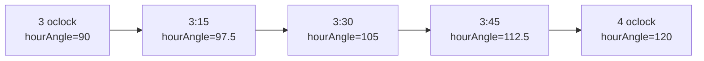
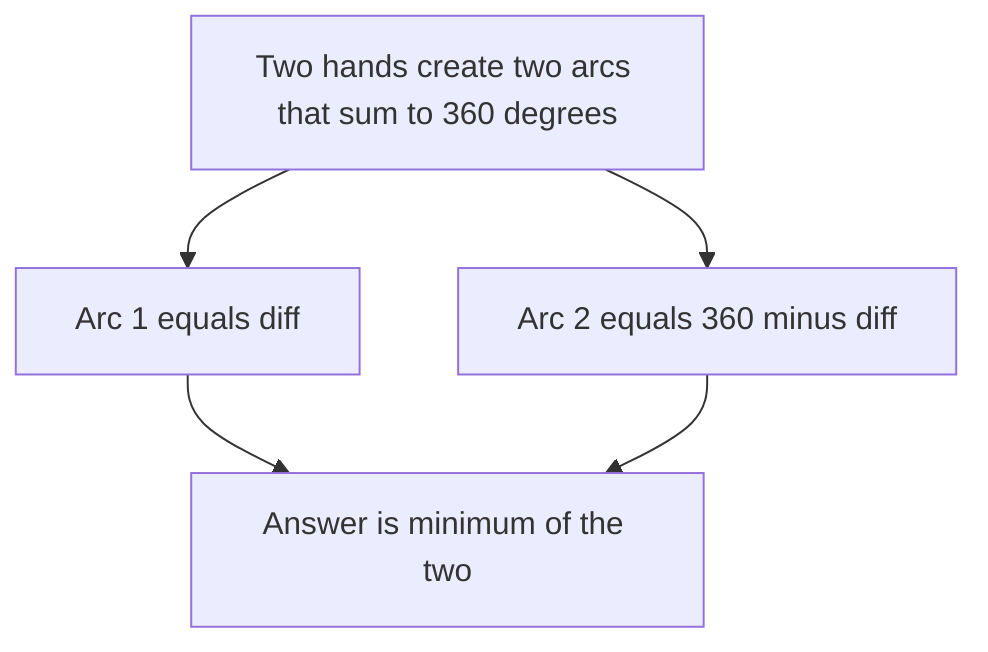

# Angle Between Hands of a Clock

## Problem Link
🔗 [LeetCode 1344 — Angle Between Hands of a Clock](https://leetcode.com/problems/angle-between-hands-of-a-clock/)

---

## What is this Problem?

Given a time as `hour` and `minutes`, return the **smaller angle** (in degrees) formed between the hour hand and minute hand of an analog clock.

**Examples:**
```
hour = 12, minutes = 30
Output: 165.0

hour = 3, minutes = 30
Output: 75.0

hour = 3, minutes = 0
Output: 90.0
```

---

## The Problem Explained

Think of it like **two hands sweeping around a circular dial**:

```
A clock face is 360° total, divided into 12 hour marks.
Each hour mark = 360/12 = 30°

The MINUTE hand sweeps the FULL circle (360°) in 60 minutes.
  → 360/60 = 6° per minute

The HOUR hand sweeps 1/12 of the circle (30°) in 60 minutes.
  → 30/60 = 0.5° per minute (it moves gradually, not in jumps!)
```

**Key idea:** Compute each hand's angle from the 12 o'clock position independently, find the absolute difference, then take the **smaller** of that difference and its complement (360° minus the difference) — since a clock angle is never reported as reflex (>180°).

---

## HOOK TO REMEMBER FOREVER

**"MINUTE HAND: 6° PER MINUTE. HOUR HAND: 30° PER HOUR PLUS 0.5° PER MINUTE. TAKE THE SMALLER ARC."**

Every time you see "angle between clock hands":
- ✅ `minAngle = minutes × 6` (minute hand moves 6° every minute)
- ✅ `hourAngle = (hour % 12) × 30 + minutes × 0.5` (hour hand moves 30°/hour PLUS drifts 0.5°/minute)
- ✅ `diff = |hourAngle - minAngle|`
- ✅ Return `min(diff, 360 - diff)` — the smaller of the two possible arcs
- ✅ O(1) time, O(1) space

**Remember: The hour hand is NOT stationary within an hour — it creeps forward continuously as minutes pass. That `0.5 × minutes` term is the most commonly forgotten piece!** 🕐

---

## The Two Critical Insights

### Insight 1 — The Hour Hand Moves Continuously

```
A common mistake: thinking the hour hand only moves when the
hour changes (like a digital "9:00" → "10:00" jump).

WRONG mental model: at 3:30, hour hand still points exactly at "3".
CORRECT mental model: at 3:30, hour hand has moved HALFWAY
                       between "3" and "4" — because 30 minutes
                       is half of an hour, and the hour hand
                       sweeps 30° per hour.

hourAngle = hour×30 + minutes×0.5

At 3:00 → hourAngle = 90 + 0 = 90°
At 3:30 → hourAngle = 90 + 15 = 105°   (drifted 15° toward 4)
At 3:59 → hourAngle = 90 + 29.5 = 119.5°  (almost at 4's position, 120°)
```



### Insight 2 — Always Return the SMALLER Angle

```
A clock has 360° total. The two hands always create TWO angles
that sum to 360° (one on each "side").

Example: diff = 300°
  The other angle = 360 - 300 = 60°
  We always want the SMALLER one: 60°, not 300°.

Why? "Angle between two hands" conventionally means the
acute/obtuse angle ≤ 180°, not the reflex angle.
```



---

## How It Works Step By Step

### Example: `hour=12, minutes=30`

```
hourAngle = (12 % 12) × 30 + 0.5 × 30
          = 0 × 30 + 15
          = 15°

minAngle = 30 × 6 = 180°

diff = |15 - 180| = 165°

min(165, 360-165) = min(165, 195) = 165°

Return 165.0 ✓
```

```
At 12:30:
  Hour hand: barely past 12, drifted 15° toward 1 (halfway between 12 and 1)
  Minute hand: pointing straight at 6 (180°)

The gap between them: 165° (the smaller arc, going one way around)
The other way around: 195° (165 + 195 = 360 ✓)

We report 165° — the smaller one.
```

### Example: `hour=3, minutes=30`

```
hourAngle = (3 % 12) × 30 + 0.5 × 30
          = 90 + 15
          = 105°

minAngle = 30 × 6 = 180°

diff = |105 - 180| = 75°

min(75, 360-75) = min(75, 285) = 75°

Return 75.0 ✓
```

---

## Code Full Solution

```cpp
class Solution {
public:
    double angleClock(int hour, int minutes) {
        double hourAngle = (hour % 12) * 30.0 + 0.5 * minutes;
        double minAngle = minutes * 6;
        double diff = abs(hourAngle - minAngle);
        return min(diff, 360 - diff);
    }
};
```

---

## Code Explanation

### Compute the Hour Hand's Angle

```cpp
double hourAngle = (hour % 12) * 30.0 + 0.5 * minutes;
```

**Why `hour % 12`?**
```
Clock hours go 1-12, but if hour=12 is passed, treating it
as "12 × 30 = 360°" would be wrong (360° is the same as 0°,
i.e., pointing at 12, but expressed incorrectly).

hour % 12 maps:
  12 → 0   (12 o'clock position = 0°, same physical spot)
  1  → 1
  2  → 2
  ...
  11 → 11

This correctly handles the 12 o'clock edge case. ✓
```

**Why `× 30.0` (with decimal) and not `× 30`?**
```
Using 30.0 forces floating-point arithmetic from the start.
Explicit and safe practice when mixing with the 0.5 * minutes
term, which is already a double computation.
```

**Why `+ 0.5 * minutes`?**
```
This is the CRITICAL term most people forget.

The hour hand doesn't just sit at hour×30° — it CONTINUOUSLY
drifts forward as minutes pass within the hour.

Rate: 30° per 60 minutes = 0.5° per minute.

At hour=3, minutes=30:
  Base position: 3×30 = 90°
  Drift: 0.5×30 = 15°
  Total: 105° (not 90°!)
```

---

### Compute the Minute Hand's Angle

```cpp
double minAngle = minutes * 6;
```

```
The minute hand completes a full 360° circle in 60 minutes.
Rate: 360/60 = 6° per minute.

At minutes=30: minAngle = 30×6 = 180° (pointing straight at 6) ✓
At minutes=15: minAngle = 15×6 = 90°  (pointing straight at 3) ✓
At minutes=0:  minAngle = 0°          (pointing straight at 12) ✓
```

---

### Compute the Absolute Difference

```cpp
double diff = abs(hourAngle - minAngle);
```

```
This gives ONE of the two possible arcs between the hands.
It could be the smaller arc OR the larger (reflex) arc —
we don't know yet, hence the next step.
```

---

### Return the Smaller of the Two Possible Arcs

```cpp
return min(diff, 360 - diff);
```

```
The two hands always split the clock into two arcs that
sum to exactly 360°.

If diff = 165°, the other arc = 360-165 = 195°.
min(165, 195) = 165° → this is already the smaller one.

If diff = 250°, the other arc = 360-250 = 110°.
min(250, 110) = 110° → THIS time, diff itself was NOT
the smaller arc — the complement was smaller!

This line handles BOTH cases uniformly. ✓
```

---

## Complete Example Traces

### Trace 1: `hour=12, minutes=30`

```
hourAngle = (12%12)*30 + 0.5*30 = 0 + 15 = 15
minAngle = 30*6 = 180
diff = |15-180| = 165
min(165, 195) = 165

Return 165.0 ✓
```

### Trace 2: `hour=3, minutes=30`

```
hourAngle = (3%12)*30 + 0.5*30 = 90+15 = 105
minAngle = 30*6 = 180
diff = |105-180| = 75
min(75, 285) = 75

Return 75.0 ✓
```

### Trace 3: `hour=3, minutes=0`

```
hourAngle = (3%12)*30 + 0 = 90
minAngle = 0*6 = 0
diff = |90-0| = 90
min(90, 270) = 90

Return 90.0 ✓
```

### Trace 4: `hour=12, minutes=0` (Both Hands Aligned)

```
hourAngle = 0 + 0 = 0
minAngle = 0
diff = 0
min(0, 360) = 0

Return 0.0 ✓ (both hands point at 12, no angle between them)
```

### Trace 5: `hour=6, minutes=0` (Hands Opposite)

```
hourAngle = (6%12)*30 = 180
minAngle = 0
diff = |180-0| = 180
min(180, 180) = 180

Return 180.0 ✓ (hands point in opposite directions, straight line)
```

### Trace 6: When the Complement is Smaller

```
hour=2, minutes=59

hourAngle = 2*30 + 0.5*59 = 60+29.5 = 89.5
minAngle = 59*6 = 354
diff = |89.5-354| = 264.5
min(264.5, 360-264.5) = min(264.5, 95.5) = 95.5

Return 95.5 ✓ (complement was smaller — diff alone would've been wrong!)
```

---

## Edge Cases

### Case 1: Both Hands at 12

```
Input: hour=12, minutes=0
diff=0. Output: 0.0 ✓
```

### Case 2: Hands Exactly Opposite (180°)

```
Input: hour=6, minutes=0
diff=180. min(180,180)=180.
Output: 180.0 ✓ (the maximum possible angle)
```

### Case 3: hour=12 (Wraps to 0 via Modulo)

```
Input: hour=12, minutes=15
(hour%12)=0, hourAngle=0+7.5=7.5
minAngle=15*6=90
diff=82.5. min(82.5,277.5)=82.5
Output: 82.5 ✓
```

### Case 4: minutes=59 (Near Full Hour)

```
Input: hour=1, minutes=59
hourAngle=30+29.5=59.5
minAngle=354
diff=294.5. min(294.5,65.5)=65.5
Output: 65.5 ✓
```

---

## Time Complexity

- **O(1)** — fixed number of arithmetic operations regardless of input
- No loops, no recursion
- Total: **O(1)**

---

## Space Complexity

- **O(1)** — only a handful of double variables
- Total: **O(1)**

---

## Key Insights

### The Most Common Bug — Forgetting Hour Hand Drift

```cpp
// WRONG — treats hour hand as stationary within the hour:
double hourAngle = (hour % 12) * 30.0;

// CORRECT — accounts for continuous drift:
double hourAngle = (hour % 12) * 30.0 + 0.5 * minutes;
```

```
At 3:45, a naive solution would compute hourAngle=90°
(as if the hour hand is frozen at "3").

In reality, at 3:45 (45 minutes into the 3 o'clock hour),
the hour hand has moved 45/60 = 3/4 of the way toward 4.
That's 0.75 × 30° = 22.5° of drift.

hourAngle = 90 + 22.5 = 112.5° — the CORRECT position.

This single missing term is the #1 source of wrong answers
for this problem.
```

### Why `min(diff, 360 - diff)` Instead of Just `diff`

```
Without this step, an answer like 264.5° (Trace 6) would be
returned as-is — even though the "real" angle a person would
perceive between the hands is 95.5° (the smaller, visually
obvious angle).

Clock angle problems ALWAYS expect the angle ≤ 180°.
The min() trick converts any "long way around" measurement
into the conventional "short way around" answer. ✓
```

### Rates Worth Memorizing

```
Minute hand:  6° per minute    (360° / 60 min)
Hour hand:    0.5° per minute  (360° / 12 hours / 60 min = 30°/60min)
            = 30° per hour     (360° / 12 hours)

These two numbers (6 and 0.5) are the entire foundation
of this problem. Once memorized, the formula writes itself.
```

### Generalizing Beyond Clocks

```
This same "two hands moving at different constant angular
speeds" pattern appears in:
  → Relative angular velocity problems
  → Gear rotation problems (gears moving at different RPMs)
  → Catching up / overtaking problems framed circularly

The core technique: compute each object's position as a
function of time, find the difference, normalize to [0°, 180°]
if a non-reflex angle is required.
```

---

## References

- 🔗 [LeetCode 1344 — Angle Between Hands of a Clock](https://leetcode.com/problems/angle-between-hands-of-a-clock/)