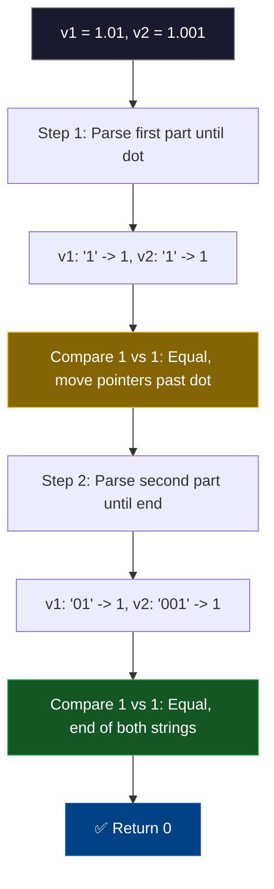

# Compare Version Numbers

## Problem Link
🔗 [LeetCode 165 — Compare Version Numbers](https://leetcode.com/problems/compare-version-numbers/)  
🔗 [GFG — Compare Two Version Numbers](https://www.geeksforgeeks.org/problems/compare-two-version-numbers3216/1)

---

## What is this Problem?

Compare two version strings `version1` and `version2`. 

Revisions are separated by dots `.`. Revisions have numeric values, possibly with leading zeros (e.g., `01` and `1` are numerically equal). If a version has fewer revisions than the other, treat the missing revisions as `0`.

**Return:**
* `1` if `version1` is greater.
* `-1` if `version2` is greater.
* `0` if they are equal.

**Example:**
```
version1 = "1.01", version2 = "1.001"
Output: 0  (both represent version 1.1)

version1 = "1.0", version2 = "1.0.0.0"
Output: 0  (missing parts default to 0)

version1 = "0.1", version2 = "1.1"
Output: -1  (0 less than 1)
```

---

## The Problem Explained

Think of it like **comparing two software releases**.

You compare them part-by-part from left to right (Major version, Minor version, Patch version, etc.):
1. Clean up each part by ignoring leading zeros.
2. If one release runs out of sub-version numbers, assume the missing numbers are just `0`.

```
Release A: 2.0.4
Release B: 2.0.4.0.0

Compare part-by-part:
- Part 1: 2 vs 2 → Equal
- Part 2: 0 vs 0 → Equal
- Part 3: 4 vs 4 → Equal
- Part 4: 0 (default) vs 0 → Equal
- Part 5: 0 (default) vs 0 → Equal
Result: They are equal (0)!
```

---

## HOOK TO REMEMBER FOREVER

**"PARSE PART BY PART, DEFAULT MISSING TO 0"**

- ✅ Use a single outer loop `while (i < n || j < m)`.
- ✅ Extract character digits for the current part until you hit a dot `.`.
- ✅ Convert string parts to integer (`stoi`) to automatically strip leading zeros.
- ✅ If a pointer has reached the end of its string, default that part's value to `0`.
- ✅ Compare the two numbers at each step. Return early if one is greater.
- ✅ Increment pointers past the dot `.` at the end of the loop.

---

## The Key Insight — Parsing and Comparing

### 🔀 Two-Pointer Traversal Flow



---

### 📊 Revisions Comparison Table

Tracking `version1 = "0.1"`, `version2 = "1.1"`

| Step | `temp1` (v1 part) | `num1` | `temp2` (v2 part) | `num2` | Comparison | Action |
|---|---|---|---|---|---|---|
| 1 | "0" | 0 | "1" | 1 | `0 less than 1` | Return `-1` ❌ |

Tracking `version1 = "1.0"`, `version2 = "1.0.0.0"`

| Step | `temp1` (v1 part) | `num1` | `temp2` (v2 part) | `num2` | Comparison | Action |
|---|---|---|---|---|---|---|
| 1 | "1" | 1 | "1" | 1 | 1 == 1 | Continue |
| 2 | "0" | 0 | "0" | 0 | 0 == 0 | Continue |
| 3 | "" (empty) | 0 | "0" | 0 | 0 == 0 | Continue |
| 4 | "" (empty) | 0 | "0" | 0 | 0 == 0 | Continue |
| **End** | — | — | — | — | All equal | Return `0` ✅ |

---

## Code — Full Solution (with Line-by-Line Explanation)

---

```cpp
while (i < n || j < m) {
```
> The outer loop runs as long as there is at least one character left to process in **either** version string. This allows us to handle version strings of different lengths.

---

```cpp
    string temp1;
    while (i < n && version1[i] != '.') {
        temp1.push_back(version1[i]);
        i++;
    }
```
> Extracts characters for the current revision of `version1` up to the next dot `.`.

---

```cpp
    int num1 = temp1.empty() ? 0 : stoi(temp1);
```
> Converts the parsed string part to an integer.  
> If the pointer `i` has already reached the end of `version1` (meaning `temp1` is empty), we default the value of this revision to `0`.  
> Using `stoi` automatically converts strings like `"001"` or `"01"` into the integer `1`, clearing any leading zeros.

---

```cpp
    if (num1 > num2)
        return 1;

    if (num1 < num2)
        return -1;
```
> Compare the numeric values of the current revisions. If they differ, return `1` or `-1` immediately.

---

```cpp
    i++;
    j++;
```
> Pointers `i` and `j` are currently standing on the dot `.`. We increment them to jump past the dot and start processing the next revision in the next iteration.

---

## Step-by-Step Trace

For `version1 = "1.2"`, `version2 = "1.10"`

```
n = 3, m = 4, i = 0, j = 0

Iteration 1:
- i = 0, extract v1 part until '.' -> temp1 = "1", i becomes 1.
- num1 = stoi("1") = 1.
- j = 0, extract v2 part until '.' -> temp2 = "1", j becomes 1.
- num2 = stoi("1") = 1.
- num1 == num2 (1 == 1) -> No return.
- i++ (i becomes 2), j++ (j becomes 2).

Iteration 2:
- i = 2, extract v1 part until end -> temp1 = "2", i becomes 3.
- num1 = stoi("2") = 2.
- j = 2, extract v2 part until end -> temp2 = "10", j becomes 4.
- num2 = stoi("10") = 10.
- num1 < num2 (2 < 10) -> return -1.

Output: -1 ✅
```

---

## Why does `temp.empty() ? 0 : stoi(temp)` work for padding?

```
If version1 = "1", version2 = "1.0.0"

First iteration:
  temp1 = "1", temp2 = "1" -> equal

Second iteration:
  i = 2 (out of bounds) -> temp1 is empty -> defaults to 0
  temp2 = "0" -> num2 = 0
  They are equal!

This simulates padding version1 with ".0.0" without modifying the string.
```

---

## Time & Space Complexity

| Operation | Complexity |
|---|---|
| **Time** | O(N + M) — Where N and M are the lengths of `version1` and `version2`. Each character is visited once. |
| **Space** | O(N + M) — To store the temporary string chunks parsed between dots (practically much smaller, as revisions are short). |

---

## References
- 🔗 [LeetCode 165 — Compare Version Numbers](https://leetcode.com/problems/compare-version-numbers/)
- 🔗 [GFG — Compare Two Version Numbers](https://www.geeksforgeeks.org/problems/compare-two-version-numbers3216/1)
