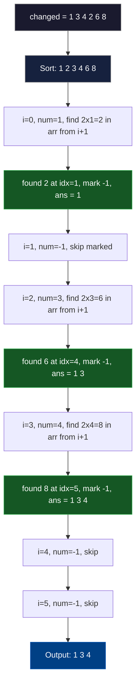

# Find Original Array From Doubled Array

## Problem Link
🔗 [LeetCode 2007 — Find Original Array From Doubled Array](https://leetcode.com/problems/find-original-array-from-doubled-array/)

---

## What is this Problem?

You are given a **changed array** which was built by taking an original array and appending **double of every element**.

Find and return the **original array**. If it's not possible, return `[]`.

**Example:**
```
changed = [1, 3, 4, 2, 6, 8]

Original: [1, 3, 4]
Doubled:  [2, 6, 8]

Together sorted: [1, 2, 3, 4, 6, 8]
Output: [1, 3, 4]

changed = [6, 3, 0, 1]
Output: []  → not a valid doubled array
```

---

## The Problem Explained

Think of it like **pair matching in a sorted list**.

Sort the array. Then for the **smallest number**, its double must exist somewhere after it. Pair them up and remove both. Repeat.

```
sorted = [1, 2, 3, 4, 6, 8]

Pick 1 → find 2×1=2 → found! → pair (1,2) → original has 1
Pick 3 → find 2×3=6 → found! → pair (3,6) → original has 3
Pick 4 → find 2×4=8 → found! → pair (4,8) → original has 4

Output: [1, 3, 4] ✅
```

> **Why sort?** After sorting, the smallest number always comes first. Its pair (double) must be somewhere to its right. We can use binary search to find it efficiently.

---

## HOOK TO REMEMBER FOREVER

**"SORT + BINARY SEARCH FOR DOUBLE + MARK USED AS -1"**

- ✅ **Sort** the array so smallest element is always processed first
- ✅ For each element, use **`lower_bound`** to find its double in the remaining array
- ✅ If double found → **mark it `-1`** (so it won't be picked again) and add to answer
- ✅ If double NOT found → array is invalid → return `{}`
- ✅ Skip elements already marked `-1` with `if (num < 0) continue`
- ✅ Search starts from `i+1` (double is always greater, never to the left after sort)

---

## The Key Insight — Sort + Mark Used

### 🔀 How It Works



---

### 📊 Step-by-Step Table

| `i` | `num` | Looking for | Found? | Action | `ans` |
|---|---|---|---|---|---|
| 0 | 1 | `2×1 = 2` | ✅ at idx 1 | mark idx 1 as -1 | [1] |
| 1 | -1 | — | skip | — | [1] |
| 2 | 3 | `2×3 = 6` | ✅ at idx 4 | mark idx 4 as -1 | [1, 3] |
| 3 | 4 | `2×4 = 8` | ✅ at idx 5 | mark idx 5 as -1 | [1, 3, 4] |
| 4 | -1 | — | skip | — | [1, 3, 4] |
| 5 | -1 | — | skip | — | [1, 3, 4] |

> ✅ **Output = [1, 3, 4]**

---

## Code — Full Solution (with Line-by-Line Explanation)

---

```cpp
sort(nums.begin(), nums.end());
```
> **Why sort?** Two reasons:
> 1. Smallest element always comes first → its double is guaranteed to be to its right → no backward search needed.
> 2. Binary search (`lower_bound`) only works on sorted arrays.

---

```cpp
for (int i = 0; i < n; i++) {
    int num = nums[i];
    if (num < 0)
        continue;
```
> Loop over every element.  
> `if (num < 0) continue` — skips elements we already **marked as used** by setting them to `-1`.  
> This is the "consumed" marker — avoids using a separate visited array.

---

```cpp
    auto idx = lower_bound(nums.begin() + i + 1, nums.end(), 2 * num);
```
> `lower_bound` does **binary search** for `2 * num` in the range `[i+1, end)`.  
> We start from `i+1` because:
> - After sorting, `2 * num` is always ≥ `num` → it can only be to the right.
> - Avoids matching an element with itself.

---

```cpp
    if (idx != nums.end() && *idx == 2 * num) {
        *idx = -1;
        ans.push_back(num);
    } else {
        return {};
    }
```
> If `lower_bound` found the exact double:
> - **Mark it `-1`** so future iterations skip it.
> - Add `num` to the answer (it belongs to the original array).
>
> If NOT found → this array cannot be a valid doubled array → return `{}` immediately.

---

## Step-by-Step Trace

```
changed = [1, 3, 4, 2, 6, 8]
After sort: [1, 2, 3, 4, 6, 8]
             0  1  2  3  4  5

i=0: num=1, find 2 in [1..end] → found at idx 1 → mark nums[1]=-1, ans=[1]
     arr: [1, -1, 3, 4, 6, 8]

i=1: num=-1 → skip

i=2: num=3, find 6 in [3..end] → found at idx 4 → mark nums[4]=-1, ans=[1,3]
     arr: [1, -1, 3, 4, -1, 8]

i=3: num=4, find 8 in [4..end] → found at idx 5 → mark nums[5]=-1, ans=[1,3,4]
     arr: [1, -1, 3, 4, -1, -1]

i=4: num=-1 → skip
i=5: num=-1 → skip

Output: [1, 3, 4] ✅
```

---

## Failure Case Trace

```
changed = [6, 3, 0, 1]
After sort: [0, 1, 3, 6]
             0  1  2  3

i=0: num=0, find 2×0=0 in [1..end] → 0 not found after index 0 → return {} ❌
```

> **Edge case: `0`** — `2×0 = 0`, so we need another `0` in the array.  
> If there's no second `0`, it fails immediately.

---
## Time & Space Complexity

| | Complexity |
|---|---|
| **Time** | O(n log n) — sort + binary search for each element |
| **Space** | O(1) — answer array |

---

## References

- 🔗 [LeetCode 2007 — Find Original Array From Doubled Array](https://leetcode.com/problems/find-original-array-from-doubled-array/)
