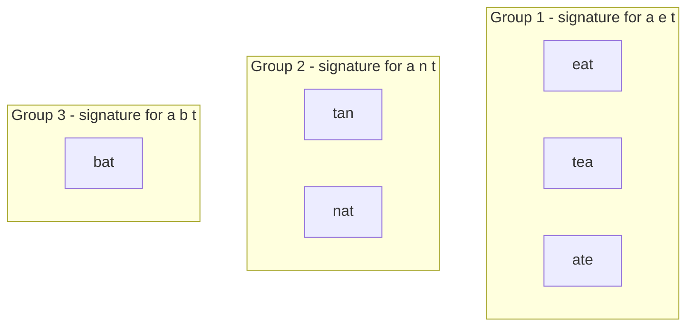

# Group Anagrams

## Problem Link
🔗 [LeetCode 49 — Group Anagrams](https://leetcode.com/problems/group-anagrams/)

---

## What is this Problem?

Given an array of strings `strs`, group all the **anagrams** together. An **anagram** is a word formed by rearranging the letters of another word, using all the original letters exactly once.

**Examples:**
```
Input:  ["eat","tea","tan","ate","nat","bat"]
Output: [["bat"],["nat","tan"],["ate","eat","tea"]]
(grouped — any order of groups, any order within a group is acceptable)

Input:  [""]
Output: [[""]]

Input:  ["a"]
Output: [["a"]]
```

---

## The Problem Explained

Think of it like **sorting Scrabble tiles into identical bags**:

```
Words: eat, tea, tan, ate, nat, bat

"eat", "tea", "ate" all use the EXACT SAME letters: {a,e,t}
  → They're anagrams of each other!

"tan", "nat" both use: {a,n,t}
  → Anagrams of each other!

"bat" uses: {a,b,t} — unique, no match.

If two words are anagrams, they must have an IDENTICAL
"letter fingerprint" — same letters, same counts, just
arranged differently.
```

**Key idea:** Compute a **canonical signature** for each string that is identical for all anagrams of each other (and different for non-anagrams). Group strings by this signature using a hashmap.

---

## HOOK TO REMEMBER FOREVER

**"COUNT LETTER FREQUENCIES, BUILD A SIGNATURE, GROUP BY THAT SIGNATURE"**

Every time you see "group strings that are anagrams of each other":
- ✅ For each string, count the frequency of each of the 26 lowercase letters
- ✅ Build a **signature** from those counts (e.g., `"1#0#0#...#2#..."` for a-z counts)
- ✅ Use the signature as a hashmap key: `mpp[signature].push_back(str)`
- ✅ Anagrams ALWAYS produce the IDENTICAL signature (same letters → same counts)
- ✅ Collect all hashmap values into the final answer
- ✅ O(n × k) time where k = max string length, O(n × k) space

**Remember: Two strings are anagrams if and only if their letter-frequency count arrays are IDENTICAL. The signature is just that count array, stringified into a hashable key!** 🔤

---

## Why Frequency Counting Beats Sorting

A common alternative approach is sorting each string and using the sorted string as the key:

```
Sorting approach:
  sort("eat") → "aet"
  sort("tea") → "aet"   ← same key!
  sort("ate") → "aet"   ← same key!

  Time per string: O(k log k) where k = string length
  Total: O(n × k log k)

Frequency counting approach (this code):
  count("eat") → [a:1,e:1,t:1,...] → "1#0#0#0#1#0#...#0#1#0#..."
  count("tea") → same counts → SAME signature!

  Time per string: O(k) — just counting characters
  Total: O(n × k)

Frequency counting is FASTER (no log k factor) because
we never actually need the letters in order — only
their COUNTS need to match.
```

## How It Works Step By Step

### Example: `strs = ["eat","tea","tan","ate","nat","bat"]`

### Step 1 — Compute Frequency Count for Each String

```
"eat": a=1,e=1,t=1, rest=0
  count = [1,0,0,0,1,0,0,0,0,0,0,0,0,0,0,0,0,0,0,1,0,0,0,0,0,0]
            a e ...                              t

"tea": a=1,e=1,t=1 → SAME counts as "eat"
"ate": a=1,e=1,t=1 → SAME counts as "eat"

"tan": a=1,n=1,t=1, rest=0
"nat": a=1,n=1,t=1 → SAME counts as "tan"

"bat": a=1,b=1,t=1, rest=0 → unique
```

### Step 2 — Build Signature Strings

```
For "eat"/"tea"/"ate":
  key = "1#0#0#0#1#0#0#0#0#0#0#0#0#0#0#0#0#0#0#1#0#0#0#0#0#0#"
         a  b  c  d  e  ...                      t  ...

For "tan"/"nat":
  key = "1#0#0#0#0#0#0#0#0#0#0#0#0#1#0#0#0#0#0#1#0#0#0#0#0#0#"
         a                          n              t

For "bat":
  key = "1#1#0#0#0#0#0#0#0#0#0#0#0#0#0#0#0#0#0#1#0#0#0#0#0#0#"
         a  b                                     t
```

### Step 3 — Group by Signature

```
mpp = {
  "1#0#...#1#...": ["eat", "tea", "ate"],
  "1#0#...#1#(n)...": ["tan", "nat"],
  "1#1#...#1#...": ["bat"]
}
```

### Step 4 — Collect Groups

```
ans = [["eat","tea","ate"], ["tan","nat"], ["bat"]]
(exact order depends on unordered_map's internal iteration order)
```



---

## Code Full Solution

```cpp
class Solution {
public:
    vector<vector<string>> groupAnagrams(vector<string>& strs) {
        int n = strs.size();
        unordered_map<string, vector<string>> mpp;

        for (string &str : strs) {
            vector<int> count(26, 0);

            for (char c : str) {
                count[c - 'a']++;
            }

            string key;
            for (int num : count) {
                key += to_string(num) + "#";
            }

            mpp[key].push_back(str);
        }

        vector<vector<string>> ans;
        for (auto &el : mpp) {
            ans.push_back(el.second);
        }
        return ans;
    }
};
```

---

## Code Explanation

### Count Letter Frequencies

```cpp
vector<int> count(26, 0);
for (char c : str) {
    count[c - 'a']++;
}
```

**Why `c - 'a'`?**

```
In ASCII/C++ char arithmetic, characters are just numbers.
'a' = 97, 'b' = 98, ..., 'z' = 122.

c - 'a' maps:
  'a' - 'a' = 0   → index 0
  'b' - 'a' = 1   → index 1
  ...
  'z' - 'a' = 25  → index 25

This converts any lowercase letter into a 0-25 array index,
letting us tally frequencies in a fixed-size array. ✓
```

---

### Build the Signature String

```cpp
string key;
for (int num : count) {
    key += to_string(num) + "#";
}
```

**Why build a string key instead of using the `vector<int>` directly as a key?**

```
unordered_map requires a hashable key type.
vector<int> does NOT have a default hash function in C++
(no built-in std::hash<vector<int>> specialization).

Converting the count array into a STRING gives us
something that's naturally hashable via std::hash<string>. ✓
```

**Why the `#` separator between numbers?**

```
Without a separator, ambiguity creeps in:
  count = [1, 12, 3] → "1123" 
  count = [11, 2, 3] → "1123"  ← SAME STRING! Different counts!

With separator:
  count = [1, 12, 3] → "1#12#3#"
  count = [11, 2, 3] → "11#2#3#"  ← Different strings, correctly distinguished!

The # acts as a delimiter ensuring multi-digit counts
(which CAN happen for very long strings, e.g., 15 a's)
don't collide with different count combinations.
```

---

### Group by Signature

```cpp
mpp[key].push_back(str);
```

```
unordered_map<string, vector<string>>:
  key   → the 26-letter frequency signature
  value → list of all original strings sharing that signature

mpp[key] auto-creates an empty vector<string> the FIRST
time a new key is seen (default-constructed), then
push_back appends to it. Subsequent strings with the
SAME key append to the SAME vector. ✓
```

---

### Collect All Groups

```cpp
vector<vector<string>> ans;
for (auto &el : mpp) {
    ans.push_back(el.second);
}
```

```
Iterate over the hashmap. el.first = signature (unused here).
el.second = the vector<string> of anagram-grouped words.

Push each group into the final answer. Order of groups
in the output is determined by unordered_map's internal
iteration order — which is UNSPECIFIED but doesn't matter
since the problem accepts any order.
```

---

## Complete Example Traces

### Trace 1: Standard Case

```
strs = ["eat","tea","tan","ate","nat","bat"]

"eat" → count(a=1,e=1,t=1) → key="1#0#0#0#1#0#0#0#0#0#0#0#0#0#0#0#0#0#0#1#0#0#0#0#0#0#"
  mpp[key] = ["eat"]

"tea" → same counts as "eat" → same key
  mpp[key] = ["eat","tea"]

"tan" → count(a=1,n=1,t=1) → different key (n instead of e)
  mpp[key2] = ["tan"]

"ate" → same key as "eat"
  mpp[key] = ["eat","tea","ate"]

"nat" → same key as "tan"
  mpp[key2] = ["tan","nat"]

"bat" → count(a=1,b=1,t=1) → unique key
  mpp[key3] = ["bat"]

Final groups: [["eat","tea","ate"], ["tan","nat"], ["bat"]] ✓
```

### Trace 2: Single Empty String

```
strs = [""]

"" → count = all zeros → key = "0#0#0#...#0#" (26 zeros)
  mpp[key] = [""]

Return [[""]] ✓
```

### Trace 3: Single Character Strings

```
strs = ["a"]

"a" → count(a=1) → key="1#0#0#...#0#"
  mpp[key] = ["a"]

Return [["a"]] ✓
```

### Trace 4: No Anagrams (All Unique)

```
strs = ["abc", "def", "ghi"]

"abc" → unique signature
"def" → unique signature
"ghi" → unique signature

Each forms its own group of size 1.
Return [["abc"], ["def"], ["ghi"]] ✓ (order may vary)
```

### Trace 5: All Strings Are Anagrams

```
strs = ["listen", "silent", "enlist"]

All three use letters: e,i,l,n,s,t (each once)
Same signature for all three.

Return [["listen","silent","enlist"]] ✓
```

### Trace 6: Multi-digit Frequency Counts

```
strs = ["aaaaaaaaaaaa", "aaaaaaaaaaaa"]  (12 a's each)

count = [12, 0, 0, ..., 0]
key = "12#0#0#...#0#"

Both strings produce the SAME key (12#0#...).
Without the # separator, "12" followed by more 0s could
theoretically be misread, but the # delimiter prevents
any ambiguity here.

Return [["aaaaaaaaaaaa","aaaaaaaaaaaa"]] ✓
```

---

## Edge Cases

### Case 1: Single String

```
Input: ["abc"]
Output: [["abc"]] ✓
```

### Case 2: Empty String in the List

```
Input: ["", "a", ""]
"" and "" share the all-zero signature → grouped together.
"a" has a unique signature → its own group.
Output: [["","",  ], ["a"]] (order of groups may vary) ✓
```

### Case 3: Strings of Different Lengths, Same Letters Impossible

```
Anagrams must have EQUAL LENGTH (same letters rearranged).
"ab" and "abc" can NEVER be anagrams — their count arrays
will always differ since "abc" has a 'c' count of 1
while "ab" has 0. The signature naturally separates them. ✓
```

### Case 4: Uppercase Letters (Not Handled)

```
⚠️ This solution assumes ALL LOWERCASE input.
c - 'a' would produce out-of-bounds or negative indices
for uppercase letters or non-letter characters.

LeetCode's constraints guarantee lowercase-only input
for this problem, so this isn't an issue in practice,
but it's worth knowing the code isn't general-purpose.
```

---

## Time Complexity

- **O(n × k)** where n = number of strings, k = max string length
- For each string: counting characters is O(k)
- Building the signature string: O(26) = O(1) (constant, since alphabet size is fixed)
- Hashmap insertion: O(k) average (hashing a string of length ~26×2 characters)
- Total: **O(n × k)**

(Faster than the sort-based approach's O(n × k log k))

---

## Space Complexity

- **O(n × k)** for the hashmap
- Storing n strings (totaling up to n×k characters) plus their signature keys
- Output `ans` also holds all n strings, grouped
- Total: **O(n × k)**

---

## Key Insights

### Why a Frequency Signature is a Valid "Anagram Fingerprint"

```
Mathematical fact: two strings are anagrams of each other
IF AND ONLY IF they have identical character frequency counts.

Proof (informal):
  Forward: if A is an anagram of B, A is just a rearrangement
    of B's letters → same letters, same counts, by definition.
  Backward: if A and B have identical counts for every letter,
    you can always rearrange A's letters to spell B (and vice versa)
    — they're trivially anagrams.

This equivalence is EXACTLY why frequency counting works
as a grouping key — no false positives, no false negatives.
```

### Alternative: Sorting as the Key (Simpler but Slower)

```cpp
// Alternative approach:
for (string &str : strs) {
    string key = str;
    sort(key.begin(), key.end());
    mpp[key].push_back(str);
}
```

```
Simpler to write conceptually, but:
  Time per string: O(k log k) for sorting
  Total: O(n × k log k)

vs. frequency counting: O(n × k)

For long strings, frequency counting wins. For short
strings, the difference is negligible — either works
fine in practice for typical LeetCode constraints.
```

### Why `#` Matters — A Subtle Collision Bug

```
Without delimiters, consider two DIFFERENT count arrays:
  [1, 23] → "123"
  [12, 3] → "123"

These produce the IDENTICAL string "123" despite being
DIFFERENT frequency distributions — a hashmap collision
that would incorrectly group non-anagrams together!

This specific bug is rare for the 26-lowercase-letter case
(since most real strings won't have 10+ repeats of a single
letter), but it's a CORRECTNESS issue, not just a style choice.
Always delimit when concatenating numbers into a string key.
```

### Generalizing Beyond Lowercase English

```
This technique (frequency-count signature as a grouping key)
generalizes to:
  → Grouping anagrams with Unicode/mixed-case text
    (use an unordered_map<char,int> instead of a fixed
    26-element array)
  → Finding anagram substrings within a larger text
  → "Group words with the same letter set" variants
    (use a SET of present letters instead of counts,
    for problems caring only about which letters appear,
    not how many times)
```

---

## References

- 🔗 [LeetCode 49 — Group Anagrams](https://leetcode.com/problems/group-anagrams/)